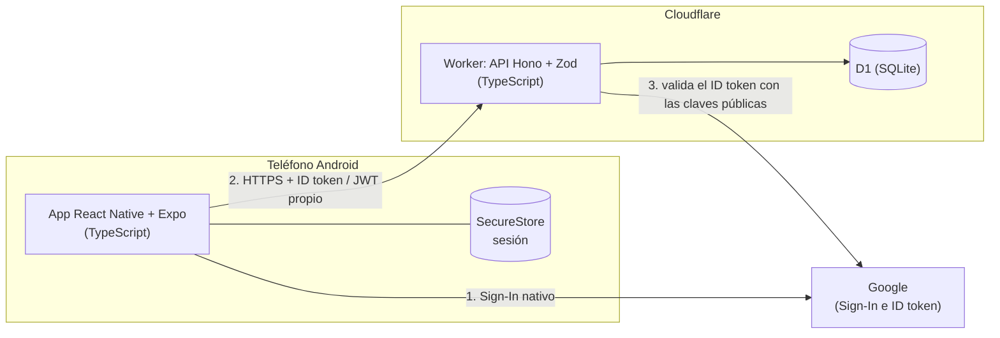

# CuidaTuBilletera

> **English summary.** CuidaTuBilletera is an Android personal-finance app (accounts, categories, income and expense tracking, calendar, reports, CSV/PDF export, manual reconciliation, Google Sign-In). It is built with React Native + Expo + TypeScript and a Cloudflare Workers + Hono + Zod + D1 API, in a single monorepo. It is published on Google Play for Ecuador only: [store listing](https://play.google.com/store/apps/details?id=com.cuidatubilletera.app). This repository documents how it is built, tested, deployed and published. It is not a bank or a payment gateway.

App móvil Android de control de gastos e ingresos, con API propia en Cloudflare Workers.

> **CuidaTuBilletera no es un banco ni una pasarela de pagos.** No mueve dinero, no se conecta a cuentas bancarias ni procesa pagos: solo registra los movimientos que la persona usuaria escribe.

## Estado

- **Disponible en Google Play, solo para Ecuador**, versión 1.0.0 (versionCode 5): [ficha pública](https://play.google.com/store/apps/details?id=com.cuidatubilletera.app).
- Páginas legales (publicadas con GitHub Pages desde `site/`): [Política de privacidad](https://luiscaizasoria.github.io/CuidaTuBilletera/privacidad/) y [Eliminar cuenta y datos](https://luiscaizasoria.github.io/CuidaTuBilletera/eliminar-cuenta/).
- La publicación en producción, la versión 5 y las fechas posteriores al 22 de octubre de 2026 las informa el responsable del proyecto; el repositorio documenta con evidencia hasta el AAB de la puerta G4 (docs/004). Ver [docs/004](docs/004-ROADMAP-PROYECTO.md).
- Pendiente para una versión futura: minificación y ofuscación de código Android (R8); Play Console lo marca con fecha límite en febrero de 2027.

## Funciones principales

- Inicio de sesión con Google (nativo en Android).
- Cuentas (con color e ícono), categorías de ingreso y gasto (con un conjunto predeterminado) y movimientos.
- Historial con filtros, calendario mensual y reportes (resumen, por categoría y por período).
- Exportación a CSV y PDF.
- Conciliación manual mediante la categoría predeterminada «Conciliación» (sin pantalla propia).
- Eliminación de la cuenta y de los datos desde la propia app.
- Los montos se guardan como enteros en centavos; lo histórico se archiva, no se borra.

## Arquitectura



La API valida las reglas de negocio y aísla todas las consultas por el usuario del token. Detalle en [docs/012-ARQUITECTURA.md](docs/012-ARQUITECTURA.md).

## Tecnologías por capa

| Capa        | Tecnología                                                                                                                                                          |
| ----------- | ------------------------------------------------------------------------------------------------------------------------------------------------------------------- |
| App         | React Native 0.86, Expo SDK 57, React 19, TypeScript estricto, `@react-native-google-signin/google-signin`, `expo-secure-store`, `expo-sharing`, `expo-file-system` |
| API         | Cloudflare Workers, Hono, Zod, `jose` (JWT), TypeScript estricto                                                                                                    |
| Datos       | Cloudflare D1 (SQLite) con migraciones SQL versionadas en `api/migrations/`                                                                                         |
| Calidad     | ESLint, Prettier, Jest (app), Vitest (API), `node --test` (scripts)                                                                                                 |
| Entorno     | Dev Container (Docker) con Node 22                                                                                                                                  |
| CI/CD       | GitHub Actions, Wrangler (API), EAS Build (app Android)                                                                                                             |
| Publicación | Google Play Console (AAB); páginas legales en GitHub Pages                                                                                                          |

## Estructura del repositorio

```text
app/        App React Native + Expo (src/, assets/, app.json, app.config.js, eas.json)
api/        Worker de Cloudflare (src/, migrations/, test/, wrangler.jsonc)
docs/       Documentación del proyecto (001 a 013)
site/       Páginas legales públicas (privacidad y eliminar cuenta)
scripts/    Verificadores y herramientas con pruebas (config de Wrangler, versión de PROD, respaldos)
.github/    Workflows de CI, despliegue de la API y páginas legales
.devcontainer/  Entorno de desarrollo reproducible
.claude/    Agentes, reglas y permisos de Claude Code
```

## Cómo levantar el entorno

Requisitos: Docker Desktop (backend WSL 2 en Windows), VS Code y la extensión Dev Containers.

1. Abrir la carpeta en VS Code.
2. `Dev Containers: Reopen in Container`.
3. Esperar a `postCreateCommand` (`npm ci` y EAS CLI fijado).

Detalle y limitaciones en [docs/005-DEVCONTAINER.md](docs/005-DEVCONTAINER.md). La configuración local (`api/.dev.vars`, `app/.env`) se crea a partir de `api/.dev.vars.example` y `app/.env.example`; esos archivos reales están ignorados por Git.

## Cómo correr las pruebas

Desde la raíz del repositorio:

```bash
npm run lint            # ESLint
npm run typecheck       # tsc en api y app
npm test                # Vitest (API) y Jest (app)
npm run test:scripts    # pruebas de los scripts y del workflow de Pages
npm run verificar:wrangler
npm run format          # Prettier en modo comprobación
```

Qué se prueba y qué no está cubierto: ver «Pruebas» en [docs/012-ARQUITECTURA.md](docs/012-ARQUITECTURA.md).

## CI/CD, entornos y secretos (resumen)

- **CI** (`.github/workflows/ci.yml`): en cada pull request y en cada push a `main` ejecuta lint, tipos, pruebas, verificación de la configuración de Wrangler y compilaciones en seco de la API y de la app.
- **Despliegue de la API**: manual (`workflow_dispatch`), en dos fases (`preparar` y `activar`), cada una con su propio entorno protegido de GitHub. Fusionar a `main` no despliega nada.
- **App Android**: la compilación del AAB se hace con EAS Build en la nube; la subida a Play es un paso aparte.
- **Entornos**: Local, DEV y PROD, con Workers, bases D1 y clientes OAuth separados.
- **Secretos**: nunca en el repositorio. Viven en GitHub (secretos y variables por entorno), en Cloudflare (secretos del Worker), en EAS (variables) y en archivos locales ignorados.

Todo el detalle, con diagramas y tablas, está en [docs/012-ARQUITECTURA.md](docs/012-ARQUITECTURA.md); la guía operativa del despliegue, en [docs/006-DESPLIEGUE.md](docs/006-DESPLIEGUE.md).

## Camino de publicación en Google Play

1. Prueba interna.
2. Prueba cerrada (12 testers durante 14 días).
3. Acceso a producción concedido por Google.
4. Publicación (Ecuador).

Las puertas técnicas previas (G0 a G7) y su evidencia están en [docs/004](docs/004-ROADMAP-PROYECTO.md) y [docs/006](docs/006-DESPLIEGUE.md).

## Cómo se trabajó con agentes

El proyecto se desarrolló con Claude Code y agentes especializados definidos en `.claude/agents/` (arquitectura, backend, móvil, diseño UX y visual, QA, DevOps), con ejecución secuencial, ramas cortas, validación independiente y autorización explícita para operaciones remotas. Ver [docs/013-FLUJO-CON-AGENTES.md](docs/013-FLUJO-CON-AGENTES.md).

## Índice de documentación

| Documento                                                                    | Contenido                                        |
| ---------------------------------------------------------------------------- | ------------------------------------------------ |
| [001-CONSTITUCION](docs/001-CONSTITUCION.md)                                 | Producto, alcance, arquitectura y reglas         |
| [002-CONVENCIONES](docs/002-CONVENCIONES.md)                                 | Estándares técnicos                              |
| [003-DECISIONES-FASE0](docs/003-DECISIONES-FASE0.md)                         | Historial de decisiones                          |
| [004-ROADMAP-PROYECTO](docs/004-ROADMAP-PROYECTO.md)                         | Estado y plan por fases                          |
| [005-DEVCONTAINER](docs/005-DEVCONTAINER.md)                                 | Entorno de desarrollo                            |
| [006-DESPLIEGUE](docs/006-DESPLIEGUE.md)                                     | Despliegue, páginas legales y publicación        |
| [007-DISENO-UX](docs/007-DISENO-UX.md)                                       | Diseño de experiencia                            |
| [008-DISENO-VISUAL](docs/008-DISENO-VISUAL.md)                               | Diseño visual                                    |
| [009-PLAN-IMPLEMENTACION-REDISENO](docs/009-PLAN-IMPLEMENTACION-REDISENO.md) | Plan del rediseño R0 a R6                        |
| [010-MATRIZ-PRUEBAS-UX](docs/010-MATRIZ-PRUEBAS-UX.md)                       | Matriz de validación UX/UI                       |
| [011-PLAN-PRODUCCION-CLOUDFLARE](docs/011-PLAN-PRODUCCION-CLOUDFLARE.md)     | Plan de producción en Cloudflare                 |
| [012-ARQUITECTURA](docs/012-ARQUITECTURA.md)                                 | Arquitectura, CI/CD, Docker, entornos y secretos |
| [013-FLUJO-CON-AGENTES](docs/013-FLUJO-CON-AGENTES.md)                       | Roles y coordinación con agentes                 |

Enlaces legales: [Privacidad](https://luiscaizasoria.github.io/CuidaTuBilletera/privacidad/) · [Eliminar cuenta](https://luiscaizasoria.github.io/CuidaTuBilletera/eliminar-cuenta/).

## Licencia

Sin licencia declarada por ahora; la decisión corresponde al responsable del proyecto.
