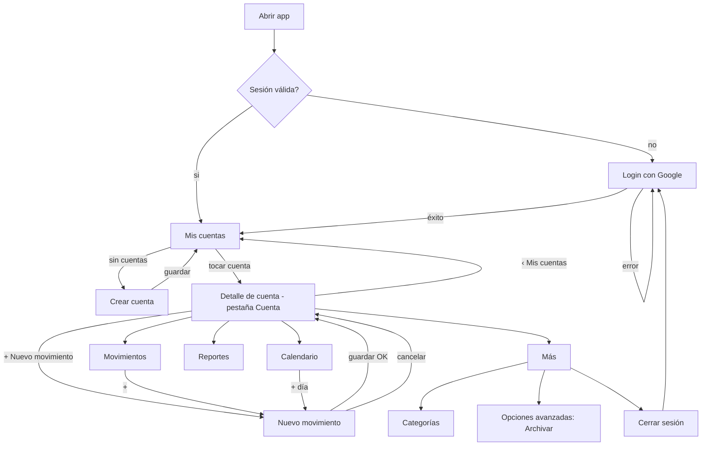
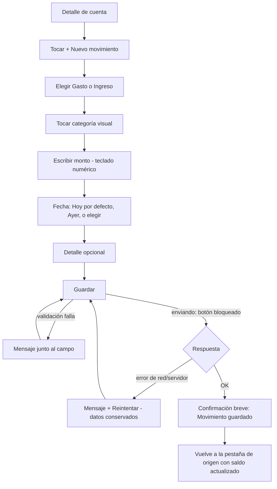
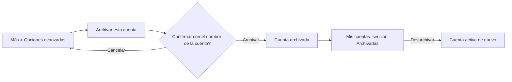

# 007 - Diseño UX del rediseño de CuidaTuBilletera

Estado: **prototipo (`docs/design/prototipo/index.html`) y navegación APROBADOS por el usuario en lo funcional, con observaciones** (la cuenta activa debe verse en todas las pantallas internas: resuelto en §3.5). La **apariencia** de la iteración 2 no se aprobó (pantalla inicial dominada por el verde, lejos del póster); la iteración 3 (composición y jerarquía de Mis cuentas §5.2, color por módulo §3.6) quedó **aprobada con el diseño completo en el paso 347** (docs/003, Decisión R0). Las decisiones que siguen abiertas están en §14. Autor: `mobile-ux-designer`. Alcance de este documento: cómo se usa la app (navegación, flujos, estados, textos, accesibilidad). No define apariencia gráfica (paleta, tipografía, iconos: `mobile-visual-designer`) ni implementa código. No se aplicó ningún cambio en `/app` ni `/api`.

Leyenda de origen de cada elemento:

- **EXISTENTE**: ya está en el código o en el contrato real (verificado en `app/src/screens/` y docs/001).
- **APROBADO**: decisión registrada en docs/001 o docs/003.
- **PROPUESTA NUEVA**: diseño nuevo de este documento; requiere aprobación (sección 14).

Fuera de alcance (no se diseña): metas, presupuestos, alertas, logros, gráficos nuevos, conciliación (Fase 6, resuelta como conciliación manual con la categoría «Conciliación» sin pantalla propia; docs/003 Decisión 6.1), eliminación de cuentas.

---

## 1. Diagnóstico UX actual, pantalla por pantalla

Base: código real. El navegador (`MainNavigator.tsx`) es una pila en `useState` con `BackHandler` (APROBADO, 2B.1 D8 / 3.1 D8). Cuenta seleccionada solo en memoria (APROBADO, 3.1 D8).

| Pantalla | Qué hay hoy (EXISTENTE) | Problemas de uso |
| --- | --- | --- |
| Login (`LoginScreen`) | Título «CuidaTuBilletera», subtítulo «Inicia sesión para continuar.», botón «Ingresar con Google», avisos y errores con `role=alert`. | Sin explicación de qué es la app ni de qué se hace con la cuenta de Google. Contenido centrado sin jerarquía. Fondo blanco sin identidad. |
| Inicio (`HomeScreen` + `HomeDashboard`) | Título «Sesión iniciada» (texto técnico), nombre y correo, chips de cuenta, «Saldo de X», 4 botones (Nuevo movimiento, Ver historial, Ver calendario, Reportes), 10 movimientos recientes, botón «Cuentas», «Cerrar sesión». Contenido centrado verticalmente (`justifyContent: center`). | El título habla de la sesión, no del dinero. Todo está en una sola columna de botones del mismo peso: la acción principal compite con 3 secundarias. Chips de cuenta mezclan «elegir cuenta» y «administrar cuentas» (botón aparte, abajo). Cerrar sesión es un botón tan grande como las acciones de dinero. Con pocos datos queda mucho vacío arriba y abajo; con muchos, el saldo se desplaza fuera de la vista. |
| Cuentas (`AccountsScreen`) | Lista con «Abrir X» (lleva a Categorías), saldo inicial (no el saldo actual), Renombrar, Archivar (con `Alert`), Desarchivar, interruptor «Mostrar archivadas», formulario inline Nueva cuenta (nombre y saldo inicial con `numbers-and-punctuation`). | «Abrir» una cuenta lleva a Categorías: sorpresa (se espera ver la cuenta). Muestra «Saldo inicial» en lugar del saldo actual. Cada fila lleva 2 botones de gestión siempre visibles: ruido y riesgo de toques erróneos. El teclado de saldo permite letras y signos. Sin guía de qué es una cuenta. |
| Categorías (`CategoriesScreen`) | Secciones por tipo, formulario inline (nombre, descripción, tipo, color), Editar/Archivar/Eliminar por fila, «Mostrar archivadas». | Solo se llega entrando a una cuenta desde Cuentas: ruta no descubrible. Tres botones por fila, uno destructivo (Eliminar) pegado a los demás. Colores sin vista previa de su uso. |
| Nuevo/Editar movimiento (`TransactionFormScreen`) | Orden: Monto, Tipo, Categoría, Fecha, Nota. Monto con `decimal-pad` y `autoFocus`; fecha como texto AAAA-MM-DD con Hoy/Ayer; categorías como chips de texto; Anular con `Alert`. | El orden no sigue el modelo mental («qué fue → cuánto → cuándo»): el teclado se abre sobre el monto y tapa tipo y categoría. Fecha como texto es propensa a error. `decimal-pad` permite coma y puntos múltiples (la validación llega tarde, al guardar). Chips de categoría sin color ni icono, difíciles de escanear con 8+ categorías. Hay `busy` que bloquea botones (EXISTENTE, protege doble envío) pero no hay confirmación visible de éxito: solo se cierra. |
| Historial (`HistoryScreen`) | Filtros siempre abiertos: Tipo, Categoría, Rango (2 textos AAAA-MM-DD), Aplicar rango, Limpiar filtros; lista con «Cargar más». | Los filtros ocupan la mitad de la pantalla antes de ver un solo movimiento. Rango por texto. Sin resumen del período. |
| Calendario (`CalendarScreen`) | Cuadrícula mensual propia, mes anterior/siguiente, importes compactos por celda, resumen del mes, detalle del día, «Nuevo movimiento» para el día. | APROBADO (4.1): se conserva. Problemas menores: es una pantalla de pila aparte, no una pestaña; el «Nuevo movimiento» del día es un botón de tamaño completo dentro del detalle. |
| Reportes (`ReportsScreen`) | Modos (mes, año, rango), navegación de período, tarjetas Ingresos/Gastos/Balance (tocables, abren Historial filtrado), desglose por categoría con barras, serie por período, Exportar CSV/PDF, rango con 2 textos. | Exportar está pegado a las tarjetas de totales con el mismo peso visual. Rango por texto. Aceptable en contenido; mejora en jerarquía y en dónde vive. |
| Configuración | No existe pantalla. «Cerrar sesión» está en Inicio. Docs/001 §7 punto 10 (Ajustes: exportar, cerrar sesión) está parcialmente cubierto. | Falta un lugar para sesión, categorías y opciones avanzadas. |

Problemas transversales (EXISTENTE, observados):

1. Cada pantalla de pila es un `ScrollView`/`View` a pantalla completa sin encabezado ni botón de volver visible: solo el botón Atrás del sistema. Quien navega con gestos o no lo conoce, queda atrapado.
2. No hay indicación de en qué cuenta se está en Historial/Calendario/Reportes más allá del título («Historial de Efectivo»).
3. Todos los botones comparten estilo (`ui.tsx`): principal y secundario casi sin diferencia de peso.
4. Objetivos táctiles: `Button` y `Chip` 44 dp mínimo; el estándar de este documento es 48 dp (sección 10).
5. Mensajes de error buenos en general (`ErrorBox`, `role=alert`); se conservan.

## 2. Hallazgos Android (confirmados en teléfono real)

Hechos verificados por el usuario; las causas son hipótesis a confirmar por `mobile-engineer`.

| # | Hallazgo (EXISTENTE) | Causa probable | Efecto de usuario |
| --- | --- | --- | --- |
| H1 | Encabezados superpuestos con la hora/barra de estado. | La app dibuja bajo la barra de estado (comportamiento edge-to-edge de Android moderno / Expo reciente) y ninguna pantalla aplica relleno superior. `App.tsx` solo usa `<StatusBar style="auto" />`; no hay `SafeAreaView` ni `react-native-safe-area-context` en el código. | Título ilegible, toques en la zona del sistema. |
| H2 | La barra inferior de Android (gestos o 3 botones) ocupa espacio / tapa contenido. | Sin relleno inferior ni conocimiento de los insets. | Botones finales (Guardar, Cerrar sesión) cerca o debajo del área del sistema. |
| H3 | Mucho espacio vacío. | `HomeScreen` centra verticalmente (`justifyContent: center`) y usa botones de ancho mínimo 240. | Pantalla poco densa; el saldo no domina. |
| H4 | Jerarquía inconsistente. | Títulos de 22 (pantallas) frente a 24 (Inicio) y 28 (Login); secciones 16; sin sistema de espacios. | Cada pantalla parece de una app distinta. |
| H5 | Teclado abierto (PROPUESTA de verificación). | `autoFocus` en Monto abre el teclado de inmediato; `ScrollView` sin `KeyboardAvoidingView` explícito. | Posible que Guardar o el campo activo queden tapados en pantallas pequeñas. |

## 3. Arquitectura de navegación propuesta

### 3.1 Principios

- **Mis cuentas es el centro** (PROPUESTA NUEVA): tras el login se llega a «Mis cuentas». Quien tiene una sola cuenta puede entrar directo a su detalle (decisión 14.2), pero siempre hay un camino visible de vuelta.
- **Cuenta seleccionada conservada** (EXISTENTE parcial: hoy solo en memoria en `MainNavigator`; PROPUESTA: se conserva mientras dure la sesión y se pasa a todas las pestañas). Cierre de sesión la borra (APROBADO 3.1 D8).
- **Sin dependencias nuevas** (APROBADO 2B.1 D8 / 3.1 D8 / 4.1 D5): pila propia en estado local + barra inferior propia (componente `BottomTabs` de React Native puro). Compatible con React Navigation futuro.

### 3.2 Mapa de pantallas

```
Login
 └─ Mis cuentas  (raíz de sesión)
     ├─ Crear cuenta            (pantalla de pila)
     └─ Detalle de cuenta       (contenedor con barra inferior propia)
         ├─ [Cuenta]       resumen: saldo, período, semana
         ├─ [Movimientos]  historial con filtros discretos
         ├─ [Calendario]   (APROBADO 4.1, se conserva)
         ├─ [Reportes]     + exportación
         └─ [Más]          Configuración de la cuenta y de la sesión
              ├─ Datos de cuenta (nombre)
              ├─ Categorías
              ├─ Opciones avanzadas (Archivar; eliminación NO implementada)
              ├─ Exportar (atajo a Reportes > Exportar)
              └─ Cerrar sesión

Pantallas de pila sobre el Detalle (ocultan la barra inferior):
   Nuevo movimiento · Editar movimiento · Crear/editar categoría
Acción destacada: botón «+ Nuevo movimiento» visible en Cuenta, Movimientos y Calendario.
```

Pestañas (PROPUESTA NUEVA): 5 elementos con icono y texto siempre visible: **Cuenta**, **Movimientos**, **Calendario**, **Reportes**, **Más**. «Nuevo movimiento» no es una pestaña: es un botón de acción destacada (FAB o botón fijo) para que la tarea más frecuente esté a un toque desde cualquier pestaña. Decisión 14.3 elige entre FAB y botón central.

Nota: «Más» corresponde a lo que docs/001 §7 llama «Ajustes» (EXISTENTE) y «Categorías» (EXISTENTE, hoy colgando de Cuentas). Se reubican sin cambiar su contenido.

### 3.3 Estado de navegación (PROPUESTA, para `mobile-engineer`)

```
Route = login-gate (lo resuelve App.tsx, EXISTENTE)
  | { name: 'accounts' }                       // Mis cuentas
  | { name: 'createAccount' }
  | { name: 'account', account, tab }          // tab: 'resumen'|'movimientos'|'calendario'|'reportes'|'mas'
  | { name: 'transaction', account, transaction?, fecha? }   // EXISTENTE
  | { name: 'categories', account } | { name: 'categoryForm', account, category? }
```

El estado por pestaña (mes del calendario, modo de reportes, filtros del historial) se conserva en el contenedor mientras se permanezca en el Detalle (EXISTENTE: `updateCalendarView`, `updateReportsView`). Cambiar de pestaña no recarga todo: cada pestaña monta una vez y se refresca al volver de una edición.

### 3.4 Comportamiento del botón Atrás (PROPUESTA NUEVA; la base EXISTENTE es «pop de pila o cerrar app en la raíz»)

| Situación | Atrás hace | Notas |
| --- | --- | --- |
| Login | Sale de la app (sistema). | Sin sesión no hay nada que volver. |
| Mis cuentas (raíz) | Sale de la app (sistema). | No cierra sesión. |
| Crear cuenta | Vuelve a Mis cuentas; si hay texto escrito sin guardar, pide confirmar descarte. | Evita perder datos. En R2 la confirmación estaba diferida; se aprueba en docs/003 R3 D1 (solo con cambios sin guardar). Crear cuenta se alinea en R3. |
| Detalle de cuenta, pestaña Cuenta | Vuelve a Mis cuentas. | Es la «pestaña de inicio» del Detalle. |
| Detalle, otra pestaña (Movimientos, Calendario, Reportes, Más) | Vuelve a la pestaña Cuenta (no sale del Detalle). | Un segundo Atrás vuelve a Mis cuentas. Evita saltos largos. |
| Calendario con día abierto | Cierra el detalle del día si está en una vista modal; si no, regla de pestaña. | Conserva comportamiento aprobado. |
| Nuevo/Editar movimiento sin cambios | Vuelve a la pestaña de origen. | EXISTENTE (`onDone`). |
| Nuevo/Editar movimiento con datos escritos | Pide «¿Descartar este movimiento?» (Seguir editando / Descartar). | PROPUESTA NUEVA. |
| Nuevo movimiento guardando (`busy`) | Se ignora Atrás hasta terminar. | Evita estados ambiguos. |
| Teclado abierto | Primero cierra el teclado (sistema), luego aplica la regla. | Comportamiento nativo. |
| Categorías / formulario de categoría | Formulario → lista → pestaña Más. | |
| Cuadros de confirmación (Alert) | Atrás = Cancelar. | `Alert` nativo ya lo hace. |
| Reportes exportando | Atrás permitido; la exportación termina en segundo plano o se cancela sin dejar archivo. | Definir con `mobile-engineer`; hoy `clearExports` limpia al desmontar (EXISTENTE). |

**Volver a Mis cuentas fácil (APROBADO con la navegación):** el Detalle muestra siempre la acción «‹ Mis cuentas» con objetivo de 48 dp, independiente del botón Atrás del sistema, para quien usa gestos o no lo conoce. Vive dentro de la barra de contexto de cuenta (§3.5).

### 3.5 Barra de contexto de cuenta (`AccountContextBar`)

Origen: observación del usuario al aprobar el prototipo («la cuenta activa debe verse claramente en todas las pantallas internas, con el nombre y, si aporta, el saldo»). Restricciones de `architect` (agentId af59ad590ed09a94f): fuente única del estado de la cuenta en el contenedor del Detalle, recarga de saldo por `refreshKey`, navegación local (React Navigation sigue diferida). Estado: APROBADO como requisito; el diseño de esta sección es PROPUESTA NUEVA salvo lo marcado.

#### 3.5.1 Opciones evaluadas

| Opción | Cómo se ve | A favor | En contra |
| --- | --- | --- | --- |
| Encabezado contextual (el título de la pantalla es la cuenta: «Efectivo») | Título grande cambia según la cuenta. | Máxima visibilidad. | Se pierde el título de la pantalla («Movimientos», «Reportes»): TalkBack y el usuario no saben en qué pantalla están; cada pantalla lo resuelve distinto. |
| Badge / pastilla (chip pequeño «Efectivo» junto al título) | Etiqueta compacta. | Ocupa poco. | Fácil de pasar por alto (el usuario pidió «claramente»); no cabe el saldo; objetivo táctil pequeño. |
| Subheader (línea de texto bajo el título) | «en Efectivo · $1,250.00» bajo cada título. | Simple. | Su posición cambia con cada título; baja jerarquía; no aloja «‹ Mis cuentas» ni estados. |
| **Barra de contexto** (franja fija arriba, igual en todas las pantallas internas, encima del título de pantalla) | Ver anatomía. | Un solo componente con la misma posición siempre; separa «dónde estoy» (título) de «con qué cuenta» (barra); aloja volver, estado y saldo; encaja con el `AccountHeader` único pedido por `architect`. | Consume ~56 dp de alto (mitigado con versión compacta). |

**Elegida: barra de contexto.** Es la única opción que cumple a la vez «visible en todas las pantallas», «no confundir con el título» y «una sola fuente de datos».

#### 3.5.2 Anatomía

```
▒▒▒▒▒▒▒▒▒▒▒▒▒▒▒▒▒▒▒▒▒▒▒▒▒▒▒▒▒▒▒▒▒▒▒  barra de estado
 [‹ Mis cuentas] │ Efectivo ▾      $1250.00     ← barra de contexto (≥ 56 dp)
                 │ [Archivada]  (solo si aplica)
 ─────────────────────────────────────
 Movimientos                            ← título de la pantalla (role header)
```

| Elemento | Contenido | Reglas |
| --- | --- | --- |
| Acción izquierda | «‹ Mis cuentas» (texto visible + chevrón). | Botón de 48 × 48 dp mínimo. En pantallas de pila (Nuevo/Editar movimiento, Categorías, Historial abierto desde Reportes) se sustituye por la salida propia de esa pantalla (✕ o «‹ Más», «‹ Reportes»), y la barra queda de solo lectura. |
| Nombre | `account.nombre` del estado del contenedor. | Una línea, elipsis al final; nunca empuja fuera el saldo. |
| Saldo | `formatCents(saldo)` (EXISTENTE en `lib/money.ts`; hoy sin separador de miles). | Texto secundario, prioridad de espacio sobre el nombre; signo «-» visible si es negativo. Se omite donde ya hay un saldo protagonista (pestaña Cuenta). |
| Estado | Etiqueta «Archivada» (texto, no solo color). | Solo si `account.archivada`. |
| Indicador de recarga | Indicador pequeño junto al saldo. | Solo mientras se relee el saldo (ver estados). |
| Toque en nombre/saldo | Abre el **selector rápido de cuenta** (decisión 14.14, aprobada). | En modo solo lectura (p. ej. Nuevo movimiento) nombre y saldo son texto sin acción; el otro cambio de cuenta es «‹ Mis cuentas». |

Selector rápido de cuenta (APROBADO, 14.14): hoja inferior con las cuentas activas (nombre + saldo, del `listAccounts` EXISTENTE, cargado al abrir), la actual marcada (`radio` + `selected`), y al pie «Ver todas mis cuentas» (va a Mis cuentas, donde están las archivadas). Elegir otra cuenta: el contenedor reemplaza su estado con esa cuenta, conserva la pestaña actual y reinicia el estado por pestaña (filtros, período, mes), porque las categorías son por cuenta y un filtro de la cuenta anterior no aplica. Se anuncia «Ahora estás en {nombre}». Atrás cierra la hoja. Estados de la hoja: cargando («Cargando tus cuentas…»), error con [Reintentar], una sola cuenta (lista con esa cuenta + «Ver todas mis cuentas»). Motivo de la recomendación: cambiar de cuenta pasa de 2 toques y una pantalla completa a 2 toques sin perder la pestaña (tarea T5). No se abre desde Nuevo/Editar movimiento ni Categorías (cambiar de cuenta a mitad de un formulario mezclaría datos).

#### 3.5.3 Flujo de datos (restricción de `architect`, no negociable en el diseño)

- **Fuente única:** el contenedor del Detalle (`AccountDetailScreen`/`MainNavigator`) guarda la cuenta (`id`, `nombre`, `saldo`, `archivada`) en su estado local. La barra solo recibe props. **Ninguna pestaña ni pantalla de pila pide el saldo por su cuenta.**
- **Valor inicial:** la cuenta elegida en Mis cuentas o en el selector (ya trae `saldo`, EXISTENTE en `GET /accounts`).
- **Tras crear, editar o anular un movimiento:** el contenedor incrementa `refreshKey` y relee el saldo con `GET /accounts/:id/balance` (endpoint EXISTENTE; respuesta `{accountId, saldoInicial, ingresos, gastos, saldo}`) mediante el método nuevo `getAccountBalance` del cliente de la app, sin cambio de contrato. Los `ingresos`/`gastos` de esa respuesta son históricos, no del período: la barra no los muestra.
- **Renombrar desde Más:** el contenedor reemplaza su estado con la respuesta de `PATCH /accounts/:id` (la barra cambia al instante; sin relectura).
- **Archivar desde Más:** vuelve a Mis cuentas con el aviso «{nombre} archivada. La encuentras en Archivadas.» (§5.9).
- **409 `ACCOUNT_ARCHIVED` al guardar un movimiento** (la cuenta se archivó en otro dispositivo): mensaje «Esta cuenta está archivada, por eso no se guardó el movimiento. Desarchívala desde Mis cuentas para anotar movimientos.» + [Volver a la cuenta]. Al volver, el contenedor marca la cuenta como archivada (el 409 es la confirmación del servidor, no un valor inventado; mecanismo exacto a confirmar con `architect`).

#### 3.5.4 Comportamiento por pantalla

| Pantalla | Barra | Qué muestra | Notas |
| --- | --- | --- | --- |
| Mis cuentas, Crear cuenta, Login | No | — | No hay cuenta activa. |
| Cuenta (resumen) | Completa | «‹ Mis cuentas», nombre, estado. **Sin saldo en la barra.** | El saldo protagonista de la tarjeta (§5.4) usa el mismo valor del contenedor; repetirlo sería ruido. |
| Movimientos (Historial) | Completa | Nombre + saldo + estado. | El título de pantalla es «Movimientos» (ya no «Historial de X»). |
| Historial filtrado abierto desde Reportes (14.6) | Solo lectura | Nombre + saldo. | Salida «‹ Reportes». |
| Calendario | Completa | Nombre + saldo + estado. | El mes sigue siendo el título de la vista. |
| Reportes | Completa | Nombre + saldo actual + estado. | Accesible como «saldo actual» para no confundirlo con el «Balance» del período. |
| Más (y Datos de cuenta, Opciones avanzadas) | Completa | Nombre + saldo + estado. | Renombrar actualiza la barra con la respuesta de PATCH. |
| Categorías y formulario de categoría | Solo lectura | Nombre + saldo + estado. | Salida «‹ Más». Sin selector. |
| Nuevo / Editar movimiento | **Compacta**, solo lectura | Una línea: «Efectivo · $1250.00» (en Editar, igual). | Sustituye «Nuevo movimiento · Efectivo» del título. Con teclado abierto se mantiene en una línea, sin indicador de recarga; si el ancho no alcanza se recorta primero el nombre. Nunca tapa Guardar. Sin selector. |

#### 3.5.5 Estados

| Estado | Qué se ve | Qué no se hace |
| --- | --- | --- |
| Normal | Nombre + saldo. | — |
| Recargando saldo (tras guardar/anular) | Último saldo conocido + indicador pequeño; `accessibilityState.busy`. | No se vacía ni se muestra «$0.00». |
| Error al releer | Nombre + «Saldo no disponible» + [Reintentar] (48 dp). | Nunca un valor inventado ni el saldo viejo como si fuera actual. Ojo: `formatCents` devuelve «$0.00» ante un valor no entero seguro (EXISTENTE): la barra no debe formatear un saldo inválido; debe mostrar el estado de error. |
| Archivada | Etiqueta «Archivada»; «+ Nuevo movimiento» (FAB y el del día del Calendario) **deshabilitado** con texto de ayuda «Cuenta archivada: no admite movimientos nuevos». | No se oculta la consulta del historial ni de reportes. |
| Nombre largo | Una línea con elipsis al final; nombre completo en la etiqueta accesible. | El saldo no se trunca. |
| Saldo negativo | «-$25.00» con signo visible (color de egreso como apoyo, nunca solo color). | No se oculta ni se muestra en valor absoluto. |
| Pantalla estrecha (≤ 340 dp) o fuente al 200 % | La barra pasa a dos filas: «‹ Mis cuentas» arriba; nombre, saldo y estado abajo. Altura mínima, no fija. | No se trunca el saldo ni «‹ Mis cuentas». |

#### 3.5.6 Accesibilidad

- La barra **no** usa `accessibilityRole="header"`: el `header` es solo el título de cada pantalla, que conserva el foco inicial de TalkBack (§10). Orden de lectura: barra, título, contenido.
- El bloque nombre/saldo/estado es un único elemento enfocable con etiqueta «Cuenta {nombre}, saldo {saldo}» y sufijos según estado: «, archivada», «, actualizando saldo», «, saldo no disponible». En Reportes: «saldo actual». En la pestaña Cuenta (sin saldo en barra): «Cuenta {nombre}».
- Con selector (14.14): `role=button` y pista «Toca para cambiar de cuenta». Sin selector o en solo lectura: `role=text` (sin `button`).
- «‹ Mis cuentas»: `role=button`, etiqueta «Volver a Mis cuentas», 48 dp.
- La recarga del saldo no es región viva (no interrumpe; el aviso de «guardado» ya se anuncia). Cambiar de cuenta desde el selector sí se anuncia una vez.
- Contraste 4.5:1 para nombre, saldo y «Archivada».

### 3.6 Color distintivo por módulo (PROPUESTA NUEVA, iteración 3; tonos finales: `mobile-visual-designer`)

Objetivo UX: que el usuario sepa **en qué módulo está** de un vistazo (como las 5 baldosas de color del póster) sin que el verde de marca domine todas las pantallas y sin competir con la semántica del dinero. El color de módulo es una **ayuda de orientación**, nunca un dato.

| Módulo | Rol de color (nombre de rol, no valor) | Referencia del póster | Dónde se manifiesta |
| --- | --- | --- | --- |
| Mis cuentas (raíz) | `marca` solo en la acción primaria; tarjetas con la paleta de cuentas (§5.2.4) | «Controla tus cuentas» | Botón «+ Nueva cuenta». Encabezado claro. |
| Cuenta (resumen del Detalle) | `modulo-cuenta` (familia de marca, verde azulado) | Panel 6 «Principal» | Pestaña activa; tarjeta de saldo protagonista (§5.4), **la única superficie fuerte** de esa pantalla. |
| Movimientos | `modulo-movimientos` (ámbar/amarillo cálido) | «Registra tus movimientos» | Pestaña activa; mosaico del título; acento del panel de filtros activo. |
| Calendario | `modulo-calendario` (azul) | «Visualiza tu calendario» | Pestaña activa; mosaico del título; marca del día seleccionado y de «hoy» (además del borde y el texto, EXISTENTE 4.1). |
| Reportes | `modulo-reportes` (violeta) | «Analiza con reportes» | Pestaña activa; mosaico del título; control segmentado Mes/Año/Rango seleccionado. Las tarjetas Ingresos/Gastos/Balance **no** usan violeta: conservan la semántica de dinero. |
| Más / Configuración / Categorías | `modulo-mas` (neutro pizarra) | Panel 11 (neutro) | Pestaña activa; mosaico del título de Más y de Categorías. Los colores de cada categoría (EXISTENTE, paleta fija) se mantienen y no se mezclan con este rol. |
| Nuevo/Editar movimiento | **Sin color de módulo propio**: manda el **tipo** | Panel 7 | Control Gasto/Ingreso: opción seleccionada con `gasto` (coral) o `ingreso` (verde) + icono (↓/↑) + texto. El botón Guardar usa la acción primaria (`marca`) con texto «Guardar gasto» / «Guardar ingreso» (etiqueta accesible «Guardar», §12). |

Dónde se manifiesta (lista cerrada; fuera de aquí el color de módulo no se usa):

1. **Pestaña activa** de la barra inferior: icono dentro de una «píldora» tintada del color del módulo + etiqueta en negrita. Las inactivas, neutras. Las 5 etiquetas siempre visibles.
2. **Mosaico del título** de la pantalla: cuadro de 32 dp con el icono del módulo sobre tinte suave, a la izquierda del título (`aria-hidden`). Es el lugar principal de identidad; sustituye la idea de encabezados de color a sangre.
3. **Acentos** de controles propios del módulo (segmentado de Reportes, día del Calendario, chips de filtro activos de Movimientos) y como máximo **una superficie fuerte** por pantalla (la tarjeta de saldo en Cuenta). Las demás tarjetas, superficie clara.

Dónde **no** se usa (reglas de no conflicto):

- **Barra de contexto de cuenta (§3.5):** neutra e idéntica en todas las pantallas internas (misma posición, mismo aspecto). No se tiñe por módulo: su valor es ser constante.
- **Importes:** siempre semánticos y neutros respecto al módulo: ingreso = verde + «+», gasto = coral + «-», saldo neutro (negativo con «-» y coral de apoyo). Ningún color de módulo se usa en cifras.
- **FAB «+ Nuevo movimiento»:** color de acción primaria constante en Cuenta, Movimientos y Calendario (es la misma acción en todas; cambiarle el color sugeriría acciones distintas).
- **Paleta de cuentas y de categorías:** independiente de los roles de módulo.
- Requisito a `mobile-visual-designer`: `modulo-movimientos` debe distinguirse claramente de `gasto` (coral) y `modulo-cuenta`/`marca` de `ingreso` (verde), también para daltonismo protanopia/deuteranopia; si no se logra, el módulo cede y usa su tono solo en la píldora de la pestaña.

El color no es el único indicador (criterio de aceptación 31):

- Pestaña activa = color + píldora (forma) + negrita + `accessibilityState.selected`; se distingue en escala de grises.
- Módulo actual = título de texto («Movimientos», «Calendario»…) con `role=header` + icono propio de cada módulo.
- Tipo de movimiento = color + icono ↑/↓ + palabra («Gasto»/«Ingreso») + signo del importe.
- Cuenta = nombre visible; el color de la tarjeta solo ayuda a reconocerla.
- Contraste: texto sobre tintes 4.5:1; icono de la pestaña activa y bordes de píldora 3:1 contra el fondo.

## 4. Diagramas de flujo

### 4.1 Flujo principal



### 4.2 Registrar un movimiento (tarea más frecuente)



### 4.3 Archivar cuenta



## 5. Pantallas, wireframes y estados

Convenciones de los wireframes: `[ ]` botón o campo, `( )` opción de selección, `▒` área del sistema (no usar), `{...}` dato dinámico. Todos los wireframes respetan la barra de estado arriba y la barra del sistema abajo (sección 9, opción A).

Estados que toda pantalla de datos debe cubrir (EXISTENTE como patrón: `useLoader`, `ErrorBox`, estados vacíos): **carga** (indicador con texto), **vacío** (qué pasó + siguiente paso), **error** (mensaje comprensible + Reintentar, `role=alert`), **éxito** (confirmación breve), **sin conexión** (EXISTENTE: mensajes de `auth-messages`).

### 5.1 Login (EXISTENTE, rediseño de contenido)

```
▒▒▒▒▒▒▒▒▒▒▒▒▒▒▒▒▒▒▒▒▒▒▒▒▒▒▒▒▒▒▒▒▒▒▒  barra de estado

        [logotipo de la app]
        CuidaTuBilletera
   Anota lo que entra y lo que sale,
   y mira cómo está tu dinero.

   [  G  Ingresar con Google  ]         48dp+
   Usamos tu cuenta de Google solo
   para identificarte. No vemos tu
   contraseña.
▒▒▒▒▒▒▒▒▒▒▒▒▒▒▒▒▒▒▒▒▒▒▒▒▒▒▒▒▒▒▒▒▒▒▒  barra del sistema
```

Estados: **cargando** (botón con indicador y texto «Ingresando…», bloqueado, `busy`); **error** (EXISTENTE: `AUTH_ERROR_MESSAGES`, caja con `role=alert` sobre el botón); **aviso de sesión cerrada** (EXISTENTE: `SIGNED_OUT_MESSAGES`); **éxito**: entra a Mis cuentas sin pantalla intermedia. El texto «Sesión iniciada» desaparece como título (sección 12).

### 5.2 Mis cuentas (PROPUESTA NUEVA como pantalla raíz; datos EXISTENTES)

Iteración 3 (composición y jerarquía). El flujo aprobado no cambia: Mis cuentas es la raíz, tocar una cuenta abre el Detalle, Archivadas están colapsadas, Renombrar/Archivar viven en Más (14.7). Lo que cambia es **cómo se reparte la pantalla**: el usuario aprobó el prototipo funcional pero no su apariencia («dominada por el verde, no refleja el póster»). Referencia de composición: panel 5 del póster «Mis cuentas» (encabezado ligero, tarjetas de cuenta diferenciadas por color suave con ilustración/icono, saldo grande, chevrón). Del póster **no** se toma: metas, «Pequeños hábitos, grandes logros» como dato, ni barra inferior en esta pantalla (la barra de 5 pestañas es del Detalle, §3.2). Colores finales: `mobile-visual-designer` (docs/008); aquí solo roles y jerarquía.

#### 5.2.1 Wireframe (360 × 640 dp, 2 cuentas activas, 1 archivada)

```
▒▒▒▒▒▒▒▒▒▒▒▒▒▒▒▒▒▒▒▒▒▒▒▒▒▒▒▒▒▒▒▒▒▒▒  barra de estado (24 dp, inset)
 CuidaTuBilletera                 (L)   ← marca 14 sp + avatar con inicial 40 dp
 Hola, Luis                      ┌───┐     (objetivo 48 dp) → hoja de perfil
 Mis cuentas                     │🐷 │  ← ilustración alcancía 72 dp, a la derecha
                                 └───┘     del bloque de títulos, alineada abajo
 ┌──────────────────────────────────┐
 │ Total en tus cuentas              │  ← resumen (14.16), superficie neutra,
 │ $1,570.50                         │     SIN color fuerte; solo si ≥ 2 cuentas
 │ Suma de los saldos de 2 cuentas   │
 └──────────────────────────────────┘
 ┌──────────────────────────────────┐
 │ [▣] Efectivo                    › │  ← tarjeta = un botón; mosaico de icono
 │     Saldo actual                  │     48 dp con color suave de la cuenta
 │     $1,250.00                     │     (§5.2.4); saldo 22-24 sp
 └──────────────────────────────────┘
 ┌──────────────────────────────────┐
 │ [▣] Tarjeta de crédito          › │
 │     Saldo actual                  │
 │     -$150.00                      │  ← signo «-» + color de egreso de apoyo
 └──────────────────────────────────┘
 [        + Nueva cuenta          ]     ← ÚNICA acción primaria, tras la lista
 ▸ Archivadas (1)                        ← fila secundaria 48 dp, colapsada
▒▒▒▒▒▒▒▒▒▒▒▒▒▒▒▒▒▒▒▒▒▒▒▒▒▒▒▒▒▒▒▒▒▒▒  barra del sistema (inset)
```

Presupuesto vertical en 360 × 640 (≈ 592 dp útiles tras insets): encabezado 128 + resumen 88 + 2 tarjetas × (88 + 10) + botón 56 + Archivadas 48 + márgenes 16 × 4 ≈ 576 dp: **cabe sin desplazamiento con 2 cuentas**; con 3 o más, la pantalla se desplaza y el encabezado se desplaza con el contenido (no es fijo: en 640 dp un encabezado fijo dejaría poco espacio a la lista).

#### 5.2.2 Encabezado amigable (PROPUESTA NUEVA)

| Elemento | Contenido | Reglas |
| --- | --- | --- |
| Marca | «CuidaTuBilletera» (14 sp, peso medio). | Texto, no imagen; `aria-hidden` no: se lee una vez, antes del saludo. |
| Saludo | «Hola, {primer nombre}» (EXISTENTE: `AuthUser.name` es **opcional**). | Primera palabra de `name`, máximo una línea con elipsis. Si `name` falta o está vacío: «Hola». Nunca el correo como saludo. |
| Título | «Mis cuentas» (`role=header`, 26/32 sp, estilo `rootTitle` de docs/008 §4; el resto de títulos de pantalla usa `title` 24/30). | Recibe el foco inicial de TalkBack (§10). |
| Acceso a perfil | Avatar circular con la inicial del nombre (o del correo si no hay nombre), 40 dp visual / 48 dp táctil, esquina superior derecha. | Discreto: superficie neutra, sin color de módulo. Etiqueta «Tu perfil y sesión». Abre la **hoja de perfil** (14.17): nombre, correo (EXISTENTES en la sesión) y [Cerrar sesión] con la confirmación de §7.3. No hay pantalla de perfil ni datos nuevos. |
| Ilustración | Alcancía con moneda (activo EXISTENTE `docs/design/assets/icon.png` o su versión sin fondo, a cargo de `mobile-visual-designer`). | A la derecha del bloque saludo/título, alineada con la línea base de «Mis cuentas». **Decorativa** (`accessible=false` / `aria-hidden`). Tamaño según la tabla 5.2.5. Nunca empuja ni trunca el título: si no cabe, se reduce y luego se oculta. |

Fondo del encabezado: **claro** (el de la pantalla o un tinte muy suave), no una franja verde a sangre. Motivo UX: la queja del usuario es que el verde domina; el color fuerte se reserva para la acción primaria (§3.6, regla «una superficie fuerte por pantalla»).

#### 5.2.3 Resumen «Total en tus cuentas» (DECISIÓN 14.16, APROBADA)

- **Qué es:** la suma de `saldo` (EXISTENTE, calculado por la API) de las cuentas **activas** que devolvió `GET /accounts`. No es una estadística ni un patrimonio: es una suma de valores reales. Moneda única USD (APROBADO docs/001), por eso la suma tiene sentido.
- **Cuándo se muestra:** solo con **2 o más** cuentas activas (con 1 repetiría su saldo). No se muestra en carga, error, vacío ni si algún saldo no es entero seguro o la suma excede `Number.MAX_SAFE_INTEGER` (en ese caso se oculta; nunca «$0.00»).
- **Texto:** «Total en tus cuentas» / `{suma}` / «Suma de los saldos de {n} cuentas». Si hay archivadas: «No incluye cuentas archivadas». Una suma negativa se muestra con «-» y color de egreso de apoyo.
- **Qué no lleva:** ni ingresos/gastos, ni comparación con el mes anterior, ni porcentajes, ni metas.
- **Interacción:** no es tocable (`role=text`, etiqueta «Total en tus cuentas, {suma}, suma de {n} cuentas activas»).
- **Resuelto (paso 347, docs/003 Decisión R0 D11):** sumar en la app saldos ya calculados por la API es presentación, no regla de negocio; el total se oculta si algún saldo no es un entero seguro.

#### 5.2.4 Tarjetas de cuenta diferenciadas (PROPUESTA NUEVA)

Anatomía (toda la tarjeta es **un** botón, alto mínimo **88 dp (92 dp con ancho ≥ 400 dp)**, sin botones internos; medida fijada en docs/008 §6.3, ver §14.A):

| Zona | Contenido | Reglas |
| --- | --- | --- |
| Mosaico izquierdo | Icono de 28 dp sobre un mosaico redondeado de 52 dp con el **color suave de la cuenta**. | Decorativo. El color identifica la tarjeta de un vistazo; el **nombre** es el identificador real. |
| Centro | Nombre (17 sp, peso alto, una línea, elipsis) · «Saldo actual» (13 sp) · saldo (22-24 sp, cifras tabulares). | Con nombre largo se recorta el nombre, nunca el saldo. Con fuente ≥ 130 % el saldo baja a su propia línea (ya está en línea propia en el wireframe). |
| Derecha | Chevrón «›». | Decorativo; la etiqueta accesible ya dice que abre. |

- **Color estable por cuenta (DECISIÓN 14.18):** se asigna por **id**, no por posición: `paleta[hash(id) mod N]` con `N` = 6 tonos suaves de `mobile-visual-designer`. Motivo: si se asigna por orden, al crear o archivar una cuenta las demás cambian de color y el usuario pierde la referencia. Alternativa (b): por orden de `createdAt` (estable mientras no se archive ninguna). Colisiones permitidas (dos cuentas pueden compartir tono): el color nunca es el único indicador. La paleta de cuentas **excluye** el verde de ingreso, el coral de gasto y el color de marca de la acción primaria, para no sugerir «esta cuenta va bien/mal». Guardar un color elegido por el usuario requeriría un campo nuevo en D1 (fuera de alcance; mejora futura).
- **Icono (DECISIÓN 14.19):** la API no guarda tipo de cuenta. Opciones: (a) un único icono de billetera para todas, diferenciadas por color; (b) icono por palabra clave del nombre (contiene «tarjeta» → tarjeta; «banco» → banco; «ahorro» → alcancía; resto → billetera), puramente decorativo. **Recomendado (b)** porque acerca la lista al póster sin datos nuevos; si confunde en la prueba de usuario, volver a (a). En ningún caso el icono afirma un tipo ante TalkBack.
- **Saldo negativo:** «-$150.00» con signo visible; color de egreso solo de apoyo; la tarjeta no cambia su fondo.
- **Etiqueta accesible:** «{nombre}, saldo actual {saldo}. Abrir cuenta» (`role=button`). Conserva el texto «saldo actual» del prototipo aprobado.
- **Archivadas:** fila «▸ Archivadas ({n})» (`role=button`, `aria-expanded`); al abrirla, tarjetas compactas (64 dp) con superficie gris, sin color de cuenta, etiqueta «Archivada» en texto, [Ver] y [Desarchivar] (EXISTENTE en el prototipo). Si `n = 0`, la fila no se muestra.

#### 5.2.5 Distribución del espacio y adaptación

Reglas generales: contenido **alineado arriba** (nunca `justifyContent: center`, causa del hallazgo H3); márgenes laterales 16 dp (20 dp si ancho ≥ 400); separación entre tarjetas 8-12 dp. Un **hueco** es espacio vacío *entre* elementos; el espacio libre *al final* del desplazamiento es aceptable.

| Caso | Encabezado / ilustración | Lista y acciones |
| --- | --- | --- |
| 360 × 640, fuente 100 % | 128 dp; alcancía 72 dp. | Total + 2 tarjetas + [Nueva cuenta] + Archivadas sin desplazar (§5.2.1). |
| 412 × 915, fuente 100 % | 152 dp; alcancía 96-104 dp. | Tarjetas de 88-96 dp. Con 1-2 cuentas sobra alto **debajo** de Archivadas: se acepta como final de lista. Para no dejar la mitad inferior vacía en la primera semana, aquí cabe la guía descartable de §7.1 («Toca una cuenta para anotar sus gastos e ingresos») debajo de la lista. No se rellena con datos ni tarjetas inventadas. |
| 1 sola cuenta | Igual. | Sin Total. La tarjeta única puede ser más alta (96 dp) con el texto «Toca para ver tus movimientos». |
| 6+ cuentas | Igual (se desplaza con el contenido). | [Nueva cuenta] queda tras la lista; **no** se fija abajo (evita tapar tarjetas y competir con la barra del sistema). |
| Fuente ≥ 130 % | Alcancía 48 dp. | Saldo en línea propia; tarjetas sin alto máximo. |
| Fuente ≥ 175 % o ancho ≤ 340 dp | **Alcancía oculta**; marca y saludo en líneas separadas. | Avatar sigue visible (48 dp). Nada se trunca salvo el nombre de cuenta con elipsis. |

Jerarquía de botones: **una** primaria (llena, color de acción): «+ Nueva cuenta» (texto del prototipo «+ Crear cuenta» pasa a «+ Nueva cuenta», como el título de §5.3; las pruebas consultan por etiqueta «Nueva cuenta», ya EXISTENTE en `AccountsScreen.test.tsx`). Secundarias discretas (texto, sin relleno): «Archivadas», avatar de perfil. El botón «Cerrar sesión» de tamaño completo del prototipo **desaparece de la lista** y pasa a la hoja de perfil (14.17).

#### 5.2.6 Estados

- **Vacío ilustrado:** alcancía 120 dp (oculta con fuente ≥ 175 %), título «Todavía no tienes cuentas», texto «Una cuenta es el lugar donde anotas tu dinero: efectivo, banco o tarjeta.», primaria [Crear mi primera cuenta]. Sin Total, sin «Archivadas» si no hay; si hay archivadas pero ninguna activa: «No tienes cuentas activas. Puedes crear una o desarchivar una de las anteriores.» y la fila Archivadas visible. El encabezado (marca, saludo, avatar) se mantiene: la sesión siempre se puede cerrar desde el avatar.
- **Carga:** encabezado real + 2 tarjetas esqueleto (mismo alto que las reales, sin cifras) + «Cargando tus cuentas…» accesible; sin Total.
- **Error:** «No pudimos cargar tus cuentas. Revisa tu conexión e inténtalo de nuevo.» + [Reintentar] (`role=alert`); sin Total ni tarjetas vacías.
- **Éxito (tras crear):** la app entra al Detalle de la cuenta nueva (§5.3, comportamiento del prototipo aprobado). Al volver, la cuenta nueva aparece con su color estable.
- **Sesión degradada** (EXISTENTE: `degraded`/`unavailable`): franja de aviso bajo el encabezado, sobre el Total, con [Reintentar]; texto de `auth-messages`.
- Renombrar y Archivar **no** están en la lista (Más > Datos de cuenta / Opciones avanzadas, §6).

### 5.3 Crear cuenta (EXISTENTE como formulario inline; PROPUESTA: pantalla de pila)

```
 ‹ Nueva cuenta
 Nombre de la cuenta
 [ Efectivo, Banco, Tarjeta…        ]
 Saldo inicial (opcional)
 [ $ 0.00                           ]  teclado numérico
 Es el dinero que ya tienes hoy en
 esta cuenta. Después no se puede
 cambiar; lo demás lo registras con
 movimientos.
 [        Crear cuenta        ]
```

Reglas: nombre obligatorio (EXISTENTE «Escribe un nombre.»); saldo inicial opcional (APROBADO docs/001 §5, vacío = 0); teclado `decimal-pad` con filtrado de caracteres; **el saldo inicial no se puede cambiar después** (hecho de contrato: PATCH solo permite nombre y archivada), por eso el texto de ayuda lo avisa antes de guardar. Estados: guardando (botón «Creando…» bloqueado), error de formato (EXISTENTE: «El saldo inicial no es válido. Usa el formato 1234.56…»), límite (EXISTENTE: «Alcanzaste el límite permitido»), éxito («Cuenta creada. Ya puedes anotar movimientos.») y navegación al Detalle de la cuenta nueva (decisión 14.2).

### 5.4 Detalle de cuenta - pestaña Cuenta (PROPUESTA NUEVA; datos EXISTENTES)

```
▒▒▒▒▒▒▒▒▒▒▒▒▒▒▒▒▒▒▒▒▒▒▒▒▒▒▒▒▒▒▒▒▒▒▒
 [‹ Mis cuentas] │ Efectivo ▾          barra de contexto (§3.5), sin saldo aquí
 ─────────────────────────────────
 ┌──────────────────────────────┐
 │ Saldo actual                 │
 │ $1,250.00                    │   grande, protagonista
 └──────────────────────────────┘
 Octubre 2026   ‹ ›                  período: mes (por defecto)
 ┌──────────┐ ┌──────────┐
 │ Ingresos │ │ Gastos   │
 │ $800.00  │ │ $350.00  │
 └──────────┘ └──────────┘
 Esta semana                    Ver todo ›
  Lun 12 · Almuerzo        -$6.50
  Dom 11 · Sueldo         +$800.00
  …
 filtros: ( Todos ) ( Gastos ) ( Ingresos )   discretos
                           [ + Nuevo movimiento ]  FAB
 ─────────────────────────────────
 Cuenta | Movimientos | Calendario | Reportes | Más
▒▒▒▒▒▒▒▒▒▒▒▒▒▒▒▒▒▒▒▒▒▒▒▒▒▒▒▒▒▒▒▒▒▒▒
```

- **Saldo** (EXISTENTE: `account.saldo`). Composición (iteración 3, §3.6): la tarjeta de saldo es la **única superficie de color fuerte** de la pestaña (rol `modulo-cuenta`); las tarjetas Ingresos/Gastos son claras con su cifra en color semántico + signo; la lista de la semana, sobre fondo claro. La alcancía decorativa del póster (panel 6) puede ir dentro de la tarjeta de saldo, a la derecha, 56-64 dp, oculta con fuente ≥ 175 % o ancho ≤ 340 dp; nunca reduce el tamaño del saldo.
- **Ingresos y gastos del período** (EXISTENTE en el contrato: `GET /reports/summary` con rango; PROPUESTA NUEVA su uso aquí). Período por defecto: mes actual; solo ‹ › para cambiar mes. Sin metas ni comparaciones inventadas. Excluye anulados (regla de reportes, EXISTENTE).
- **Movimientos de la semana** (PROPUESTA NUEVA): `GET /transactions` con `desde/hasta` de la semana lunes-domingo (lunes = `WEEK_START`, APROBADO 4.1 D3). Máximo 10 filas, «Ver todo» abre la pestaña Movimientos. Tocar una fila abre Editar (EXISTENTE).
- **Filtros discretos:** un solo control segmentado Todos/Gastos/Ingresos que afecta la lista de la semana; el resto de filtros (categoría, rango) viven en Movimientos.
- **Estados:** carga con esqueleto o indicador por bloque (saldo, período y semana cargan independientes: un error en uno no vacía los demás; EXISTENTE el patrón de `RecentTransactions`). Vacío semana: «Esta semana no has anotado movimientos. Toca + para registrar el primero.» Vacío total (cuenta nueva): «Tu cuenta está lista. Anota tu primer gasto o ingreso con el botón +.» Error por bloque: mensaje corto + [Reintentar]. Éxito tras guardar: la fila nueva aparece y el saldo se actualiza.
- **Saldo:** el de la tarjeta sale del estado del contenedor (§3.5.3), el mismo que muestra la barra en las demás pestañas; tras guardar/anular se relee con `getAccountBalance` (recargando: último valor + indicador; error: «Saldo no disponible» + [Reintentar], nunca un valor inventado).
- **Cuenta archivada** (EXISTENTE: no admite movimientos nuevos): etiqueta «Archivada» en la barra y banner «Cuenta archivada. Puedes consultar su historial, pero no anotar movimientos.»; el FAB se muestra **deshabilitado** (restricción de `architect`; antes se ocultaba).

### 5.5 Nuevo movimiento (EXISTENTE; reordenado)

Pantalla de pila (sin barra inferior). Orden propuesto (PROPUESTA NUEVA): **Tipo → Categoría visual → Monto → Fecha → Detalle → Guardar.** El docs/001 §7 pide «monto primero»; el rediseño lo cambia a favor de tipo y categoría primero porque el teclado numérico, al abrirse al final del recorrido, no tapa las categorías. Es una desviación de una regla de experiencia de docs/001 (§7): requiere aprobación explícita (14.4), con alternativa de mantener el monto primero.

```
▒▒▒▒▒▒▒▒▒▒▒▒▒▒▒▒▒▒▒▒▒▒▒▒▒▒▒▒▒▒▒▒▒▒▒
 Efectivo · $1250.00                    barra compacta, solo lectura (§3.5)
 ✕  Nuevo movimiento
 ( Gasto ) ( Ingreso )                 segmentado, 48dp
 ¿En qué fue?
 [🍽 Alimentación] [🚌 Transporte] [💡 Servicios]
 [🏥 Salud] [📚 Educación] [🏠 Hogar] …     rejilla, color + icono + texto
 ¿Cuánto?
 [ $  12.50                        ]   teclado numérico
 ¿Cuándo?
 ( Hoy ) ( Ayer ) ( Otra fecha… )      «Otra fecha» abre selector
 Detalle (opcional)
 [ Almuerzo con Ana                  ]  0/500
 [          Guardar gasto           ]   fijo sobre el teclado
▒▒▒▒▒▒▒▒▒▒▒▒▒▒▒▒▒▒▒▒▒▒▒▒▒▒▒▒▒▒▒▒▒▒▒
```

Reglas y estados:

- **Categoría visual:** rejilla de botones con el color de la categoría (campo `color` EXISTENTE) y el nombre; el icono es PROPUESTA del diseñador visual (campo `icono` existe en el modelo, docs/001 §5). El color nunca es el único portador de significado: siempre va el nombre. Solo categorías activas del tipo elegido (EXISTENTE). Cambiar de tipo limpia la categoría (EXISTENTE `changeTipo`).
- **Monto:** teclado numérico estricto (`decimal-pad` con filtrado de entrada a dígitos y un separador, hasta 2 decimales; EXISTENTE `parseCentsFromInput` valida), prefijo «$» fijo, `inputMode`/`keyboardType` numérico. Error junto al campo: «Ingresa un monto mayor a cero, por ejemplo 12.50.» (EXISTENTE). Máximo EXISTENTE 99 999 999 999 centavos.
- **Fecha:** botones Hoy (seleccionado por defecto) / Ayer (EXISTENTE) y «Otra fecha…» que abre un selector (calendario del sistema o cuadrícula del propio `CalendarScreen`). El texto AAAA-MM-DD deja de ser la entrada principal. Fechas futuras permitidas (EXISTENTE docs/001 §6). El selector de fecha nativo es una dependencia (`@react-native-community/datetimepicker`, módulo nativo): **no se propone**; la opción sin dependencia es reutilizar la cuadrícula de `CalendarScreen` en modo selección (14.5).
- **Detalle:** el campo `nota` del API (límite 500, EXISTENTE); etiqueta visible «Detalle (opcional)».
- **Doble envío:** al tocar Guardar, el botón pasa a «Guardando…», se deshabilita y todos los campos quedan `editable={false}` (EXISTENTE `busy`); además se ignora Atrás durante el envío. Si el envío falla, los datos se conservan y se muestra el error con [Reintentar]. Idempotencia: la API no tiene clave de idempotencia (no verificada); el bloqueo es solo de cliente. Si la respuesta se pierde por la red, un reintento podría duplicar: el texto de error de red debe invitar a revisar el historial antes de reintentar (PROPUESTA NUEVA: «No pudimos confirmar si se guardó. Revisa tus movimientos antes de volver a intentar.»).
- **Confirmación:** al éxito, vuelve a la pantalla de origen y muestra un aviso breve no bloqueante (snackbar propio, 3 s): «Gasto de $12.50 guardado en Alimentación». Con acción «Deshacer» NO (anular es otra operación; mantener simple). El saldo en pantalla ya refleja el cambio.
- **Cuenta visible:** barra compacta de una línea, de solo lectura, también con teclado abierto (§3.5.4). Si al guardar llega 409 `ACCOUNT_ARCHIVED`: mensaje de §3.5.3 + [Volver a la cuenta], datos del formulario sin enviar.
- **Regreso:** a la pestaña de origen (Cuenta, Movimientos o Calendario con su día); si venía del Calendario, vuelve al mismo mes y día (EXISTENTE).
- **Teclado abierto:** el botón Guardar queda visible encima del teclado (`KeyboardAvoidingView` o relleno por altura del teclado). El `autoFocus` se quita del monto (para no abrir el teclado antes de elegir categoría); el teclado se abre al tocar el campo o tras elegir la categoría (PROPUESTA NUEVA).
- **Editar (EXISTENTE):** tipo y categoría son de solo lectura (APROBADO docs/001 §5), se editan monto, fecha y detalle. «Anular movimiento» queda **al final, separado, en rojo**, con confirmación (EXISTENTE `Alert`: «¿Anular este movimiento? Dejará de contar en el saldo.»).
- **Sin categorías del tipo:** «No tienes categorías de gasto activas. Crea una en Más > Categorías.» + [Ir a Categorías] (hoy dice «desde Cuentas»; cambia).
- **Errores 409 de categoría obsoleta** (EXISTENTE `STALE_CATEGORY_CODES`): se recargan categorías y se pide elegir de nuevo con el mensaje «Esa categoría cambió. Elige otra.»

### 5.5.1 Especificación de implementación de R3 (formulario de movimiento y Crear cuenta)

Ámbito: `TransactionFormScreen.tsx`, `NewAccountScreen.tsx` y un helper nuevo de entrada monetaria. Marcas: EXISTENTE = ya está en el código; APROBADO = docs/003 (Rediseño D5 y R3 D1) o docs/001 §7; PROPUESTA = nuevo en esta sección, pendiente de la aprobación del usuario junto con R3.

#### A. Orden y comportamiento aprobados, y conformidad del código actual (HEAD 94e37e0)

Orden APROBADO (docs/003 Rediseño D5): **Tipo, Categoría, Monto, Fecha, Detalle, Guardar**. En Editar, tipo y categoría son de solo lectura (docs/001 §5).

Ya cumple (EXISTENTE):

- Tipo y categoría inmutables al editar; «Anular movimiento» al final, en rojo, con `Alert` de confirmación.
- `changeTipo` limpia la categoría; solo categorías activas del tipo elegido; recarga si llegan 409 de categoría obsoleta.
- Hoy / Ayer rápidos y validación de fecha con `isValidDateString` (2000 a 2100); fechas futuras permitidas.
- Validación de monto en cliente (`parseCentsFromInput`, máximo 99 999 999 999 centavos) y de categoría; la API sigue validando.
- Bloqueo durante el guardado: `busy` deshabilita Guardar/Cancelar/Anular/chips/«Hoy»/«Ayer» y pone `editable={false}`; Atrás se ignora con `BackHandler` (en el formulario y en Crear cuenta).
- Editar sin cambios no llama a la API; 409 `ACCOUNT_ARCHIVED` avisa al contenedor.
- Crear cuenta: «Creando…» con botón ocupado, «Volver» deshabilitado al guardar, teclado `decimal-pad`, texto de ayuda de saldo inicial.

No cumple todavía (trabajo de R3):

1. Orden: hoy es Monto, Tipo, Categoría, Fecha, Nota.
2. `autoFocus` en el monto (el diseño lo quita; el teclado se abre al tocar el campo o tras elegir categoría).
3. Categoría como chips de texto; falta rejilla visual con color de la categoría (e icono si lo define docs/008), nombre siempre visible.
4. Tipo con `Chip` en lugar de `Segmented` de 48 dp.
5. Monto sin filtrado de caracteres (acepta letras hasta guardar), sin prefijo «$» y sin límite de dígitos (§C).
6. Fecha como texto libre AAAA-MM-DD; falta «Otra fecha…» con selector (§F).
7. Etiqueta «Nota (opcional)» debe ser «Detalle (opcional)»; falta contador 0/500.
8. Botón «Guardar» genérico: debe ser «Guardar gasto» / «Guardar ingreso» / «Guardar cambios» y «Guardando…» al enviar; no usa la variante `busy` ni `tall`.
9. Guardar no es fijo: va dentro del `ScrollView`, puede quedar bajo el teclado.
10. Sin confirmación de descarte: Cancelar sale directo y Atrás no se intercepta (APROBADO R3 D1). Igual en Crear cuenta.
11. Sin encabezado propio con «✕» (48 dp) ni barra compacta de solo lectura (hoy un `Text` «Cuenta: …»).
12. Sin aviso de éxito «Gasto de $12.50 guardado en Alimentación» (el contenedor recibe solo `onDone(changed)`; el aviso viaja con el resultado o lo emite el contenedor con el Snackbar único del navegador, decisión de `architect`).
13. Sin foco ni anuncio al primer error; mensajes de categoría obsoleta («Esa categoría cambió. Elige otra.») y de respuesta perdida no existen; el vacío de categorías dice «desde Cuentas» y debe decir «Más > Categorías» con [Ir a Categorías].
14. Crear cuenta: saldo sin filtrado ni límite, sin guard de descarte, sin forma de indicar saldo negativo en Android (§C.3).

#### B. Confirmación de descarte (APROBADO R3 D1; textos PROPUESTA salvo el de movimiento)

Mecanismo recomendado por `architect`: hook local `useDiscardGuard` por pantalla, `Alert.alert` nativo.

| Pantalla | Título | Cuerpo | Botones |
| --- | --- | --- | --- |
| Nuevo movimiento | «¿Descartar este movimiento?» (APROBADO) | «Lo que escribiste se perderá.» (APROBADO) | [Seguir editando] (`cancel`) [Descartar] (`destructive`) |
| Editar movimiento (ajuste) | «¿Descartar los cambios?» | «Los cambios que hiciste no se guardarán.» | igual |
| Nueva cuenta | «¿Descartar esta cuenta?» | «Lo que escribiste se perderá.» | igual |

Ajuste para Editar: el movimiento ya existe, por lo que «Descartar este movimiento» sugeriría borrarlo; el texto de «cambios» evita el malentendido. Si el usuario prefiere un solo texto, se usa el de Nuevo.

Reglas:

- «Cambio» = el estado actual difiere de la **instantánea inicial** tomada al abrir. La fecha prefijada (`initialFecha` o hoy) y una categoría prefijada no cuentan. Comparación normalizada: monto en centavos (o texto vacío), `nota.trim()`, tipo, categoría y fecha. Volver al valor inicial deja de contar como cambio. Nuevo movimiento: cambia si hay categoría elegida, monto no vacío, nota no vacía, fecha distinta de la inicial o tipo distinto de Gasto con categoría elegida (solo cambiar el tipo sin más no pierde nada). Editar: monto, fecha o nota distintos del movimiento. Nueva cuenta: nombre con texto (tras `trim`) o saldo no vacío o signo negativo marcado.
- Puntos de salida que pasan por el guard: Atrás del sistema, «✕»/«‹ Volver» y «Cancelar». Sin cambios: se sale sin diálogo. Con cambios: diálogo; `cancelable` verdadero y Atrás sobre el diálogo = Seguir editando.
- No pasan por el guard: éxito de guardar, «Anular» confirmado, 409 `ACCOUNT_ARCHIVED` con «Volver a la cuenta» (los datos ya no se pueden enviar; ahí sí se descartan sin preguntar).
- Cambiar de pestaña o de cuenta es inalcanzable con el formulario abierto (pantalla de pila sin barra inferior ni selector); no requiere guard.
- Con `busy` no hay diálogo: Atrás se ignora.

#### C. Entrada monetaria (monto de movimiento y saldo inicial)

Helper: `validateAmountText(text)` en `app/src/lib/money.ts`, puro y probado (docs/003 R3 D8). Valida al guardar y no normaliza en silencio. `parseCentsFromInput` no cambia.

1. **Entrada y validación (docs/003 Rediseño R3 D8; sustituye al filtrado y a la normalización de miles):** el campo conserva lo escrito o pegado, hasta 24 caracteres, y no descarta ni reinterpreta nada en silencio. La función pura `validateAmountText` (`lib/money.ts`) valida al guardar. Se aceptan solo enteros y decimales con punto o coma y hasta 2 decimales: «1000», «1234», «12.50», «12,50», «.5», «5.», «0.07». Se rechazan, con mensaje y sin llamar a la API: (a) un separador seguido de 3 o más dígitos («1.000», «1,234», «12.345»; «1234.567» como exceso de decimales); (b) varios separadores («1,234.56», «1.234,56», «1.234.567»); (c) cualquier carácter que no sea dígito o separador (notación exponencial «1e5», letras, signos, espacios internos, «$»). El texto mostrado es siempre el validado y enviado (la coma se envía como punto decimal). Vacío o «.» equivale a «sin monto» (monto: error de «mayor a cero»; saldo: 0).
2. **Decimales:** máximo 2 (se valida al guardar, ver el punto 1).
3. **Signo negativo:** el teclado `decimal-pad` de Android no tiene «-»; por eso el campo **no** admite el signo. Solo el saldo inicial puede ser negativo (APROBADO docs/003 2A D7, API acepta de −9 007 199 254 740 991 a +9 007 199 254 740 991 centavos). PROPUESTA, requiere aprobación: interruptor visible bajo el campo, `Chip` con rol `checkbox` de 48 dp, «Es un saldo en contra (debo dinero)», que antepone «-» al valor enviado y se muestra como «-$» en el prefijo. El monto de movimiento nunca es negativo (tipo y signo los da Gasto/Ingreso).
4. **Máximo de cifras:** movimiento, `MAX_AMOUNT_CENTS` = 99 999 999 999 centavos ($999999999.99): mayor se rechaza al guardar con «El monto máximo es $999999999.99.». Saldo inicial, 14 dígitos enteros caben en un entero seguro; el tope exacto de la API (9 007 199 254 740 991 centavos, `Number.isSafeInteger`) se valida al guardar con «El saldo inicial es demasiado grande. Revisa la cifra.».
5. **Prefijo:** «$» fijo fuera del texto editable (o «-$» si el saldo es en contra), no forma parte del valor. Teclado `decimal-pad`; `maxLength` 24 (margen para pegados).
6. **Cuándo se valida:** al guardar (no al salir del campo ni en cada tecla); sin errores mientras se escribe. Tras un intento fallido, el error de un campo se borra en cuanto ese campo cambia. Un separador final («12.») es válido y equivale a «12»; un separador inicial («.5») equivale a «0.5».

Mensajes exactos (español cotidiano):

| Caso | Dónde | Texto |
| --- | --- | --- |
| Monto vacío, «.» o igual a 0 | Monto | «Ingresa un monto mayor a cero, por ejemplo 12.50.» (EXISTENTE) |
| Monto sobre el máximo (se rechaza al guardar) | Monto | «El monto máximo es $999999999.99.» (EXISTENTE con `formatCents`; en pantalla igual que `formatCents`, sin separador de miles; si 007 §7.4 exhibe comas, prevalece el formato real del código) |
| Separador de miles o varios separadores (monto y saldo) | Monto, Saldo inicial | «Escribe el monto sin separador de miles, por ejemplo 1000 o 12.50.» |
| Caracteres que no son números (letras, «1e5», signos, espacios) | Monto, Saldo inicial | «Escribe solo números, por ejemplo 12.50.» |
| Más de 2 decimales (p. ej. «1234.567») | Monto, Saldo inicial | «Usa como máximo 2 decimales, por ejemplo 12.50.» |
| Saldo sobre el tope de la API | Saldo inicial | «El saldo inicial es demasiado grande. Revisa la cifra.» (PROPUESTA) |
| Saldo vacío | Saldo inicial | sin error: vacío = 0 (APROBADO docs/001 §5) |
| Nombre vacío | Nombre | «Escribe un nombre.» (EXISTENTE) |
| Sin categoría | Categoría | «Elige una categoría.» (EXISTENTE) |

#### D. Estados durante el guardado

- Botón principal: texto «Guardando…» (en Crear cuenta se conserva «Creando…»), `busy`, `accessibilityState={{ busy: true, disabled: true }}`; el segundo toque no genera segunda llamada.
- Campos de texto `editable={false}`; chips, Tipo, Hoy/Ayer/Otra fecha y Anular deshabilitados.
- «✕»/«‹ Volver» y «Cancelar» deshabilitados; Atrás del sistema se ignora. El diálogo de descarte no aparece.
- Si falla: se rehabilita todo, los datos se conservan, el error aparece sobre el botón (rol `alert`) y el foco va al mensaje; texto de red perdida de §5.5. Error 401/sesión: lo gestiona `authorizedCall` como hoy.
- El guard y `busy` son independientes: `busy` bloquea y el guard solo actúa en reposo.

#### E. Accesibilidad

- Etiquetas: «Tipo» (grupo, opciones «Gasto» y «Ingreso» con rol `radio` y estado `selected`), «Categoría» (grupo; cada botón «Categoría {nombre}», `selected`), «Monto» (con valor, el «$» decorativo se oculta a lectores), «Fecha» (botón/valor «Fecha: {formatDateEs}»), «Detalle», «Nombre de la cuenta», «Saldo inicial».
- Objetivos táctiles ≥ 48 dp en todos los controles, incluidos «✕»/«Volver», celdas del selector de fecha y el interruptor de saldo en contra.
- Errores: cada mensaje con `accessibilityRole="alert"` y `accessibilityLiveRegion="polite"`; además se anuncia con `AccessibilityInfo.announceForAccessibility`. Orden de revisión = orden visual (Categoría, Monto, Fecha); el foco va al primer campo con error: el campo de texto con `ref.focus()`, la rejilla de categorías con `AccessibilityInfo.setAccessibilityFocus` sobre su mensaje y desplazamiento hasta verla. Un solo anuncio por intento.
- Teclado: `keyboardType="decimal-pad"` en monto y saldo; nombre y detalle con teclado de texto; detalle multilínea con `returnKeyType` por defecto; sin `autoFocus`; `keyboardShouldPersistTaps="handled"`.
- Guardar visible con teclado abierto: el botón vive en un pie fijo **fuera del `ScrollView`**, bajo el contenido y sobre el teclado, con el margen inferior del `Screen` (D7 bis, 48 dp de respaldo). El campo activo se desplaza a la vista. El mecanismo (ajuste de ventana o `KeyboardAvoidingView`) lo decide `architect`/`mobile-engineer`; validar en Android real (nivel D) con gestos y con tres botones.
- Fuente al 200 %: nombres de categoría de dos líneas o más, sin elipsis; el pie fijo no tapa campos (el contenido se desplaza).
- Contraste y color: la categoría lleva siempre nombre; error en `colors.expenseText`, no solo color (el texto lo acompaña).

#### F. Selector de fecha «Otra fecha…» (decisión 14.5 ABIERTA; esta es la PROPUESTA (a))

- Fila `Hoy` (seleccionado por defecto, o la fecha prefijada si es otra) / `Ayer` / `Otra fecha…`. Si la fecha no es hoy ni ayer, el tercer botón muestra la fecha elegida (`formatDateEs`) como seleccionado.
- «Otra fecha…» abre un `Sheet` modal (`sheets.tsx`) con cuadrícula mensual propia (reutiliza `lib/calendar.ts`: `buildMonthGrid`, `shiftMonth`, `monthTitle`, `WEEK_START`), mes inicial = el de la fecha actual del formulario, «‹ ›» de 48 dp acotados a 2000 a 2100, celdas de día de 48 dp, fechas futuras permitidas. Tocar un día selecciona y cierra. Atrás o tocar fuera cierra sin cambiar. Sin dependencias nativas.
- Sin 14.5 aprobada, R3 no puede quitar el texto AAAA-MM-DD sin dejar al usuario sin entrada de fechas lejanas: se necesita la aprobación del usuario antes de implementarlo.

#### G. Criterios de aceptación de R3 (verificables en Jest; N = nivel D solo en teléfono)

1. Nuevo movimiento: el orden de los grupos en el árbol es Tipo, Categoría, Monto, Fecha, Detalle, Guardar (comparar posiciones por `testID`/etiquetas).
2. El monto no recibe foco al abrir (sin `autoFocus`).
3. Montos (R3 D8): el campo conserva lo escrito o pegado. Válidos al guardar: «1000», «12.50», «12,50», «.5», «5.», «0.07». Rechazados con su mensaje y sin llamar a la API: «1.000», «1,234», «1,234.56», «1.234.567» (separador de miles), «1234.567» (decimales), «1e5», «abc», «-5» (solo números).
4. Monto con 10 dígitos enteros se rechaza al guardar con «El monto máximo es $999999999.99.»; saldo de 14 enteros admitido hasta el tope seguro y, sobre él, «El saldo inicial es demasiado grande. Revisa la cifra.».
5. Monto vacío o 0 al guardar: muestra «Ingresa un monto mayor a cero, por ejemplo 12.50.», no llama a la API, enfoca el campo y el mensaje tiene rol `alert`.
6. Sin categoría al guardar: «Elige una categoría.» antes que el error de monto, sin llamada.
7. El error de un campo desaparece al editarlo; no hay error mientras se escribe.
8. Fecha: Hoy preseleccionado (o `initialFecha`); «Ayer» fija ayer; «Otra fecha…» abre el selector, elegir un día cambia la fecha y cierra; Atrás en el selector no cambia la fecha; no hay campo de texto libre (si se aprueba 14.5).
9. Doble toque en Guardar produce exactamente una llamada a `createTransaction`.
10. Durante el guardado: botón con «Guardando…» y `busy`; campos `editable` falso; Cancelar y «✕» deshabilitados; `BackHandler` devuelve `true` y no aparece diálogo; tras fallo todo se rehabilita y los datos persisten.
11. Guard sin cambios: Atrás, «✕» y Cancelar llaman `onDone(false)` sin `Alert.alert`. Con prefijo de fecha o de categoría y sin tocar nada: igual, sin diálogo.
12. Guard con cambios (monto, nota, categoría elegida o fecha distinta): Atrás, «✕» y Cancelar llaman `Alert.alert` con los textos de §B y no salen; [Seguir editando] conserva los datos; [Descartar] llama `onDone(false)`.
13. Escribir y borrar para volver al valor inicial: sin diálogo. Cambiar de Gasto a Ingreso y volver sin más: sin diálogo.
14. Éxito de guardar, anular confirmado y 409 `ACCOUNT_ARCHIVED` salen sin diálogo.
15. Editar: tipo y categoría de solo lectura; sin cambios no llama a la API; el diálogo usa el texto de «cambios».
16. Crear cuenta: «Escribe un nombre.» con nombre vacío; saldo vacío crea con 0; saldo con letras filtrado; saldo de 14 enteros admitido; saldo en contra (si se aprueba) envía importe negativo en centavos; saldo sobre el tope de la API muestra «El saldo inicial es demasiado grande. Revisa la cifra.»; guard con «¿Descartar esta cuenta?» solo si hay texto; «Creando…» bloquea Volver y Atrás.
17. El pie con Guardar no es descendiente del `ScrollView` del formulario (testID); los controles tienen etiquetas y roles de §E; «Detalle (opcional)» reemplaza a «Nota (opcional)» con contador 0/500.
18. Sin categorías del tipo: texto «No tienes categorías de gasto activas. Crea una en Más > Categorías.» con [Ir a Categorías].
19. 409 de categoría obsoleta: categoría limpiada, recarga y mensaje «Esa categoría cambió. Elige otra.».
20. `validateAmountText` y `parseCentsFromInput`: pruebas unitarias de tabla en `money.test.ts`; typecheck, lint y Prettier en verde.
21. N: Guardar visible con teclado abierto con gestos y con tres botones; TalkBack lee etiquetas y anuncia el error.

Archivos que tocaría (PROPUESTA): `app/src/screens/TransactionFormScreen.tsx`, `app/src/screens/NewAccountScreen.tsx`, `app/src/lib/money.ts`, `app/src/hooks/use-discard-guard.ts` (nuevo), un selector de fecha en `app/src/screens/` (nuevo, si se aprueba 14.5), `app/src/screens/MainNavigator.tsx` (aviso de éxito y «Ir a Categorías»), y las pruebas correspondientes.

Preguntas para el usuario: (1) aprobar 14.5 (a); (2) aprobar el interruptor de saldo en contra; (3) aprobar el texto de Editar «¿Descartar los cambios?».

### 5.6 Historial = pestaña Movimientos (EXISTENTE; filtros discretos)

```
 [‹ Mis cuentas] │ Efectivo ▾   $1250.00   barra de contexto (§3.5)
 ─────────────────────────────────
 Movimientos            [ ⚲ Filtros (2) ]   ← abre panel
 Octubre 2026 · 14 movimientos
  Hoy
   Almuerzo · Alimentación     -$6.50
  Ayer
   Sueldo · Sueldo           +$800.00
  …
  [ Cargar más ]
```

- Filtros (tipo, categoría, rango) pasan a un **panel plegable** (hoja inferior o sección colapsable) abierto con «Filtros». Con filtros activos se muestra el contador y una fila de «chips de filtro» con ✕ para quitarlos uno a uno. «Limpiar filtros» se conserva (EXISTENTE).
- Rango de fechas: dos botones «Desde» y «Hasta» que abren el selector de fecha (14.5); el texto AAAA-MM-DD deja de ser entrada principal.
- Lista agrupada por día (PROPUESTA NUEVA), paginación con «Cargar más» (EXISTENTE, APROBADO 3.1 D8).
- Estados: carga (indicador + «Cargando movimientos…»); vacío sin filtros: «Aún no hay movimientos. Cuando anotes el primero, aparecerá aquí.»; vacío con filtros: «Ningún movimiento coincide con estos filtros.» + [Limpiar filtros]; error: mensaje + [Reintentar] (EXISTENTE «No se pudo conectar…»); error al cargar más: mensaje inline sin perder lo ya cargado (EXISTENTE).
- Tocar una fila abre Editar movimiento (EXISTENTE).

### 5.7 Calendario (APROBADO 4.1: se conserva)

```
 [‹ Mis cuentas] │ Efectivo ▾   $1250.00   barra de contexto (§3.5)
 ─────────────────────────────────
 ‹  Octubre 2026  ›                       cuadrícula aprobada (4.1), sin cambios
```

Se conserva íntegro: cuadrícula propia, lunes primer día, importes compactos por celda, resumen del mes, detalle del día, acceso a Nuevo movimiento con la fecha del día. Cambios solo de **contenedor** (PROPUESTA NUEVA): vive como pestaña del Detalle (sin título duplicado «Calendario de X»; el encabezado de la cuenta ya lo da), su botón «Nuevo movimiento» se mantiene dentro del detalle del día, y se reemplaza por la acción destacada global solo si 14.3 lo decide así. Estados EXISTENTES: carga, vacío de mes («No hay movimientos en este mes»), vacío de día («Este día no tiene movimientos registrados»), error con reintento, «Cargar más».

### 5.8 Reportes y exportación (EXISTENTE; jerarquía)

```
 [‹ Mis cuentas] │ Efectivo ▾   $1250.00   barra (saldo actual, no del período)
 ─────────────────────────────────
 Reportes
 ( Mes ) ( Año ) ( Rango )   ‹ Octubre 2026 ›
 ┌ Ingresos ┐ ┌ Gastos ┐ ┌ Balance ┐
 Por categoría (gastos) …barras…
 Por mes …
 ───────────────────────────────
 Exportar este período
 [ Exportar CSV ]   [ Exportar PDF ]
```

- La exportación pasa a una sección propia **al final** («Exportar este período») con texto que dice qué incluye. Los textos «Exportar CSV»/«Exportar PDF» y sus `accessibilityLabel` se conservan (las pruebas dependen de ellos, sección 12).
- Tarjetas y barras tocables conservan «Ver movimientos» (EXISTENTE, abre Movimientos filtrado). Al abrir Movimientos desde aquí, Atrás vuelve a Reportes (hoy es una pila; con pestañas se conserva empujando una ruta de pila `history` encima, o cambiando de pestaña y recordando la anterior: 14.6).
- Rango por selector de fechas (14.5).
- Estados: carga («Calculando tu resumen…»), vacío («Sin movimientos en este período», EXISTENTE; agregar «Prueba con otro mes»), error + reintento, exportando («Exportando…», botones bloqueados, EXISTENTE), éxito («Archivo listo. Elige dónde compartirlo.» al abrir el selector de compartir, EXISTENTE `expo-sharing`), exportación vacía o fallida con mensaje comprensible («No pudimos crear el archivo. Inténtalo otra vez.»).
- El exportar vive también como atajo en Más (PROPUESTA NUEVA, solo enlace a esta sección).

### 5.9 Configuración = pestaña Más (PROPUESTA NUEVA; funciones EXISTENTES)

```
 [‹ Mis cuentas] │ Efectivo ▾   $1250.00   barra de contexto (§3.5)
 ─────────────────────────────────
 Más
 Cuenta
  ┌ Datos de cuenta                     › ┐   nombre
  ├ Categorías                          › ┤
  └ Exportar                            › ┘
 Sesión
  Conectado como ana@example.com
  [ Cerrar sesión ]
 Opciones avanzadas                      ▸    colapsado
```

**Datos de cuenta (solo nombre, PROPUESTA NUEVA basada en contrato):** campo «Nombre de la cuenta» + [Guardar cambios]. Nota informativa: «El saldo inicial no se puede cambiar. Si el saldo no coincide, anota un movimiento.» No hay edición del saldo inicial (PATCH no lo admite; hecho verificado). Éxito: «Nombre actualizado» y la barra de contexto muestra el nombre nuevo de inmediato (el contenedor toma la respuesta del PATCH, §3.5.3). Errores: nombre vacío (EXISTENTE), conflicto/red con reintento.

**Categorías:** ver 5.10.

**Opciones avanzadas (colapsadas por defecto, separadas visualmente por una línea y encabezado en rojo atenuado):**

```
 Opciones avanzadas
 ┌ Archivar esta cuenta ───────────┐
 │ La cuenta deja de aparecer en tu │
 │ lista y no admite movimientos    │
 │ nuevos. Su historial se conserva │
 │ y puedes desarchivarla.          │
 │ [ Archivar cuenta ]    (rojo)    │
 └──────────────────────────────────┘
 ┌ Eliminar cuenta ─────────────────┐
 │ No disponible por ahora.         │   deshabilitado, ver 6
 └──────────────────────────────────┘
```

- **Archivar** (EXISTENTE: `PATCH {archivada: true}` con confirmación): botón separado del resto, texto rojo, diálogo de confirmación con el nombre de la cuenta: título «Archivar cuenta», cuerpo «¿Archivar «Efectivo»? Dejará de aparecer en tu lista y no podrás anotarle movimientos. Podrás desarchivarla cuando quieras.», botones [Cancelar] [Archivar]. Éxito: vuelve a Mis cuentas con aviso «Efectivo archivada. La encuentras en Archivadas.»
- **Eliminación:** NO implementada, ni la API la ofrece (no existe `DELETE /accounts`; docs/001 §5: las cuentas se archivan, no se eliminan). Qué se mostraría y por qué requiere decisión de contrato: ver sección 6. En este rediseño la fila «Eliminar cuenta» **no se muestra** salvo que se apruebe la alternativa de 6.3; si se muestra, es texto informativo sin botón de borrar.

**Sesión:** Cerrar sesión (EXISTENTE) se mueve aquí desde Inicio, como botón secundario, y pide confirmación solo si hay un envío en curso (el cierre ya limpia datos, EXISTENTE). Conectado como: correo (EXISTENTE, hoy en Inicio).

**Estados:** carga de datos de cuenta no aplica (viene del Detalle); error de guardado con mensaje inline; sesión degradada: el aviso de `auth-messages` se muestra en esta pestaña y en Mis cuentas.

### 5.10 Categorías (EXISTENTE; reubicada en Más)

```
 [‹ Más] │ Efectivo   $1250.00          barra de solo lectura (§3.5)
 ─────────────────────────────────
 Categorías
 ( Gastos ) ( Ingresos )               segmentado
 [ + Nueva categoría ]
  ● Alimentación                    ⋮
  ● Transporte                      ⋮
  …
 ▸ Archivadas (2)
```

- Hoy: dos secciones (egreso/ingreso) con Editar/Archivar/Eliminar en cada fila (EXISTENTE). Propuesta: segmentado por tipo y **una sola acción «⋮» por fila** que abre un menú con Editar, Archivar y Eliminar (este último solo si no tiene movimientos, ver abajo), con el destructivo al final y en rojo. Conserva todas las funciones.
- Crear/editar: nombre, descripción (opcional), tipo (solo al crear: inmutable, APROBADO docs/001 §5; en edición se muestra como texto), color de una paleta fija (EXISTENTE `CATEGORY_COLORS`) con nombre accesible. Vista previa de la categoría como se verá en Nuevo movimiento (PROPUESTA NUEVA).
- **Eliminar vs archivar (EXISTENTE):** el API elimina solo categorías sin movimientos (incluidos anulados; `409 CATEGORY_IN_USE` si no). Mensaje comprensible ante `CATEGORY_IN_USE` (EXISTENTE «tiene movimientos y no puede eliminarse»): ampliar con la salida: «Esta categoría tiene movimientos, por eso no se puede eliminar. Puedes archivarla: no aparecerá al anotar movimientos nuevos, pero tu historial se conserva.» + [Archivar]. Confirmación de eliminar (EXISTENTE): «¿Eliminar «X»? Esta acción no se puede deshacer.»
- Estados: carga, vacío por tipo («Aún no tienes categorías de gasto. Crea la primera.»), error + reintento, cuenta archivada (EXISTENTE: «Cuenta archivada: no se pueden crear ni desarchivar categorías.»), límite (EXISTENTE `LIMIT_REACHED`).

### 5.11 Especificación de implementación de R4 (Historial, Calendario, Reportes y Categorías; sin cambiar cálculos ni contratos)

Alcance: presentación y flujo de las cuatro pantallas con el sistema visual de docs/008, conservando datos, cálculos (`lib/calendar.ts`, `lib/reports.ts`, `lib/money.ts`) y contratos de la API. Base: HEAD 281bc86. Docs/003 R4 D1: las barras se dibujan con componentes de React Native, sin `react-native-svg`. Convención: EXISTENTE (ya en el código), APROBADO (decisión del usuario), PROPUESTA (nuevo en esta sección).

#### A. Veredicto de conformidad del código actual con docs/007

Veredicto global: **NO CONFORMES** las cuatro pantallas. Funcionalmente cumplen lo EXISTENTE (estados de carga, error con reintento, paginación, aislamiento por `account.id` mediante `key` en el contenedor, `bottomInset`), pero ninguna aplica aún el sistema visual ni los cambios de §5.6 a §5.10. Se mantienen los `testID` y las etiquetas que las pruebas ya usan.

Defectos comunes a las cuatro (R4-C):

- C1. Títulos «Historial de {cuenta}», «Calendario de {cuenta}», «Reportes de {cuenta}» y «Categorías de {cuenta}» (`screenStyles.title`, 22 bold): §3.5.4 y docs/003 R2 piden títulos sin el nombre de la cuenta (la barra de contexto ya la muestra) y con `ModuleTile`; falta el componente `ScreenTitle`/`ModuleTile` (docs/008 §12), solo existe `moduleColors`.
- C2. Colores literales de la línea base (`#b3261e`, `#2e7d32`, `#1a73e8`, `#e8f0fe`, `#dddddd`, `#eeeeee`, `#555555`, `#9e9e9e`) en lugar de tokens (`expenseText`, `incomeText`, `calStrong`, `border`, `text2`).
- C3. Secciones con `screenStyles.section` 16/700 y tarjetas `s.row`: sin `Card`, `SummaryTile` ni encabezados de grupo.

Historial (`HistoryScreen.tsx`, `TransactionRow.tsx`):

- H1. Filtros siempre desplegados (Tipo, Categoría, Rango): §5.6 pide panel plegable con contador y chips de filtro activo con ✕.
- H2. Rango con dos `TextInput` AAAA-MM-DD y botón «Aplicar rango»: §5.6 y docs/003 R3 D5 piden «Desde» y «Hasta» con el selector de fecha propio (`DatePickerSheet`), sin texto como entrada principal.
- H3. Lista plana sin agrupar por día (§5.6, prototipo aprobado) y sin contador de resultados.
- H4. `TransactionRow`: color de categoría como punto de 16 dp (sin `CategoryIcon`), nombre sin límite pero sin `minHeight`, la fecha se repite en cada fila, la nota sin límite de líneas; la etiqueta accesible omite el importe y el tipo; importe solo con color.
- H5. Estados: vacío «Aún no hay movimientos en esta cuenta» y «No hay movimientos con estos filtros» (no coinciden con §7.2), sin acción [Limpiar filtros] en el vacío, carga sin texto, «Cargar más» sin estado «Cargando…».
- H6. Chips de categoría de 48 dp (no `size="sm"` con `hitSlop`, P-1) y sin marcar categorías archivadas en el filtro.
- H7. Defensa de cuenta: el efecto que reinicia la lista depende solo de `filters` y `reloadCount`; hoy no hay fuga porque `MainNavigator` remonta con `key={account.id}`, pero la pantalla no se protege sola.

Calendario (`CalendarScreen.tsx`):

- K1. Cumple la lógica aprobada (4.1): cuadrícula propia, lunes primero, importes compactos, totales del mes y del día, `selected`, «hoy». Celdas con `minHeight: 56` y `margin: 1` (separación 2 dp): no siguen P-3 (alto 52, separación 3, ancho calculado por pantalla).
- K2. Mes seleccionado y hoy usan azul literal y borde: falta `calStrong`/texto blanco sobre la celda elegida y los importes de la celda elegida no tendrían contraste (se define en E.3).
- K3. Resumen del mes como una línea de texto («Mes: Ingresos… · Gastos… · Neto…»): §5.7/docs/008 §6.5 piden `SummaryTile`; el texto debe seguir disponible para lectores de pantalla.
- K4. «Nuevo movimiento» del día es el botón primario y coexiste con el FAB de la pestaña (también «Nuevo movimiento»): dos acciones primarias con el mismo nombre en la misma pantalla.
- K5. Flechas de mes como `Button` genérico, no «círculo de 32 dp con objetivo de 48 dp» (docs/008 §6.6); el cambio de mes no se anuncia.
- K6. Textos: «No hay movimientos en este mes» sin punto final y «Sin movimientos este día» más «Este día no tiene movimientos registrados» (dos mensajes para lo mismo).

Reportes (`ReportsScreen.tsx`):

- R1. Modo Mes/Año/Rango como `Chip` en un grupo, no `Segmented` con tono Reportes (P-2, 48 dp).
- R2. Rango con `TextInput` AAAA-MM-DD y «Aplicar» (mismo defecto que H2); error de formato obsoleto «Escribe fechas válidas con formato AAAA-MM-DD…».
- R3. Exportación entre las tarjetas y el desglose: §5.8 la pide en una sección propia **al final** («Exportar este período») con texto de alcance.
- R4. Nombre de categoría en las barras con `numberOfLines={1}` (trunca nombres, incumple D2/§10), sin `CategoryIcon`, barras con el color crudo de la API (sin `categoryFill`, contraste no garantizado) y sin ancho mínimo visible para importes pequeños.
- R5. Serie «Evolución mensual/anual»: sin leyenda de Ingresos/Gastos (solo color), sin alternativa textual en tabla, etiquetas con `allowFontScaling={false}` de 10 y 11 sp; scroll horizontal sin indicación de que hay más.
- R6. Estados: carga sin texto («Calculando tu resumen…»), vacío sin «Prueba con otro mes.», tarjetas Ingresos/Gastos sin pista visible de que son tocables.
- R7. El período por defecto ya es el mes actual (`initialReportsView`): **conforme**.

Categorías (`CategoriesScreen.tsx`):

- G1. Dos secciones fijas «Ingresos» y «Egresos» con tres botones por fila: §5.10 pide segmentado por tipo (Gastos | Ingresos) y una sola acción «⋮» por fila.
- G2. Terminología: «Egresos», «Tipo egreso/ingreso» en pantalla; el resto de la app dice «Gasto/Ingreso».
- G3. Colores de 40 dp (no 48), sin nombre visible y la selección solo por borde negro; sin vista previa; en Editar no se muestra el tipo.
- G4. Fila con punto de color de 16 dp, no `CategoryIcon`.
- G5. `CATEGORY_IN_USE` muestra la frase corta del mapa de mensajes, sin la salida [Archivar] de §5.10.
- G6. El formulario es local: Atrás desde el formulario sale de Categorías y descarta el texto sin confirmar (§3.4 pide Formulario → lista → Más, con confirmación de descarte, R3 D1).
- G7. «Sin categorías» y «Esta cuenta no tiene categorías» no siguen §7.2 (vacío por tipo con siguiente paso).
- G8. Conforme: eliminar con `Alert` y su texto, crear/editar/archivar/desarchivar, interruptor de archivadas, aviso de cuenta archivada, 409 `ACCOUNT_ARCHIVED` hacia el contenedor, acceso desde Más y «Ir a Categorías» desde el formulario (salida «‹ Volver»).

#### B. Reglas comunes de R4

1. Título de pantalla con `ScreenTitle` (módulo: Movimientos ámbar, Calendario azul, Reportes violeta, Categorías pizarra), `role=header`, sin el nombre de la cuenta: «Movimientos», «Calendario», «Reportes», «Categorías». La barra de contexto sigue arriba (§3.5.4).
2. Una sola acción primaria por pantalla: Historial y Calendario, el FAB; Reportes, ninguna (Exportar es secundaria); Categorías, «Nueva categoría».
3. Importes: «-$6.50» con `expenseText` y «+$800.00» con `incomeText`, siempre con signo y la palabra del tipo en la etiqueta accesible; el color de la categoría vive solo en `CategoryIcon`, nunca en el importe.
4. Nombres de categoría: hasta dos líneas sin elipsis en filas y barras; en Categorías, sin límite de líneas. Solo se trunca texto libre (nota: dos líneas; nombre de cuenta lo resuelve la barra) y la etiqueta accesible lleva el texto completo. Importes y totales nunca se truncan (`flexShrink: 0`).
5. Estados de toda pantalla (§5): carga con texto, vacío con siguiente paso, error con mensaje y [Reintentar] (`role=alert`), y los mensajes de `resources-messages.ts` **se conservan** (los de §7.4 que difieren no se aplican; ver L.8). Los dibujos de estados vacíos y las guías son R5; R4 entrega textos y el espacio.
6. Aislamiento: cada pantalla recibe `account` y `key={account.id}` del contenedor (EXISTENTE). Defensa propia en B.7.
7. Cambio de cuenta sin fuga (aprobado §3.5.2: el selector reinicia filtros, período y mes): al cambiar `account.id` ninguna lista, total ni barra de la cuenta anterior debe verse, ni siquiera un instante; se muestra «cargando» y se descartan respuestas en vuelo (patrón `generation`/`cancelled` EXISTENTE).
8. Colores solo con tokens (docs/008); sin literales.
9. `bottomInset` y `keyboardShouldPersistTaps="handled"` se conservan; Reportes y Categorías no llevan FAB ni margen extra.

#### C. Historial (pestaña Movimientos)

Wireframe (360 dp):

```
 {barra de contexto}
 [tile] Movimientos
 14 movimientos
 [ Filtros (2) ▾ ]
 [Gastos ✕] [Alimentación ✕] [Desde 01/10/2026 ✕]      chips activos (36 dp, zona 48)
 ── Hoy ──────────────────────
  (ícono) Alimentación            -$6.50
          Almuerzo con Ana
 ── Ayer ─────────────────────
  (ícono) Sueldo                 +$800.00
 ...
 [ Cargar más ]
```

**C.1 Encabezado y contador (PROPUESTA).** Debajo del título, «{total} movimientos» o «1 movimiento»; `total` es el de la API (con los filtros aplicados), nunca la suma de lo cargado. Se oculta mientras carga o hay error. No se muestran totales de dinero en Historial (la lista está paginada: cualquier suma parcial sería engañosa); el dinero del período está en Cuenta y Reportes.

**C.2 Panel de filtros (APROBADO en §5.6; formato PROPUESTA: sección plegable en línea, ver L.1).**
- Botón «Filtros» (secundario, 48 dp, «▾» cerrado / «▴» abierto, ocultos a lectores) con contador de grupos activos (tipo, categoría, rango = máximo 3): «Filtros» o «Filtros (2)». Etiqueta accesible «Filtros, 2 activos» / «Filtros, ninguno activo», `accessibilityState.expanded`. Cerrado por defecto, también al abrir desde Reportes con filtros iniciales (los chips ya los muestran).
- Contenido: **Tipo** (`Segmented` tono Movimientos, 48 dp: Todos | Gastos | Ingresos, etiquetas actuales). **Categoría**: chips `sm` (36 dp, `hitSlop` 6 dp arriba y abajo, filas separadas 12 dp, 8 dp entre chips; P-1) «Todas» y una por categoría, ordenadas como llegan de la API; las archivadas llevan «(archivada)» en el texto y la etiqueta «Filtrar por {nombre}». El texto del chip puede pasar a dos líneas; la altura es mínima, no fija. **Rango**: dos botones de 48 dp «Desde» y «Hasta» que muestran «Elegir» o la fecha (`formatDateEs`), con etiqueta «Desde: 01/10/2026» / «Desde: sin elegir». Abren `DatePickerSheet` (R3 D5, tono neutro; ver K). **Limpiar filtros** (ghost) al pie del panel.
- Aplicar es inmediato: elegir tipo, categoría o fecha relee la página 1 (EXISTENTE: cambiar un filtro reinicia). Desaparece «Aplicar rango».
- Fecha que invierte el rango: no se aplica, la hoja se cierra y aparece el mensaje (`alert`, bajo el botón) «La fecha «Desde» no puede ser posterior a «Hasta».»; el botón conserva su valor anterior. El mensaje se quita al elegir una fecha válida o limpiar.
- Cambiar el tipo limpia una categoría de otro tipo (EXISTENTE).

**C.3 Chips de filtro activo (APROBADO §5.6).** Una fila con un chip `sm` por filtro: «Gastos ✕», «{categoría} ✕», «Desde 01/10/2026 ✕», «Hasta 31/10/2026 ✕». Cada uno: `button`, etiqueta «Quitar filtro: Gastos», quita solo ese filtro. Visibles con el panel cerrado o abierto. Sin filtros no hay fila.

**C.4 Agrupación por día (APROBADO en el prototipo y §5.6; no por semana: la semana es de la pestaña Cuenta, 14.11).** Encabezado por fecha, `role=header`, orden tal como lo devuelve la API (más reciente primero): «Hoy», «Ayer» o «{día} {d} de {mes}» (p. ej. «Miércoles 14 de octubre»), con «de {año}» si el año no es el actual. Los movimientos de una misma fecha que continúan en la página siguiente se unen bajo el mismo encabezado (se agrupa sobre la lista ya fusionada por `mergeById`). El día de la semana se calcula con una función pura nueva en `lib/calendar.ts` (sin `Date`, como el resto del archivo).

**C.5 Fila de movimiento (`TransactionRow`; PROPUESTA con visual de docs/008 §12).**
- Estructura: `CategoryIcon` de 40 dp (archivada: opacidad 0,5), bloque de texto flexible, importe a la derecha sin truncar.
- Texto: nombre de la categoría (hasta 2 líneas, sin elipsis), debajo la nota (hasta 2 líneas con elipsis; completa en la etiqueta). Si se muestra fuera de un grupo de día (Calendario ya lo agrupa en su cabecera del día), la fecha no se repite: `showDate` por defecto falso en ambas pantallas.
- Objetivo táctil: toda la fila, `minHeight: 56`; separación entre filas 8 dp.
- Accesibilidad: `button`; etiqueta «Editar movimiento de {categoría} del {fecha}: {gasto|ingreso} de {monto}{, nota: …}». El prefijo actual se conserva y se añaden tipo, monto y nota (cambia el texto exacto: ver impacto en I).
- Los movimientos anulados no llegan a la lista (la API devuelve solo el historial vigente); no hay estado «anulado» en R4.

**C.6 Estados.** Carga: indicador y «Cargando movimientos…». Vacío sin filtros: «Aún no hay movimientos. Cuando anotes el primero, aparecerá aquí.» Vacío con filtros: «Ningún movimiento coincide con estos filtros.» + [Limpiar filtros] (48 dp). Error: mensaje + [Reintentar] (vuelve a «cargando»). Error al cargar más: mensaje inline (`alert`) sin perder lo cargado; «Cargar más» sigue disponible como reintento. «Cargar más» muestra «Cargando…» y se deshabilita mientras trabaja (un solo envío). Errores de categorías del filtro: `ErrorBox` dentro del panel con su Reintentar (EXISTENTE).

**C.7 Cambio de cuenta.** El selector reemplaza `detail` y el contenedor remonta la pestaña (`key={account.id}`, EXISTENTE): filtros y lista parten vacíos, se anuncia «Ahora estás en {nombre}» (EXISTENTE). Además la pantalla incluye `account.id` en el efecto de carga y descarta respuestas de la cuenta anterior (B.7).

#### D. Calendario

Wireframe (360 dp):

```
 {barra de contexto}
 [tile] Calendario
 ( ‹ )   Octubre 2026   ( › )
  L  M  M  J  V  S  D
 [ 1][ 2][ 3]...                 celdas 44,3 x 52 dp, separación 3
 Resumen de octubre
 [↑ Ingresos] [↓ Gastos] [Neto]
 14 de octubre
 Ingresos $... · Gastos $... · Neto $...
 [ + Anotar en este día ]
 (ícono) Alimentación  -$6.50
```

**D.1 Navegación de mes (EXISTENTE, estilo nuevo).** «‹» y «›» como círculo de 32 dp con objetivo de 48 dp, etiquetas «Mes anterior» y «Mes siguiente», deshabilitados en enero de 2000 y diciembre de 2100 (EXISTENTE). El título del mes es `header`. Al cambiar de mes se anuncia el nuevo título («Octubre 2026») con `AccessibilityInfo.announceForAccessibility`, porque el foco queda en la flecha. El día seleccionado pasa al día por defecto del mes (EXISTENTE `defaultDay`).

**D.2 Cuadrícula y P-3 (APROBADO).** Siete columnas, lunes primero (`WEEK_START`), cabeceras con etiqueta larga. Celda: alto 52 dp (`sizes.calendarCellHeight`), separación horizontal y vertical 3 dp, radio 8, fondo `surface`. Ancho = (ancho de ventana − 2 × 16 dp de margen − 6 × 3 dp) / 7: 44,3 dp a 360 dp y ≥ 48 dp con ≥ ≈ 386 dp. Se calcula con `useWindowDimensions` y una función pura probada (`calendarCellWidth`). P-3 solo ampara anchos < ≈ 400 dp y ≥ 44 dp; las zonas táctiles no se solapan. Por debajo de ≈ 350 dp la celda baja de 44 dp: **decisión del usuario L.3**.
- Contenido: número del día 13/700 y, si hay movimientos, ingreso «+{compacto}» y gasto «−{compacto}» (10 sp, `incomeText`/`expenseText`, una línea, `allowFontScaling={false}` como hoy). El indicador de «hay movimientos» son esas cifras con signo (nunca solo color); la información completa va en la etiqueta y en el detalle del día, que sí escalan con la fuente del sistema.
- Hoy: borde 2 `calStrong` y «, hoy» en la etiqueta. Día elegido: fondo `calStrong`, número e importes en blanco (con su signo), `accessibilityState.selected`. Un día puede ser hoy y elegido. Celdas vacías (días fuera del mes): sin objetivo táctil.
- Etiqueta (EXISTENTE): «{d} de {mes}: ingresos $X, gastos $Y, {n} movimiento(s)[, hoy]»; sin movimientos, «{d} de {mes}[, hoy]».

**D.3 Resumen del mes.** Tres `SummaryTile` (Ingresos ↑ verde, Gastos ↓ coral, Neto neutro) con los valores de `monthTotals`; un `—` (dato no seguro) se lee «no disponible». El contenedor es un solo elemento accesible: «Resumen de octubre: ingresos $X, gastos $Y, neto $Z». Sin movimientos en el mes: «No hay movimientos en este mes.» en lugar de las tarjetas. Carga: indicador pequeño; error: `ErrorBox` con «Reintentar calendario» (independiente del día).

**D.4 Detalle del día.** Encabezado `header` «{d} de {mes}». Si el día tiene movimientos, una línea «Ingresos $X · Gastos $Y · Neto $Z» (EXISTENTE); si no, no se muestra esa línea y solo el texto «Este día no tiene movimientos registrados.» (se elimina la duplicidad «Sin movimientos este día»). Botón secundario «+ Anotar en este día» (48 dp, etiqueta accesible «Nuevo movimiento el {d} de {mes}») que llama `onNewTransaction(día)`; con la cuenta archivada queda deshabilitado (`disabled`) y el aviso de cuenta archivada de la pestaña lo explica. Es secundario porque el FAB de la pestaña es la acción primaria («Nuevo movimiento» para hoy). Lista del día con `TransactionRow` (sin fecha), «Cargar más» (EXISTENTE, mismo patrón que C.6), error «Reintentar movimientos del día».

**D.5 Selección y accesibilidad.** Cada celda es un `button` con `selected`; al activar, el foco de TalkBack permanece en la celda (el estado «seleccionado» se anuncia) y el detalle se actualiza debajo con su encabezado alcanzable. No hay anuncio adicional del día (evita duplicar el estado).

#### E. Reportes

Wireframe (360 dp):

```
 {barra de contexto: saldo actual}
 [tile] Reportes
 [ ✓ Mes | Año | Rango ]                    segmentado violeta, 48 dp
 ( ‹ )   Octubre 2026   ( › )
 [↑ Ingresos] [↓ Gastos] [Balance]          tocables los dos primeros: «Ver movimientos ›»
 Gastos por categoría
  (ícono) Alimentación           $120.00
          40.0%  ████████░░░░
 Ingresos por categoría
 Evolución mensual           [ Gráfico | Tabla ]   (solo Año y Rango)
  ■ Ingresos  ■ Gastos
 ─────────────
 Exportar este período
 Descarga los movimientos de este período en un archivo para guardarlo o compartirlo.
 [ Exportar CSV ] [ Exportar PDF ]
```

**E.1 Período (EXISTENTE; APROBADO mensual por defecto).** Abre en el mes actual (`initialReportsView`). `Segmented` tono Reportes con las etiquetas accesibles «Modo Mes», «Modo Año», «Modo Rango». «‹ ›» como en D.1 («Mes anterior/siguiente», «Año anterior/siguiente»). Cambiar de modo conserva el período visto (EXISTENTE: Rango parte del período actual). El rango se elige con «Desde» y «Hasta» (botones y `DatePickerSheet`, igual que C.2); «Aplicar» se conserva (48 dp, secundario). Faltan fechas al aplicar: «Elige las fechas «Desde» y «Hasta».» (reemplaza el aviso AAAA-MM-DD, que ya no es entrada); orden inválido: «La fecha «Desde» no puede ser posterior a «Hasta».» (EXISTENTE). Debajo: «Del 01/10/2026 al 31/10/2026».

**E.2 Resumen (EXISTENTE; APROBADO 5.8).** Tres `SummaryTile`: Ingresos y Gastos son botones («Ingresos $X. Ver movimientos», con «Ver movimientos ›» visible en 13 sp y 48 dp de alto mínimo) que abren Historial filtrado (pila, Atrás vuelve a Reportes: 14.6); Balance es texto (`accessible`, «Balance $X»), sin color de módulo y con signo «-» si es negativo. Valores = respuesta de la API; la app no suma ni resta.

**E.3 Barras por categoría (APROBADO R4 D1: componentes de React Native).** Una fila por categoría, botón «Ver movimientos» (EXISTENTE etiqueta): `CategoryIcon` 32 dp, nombre (2 líneas, sin elipsis; archivada «(archivada)»), total a la derecha, debajo el porcentaje en texto (`formatPercent`) y la barra: pista `border` de 10 dp, relleno con `categoryFill(color)` (3:1 sobre blanco), ancho = `scaleUnits(total, máximo, 1000)/10` % (EXISTENTE, proporcional a la categoría mayor del grupo, **no** al 100 % del total; el porcentaje en texto es el del total, ver L.5), con mínimo visible de 4 dp si el total es mayor que cero (solo presentación). Alternativa textual: cada fila ya contiene nombre, importe y porcentaje en texto y en la etiqueta («{nombre}: $X, 40.0% de los gastos. Ver movimientos»); la barra es decorativa (`importantForAccessibility="no"`). Grupo vacío: «Sin gastos en este período» / «Sin ingresos en este período».

**E.4 Evolución por período (solo Año y Rango; EXISTENTE; API agrupa por mes o por año).** No existe serie por día: la API solo admite `group` = `month` | `year`; una gráfica por día exigiría un cambio de contrato y queda fuera de R4 (sección M). Elementos:
- Selector de vista `Segmented` «Gráfico | Tabla» (neutro, 48 dp; por defecto Gráfico).
- Gráfico: columnas de dos barras por período (EXISTENTE, 56 dp de ancho, barras de 18 dp, alto 80 dp, escala `scaleUnits`), con **leyenda** visible «↑ Ingresos» (`income`) y «↓ Gastos» (`expense`), etiquetas del período y cifras compactas con signo. Cada columna es un elemento accesible: «{período}: ingresos $X, gastos $Y» (EXISTENTE). Aviso bajo el gráfico cuando hay desplazamiento: «Desliza para ver más períodos.» Las cifras pequeñas no escalan con la fuente (hoy `allowFontScaling={false}`); la tabla es la alternativa que sí escala.
- Tabla: una fila por período con «Período», «Ingresos», «Gastos», «Balance» (valores de la API, sin calcular); cada fila un elemento accesible: «{período}: ingresos $X, gastos $Y, balance $Z». Sin scroll horizontal (filas apiladas si el texto es grande).

**E.5 Exportación (EXISTENTE; reubicada).** Al final: encabezado `header` «Exportar este período», texto «Descarga los movimientos de este período en un archivo para guardarlo o compartirlo.», botones «Exportar CSV» y «Exportar PDF» (secundarios, 48 dp; las etiquetas accesibles actuales se conservan). Mientras exporta: el botón elegido dice «Exportando…», ambos bloqueados, indicador (`export-loading`); doble toque = una sola llamada (EXISTENTE `exporting`). Éxito: se abre el selector de compartir del sistema (sin mensaje propio: Android no informa si se envió). Error: mensaje + [Reintentar exportación]. Un cambio de período descarta la exportación en curso sin compartir (EXISTENTE). Con período sin movimientos no se ofrece exportar. Más > Exportar sigue llevando a la pestaña Reportes (EXISTENTE).

**E.6 Estados.** Carga: indicador y «Calculando tu resumen…». Vacío (`cantidad === 0`): «Sin movimientos en este período. Prueba con otro mes.» (Año: «…otro año.»; Rango: «…otro rango.»). Error: mensaje + «Reintentar reportes» (EXISTENTE etiqueta). Cambiar de período o de cuenta muestra «cargando», no los datos anteriores (EXISTENTE `key`).

#### F. Categorías (acceso desde Más y desde el formulario, EXISTENTE)

**F.1 Lista.** `ScreenTitle` «Categorías» (salida «‹ Más», o «‹ Volver» si se llegó desde Nuevo movimiento: EXISTENTE). `Segmented` neutro «Gastos | Ingresos» (valor interno `egreso`/`ingreso`; Gastos por defecto). Botón primario «+ Nueva categoría» (oculto con la cuenta archivada, EXISTENTE). Interruptor «Mostrar archivadas» (EXISTENTE; la tabla con «Archivadas (n)» de §5.10 exigiría cargar siempre las archivadas, no se rediseña ahora). Si se llegó desde el formulario: ayuda «Crea una categoría y vuelve para anotar tu movimiento.»

**F.2 Fila.** `CategoryIcon` 40 dp (color e ícono de la API), nombre **completo** (sin límite de líneas), descripción si existe, etiqueta «Archivada» (texto en `yellowSoft`/`yellowText`, no solo opacidad), y «⋮» de 48 × 48 dp con etiqueta «Acciones de {nombre}». La fila no es pulsable por sí misma.

**F.3 Menú «⋮» (PROPUESTA sobre §5.10).** Hoja inferior (`Sheet`, sin dependencias) titulada con el nombre, con tres acciones de 48 dp: «Editar», «Archivar» o «Desarchivar», y al final, separada y en rojo (`danger`), «Eliminar». Atrás cierra la hoja. Las etiquetas accesibles actuales («Editar {nombre}», «Archivar {nombre}», «Eliminar {nombre}») se conservan dentro del menú. Con otra operación en curso (`busy`) las acciones quedan deshabilitadas.

**F.4 Formulario (crear/editar; EXISTENTE con ajustes).** Título «Nueva categoría» / «Editar categoría». «Nombre» (obligatorio) y «Descripción (opcional)». Tipo: al crear, preseleccionado el del segmento activo, con dos opciones «Gasto» / «Ingreso» (48 dp, `radio`); al editar, texto «Tipo: Gasto (no se puede cambiar)». Color: siete opciones de 48 × 48 dp con círculo `categoryFill(color)`, «✓» en la elegida y etiqueta «Color {nombre}»; texto «Color: Rojo» o «Color: sin elegir (se asigna uno por defecto)»; opcional como hoy. **Vista previa:** `CategoryIcon` con el color elegido (ícono genérico: la app no ofrece elegir íconos) y el nombre tal como se verá en Nuevo movimiento. «Guardar» (primario, «Guardando…» y bloqueado mientras trabaja) y «Cancelar». Errores en `alert`: «Escribe un nombre.», y los de la API (`CATEGORY_NAME_TAKEN`, `LIMIT_REACHED`) con los textos actuales. Descarte (R3 D1/D4, hook `useDiscardGuard` montado solo mientras el formulario está abierto): Atrás, «Cancelar» con cambios piden confirmación; sin cambios cierran el formulario sin diálogo; Atrás con el formulario abierto **cierra el formulario y no la pantalla** (§3.4).

**F.5 Eliminar y archivar.** Archivar/Desarchivar: sin confirmación (reversible, EXISTENTE). Eliminar: `Alert` «Eliminar categoría» / «¿Eliminar «{nombre}»? Esta acción no se puede deshacer.» / [Cancelar] [Eliminar] (EXISTENTE; §7.3 abrevia la frase: se conserva la existente, ver L.8). Ante `CATEGORY_IN_USE`: aviso inline (`alert`) «Esta categoría tiene movimientos, por eso no se puede eliminar. Puedes archivarla: no aparecerá al anotar movimientos nuevos, pero tu historial se conserva.» con el botón «Archivar «{nombre}»» (48 dp) que ejecuta el archivo; se quita al elegir otra acción. Nombres duplicados y límite: mensajes actuales.

**F.6 Estados.** Carga: indicador y «Cargando categorías…». Vacío por tipo: «Aún no tienes categorías de gasto. Crea la primera.» / «…de ingreso…»; con la cuenta archivada: sin la invitación a crear. Error: mensaje + [Reintentar]. Cuenta archivada: aviso EXISTENTE «Cuenta archivada: no se pueden crear ni desarchivar categorías.» y 409 `ACCOUNT_ARCHIVED` hacia el contenedor (EXISTENTE).

#### G. Textos exactos (español)

| Lugar | Texto |
| --- | --- |
| Títulos | «Movimientos», «Calendario», «Reportes», «Categorías» |
| Contador Historial | «14 movimientos» / «1 movimiento» |
| Botón de filtros | «Filtros» / «Filtros (2)»; accesible «Filtros, 2 activos» |
| Rango (botones) | «Desde» / «Hasta»; valor «Elegir» o la fecha; accesible «Desde: 01/10/2026» / «Hasta: sin elegir» |
| Quitar filtro | «Quitar filtro: Gastos» |
| Error de rango | «La fecha «Desde» no puede ser posterior a «Hasta».» |
| Encabezados de día | «Hoy», «Ayer», «Miércoles 14 de octubre» (+ « de 2025» si es otro año) |
| Cargas | «Cargando movimientos…», «Cargando…» (Cargar más), «Calculando tu resumen…», «Cargando categorías…» |
| Historial vacío | «Aún no hay movimientos. Cuando anotes el primero, aparecerá aquí.» |
| Historial filtrado vacío | «Ningún movimiento coincide con estos filtros.» + [Limpiar filtros] |
| Calendario mes vacío | «No hay movimientos en este mes.» |
| Calendario día vacío | «Este día no tiene movimientos registrados.» |
| Botón del día | «+ Anotar en este día» (accesible «Nuevo movimiento el 14 de octubre») |
| Resumen del mes (accesible) | «Resumen de octubre: ingresos $X, gastos $Y, neto $Z» |
| Reportes vacío | «Sin movimientos en este período. Prueba con otro mes.» (año / rango según modo) |
| Rango incompleto | «Elige las fechas «Desde» y «Hasta».» |
| Pista de tarjetas | «Ver movimientos ›» |
| Barras vacías | «Sin gastos en este período», «Sin ingresos en este período» |
| Serie | Leyenda «↑ Ingresos» / «↓ Gastos»; «Gráfico» / «Tabla»; «Desliza para ver más períodos.» |
| Exportación | «Exportar este período», «Descarga los movimientos de este período en un archivo para guardarlo o compartirlo.», «Exportar CSV», «Exportar PDF», «Exportando…», [Reintentar exportación] |
| Categorías | «Gastos», «Ingresos», «+ Nueva categoría», «Mostrar archivadas», «Archivada», «Acciones de {nombre}», «Editar», «Archivar», «Desarchivar», «Eliminar» |
| Vacío por tipo | «Aún no tienes categorías de gasto. Crea la primera.» / «…de ingreso. Crea la primera.» |
| Formulario | «Nueva categoría», «Editar categoría», «Descripción (opcional)», «Tipo: Gasto (no se puede cambiar)», «Color: Rojo», «Color: sin elegir (se asigna uno por defecto)», «Guardar», «Guardando…», «Cancelar» |
| Descarte | Nueva: «¿Descartar esta categoría?» / «Lo que escribiste se perderá.»; Editar: «¿Descartar los cambios?» / «Los cambios que hiciste no se guardarán.»; [Seguir editando] [Descartar] |
| Categoría en uso | «Esta categoría tiene movimientos, por eso no se puede eliminar. Puedes archivarla: no aparecerá al anotar movimientos nuevos, pero tu historial se conserva.» + [Archivar «{nombre}»] |
| Desde el formulario | «Crea una categoría y vuelve para anotar tu movimiento.» |
| Anuncios | «Octubre 2026» (cambio de mes) |

#### H. Accesibilidad y objetivos táctiles de R4

- Mínimo 48 dp efectivos: botones «Filtros», «Desde», «Hasta», «Cargar más», «Limpiar filtros», «⋮», colores, flechas de mes (círculo 32 dp con objetivo 48), opciones de segmentado (48 dp, P-2), filas de movimiento (≥ 56 dp), tarjetas Ingresos/Gastos, botones de exportar. **Únicas excepciones aprobadas:** chips `sm` de filtro (36 dp visibles, zona 48 dp, P-1) y celdas de día del calendario (P-3).
- Roles: `header` en títulos, encabezados de día y de sección; `radio` + `selected` en segmentados y colores; `button` en filas, chips y «⋮»; `alert` en errores; `expanded` en «Filtros»; estados `busy`/`disabled` en carga, guardado y exportación.
- Foco inicial en el título; orden: barra, título, contenido principal, acciones (§10). Los ornamentos (`CategoryIcon`, barras, «✓», «▾») ocultos a lectores.
- Color y texto: ingresos/gastos con signo y palabra en la etiqueta; barras con leyenda; calendario con cifras con signo; contraste ≥ 4,5:1 en textos y ≥ 3:1 en barras, íconos y bordes (`categoryFill`, `calStrong`).
- Fuente del sistema: sin alturas fijas en filas, chips, tarjetas y botones; las cifras de celdas del calendario y de la serie son la excepción documentada y su información equivalente escala en el detalle y la tabla.
- Teclado: Categorías (nombre y descripción) con «Guardar» alcanzable con el teclado abierto; ya no hay `TextInput` en Historial ni Reportes.

#### I. Criterios de aceptación de R4

Verificables en Jest (A = componente con el fake de `ResourcesApi`; U = prueba unitaria):

1. (A) Los títulos son `header`: «Movimientos», «Calendario», «Reportes» y «Categorías»; no existe «Historial de», «Calendario de», «Reportes de» ni «Categorías de».
2. (A) Los cinco archivos de pantalla de R4 no contienen colores literales de la línea base (`#b3261e`, `#2e7d32`, `#1a73e8`, `#e8f0fe`, `#dddddd`, `#eeeeee`, `#555555`, `#9e9e9e`); revisión por búsqueda de `qa-engineer` y comprobación de estilos de los elementos clave.
3. (A) Historial: panel de filtros cerrado por defecto; «Filtros» tiene `expanded` falso, «Filtros (N)» con N = grupos activos y etiqueta «Filtros, N activos».
4. (A) Con filtros iniciales (desde Reportes) hay un chip por filtro con el panel cerrado; cada chip «Quitar filtro: …» quita solo su filtro y `listTransactions` se llama con la página 1 y los demás filtros.
5. (A) Tipo y categoría: elegir un tipo limpia una categoría de otro tipo; «Todas» limpia la categoría (regresión).
6. (A) Rango: «Desde» y «Hasta» abren el selector, no hay `TextInput` de fecha ni «AAAA-MM-DD»; elegir una fecha llama a `listTransactions` con `desde`/`hasta`; una fecha que invierte el rango no llama a la API y muestra el mensaje de C.2.
7. (A) «Limpiar filtros» (panel y vacío filtrado) restablece y relee sin `tipo`, `categoryId`, `desde` ni `hasta`.
8. (A) Agrupación: tres fechas producen tres encabezados `header` en el orden recibido; la fecha de hoy dice «Hoy» y la de ayer «Ayer»; un día que continúa en la página 2 no repite el encabezado.
9. (A) Fila: nombre completo de una categoría de 40 caracteres sin `numberOfLines` de 1, nota con elipsis a dos líneas, importe «-$6.50»/«+$800.00», sin fecha dentro del grupo, `minHeight` ≥ 56, etiqueta con tipo e importe; pulsarla llama a `onOpenTransaction`.
10. (A) Contador «N movimientos» = `total` de la API (no la cantidad cargada); «1 movimiento» en singular; oculto al cargar o en error.
11. (A) Estados de Historial: carga con texto; vacío con y sin filtros (con [Limpiar filtros]); error con [Reintentar]; error al cargar más conserva lo cargado; doble toque en «Cargar más» = una sola llamada a la página 2 y texto «Cargando…».
12. (A) Una respuesta tardía de un filtro anterior no pisa la lista actual (regresión del patrón `generation`).
13. (A) Re-render de `HistoryScreen` con otro `account.id` sin remontar: no se ve ningún movimiento anterior, se muestra «cargando» y se llama a `listTransactions` con la cuenta nueva.
14. (U) `lib/calendar.ts`: la función de día de la semana devuelve el día correcto en fechas de control (p. ej. 2026-10-14 es miércoles, 2000-01-01 sábado, 2100-12-31 viernes, bisiesto) y no usa `Date`.
15. (U) `calendarCellWidth(360)` ≈ 44,3 dp (≥ 44); `calendarCellWidth(412)` ≥ 48; la altura es 52.
16. (A) Calendario: cuadrícula de 7 columnas con lunes primero, `testID` `calendar-cell-{fecha}` y etiquetas actuales; los días con movimientos muestran «+» y «−» compactos; hoy lleva «, hoy»; solo una celda está `selected`; la celda elegida usa `calStrong`.
17. (A) «‹»/«›» cambian de mes, llaman a `onViewChange`, anuncian el título (mock de `announceForAccessibility`) y se deshabilitan en 2000-01 y 2100-12.
18. (A) Elegir un día llama a `onViewChange(mes, día)` y a `listTransactions` con `desde = hasta = día`.
19. (A) Resumen del mes con etiqueta accesible única; un total no seguro se lee «no disponible»; mes vacío muestra «No hay movimientos en este mes.».
20. (A) Detalle del día: sin movimientos se muestra solo «Este día no tiene movimientos registrados.» (no «Sin movimientos este día»); con movimientos aparece la línea de ingresos, gastos y neto.
21. (A) «+ Anotar en este día» llama a `onNewTransaction(día)`; con `canCreate` falso queda con `accessibilityState.disabled`; no comparte etiqueta con el FAB.
22. (A) Errores independientes del mes y del día, cada uno con su reintento; «Cargar más» del día sin duplicados.
23. (A) Reportes abre en el mes actual; «‹ ›» y los límites funcionan; el `Segmented` tiene las etiquetas «Modo Mes/Año/Rango» y pasar a Rango parte del período visto.
24. (A) Rango: botones con selector; sin fechas, «Elige las fechas «Desde» y «Hasta».» sin llamar a la API; orden inválido, mensaje de C.2; válido, se piden resumen, categorías y período con ese rango.
25. (A) Tarjetas: Ingresos y Gastos son botones que llaman a `onOpenHistory` con tipo, desde y hasta; Balance no es botón; los valores son los de la API.
26. (A) Barras de categoría: `report-bar-{id}` con el ancho de `scaleUnits` (regresión), mínimo visible con importe pequeño, nombre sin `numberOfLines` de 1, porcentaje en texto, etiqueta completa, fila abre `onOpenHistory({ categoryId, desde, hasta })`.
27. (A) Serie (Año/Rango): leyenda Ingresos/Gastos visible; cada columna conserva su etiqueta; «Tabla» muestra una fila por período con ingresos, gastos y balance de la respuesta de la API; la vista elegida se conserva al cambiar de pestaña interna si el contenedor la guarda (si no, vuelve a Gráfico).
28. (A) Exportación: sección «Exportar este período» después de las barras y de la serie; etiquetas «Exportar CSV/PDF» conservadas; doble toque = una llamada a `exportFile`; «Exportando…» y bloqueo; error con «Reintentar exportación»; cambiar de período descarta sin compartir; sin movimientos no se ofrece.
29. (A) Estados de Reportes: carga con «Calculando tu resumen…»; vacío según modo; error con «Reintentar reportes»; ningún dato del período anterior al cambiar.
30. (A) Todas las pruebas existentes de cálculo de Reportes y Calendario (`lib/reports.test.ts`, `lib/calendar.test.ts`) siguen en verde sin cambios de expectativas.
31. (A) Categorías: segmentado Gastos | Ingresos (Gastos por defecto) y lista filtrada por tipo; vacío por tipo con el texto exacto; sin «Egresos» en pantalla.
32. (A) Fila: `CategoryIcon`, nombre completo sin límite de líneas, descripción, «Archivada» como texto, «⋮» con etiqueta «Acciones de {nombre}» y ≥ 48 dp.
33. (A) «⋮» abre la hoja con Editar, Archivar/Desarchivar y Eliminar en ese orden, Eliminar con variante `danger`; las etiquetas «Editar X», «Archivar X», «Eliminar X» se conservan; Atrás cierra la hoja.
34. (A) Crear: el tipo parte del segmento activo; color con «✓» y texto «Color: …»; la vista previa refleja nombre y color; nombre vacío da «Escribe un nombre.» sin llamar a la API; editar muestra «Tipo: … (no se puede cambiar)» y envía solo los campos cambiados (regresión).
35. (A) Eliminar: `Alert` con el texto vigente; confirmar llama a `deleteCategory`; `CATEGORY_IN_USE` muestra el aviso de F.5 con «Archivar «{nombre}»», que llama a `updateCategory({ archivada: true })`.
36. (A) Descarte: formulario sucio + Atrás/Cancelar → `Alert` con los textos de G; sin cambios → cierra el formulario sin diálogo; con el formulario abierto Atrás no sale de Categorías; guardando, Atrás se ignora.
37. (A) Cuenta archivada: sin «+ Nueva categoría», aviso EXISTENTE y 409 `ACCOUNT_ARCHIVED` llama a `onAccountArchived`; `CATEGORY_NAME_TAKEN` y `LIMIT_REACHED` con sus mensajes actuales.
38. (A) Llegada desde Nuevo movimiento: ayuda «Crea una categoría y vuelve…» y salida «‹ Volver» (regresión de `MainNavigator.test.tsx`).
39. (A) `MainNavigator`: cambiar de cuenta desde el selector deja las cuatro pantallas sin datos de la cuenta anterior; Atrás Reportes → Historial filtrado → Reportes y Categorías → Más se conservan.
40. Typecheck, lint, Prettier y la suite completa de `app` en verde (línea base: docs/004).

Solo en dispositivo (N, nivel D de docs/010):

41. (N) Celdas del calendario medidas a 360 y 412 dp: ≥ 44 × 52 dp y ≥ 48 dp a ≥ ≈ 400 dp, sin zonas solapadas; 6 semanas entran o se desplazan sin recortes.
42. (N) TalkBack: recorre el calendario, anuncia «seleccionado», el cambio de mes, el resumen del mes y el orden barra → título → contenido; las filas leen tipo e importe.
43. (N) Fuente del sistema al 130 % y 200 %: filas, chips de filtro (se envuelven), tarjetas de Reportes, botones «Desde/Hasta», tabla de la serie y filas de Categorías sin truncar importes ni nombres de categorías habituales.
44. (N) `DatePickerSheet` desde Historial y Reportes con navegación por gestos y por tres botones (Atrás cierra la hoja) y sin quedar bajo la barra del sistema.
45. (N) Hoja «⋮» de Categorías y formulario con el teclado abierto: «Guardar» alcanzable; Atrás cierra primero el teclado.
46. (N) Exportar CSV y PDF en Android real: se abre el selector de compartir y el archivo es legible.
47. (N) Scroll largo en Historial, Calendario y Reportes: último elemento por encima del FAB y de la barra de pestañas (AND-09).
48. (N) Zonas ampliadas de los chips `sm` sin solaparse (filas a 12 dp) y barras de ingresos/gastos distinguibles con la leyenda y en escala de grises.

#### J. Archivos que tocaría R4 (PROPUESTA; implementa `mobile-engineer`)

- `app/src/screens/HistoryScreen.tsx`, `TransactionRow.tsx`, `CalendarScreen.tsx`, `ReportsScreen.tsx`, `CategoriesScreen.tsx`.
- `app/src/screens/ui.tsx`: `ScreenTitle`/`ModuleTile`, `SummaryTile`, círculo de flechas de mes (docs/008 §12). `Segmented` ya admite tono `reportes` y `movimientos`.
- `app/src/screens/DatePickerSheet.tsx`: hoy exige `tipo` y colorea según gasto/ingreso; necesita un tono neutro (prop opcional) para filtros y rango. No estaba en la lista de docs/009 R4: ver L.2.
- `app/src/lib/calendar.ts`: función pura de día de la semana y `calendarCellWidth` (o en un helper nuevo); sin tocar `buildMonthGrid`, `monthTotals` ni `lib/reports.ts`.
- `app/src/screens/MainNavigator.tsx`: pasar a Categorías que viene del formulario (`fromForm`) y conservar la pestaña/vista; sin cambios de rutas.
- Pruebas: `HistoryScreen.test.tsx`, `CalendarScreen.test.tsx`, `ReportsScreen.test.tsx`, `CategoriesScreen.test.tsx`, `ui.test.tsx`, `calendar.test.ts`, `MainNavigator.test.tsx`, `App.resources.test.tsx`. Cambian: consultas por «Aplicar rango», los `TextInput` Desde/Hasta, «Historial de…», «Aún no hay movimientos en esta cuenta», «No hay movimientos con estos filtros», «Nuevo movimiento» del día, «Editar/Archivar/Eliminar» (ahora dentro de la hoja «⋮»), «Egresos», «Tipo egreso/ingreso» y la etiqueta de `TransactionRow`. No se tocan `/api`, D1, `lib/reports.ts` ni dependencias.

#### K. Reutilización del selector de fecha

Docs/003 R3 D5 aprobó el selector propio para el formulario; §5.6 y §5.8 ya pedían «Desde/Hasta» con él. Se reutiliza `DatePickerSheet` (Modal propio, sin dependencias): mes inicial = el de la fecha elegida o el mes de hoy, «‹ ›» de 48 dp acotados a 2000-2100, Atrás cierra sin cambiar. Para rango de Historial y Reportes el tono es neutro (marca), no el del tipo de movimiento.

#### L. Decisiones y confirmaciones para el usuario (no decididas aquí)

1. Formato del panel de filtros de Historial: sección plegable en línea (recomendada: una sola capa modal, sin teclado, se ven los chips al mismo tiempo) u hoja inferior (§5.6 admite ambas).
2. Confirmar que R4 incluya `DatePickerSheet.tsx` (tono neutro) y una función de día de la semana en `lib/calendar.ts`; ninguno cambia cálculos aprobados, pero no figuran en docs/009 §3 (se añadieron a la fila R4).
3. Calendario por debajo de ≈ 350 dp de ancho: la celda baja de 44 dp (a 320 dp ≈ 41 dp); sigue cumpliendo WCAG 2.5.8 (24 dp) pero queda fuera de P-3. Opciones: aceptar (recomendada, la matriz de pruebas es 360 y 412) o ampliar P-3 a 40 dp.
4. Botón del día en Calendario: pasa a secundario «+ Anotar en este día» porque el FAB ya es el primario «Nuevo movimiento» (hoy hay dos con el mismo nombre). Cambia la etiqueta que usan las pruebas.
5. Largo de las barras por categoría: se conserva el cálculo actual (relativo a la mayor categoría); el porcentaje en texto es sobre el total del grupo y el usuario podría esperar que coincidan. Alternativa: barra proporcional al porcentaje (cambia el cálculo de presentación). Recomendación: conservar (docs/003 R4 D1).
6. Texto «Egreso» en Categorías pasa a «Gasto» en pantalla (el dato interno `egreso` no cambia).
7. Interruptor «Mostrar archivadas» se conserva; «Archivadas (n)» de §5.10 exigiría cargar siempre las archivadas.
8. Mensajes: se conservan los de `resources-messages.ts` y la frase de eliminar de §5.10; difieren de §7.4/§7.3 en `CATEGORY_NAME_TAKEN` («Ya tienes una categoría con ese nombre.»), `LIMIT_REACHED`, la frase de eliminar y los de conexión. Decidir si se unifican (cambio de texto y de pruebas, no de contrato).
9. UXQA-R3-03 (Categorías desde el formulario descarta el formulario) sigue siendo comportamiento aceptado; R4 solo añade la ayuda de F.1.

#### M. Fuera de alcance de R4 (listado, sin diseñar)

Serie de Reportes por día (la API solo agrupa por mes o año), gráfico de dona, comparación entre períodos, presupuestos y metas, búsqueda de texto en Historial, edición de ícono de categoría, ilustraciones de estados vacíos y guías (R5). La conciliación (Fase 6) se resolvió como categoría predeterminada manual, sin diseño nuevo.

### 5.12 R5: guías contextuales y estados vacíos ilustrados (especificación; PROPUESTA salvo lo marcado)

Alcance: presentación y una preferencia local. No cambia reglas financieras, endpoints, D1, sesión ni la navegación aprobada (§3), y no añade dependencias nativas. Las guías de §7.1 y la opción «Ver ayudas otra vez» están APROBADAS (14.9, paso 347); el catálogo exacto, las claves de persistencia y las ilustraciones son PROPUESTA hasta que el usuario responda §5.12.H. Las medidas visuales finales las fija `mobile-visual-designer` (docs/008 §9 y componente `EmptyState`, §12).

#### A. Inventario de lo que ya existe (HEAD 3c5630c) y lo que falta

| Elemento | Estado en el código | Falta para R5 |
| --- | --- | --- |
| Pista «Toca para ver tus movimientos» | EXISTENTE: `AccountCard hint`, `AccountsScreen.tsx`, solo con una cuenta activa. Es un texto fijo de la tarjeta, no una guía. | Decisión H.4 (convivencia con la guía de la lista). |
| Mis cuentas sin cuentas | EXISTENTE: bloque propio (`styles.empty`) con «Todavía no tienes cuentas», «Una cuenta es el lugar donde anotas tu dinero: efectivo, banco o tarjeta.» y [Crear mi primera cuenta] 'tall'. No usa `EmptyState` ni ilustración. Sin cuentas activas pero con archivadas: «No tienes cuentas activas. Puedes crear una o desarchivar una de las anteriores.» | Ilustración (alcancía 120 dp) y unificar con `EmptyState`. |
| Pestaña Cuenta: semana | EXISTENTE (`WeekEmpty`, `AccountSummaryTab.tsx`): «Tu cuenta está lista.» + «Anota tu primer gasto o ingreso con el botón +.» (solo al llegar de Crear cuenta, `justCreated`); «Esta semana no has anotado movimientos.» + «Toca + para registrar el primero.» (omitido si la cuenta está archivada); con filtro: «Esta semana no tienes gastos/ingresos anotados.» Sin ilustración. | Ilustración «movimientos»; decisión H.5 (botón frente a FAB). |
| Historial | EXISTENTE: `EmptyState` (glifo en círculo de 96 dp, oculto con `fontScale >= 1.75`): «Aún no hay movimientos. Cuando anotes el primero, aparecerá aquí.» y filtrado «Ningún movimiento coincide con estos filtros.» con [Limpiar filtros]. | Ilustraciones reales (hoja con «+», embudo). |
| Calendario | EXISTENTE: texto plano «No hay movimientos en este mes.» (`s.muted`) y «Este día no tiene movimientos registrados.» (`dayEmpty`) con el botón «+ Anotar en este día». | Aspecto de vacío (variante compacta, ver F). |
| Reportes | EXISTENTE: `EmptyState` «Sin movimientos en este período. Prueba con otro mes/otro año/otro rango.» | Ilustración «gráfico». |
| Categorías | EXISTENTE: `EmptyState` «Aún no tienes categorías de gasto/ingreso. Crea la primera.» (sin la última frase si la cuenta está archivada). | Ilustración. |
| Archivadas | No aplica: la fila «Archivadas (n)» solo aparece con n > 0; el texto «No tienes cuentas archivadas.» de §7.2 no tiene dónde mostrarse. | Nada (documentar el texto como no usado). |
| Guías de primera vez (§7.1) | NO EXISTEN: ninguna pantalla tiene tarjeta descartable. | Todo: `lib/guides.ts`, proveedor, `GuideCard`, opción en Más. |
| «Ver ayudas otra vez» | NO EXISTE en `MoreScreen.tsx` (hoy: Datos de cuenta, Categorías, Exportar, Sesión, Opciones avanzadas). | Fila nueva. |
| Persistencia de preferencias locales | Solo hay `expo-secure-store` (instalado, `~57.0.4`), usado por `lib/session-storage.ts` para `session_v2`/`session_token`. NO hay `@react-native-async-storage/async-storage` en `package.json`. | R5 usa `expo-secure-store` (ya instalado, sin build nueva). Si el usuario prefiere AsyncStorage sería una dependencia nativa nueva y una build nueva: no se propone. |
| Ilustraciones | `EmptyState` dibuja un círculo con el `tile` del módulo y un glifo emoji (docs/008 §12). NO existe `app/assets/`; los PNG de `docs/design/assets/` son solo íconos de la app y la alcancía (`adaptive-icon-foreground.png`). Los PNG de vacíos (hoja, embudo, barras) de docs/008 §9 NO existen todavía. La alcancía de Mis cuentas quedó diferida a R6 (docs/003 R4 D6.5). | Decisión H.1. |

#### B. Reglas de las guías

1. **No bloquean.** Son una tarjeta en el flujo de la pantalla, nunca modal ni superpuesta; no tapan ni deshabilitan el contenido, el FAB ni la barra; no toman el foco ni abren el teclado.
2. **Una a la vez.** Como máximo una `GuideCard` visible por pantalla renderizada y ninguna mientras otra esté visible en la pila (el formulario y Crear cuenta son rutas de pila: solo se evalúa la guía de la ruta superior). Si una pantalla tuviera dos candidatas, gana la primera del catálogo.
3. **Condición «sin datos».** Aparece solo si la guía no está descartada **y** la pantalla terminó de cargar sin error **y** no hay datos que la hagan innecesaria (columna Condición). No aparece con carga, error ni sesión degradada. No se muestra a quien ya tiene datos (evita molestar a usuarios existentes tras actualizar); ver H.3.
4. **Descartar.** [Entendido] (48 dp) o [✕] (48 dp, etiqueta «Cerrar ayuda»). Se marca descartada en memoria al instante (la tarjeta desaparece sin esperar) y se guarda de forma asíncrona. Si guardar falla, la guía no reaparece durante la sesión de la app y puede volver al reiniciarla; no se muestra error al usuario.
5. **Completar la acción también la descarta.** Crear la primera cuenta descarta `cuentas-vacio` y `cuenta-crear`; guardar el primer movimiento descarta `movimiento-nuevo` y `cuenta-detalle`. Evita ver una guía sobre algo que ya hizo.
6. **No se repiten las descartadas.** Reaparecen únicamente con «Ver ayudas otra vez» (D). Cambiar de cuenta, de pestaña, rotar la pantalla o cerrar y abrir la app no las trae de vuelta.
7. **Sin datos financieros en el almacenamiento.** Se guarda solo `{ v: 1, vistas: ["id", ...] }`: versión e ids de guías del catálogo. Nunca montos, nombres de cuenta, correos ni ids de cuenta.
8. **Fallo de lectura o dato corrupto.** Se tratan como «ninguna descartada» (la guía se muestra) y no se rompe la pantalla ni se registra el contenido. Ids desconocidos se ignoran. Una versión mayor a 1 se lee como vacía y **no se sobrescribe** (se conserva en memoria).
9. **Mientras carga la preferencia** (una lectura asíncrona por usuario) no se muestra ninguna guía: evita el parpadeo de una guía ya descartada.
10. **Textos en `lib/guides.ts`** (catálogo puro y probado), no repartidos en pantallas.

#### C. Catálogo de guías (ids estables; no se renombran)

Origen del texto: docs/007 §7.1 (APROBADO en 14.9) salvo la fila 2, tomada del prototipo (docs/008 §14, «Toca una cuenta para anotar sus gastos e ingresos.»). Módulo: color del módulo para el tinte de la tarjeta (§3.6).

| # | id | Pantalla | Condición de aparición (además de las reglas 3) | Texto exacto | Acción | Se descarta también al |
| --- | --- | --- | --- | --- | --- | --- |
| 1 | `cuentas-vacio` | Mis cuentas | Cero cuentas activas y cero archivadas | «Bienvenido. Empieza creando una cuenta: puede ser tu efectivo, tu banco o tu tarjeta.» | [Entendido]; el botón [Crear mi primera cuenta] del vacío es la acción | Crear la primera cuenta |
| 2 | `cuentas-lista` | Mis cuentas | Una o más cuentas activas. La lista no sabe si hay movimientos, por eso la condición es solo «hay cuentas activas» (ver H.3) | «Toca una cuenta para anotar sus gastos e ingresos.» | [Entendido] | Abrir una cuenta |
| 3 | `cuenta-crear` | Crear cuenta | Siempre que no esté descartada (el formulario es de por sí «sin datos») | «El saldo inicial es lo que ya tienes hoy. Si no estás seguro, déjalo vacío.» | [Entendido] | Guardar la cuenta |
| 4 | `cuenta-detalle` | Detalle, pestaña Cuenta | Cuenta activa (no archivada) y, con lo ya cargado, sin movimientos en la semana ni en el mes mostrados | «Aquí ves cuánto tienes y lo que has anotado. Toca + para registrar un gasto o un ingreso.» | [Entendido]; el FAB es la acción | Guardar un movimiento |
| 5 | `movimiento-nuevo` | Nuevo movimiento (solo modo nuevo, nunca editar ni anular) | Cuenta activa | «Elige qué fue, escribe cuánto y listo. La fecha es hoy, pero puedes cambiarla.» | [Entendido] | Guardar el movimiento |
| 6 | `calendario` | Calendario | Mes cargado sin error, cuenta activa y mes sin movimientos (`entries.size === 0`) | «Los días con movimientos muestran sus importes. Toca un día para ver el detalle.» | [Entendido] | Tocar un día con movimientos |
| 7 | `reportes` | Reportes | Resultado cargado sin error y período sin movimientos | «Aquí ves cuánto entró y cuánto salió en un período. Toca una barra o un total para ver sus movimientos.» | [Entendido] | Abrir «Ver movimientos ›» |
| 8 | `categorias` | Más > Categorías | Lista cargada sin error y cuenta activa | «Las categorías ordenan tus gastos e ingresos. Puedes cambiarles el nombre y el color.» | [Entendido] | Crear o editar una categoría |

Notas: los movimientos de los puntos 4, 6 y 7 son los que la pantalla ya cargó; no se añade ninguna petición. En 7 la condición «período sin movimientos» hace que la guía y el vacío coincidan: se prioriza la guía arriba y el vacío debajo (sin repetir la misma frase). En Historial no hay guía (el vacío ya explica). La guía 6 y la 7 son ayudas de una pantalla sin datos; con datos no se muestran (regla 3).

Anatomía de `GuideCard` (componente nuevo en `ui.tsx`): superficie con el tinte `tile` del módulo, radio 16, relleno 12 a 16, texto `body` `text`, fila inferior con [Entendido] (`secondary`, 48 dp) y [✕] arriba a la derecha (48 × 48 dp de zona táctil; el glifo puede ser menor). Sin sombra, sin animación obligatoria, sin color de alerta (no es un error). A ≥ 130 % de fuente el texto crece sin truncarse y el botón ocupa todo el ancho; a ≥ 175 % la tarjeta se conserva (es texto útil) y solo se oculta la ilustración de los vacíos.

#### D. «Ver ayudas otra vez» en Más

- Dónde: nueva sección «Ayuda» en `MoreScreen`, entre «Cuenta» y «Sesión» (fuera de Opciones avanzadas): fila de 48 dp o más, `accessibilityRole="button"`, título «Ver ayudas otra vez» y subtítulo «Vuelve a mostrar las guías que cerraste.».
- Confirmación: **ninguna** (es reversible, no destructiva y no toca datos; §7.3 limita las confirmaciones a lo destructivo). Aviso breve tras éxito (Snackbar existente): «Listo. Verás las ayudas otra vez.»
- Error al guardar: «No pudimos restablecer las ayudas. Inténtalo de nuevo.» (inline o aviso; la fila vuelve a estar activa).
- Anti doble toque: la fila se deshabilita mientras guarda (`accessibilityState={{ busy, disabled }}`).
- Efecto: borra todos los ids de `vistas` del usuario y las guías vuelven a evaluarse en cada pantalla según sus condiciones, sin recargar la app (el estado de guías es compartido, ver I). Es por usuario, no por cuenta; el subtítulo lo dice con «las guías».
- Con cuenta archivada la fila sigue disponible (no depende de la cuenta).

#### E. Persistencia y alcance de la clave (APROBADO 14.9: «guardadas localmente»; el alcance es PROPUESTA)

- Almacén: `expo-secure-store` (ya instalado). Una sola entrada por usuario: clave `guias_v1_<user.id>` con los caracteres que no sean `A-Z a-z 0-9 . - _` reemplazados por `_` (SecureStore solo admite ese conjunto). Valor `{"v":1,"vistas":["cuentas-vacio",...]}` (< 400 bytes, bajo el límite de 2 KB). Módulo en `lib/guides.ts` con una interfaz inyectable (como `SessionStorage`) para probar sin nativos.
- **Por usuario, no por cuenta** (recomendado): las guías explican pantallas, no cuentas; con clave por cuenta, crear una segunda cuenta volvería a mostrar las ayudas y contradice «aparecen una sola vez por pantalla» (§7). Dos personas en el mismo teléfono tienen cada una su estado. Alternativa por cuenta: ver H.2.
- Escritura: leer, modificar y escribir la misma entrada en serie (una cola), para que dos descartes seguidos no se pisen.

#### F. Estados vacíos por pantalla

Componente: `EmptyState` evoluciona a `{ art, message, actionLabel?, onAction?, compact? }`: ilustración decorativa de **96 dp** (alcancía de **120 dp** en cuentas) centrada sobre el círculo con el tinte del módulo, separación 12, texto `body` `text2` centrado, acción debajo. Con `fontScale >= 1.75` la ilustración se oculta y queda texto y acción (conserva el comportamiento actual). `compact` (sin ilustración) para vacíos que comparten pantalla con una cuadrícula.

| Pantalla | Estado | Ilustración (docs/008 §9) | Texto (docs/007 §7.2; EXISTENTE salvo marca) | Acción |
| --- | --- | --- | --- | --- |
| Mis cuentas | Sin cuentas ni archivadas | Alcancía 120 dp (ver H.1) | «Todavía no tienes cuentas» + «Una cuenta es el lugar donde anotas tu dinero: efectivo, banco o tarjeta.» (EXISTENTE; §7.2 dice «Todavía no tienes cuentas.») | [Crear mi primera cuenta] (`tall`, EXISTENTE) |
| Mis cuentas | Solo archivadas | Alcancía 120 dp | «No tienes cuentas activas. Puedes crear una o desarchivar una de las anteriores.» (EXISTENTE) | [Crear mi primera cuenta] (EXISTENTE; el texto del botón es discutible con archivadas: H.6) |
| Pestaña Cuenta | Cuenta recién creada | Hoja con «+» ámbar, 96 dp | «Tu cuenta está lista.» + «Anota tu primer gasto o ingreso con el botón +.» (EXISTENTE) | Ninguna propia: el FAB «+ Nuevo movimiento» |
| Pestaña Cuenta | Semana sin movimientos | Hoja con «+» ámbar | «Esta semana no has anotado movimientos.» + «Toca + para registrar el primero.» (EXISTENTE; sin la segunda línea si está archivada) | FAB (H.5) |
| Pestaña Cuenta | Semana con filtro sin resultados | Sin ilustración (compact) | «Esta semana no tienes gastos/ingresos anotados.» (EXISTENTE) | Ninguna |
| Historial | Sin movimientos | Hoja con «+» ámbar | «Aún no hay movimientos. Cuando anotes el primero, aparecerá aquí.» (EXISTENTE) | FAB (cuenta activa); sin botón extra |
| Historial | Filtros sin resultados | Embudo azul (`calTile`/`calInk`) | «Ningún movimiento coincide con estos filtros.» (EXISTENTE) | [Limpiar filtros] (EXISTENTE) |
| Calendario | Mes sin movimientos | Sin ilustración (`compact`); la cuadrícula ya ocupa la pantalla | «No hay movimientos en este mes.» (EXISTENTE) | Ninguna (el día seleccionado ofrece «+ Anotar en este día») |
| Calendario | Día sin movimientos | Sin ilustración (`compact`) | «Este día no tiene movimientos registrados.» (EXISTENTE) | «+ Anotar en este día» (EXISTENTE; deshabilitado si archivada) |
| Reportes | Período sin movimientos | Barras violeta (`repTile`/`repInk`) | «Sin movimientos en este período. Prueba con otro mes/otro año/otro rango.» (EXISTENTE) | Ninguna (los selectores de período están arriba) |
| Categorías | Sin categorías del tipo | Etiqueta ámbar del módulo Más (no figura en docs/008 §9: H.1) | «Aún no tienes categorías de gasto/ingreso. Crea la primera.» (EXISTENTE; sin «Crea la primera.» si está archivada) | Ninguna propia: el botón de crear ya está en la pantalla |
| Archivadas | — | — | «No tienes cuentas archivadas.» no se muestra nunca (la fila no existe con 0) | — |

Cada vacío usa el mismo componente; ninguno promete funciones inexistentes ni celebra («tono sereno», docs/008 §9). Cargando sigue siendo `LoadingState`, nunca un vacío; error sigue siendo `ErrorBox`.

Estado con fuente ≥ 175 % (`fontScale >= 1.75`): ilustración oculta (sin hueco reservado), texto sin truncar con desplazamiento, acción completa de ≥ 48 dp, guía conservada.

#### G. Accesibilidad

1. Ilustraciones y círculos decorativos: `importantForAccessibility="no"` y `accessibilityElementsHidden`; sin `accessibilityLabel`. El significado está en el texto.
2. El vacío se lee como texto normal en orden: mensaje, luego la acción. No es `alert` (no es error) ni región viva: no se anuncia solo.
3. `GuideCard`: no es región viva (no interrumpe a TalkBack al aparecer). Orden de lectura: después del título de la pantalla y antes del contenido. [Entendido] `accessibilityRole="button"`; [✕] `accessibilityLabel="Cerrar ayuda"`, ambos con zona táctil de 48 × 48 dp mínimo. Al descartar, el foco de accesibilidad pasa al encabezado de la pantalla (no se pierde en un elemento desmontado) y no hay anuncio extra.
4. «Ver ayudas otra vez»: rol botón, etiqueta «Ver ayudas otra vez», estado `busy` mientras guarda; el resultado se anuncia con el Snackbar existente (`accessibilityLiveRegion="polite"`).
5. Contraste: texto `text` sobre el tinte `tile` del módulo ≥ 4.5:1 (verificar con `docs/design/contrast.js`; lo confirma `mobile-visual-designer`).
6. Las guías respetan el tamaño de fuente del sistema (sin alturas fijas) y las safe areas (están dentro del contenido con scroll, no flotan sobre las barras).

#### H. Decisiones para el usuario (no decididas aquí)

1. **Ilustraciones de los vacíos.** (a) Crear y empaquetar PNG propios en `app/assets/illustrations/` (hoja, embudo, barras, etiqueta; los de docs/008 §9 aún no existen: los produce `mobile-visual-designer`) y copiar `adaptive-icon-foreground.png` para la alcancía ya en R5 (se empaquetan con Metro: no exigen build nueva, pero R6 también usa esa carpeta); (b) mantener el círculo con glifo emoji actual hasta R6 y que R5 solo cambie textos, guías y estructura. Recomendación: (a) para los cuatro vacíos de módulo; la alcancía depende de la nota R4 D6.5 («obligatoria antes del cierre del rediseño»): confirmar si entra en R5 o en R6. Para Calendario y Categorías docs/008 no define dibujo: usar (b) o pedir uno nuevo.
2. **Alcance de la clave:** por usuario (recomendada) o por cuenta.
3. **A quién se muestran:** solo con «sin datos» (recomendada) o también a usuarios que ya tienen movimientos la primera vez que abren cada pantalla tras actualizar. Afecta a las guías 2 y 8 que no pueden saber si hay datos.
4. **Pista «Toca para ver tus movimientos»** (una cuenta activa): conservarla junto a la guía `cuentas-lista` (dos frases parecidas en la misma pantalla) o retirarla cuando la guía esté visible. Recomendación: conservarla y no mostrar `cuentas-lista` con una sola cuenta.
5. **Vacío de semana: botón frente a FAB.** §7.2 pide [+ Nuevo movimiento] en el vacío; el código lo resuelve con el texto «Toca + para registrar el primero.» porque el FAB ya está visible. Recomendación: mantener el texto y no duplicar el botón.
6. **Cerrar sesión:** no borrar las guías descartadas (recomendada; preferencia no sensible, ligada al usuario, ver I) o borrarlas al cerrar sesión.
7. **Texto del botón con solo archivadas:** «Crear mi primera cuenta» (EXISTENTE) o «Crear una cuenta».
8. **Guía en Historial:** no hay (propuesta); confirmar.

#### I. Cambio de cuenta, de usuario y cierre de sesión

- Estado compartido: un proveedor (p. ej. `GuidesProvider` en el navegador, por encima de las pantallas) carga la entrada del usuario autenticado una vez y la comparte; así «Ver ayudas otra vez» surte efecto sin recargar y las pantallas no leen el almacén por separado.
- **Cambiar de cuenta** (selector rápido, «‹ Mis cuentas»): no cambia nada; las guías son por usuario. Solo cambian las condiciones «sin datos» (que dependen de la cuenta cargada).
- **Cambio de usuario** (otro Google en el mismo teléfono): al cambiar `user.id` se descarta el estado en memoria, se muestra sin guías hasta terminar de leer la clave del nuevo usuario (regla B.9) y nunca se usan los ids del anterior.
- **Cerrar sesión:** el cierre limpia solo `session_v2` y `session_token` (`clearAll`, sin cambios); **no se toca** `guias_v1_*` (recomendado, H.6). Al volver a entrar el mismo usuario no ve de nuevo las ayudas. El estado en memoria se descarta al cerrar sesión. Si el usuario elige borrarlas al salir, sería una llamada extra no bloqueante que no puede impedir ni retrasar el cierre de sesión ni usar la cola de la sesión.
- Desinstalar la app borra el almacén (Android): las ayudas vuelven; es aceptable.
- Sesión degradada o sin conexión: las guías no dependen de la API ni de la red.

#### J. Criterios de aceptación de R5

Verificables en Jest (`jest-expo`, pruebas de `lib/guides.ts` y de pantallas con SecureStore simulado):

1. `lib/guides.ts` exporta el catálogo con exactamente los 8 ids de §5.12.C, únicos, y el texto de cada uno igual al de la tabla.
2. La clave de almacenamiento se construye como `guias_v1_` + `user.id` con caracteres no permitidos reemplazados por `_`, y cumple `/^[A-Za-z0-9._-]+$/`.
3. Lo que se escribe es solo `{ v: 1, vistas: [...] }` con ids del catálogo, sin duplicados; no contiene montos, nombres, correos ni ids de cuenta (la prueba inspecciona el valor serializado tras usar el flujo completo).
4. Lectura: vacío/ausente, JSON inválido, forma inesperada y un id desconocido se tratan como «ninguna descartada» (los desconocidos se ignoran) sin lanzar; versión 2 no se sobrescribe al descartar.
5. Si `getItemAsync` o `setItemAsync` fallan, la pantalla no se rompe, la guía recién descartada no reaparece en esa sesión y no se muestra error.
6. Mientras la lectura está pendiente no se renderiza ninguna guía; tras resolver, se renderiza solo la no descartada.
7. Mis cuentas sin cuentas muestra `cuentas-vacio` y el vacío; al pulsar [Entendido] desaparece y, al re-montar la pantalla con el mismo almacén, no vuelve.
8. Cada guía del catálogo aparece cuando se cumple su condición y no aparece con datos (movimientos, cuentas archivadas donde aplique), en carga, con error ni con cuenta archivada donde la condición lo exige.
9. Nunca hay dos `GuideCard` a la vez en una misma pantalla (con candidatas simultáneas se ve solo la primera del catálogo).
10. [Entendido] y [✕] (`accessibilityLabel` «Cerrar ayuda») descartan; ambos tienen zona táctil ≥ 48 dp (altura/`minHeight` y ancho).
11. Guardar la primera cuenta marca `cuentas-vacio` y `cuenta-crear`; guardar el primer movimiento marca `movimiento-nuevo` y `cuenta-detalle`.
12. Una guía descartada no reaparece al cambiar de cuenta, de pestaña ni al re-montar.
13. «Ver ayudas otra vez» existe en Más con ese texto y su subtítulo; al pulsarla vacía `vistas`, muestra el aviso «Listo. Verás las ayudas otra vez.», y las pantallas montadas vuelven a mostrar sus guías sin recargar.
14. Esa fila se deshabilita (`busy`) mientras guarda; un doble toque produce una sola escritura; si falla, muestra «No pudimos restablecer las ayudas. Inténtalo de nuevo.» y se reactiva.
15. Dos usuarios (ids distintos) en el mismo almacén simulado tienen estados independientes; al cambiar `user.id` no se ven los ids del usuario anterior.
16. `signOut` no borra la clave de guías (la prueba comprueba que `deleteItemAsync` solo se llama con `session_v2` y `session_token`), y el módulo de sesión (`session-storage`) no cambia.
17. Cada estado vacío de §5.12.F muestra su texto exacto y su acción (o ninguna, donde se indica); `EmptyState` renderiza la ilustración decorativa con `importantForAccessibility="no"` y `accessibilityElementsHidden`.
18. Con `fontScale = 1.75` (y 2) la ilustración no se renderiza, el texto y la acción sí, y la `GuideCard` sigue visible.
19. La acción de [Limpiar filtros] y las de «+ Anotar en este día» y [Crear mi primera cuenta] conservan sus `testID`/etiquetas actuales y su zona de 48 dp.
20. Regresión: no cambian endpoints, cálculos, `session-storage`, `auth-service`, navegación (Atrás) ni las pruebas existentes de R2 a R4; `package.json` sin dependencias nuevas; typecheck, lint y Prettier sin errores.

De dispositivo (nivel D, teléfono real; no se pueden marcar hechos sin él):

21. Una guía descartada no vuelve tras cerrar la app desde recientes y reabrirla; vuelve tras «Ver ayudas otra vez».
22. Las guías no tapan el FAB, la barra de pestañas ni la barra del sistema; con teclado abierto en Nuevo movimiento la guía no empuja el campo de monto fuera de vista.
23. TalkBack: la guía se lee después del título, [Entendido] y «Cerrar ayuda» se anuncian como botones, el foco no se pierde al descartar y las ilustraciones no se anuncian.
24. Fuente al 130 %, 175 % y 200 %: textos sin recortar, ilustración oculta desde 175 %, acciones alcanzables.
25. Anchos de 360 y 412 dp: ilustración de 96 dp (alcancía de 120) centrada, sin solapar texto.
26. Dos cuentas de Google en el mismo teléfono: cada una conserva sus ayudas.

#### K. Archivos que tocaría R5 (PROPUESTA; implementa `mobile-engineer`)

`app/src/lib/guides.ts` (+ `guides.test.ts`, nuevo), proveedor y hook de guías (`app/src/hooks/use-guides.tsx`, nuevo), `app/src/screens/ui.tsx` (`GuideCard`, `EmptyState` con `art`/`compact`), `AccountsScreen.tsx`, `NewAccountScreen.tsx`, `AccountSummaryTab.tsx`, `TransactionFormScreen.tsx`, `CalendarScreen.tsx`, `ReportsScreen.tsx`, `CategoriesScreen.tsx`, `HistoryScreen.tsx` (solo ilustración), `MoreScreen.tsx` (fila de ayudas), `MainNavigator.tsx` (montar el proveedor) y sus pruebas; `app/assets/illustrations/*` solo si se aprueba H.1(a). No se tocan `/api`, `lib/session-storage.ts`, `lib/auth-service.ts`, `app.json` ni `package.json`.

### 5.13 R5.1: Login, «Cerrar sesión» visible, ícono de categoría y «+ Crear categoría» en Nuevo movimiento (especificación; PROPUESTA salvo lo marcado)

Origen: prueba en un Android real (docs/003 «Decisión R5.1» D1 a D10). Regla: preservar lo que funciona. Se implementan solo los puntos 1, 2, 3, 5, 6 y 8 de D1 (numeración de D1: Login, logotipo de Google, «Cerrar sesión» en Mis cuentas, ícono de categoría, «+ Crear categoría», mitigación de la barra de estado). No cambian: autenticación y tokens, cálculos, reportes, calendario, historial, guías R5, navegación aprobada ni contratos de la API (`createCategory` y `updateCategory` ya aceptan `icono` y `color`, D2). Estado de cada afirmación: EXISTENTE = verificado en el código de HEAD dbe5201; APROBADO = docs/003; PROPUESTA = nuevo en esta sección.

#### A. Login (rediseño de contenido de `LoginScreen.tsx`; §5.1 queda sustituido en lo que contradiga esto)

Jerarquía, de arriba abajo, centrada en una columna con ancho máximo de 360 dp:

1. Marca: círculo de 72 dp `brand100` con la alcancía/billetera existente solo si ya hay un recurso aprobado; si no, el emoji 👛 (mismo que `accountIcon` por defecto) decorativo (`importantForAccessibility="no"`). No se crea ilustración nueva (D7 de R5).
2. Nombre «CuidaTuBilletera»: `typography.rootTitle` en `brandInk`, `accessibilityRole="header"`, centrado. EXISTENTE el texto; cambia la tipografía.
3. Mensaje del beneficio (`body`, `text2`, centrado, máximo 3 líneas a 360 dp). Dos variantes, a elegir por el usuario (decisión 1):
   - Variante A (recomendada; es la de §5.1): «Anota lo que entra y lo que sale, y mira cómo está tu dinero.»
   - Variante B: «Sabe en qué gastas y cuánto te queda, todo en un solo lugar.»
   Ninguna promete ahorro, estadísticas ni resultados. Sustituye a «Inicia sesión para continuar.».
4. Avisos y errores (solo si existen; ver estados) en una caja sobre el botón, a todo el ancho.
5. Botón «Continuar con Google» (ver B), a todo el ancho de la columna, bajo el mensaje, separado 24 dp. Ocupa la zona central-baja del contenido, alcanzable con el pulgar.
6. Nota de privacidad bajo el botón (`small`, `text2`, centrada, 12 dp de separación): «Usamos tu cuenta de Google solo para identificarte. No vemos tu contraseña.» (texto de §5.1; es verdad con Google Sign-In: la app recibe un token, no la contraseña).

Estados (todos con textos EXISTENTES en `auth-messages.ts`, no se inventa ninguno):

| Estado | Comportamiento |
| --- | --- |
| Reposo | Botón activo. |
| Cargando (`busy`) | Botón con el indicador (se conserva `testID="login-loading"`) y el texto «Ingresando…»; `disabled` y `accessibilityState {disabled: true, busy: true}`; etiqueta accesible «Ingresando…». Un segundo toque no hace nada. El logo se oculta mientras carga para no mostrar dos elementos giratorios y de marca. |
| Error | `AUTH_ERROR_MESSAGES[error]` en caja `expenseSoft` con texto `expenseText` 14/700 y prefijo «⚠ » decorativo, `accessibilityRole="alert"`, sobre el botón. El botón vuelve a quedar activo (reintentar es tocarlo de nuevo). |
| Aviso de cierre | `LOGOUT_NOTICE_MESSAGES[notice]` y `SIGNED_OUT_MESSAGES[motivo]` en caja `yellowSoft` con texto `yellowText`, rol `alert`. Prioridad EXISTENTE: error, luego aviso, luego motivo; solo uno de los tres motivos a la vez según la lógica actual. |
| Éxito | Entra a Mis cuentas sin pantalla intermedia (EXISTENTE). |

Safe areas, pantallas pequeñas y fuente ampliada:

- El contenido va dentro de un `ScrollView` con `contentContainerStyle={{ flexGrow: 1, justifyContent: 'center' }}` y `keyboardShouldPersistTaps="handled"`: centrado en pantallas altas y desplazable en pantallas cortas o con fuente al 200 %. El botón nunca queda fuera de alcance.
- Relleno superior = `useSystemInsets().top + 24` e inferior = `useSystemInsets().bottom + 24` (hoy el Login no usa insets, y es una de las pantallas donde la barra de estado puede tapar el contenido: ver F). Relleno lateral = `useScreenMargin()` del tema.
- 320 dp de ancho: el nombre y el mensaje se ajustan en 2 o 3 líneas, el botón no se trunca (la etiqueta puede ocupar 2 líneas).
- Fuente ≥ 1.75: se oculta el círculo de marca (como las ilustraciones de R5) y el resto escala.
- Fondo `bg`; `StatusBar style="dark"` (EXISTENTE en `App.tsx`).

#### B. Botón «Continuar con Google» con el logotipo oficial

- Texto visible EXACTO: «Continuar con Google» (sustituye a «Ingresar con Google»). Cargando: «Ingresando…».
- Logotipo: el PNG «G» multicolor descargado de Google (D7 de R5.1; hoy aún no está en el repositorio: la ruta final la fija `mobile-engineer`, propuesta `app/assets/brand/google-g.png`), cargado con `require`, de 20 × 20 dp, `resizeMode="contain"`, a la izquierda del texto con 12 dp de separación. No se recolorea, no se recorta, no se dibuja. Es decorativo: `accessibilityElementsHidden` e `importantForAccessibility="no"`.
- Estilo claro de la guía de marca de Google (los dos colores son excepción de marca, no tokens del proyecto; deben anotarse como tal en docs/008): fondo `#FFFFFF`, borde 1.5 dp `#747775`, texto `#1F1F1F` 16/600, radio 12 dp (se mantiene el de los botones del proyecto en lugar de píldora para no introducir otra forma), alto mínimo 52 dp (`sizes.primaryTall`) para una zona táctil holgada (supera los 48 dp), relleno horizontal 16. Presionado: fondo `#E6E6E6`. Deshabilitado/cargando: opacidad 0.6 (EXISTENTE).
- Accesibilidad: `accessibilityRole="button"`, `accessibilityLabel` igual al texto visible («Continuar con Google»; «Ingresando…» al cargar), `accessibilityState {disabled: busy, busy}`. Con fuente ampliada el botón crece en alto, no recorta.
- No cambia `signIn`, el módulo de Google ni el flujo de tokens.

#### C. «Cerrar sesión» visible en el encabezado de Mis cuentas

Hoy (EXISTENTE): el encabezado tiene la marca a la izquierda y el avatar (48 dp) a la derecha; el avatar abre `ProfileSheet`, que tiene «Cerrar sesión» sin confirmación (R2 D5 y D8). `MoreScreen.tsx` y `SessionBanner.tsx` (solo con «Sesión no disponible») tienen su propio botón.

- Forma: botón icono de 48 × 48 dp de zona táctil con un círculo visual de 40 dp (mismo tamaño y estilo `surface` + borde 1.5 `border` que el avatar, para que parezca de la misma familia pero no se confunda con él), con el glifo 🚪 (Unicode 6, decorativo) de 18 dp. `accessibilityRole="button"`, `accessibilityLabel="Cerrar sesión"`. Sin texto visible (el espacio del encabezado es limitado); la etiqueta accesible es la que nombra la acción, por lo que se pide la prueba D8 en dispositivo. Alternativa si el usuario considera la puerta ambigua: texto «Salir» bajo el glifo (decisión 5).
- Posición: grupo a la derecha de la fila `brandRow`: [🚪] [avatar], con 8 dp entre las dos zonas de 48 dp, para evitar toques accidentales (no hay confirmación). La marca queda a la izquierda con `flexShrink: 1` y `numberOfLines={2}`; a 320 dp el grupo ocupa 104 dp y la marca conserva ≥ 150 dp.
- Sin confirmación (R2 D5 y D8), sin borrar datos ni preferencias ni ayudas descartadas (R5 D4); llama a la misma función `signOut` de `useAuth()`.
- Un solo componente compartido, `SignOutControl` (nuevo, propuesta `app/src/screens/session-ui.tsx`), con dos presentaciones: `variant="icon"` (encabezado de Mis cuentas) y `variant="button"` (usa el `Button` secundario existente, con el texto «Cerrar sesión», en `ProfileSheet`, en la sección SESIÓN de Más y en `SessionBanner`). Todas llaman a `signOut()` de `useAuth()` y comparten: etiqueta «Cerrar sesión», protección contra doble toque y estados. No se duplica lógica ni se agrega confirmación en ninguna.
- Estados:
  - Normal: activo.
  - En curso: al tocar queda `disabled` + `busy` hasta que la sesión cambie (la app pasa a Login); un segundo toque no repite `signOut`. Si `useAuth().busy` no cubre el cierre, la protección es un `useRef` local del componente.
  - Sesión no disponible (`status === 'unavailable'`): el control sigue visible y activo (es la salida cuando no hay conexión); `SessionBanner` mantiene además su botón, que usa el mismo componente. Con sesión degradada también está disponible.
  - Resultado: al volver a Login se muestran, si corresponden, los avisos `LOGOUT_NOTICE_MESSAGES` (EXISTENTE).
- `ProfileSheet` conserva su botón «Cerrar sesión» y «Cerrar»; el avatar sigue abriéndola (nombre y correo del usuario). El encabezado no cambia en nada más.

#### D. Ícono de categoría en crear/editar categoría

Archivos: `app/src/lib/category-appearance.ts` (catálogo), formulario compartido nuevo `app/src/screens/category-form.tsx` (extraído de `CategoryFormCard`, que usa también la hoja de F), `CategoriesScreen.tsx`.

Catálogo cerrado (D9 de R5.1): 30 íconos, emoji de Unicode 11 o anterior; ya existentes los 11 de `categoryGlyphs` más `tag`. Un slug desconocido se dibuja como 🏷️ (EXISTENTE). Los slugs cumplen `^[a-z0-9_-]{1,40}$`. Etiqueta accesible = «Ícono {nombre}».

| Slug | Glifo | Nombre accesible | Slug | Glifo | Nombre accesible |
| --- | --- | --- | --- | --- | --- |
| `utensils` | 🍽️ | Comida | `gift` | 🎁 | Regalos |
| `shopping-cart` | 🛒 | Supermercado | `paw` | 🐾 | Mascotas |
| `coffee` | ☕ | Café | `shirt` | 👕 | Ropa |
| `bus` | 🚌 | Transporte público | `phone` | 📱 | Teléfono |
| `car` | 🚗 | Auto | `wifi` | 📶 | Internet |
| `fuel` | ⛽ | Combustible | `plane` | ✈️ | Viajes |
| `lightbulb` | 💡 | Servicios básicos | `gamepad` | 🎮 | Juegos |
| `home` | 🏠 | Hogar | `music` | 🎵 | Música |
| `heart-pulse` | 🩺 | Salud | `film` | 🎬 | Cine |
| `pill` | 💊 | Medicinas | `wrench` | 🔧 | Reparaciones |
| `graduation-cap` | 🎓 | Educación | `dumbbell` | 🏋️ | Deporte |
| `book` | 📚 | Libros | `trending-up` | 📈 | Inversiones |
| `briefcase` | 💼 | Trabajo | `money-bag` | 💰 | Ahorros |
| `shopping-bag` | 🛍️ | Compras | `plus-circle` | ＋ (texto) | Ingreso extra |
| `ellipsis` | ⋯ (texto) | Otros | `tag` | 🏷️ | Etiqueta |

Selector (después de «Color», antes de «Vista previa»; mismo patrón que el selector de color):

- Etiqueta de sección «Ícono» (`styles.label` de la pantalla) y línea de resumen `small` `text2`: «Ícono: {nombre}» o «Ícono: sin elegir (se usa la etiqueta)».
- Rejilla `accessibilityRole="radiogroup"` con `accessibilityLabel="Ícono"`. Cada celda: `radio`, zona táctil 48 × 48 dp mínimo, cuadro visual de 40 dp, radio 10, glifo 22 dp. Número de columnas = `floor((ancho disponible + 8) / 56)`, con mínimo 4 y máximo 6: a 360 dp son 5 columnas × 6 filas, a 320 dp 4 columnas; con fuente ≥ 1.75 el cuadro crece en alto pero la rejilla se mantiene. Separación 8 dp. Sin scroll interno: la rejilla crece y desplaza el formulario.
- Reposo: `surface`, borde 1.5 `border`. Elegido: fondo `brand100`, borde 3 `text` (`colors.text`) y una marca «✓» pequeña en la esquina (decorativa), `accessibilityState {selected: true}`; la selección no depende solo del color. Deshabilitado (`busy`): opacidad 0.5.
- Vista previa: `CategoryIcon` recibe el ícono elegido (hoy recibe `icono=""` fijo) con el color elegido, más el nombre.
- Crear: ningún ícono preseleccionado; si no se elige, la petición NO envía `icono` y la API usa `tag` (D2). Vista previa 🏷️.
- Editar: se preselecciona el ícono de la categoría si está en el catálogo. Las categorías por defecto de la API usan slugs del catálogo. Una categoría antigua con slug fuera del catálogo queda sin selección, con vista previa 🏷️ y resumen «Ícono: sin elegir»; si el usuario no toca el selector no se envía nada de ícono.
- Enviar solo si cambió: en Editar, `icono` entra en `UpdateCategoryInput` solo si hay selección y es distinta de `existing.icono` (mismo criterio que `color`). Si no cambió ningún campo, el PATCH sale vacío como hoy (comportamiento EXISTENTE; no se cambia).
- Descarte: cambiar el ícono cuenta como cambio para `dirty` (hoy cuentan nombre, descripción, tipo y color). Etiquetas de descarte sin cambios: «¿Descartar esta categoría?» / «¿Descartar los cambios?» (EXISTENTES).
- Las filas de la lista y la rejilla de Nuevo movimiento ya usan `CategoryIcon`, así que muestran el ícono nuevo sin más cambios. Apps ya instaladas degradan a 🏷️.

#### E. «+ Crear categoría» dentro de Nuevo movimiento (D8 de R5.1; sustituye UXQA-R3-03)

Archivos: `TransactionFormScreen.tsx`, `category-form.tsx` (reutilizado), `MainNavigator.tsx`, `CategoriesScreen.tsx`, `navigation.ts`.

Ubicación y texto:

- Solo al crear un movimiento (en Editar la categoría es de solo lectura y no hay botón), con las categorías cargadas con éxito (no en cargando ni en error).
- Es la última celda de la rejilla de categorías: misma anchura y alto mínimo 56 dp que una opción; si la última fila tiene una sola opción ocupa el hueco vacío, si no abre una fila nueva a todo el ancho. Aspecto: `surface`, borde 2 punteado `borderStrong`, texto `brand700` 14/700, sin ícono de categoría. Texto visible EXACTO «+ Crear categoría»; `accessibilityRole="button"`, `accessibilityLabel="Crear categoría"`; deshabilitado con `busy` (guardando el movimiento). No es un `radio`: queda fuera del conteo de la selección.
- Sin categorías activas del tipo: el aviso de vacío cambia a «No tienes categorías de gasto activas. Crea una para anotar este movimiento.» (o «de ingreso»), seguido del mismo botón «+ Crear categoría» a todo el ancho (variante `primary`, 48 dp). Se retira el texto «Crea una en Más > Categorías.» y el botón «Ir a Categorías».
- Se retiran: el botón «Ir a Categorías» y su prop `onOpenCategories` en `TransactionFormScreen`; la función `replaceTopWithCategories` y la ruta `categories` con `fromForm` (`navigation.ts`, `MainNavigator.tsx`, textos «‹ Volver»/«Volver» solo de esa ruta); la prop `fromForm` y la frase «Crea una categoría y vuelve para anotar tu movimiento.» (`FROM_FORM_HELP`) de `CategoriesScreen`. La entrada normal a Categorías desde Más no cambia. Retirar la variante `fromForm` del tipo de ruta es limpieza de código que ya no puede alcanzarse; si se prefiere no tocar `navigation.ts`, se deja el tipo y solo se elimina su uso (decisión 6).

Hoja «Nueva categoría» (`Sheet` existente montada dentro de `TransactionFormScreen`, de modo que el estado del formulario no se pierde):

- Contenido: título `h2` «Nueva categoría» (rol `header`); un único indicador de tipo, la píldora no interactiva «Tipo: Gasto» o «Tipo: Ingreso» junto al título (es el del movimiento; no se puede cambiar, no es un control y no se repite en otra línea); «Nombre» (`FormTextInput`, etiqueta accesible «Nombre de la categoría», `autoFocus` no: el teclado no debe saltar al abrir); «Color» (misma paleta `CATEGORY_COLORS`, resumen «Color: …»); «Ícono» (D); «Vista previa». No lleva «Descripción» (el campo es opcional en la API y se omite para mantener la hoja corta; sigue en la pantalla Categorías).
- Altura y scroll: el cuerpo (nombre, color, ícono, vista previa) va en un `ScrollView` con `keyboardShouldPersistTaps="handled"` y altura máxima 75 % del alto de ventana menos el margen superior del sistema; el pie (Guardar y Cancelar) queda fijo bajo el scroll, dentro de la hoja y sobre el margen inferior del sistema que ya aplica `Sheet`. `Sheet` no se modifica.
- Teclado: con el campo de nombre enfocado el pie y el campo deben seguir visibles sobre el teclado (comprobación en dispositivo, pruebas D6 y D7). Si en la Development Build el teclado tapa el pie, se resuelve en la implementación sin dependencias nuevas y se registra.
- Guardar: botón `primary` + `tall` «Guardar categoría» (cargando: «Guardando…», `busy`, etiqueta accesible «Guardar categoría»). Valida «Escribe un nombre.» (mismo texto EXISTENTE, bajo el campo, rol `alert`). Llama a `createCategory` con `{ nombre, tipo, color?, icono? }` (`tipo` = `egreso` para Gasto, `ingreso` para Ingreso; solo se incluyen `color` e `icono` si se eligieron). Protección contra doble envío con `useMutation` (EXISTENTE).
- Cancelar: botón `ghost` «Cancelar». También cierran: tocar el velo, Atrás del sistema y `onRequestClose` del `Modal`; todos pasan por `requestLeave` del guard propio de la hoja. Mientras se guarda, todos se ignoran.
- Descartar: la hoja tiene su propio `useDiscardGuard` (`title` «¿Descartar esta categoría?», `message` «Lo que escribiste se perderá.», botones «Seguir editando» y «Descartar»). Hay cambios si el nombre recortado no está vacío o se eligió un color o un ícono. Sin cambios, cierra sin preguntar. Con la hoja abierta, Atrás nunca llega al guard del formulario de movimiento (la hoja consume `hardwareBackPress`); descartar cierra solo la hoja y el movimiento conserva todo lo escrito.
- Conservación del movimiento: monto, fecha, detalle, tipo y categoría elegida previamente permanecen intactos al abrir, cancelar, descartar y guardar. Abrir la hoja no cuenta como cambio del movimiento.

Éxito:

- La hoja se cierra; la categoría nueva se agrega a la lista local y a la rejilla (y se relee la lista en segundo plano), queda seleccionada (`setCategoryId(nueva.id)`), se borra el error «Elige una categoría.» si había, y debajo de la rejilla aparece una línea `small` `incomeText`/`text` con rol `status` y `accessibilityLiveRegion="polite"`: «Categoría «{nombre}» creada y seleccionada.». Permanece hasta que el usuario elija otra categoría o cambie el tipo.
- El formulario de movimiento queda como estaba; el cursor/foco de TalkBack pasa al aviso. Crear la categoría completa la acción de la guía `categorias` (R5 D3), así que se llama a `dismiss('categorias')` como ya hace Categorías.
- Esto no cuenta como "guardar el movimiento": no se llama a `onDone` y el movimiento no se registra.

Errores (se muestran dentro de la hoja, bajo el campo o sobre el pie, rol `alert`; la hoja no se cierra y lo escrito se conserva):

| Caso | Texto | Comportamiento |
| --- | --- | --- |
| 409 `CATEGORY_NAME_TAKEN` | «Ya existe una categoría de ese tipo con ese nombre.» (EXISTENTE) | Bajo el campo Nombre, borde de error; se borra al editar el nombre. |
| 409 `LIMIT_REACHED` | «Llegaste al máximo de categorías de esta cuenta. Archiva alguna en Más > Categorías para crear otra.» (texto NUEVO solo para este caso; el genérico de `resources-messages.ts` no explica qué hacer aquí) | Sobre el pie. Guardar sigue disponible, pero el usuario debe cancelar para resolverlo. |
| 409 `ACCOUNT_ARCHIVED` | «La cuenta está archivada. Desarchívala para modificarla.» (EXISTENTE) | Se llama a `onAccountArchived(account.id)` y se activa `archivedBlocked` del formulario (flujo EXISTENTE «Volver a la cuenta»); la hoja se cierra sin preguntar. |
| Sin sesión / `network` / `server` / 5xx (fallo incierto, `isUncertainWriteFailure`) | «No pudimos confirmar si se creó. Revisa la lista de categorías antes de volver a intentar.» (texto NUEVO, mismo patrón que `LOST_RESPONSE_*`) | No se invita a reintentar a ciegas: Guardar queda deshabilitado y aparece el botón «Revisar la lista». Al tocarlo se relee la lista de categorías; si existe una del mismo tipo con ese nombre (sin distinguir mayúsculas) se cierra la hoja, se selecciona y se muestra «Categoría «{nombre}» creada y seleccionada.»; si no existe, se muestra «No se creó. Puedes intentarlo de nuevo.» y Guardar vuelve a estar activo. Si la relectura también falla se muestra el error de carga EXISTENTE y Guardar sigue deshabilitado. |
| Otro 4xx (p. ej. `INVALID_REQUEST`) | `resourceErrorMessage` EXISTENTE | Sobre el pie; Guardar activo. |

#### F. Barra de estado Android (punto 8; mitigación provisional)

Estado de la hipótesis (D5): la altura superior es un respaldo de 24 dp que puede quedar corto en teléfonos con recorte. La corrección exacta con `react-native-safe-area-context` está BLOQUEADA (ver G). Comportamiento visual esperado de la mitigación, sea cual sea la técnica que elija `mobile-engineer` sin dependencias nuevas:

- Ninguna pantalla muestra texto, botones o el encabezado bajo la barra de estado: el espacio superior reservado es ≥ la altura real de la barra (reloj, íconos y recorte de cámara) en el teléfono de prueba, con un margen visual razonable. Es preferible reservar unos dp de más que tapar contenido.
- Las zonas superiores (`screen-top-inset` de `Screen`) tienen el mismo color que el fondo de la pantalla (`bg` o `surface`, EXISTENTE), así que no se ve una franja distinta.
- Aplica a: Login (A), Mis cuentas y todas las pantallas con `Screen`, Nuevo movimiento y las hojas. Las hojas (`Sheet`) usan `statusBarTranslucent`: su velo cubre también la barra, sin contenido propio debajo.
- No aparece un hueco exagerado en teléfonos sin recorte: tolerancia visual de unos 8 dp respecto de la barra.
- Sigue siendo mejor esfuerzo: la mitigación no sustituye a la corrección exacta (G), y la validación es solo en dispositivo.
- Se prohíbe tocar `app.json`, `package.json` y los módulos nativos.

Casos de prueba en dispositivo: D1 a D5 de la lista de criterios (sección H).

#### G. Bloqueado (NO se implementa ni cuenta en los criterios de R5.1; diseño propuesto para cuando se autorice)

1. Color e ícono de cuenta (D1.4 y D3 de R5.1). Bloqueado por backend: migración D1 0004, `AccountDto`, Zod de POST/PATCH, pruebas y despliegue, con el orden migración, Worker, app. Diseño propuesto: en «Nueva cuenta» y en renombrar, bajo el nombre, una sección «Aspecto» con (a) «Color», la misma paleta de siete colores de `CATEGORY_COLORS` con nombres en español (el color por hash `accountColors(id)` sigue como valor para cuentas sin elegir, `NULL`), y (b) «Ícono», rejilla de 12 íconos propios de cuenta (👛 Billetera, 💳 Tarjeta, 🏦 Banco, 💵 Efectivo, 🐷 Ahorro, 💰 Ahorros, 🏠 Casa, 🚗 Auto, 🎓 Estudios, 💼 Trabajo, ✈️ Viajes, 🎁 Regalos) con la misma mecánica de D (radiogroup, 48 dp, resumen, «enviar solo si cambió», vista previa). Las cuentas antiguas conservan su aspecto derivado (`accountIcon(nombre)`). Revierte lo decidido en §14.18 (color por hash). Hasta entonces no se muestra ninguna interfaz ni se simula con almacenamiento local.
2. Barra de navegación inferior del sistema (D1.7 y D4). No se implementa: exige `expo-navigation-bar`, contradice la opción A aprobada de §9 y empeoraría Atrás con gestos, teclado y TalkBack. Alternativa recomendada: corrección de insets (siguiente punto). Si el usuario autorizara el modo inmersivo, diseño propuesto: barra oculta solo en las pantallas de lectura (Reportes y Calendario), nunca en formularios ni con el teclado abierto, restaurada al abrir una hoja, sin quitar el respaldo de 48 dp de `useSystemInsets`, y probada con navegación por gestos, por 3 botones y con TalkBack.
3. Corrección exacta de insets (D5). Con `react-native-safe-area-context`: un `SafeAreaProvider` en la raíz y `useSafeAreaInsets()` reemplazando la aproximación de `useSystemInsets` (mismo contrato `{top, bottom}`), de modo que Login, `Screen`, `Sheet` y el pie del formulario usen valores reales y `FALLBACK_TOP_DP`/`FALLBACK_BOTTOM_DP` solo queden como respaldo de pruebas. Exige nueva Development Build y autorización de dependencias nativas.

#### H. Criterios de aceptación de R5.1

Automáticos (Jest + Testing Library; sin cambiar las pruebas de otras etapas salvo las que mencionan «Ir a Categorías», `fromForm` o «Ingresar con Google»):

Login
- R51-01. `LoginScreen` muestra el nombre «CuidaTuBilletera» con rol `header`, el mensaje de beneficio de la variante aprobada y la nota «Usamos tu cuenta de Google solo para identificarte. No vemos tu contraseña.».
- R51-02. El botón se llama «Continuar con Google» (por etiqueta y rol `button`); ya no existe «Ingresar con Google».
- R51-03. El botón contiene la imagen del logotipo de Google, oculta a los lectores de pantalla (la etiqueta accesible no la menciona).
- R51-04. Con `busy` el botón muestra `login-loading` y el texto «Ingresando…», con `accessibilityState {disabled: true, busy: true}`, y un segundo toque no llama a `signIn`; sin `busy` un toque llama a `signIn` una vez.
- R51-05. Con `error` se muestra `AUTH_ERROR_MESSAGES[error]` con rol `alert` sobre el botón; con `notice` o `signedOutReason` se muestran los textos EXISTENTES, con la prioridad error > aviso > motivo.
- R51-06. El botón mide al menos 48 dp de alto (`minHeight`) y el contenido está en un `ScrollView`.

Cerrar sesión
- R51-07. `AccountsScreen` muestra un control con etiqueta «Cerrar sesión» y rol `button` junto al avatar («Tu perfil y sesión»); ambos con zona táctil de 48 × 48 dp como mínimo y separados.
- R51-08. Tocar el control del encabezado llama a `signOut` una vez y sin diálogo de confirmación (`Alert.alert` no se llama); un segundo toque durante el cierre no vuelve a llamarlo.
- R51-09. El control del encabezado, el botón de `ProfileSheet`, el de `MoreScreen` y el de `SessionBanner` usan el mismo componente compartido y la misma etiqueta; cada uno llama a `signOut` del `useAuth`.
- R51-10. Con `status === 'unavailable'` y con sesión degradada el control del encabezado sigue visible y activo; el avatar sigue abriendo `ProfileSheet`.
- R51-11. Cerrar sesión no llama a `clearAll` de guías ni borra preferencias (las ayudas siguen descartadas).

Ícono de categoría
- R51-12. `category-appearance` expone exactamente 30 íconos con slug válido (`^[a-z0-9_-]{1,40}$`), glifo y nombre en español sin repetidos; incluye los 11 slugs actuales y `tag`; un slug desconocido sigue dando 🏷️.
- R51-13. El formulario de categoría muestra «Ícono» con un `radiogroup` de 30 `radio`, cada uno con etiqueta «Ícono {nombre}», zona táctil ≥ 48 dp y `accessibilityState.selected` solo en el elegido; columnas entre 4 y 6.
- R51-14. Crear sin elegir ícono llama a `createCategory` sin `icono`; elegir uno envía su slug. La vista previa refleja el ícono y el color elegidos.
- R51-15. Editar una categoría con ícono del catálogo lo muestra seleccionado; con ícono fuera del catálogo no hay selección y la vista previa es 🏷️.
- R51-16. Editar sin tocar el ícono no incluye `icono` en `updateCategory`; cambiarlo lo incluye solo si es distinto del actual.
- R51-17. Cambiar solo el ícono vuelve el formulario «sucio» (Cancelar/Atrás piden confirmar) y volver al ícono inicial lo limpia.

Crear categoría en Nuevo movimiento
- R51-18. Al crear un movimiento con categorías cargadas, la rejilla termina con «+ Crear categoría» (rol `button`, etiqueta «Crear categoría»), que no cuenta entre los `radio`; en Editar no existe. No existen «Ir a Categorías», la prop `onOpenCategories`, `FROM_FORM_HELP` ni la ruta `fromForm`.
- R51-19. Sin categorías del tipo elegido se muestra «No tienes categorías de gasto activas. Crea una para anotar este movimiento.» (o «de ingreso») y el botón «+ Crear categoría»; ya no aparece «Crea una en Más > Categorías.».
- R51-20. Tocar el botón abre la hoja «Nueva categoría» con «Tipo: Gasto» (o «Tipo: Ingreso») sin control para cambiarlo, nombre, color, ícono y vista previa; sin campo de descripción.
- R51-21. Abrir, cancelar o descartar la hoja no altera monto, fecha, detalle, tipo ni categoría elegida del movimiento, ni llama a `onDone`.
- R51-22. Guardar con nombre vacío muestra «Escribe un nombre.» y no llama a `createCategory`. Guardar válido llama una sola vez a `createCategory(token, account.id, {nombre, tipo: 'egreso'|'ingreso', …})` según el tipo del movimiento, aunque se toque dos veces.
- R51-23. Tras el éxito la hoja se cierra, la categoría nueva aparece en la rejilla y queda seleccionada, se muestra «Categoría «{nombre}» creada y seleccionada.» con rol `status`, se borra el error «Elige una categoría.» y el movimiento aún no se envía; el siguiente Guardar envía su `categoryId`.
- R51-24. Con la hoja abierta y cambios, Cancelar, el velo y Atrás muestran «¿Descartar esta categoría?» con «Seguir editando» y «Descartar»; sin cambios cierran directo; con `busy` se ignoran. Atrás nunca dispara el descarte del formulario de movimiento mientras la hoja está abierta; «Descartar» cierra solo la hoja.
- R51-25. Errores: `CATEGORY_NAME_TAKEN` muestra «Ya existe una categoría de ese tipo con ese nombre.» bajo el nombre; `LIMIT_REACHED` muestra el texto específico de E; `ACCOUNT_ARCHIVED` llama a `onAccountArchived` y bloquea el formulario; en todos la hoja conserva lo escrito (salvo el último, que cierra).
- R51-26. Fallo incierto (red, `server`, 5xx): se muestra «No pudimos confirmar si se creó. Revisa la lista de categorías antes de volver a intentar.», Guardar queda deshabilitado y «Revisar la lista» relee la lista: si la categoría existe se selecciona y cierra; si no, se muestra «No se creó. Puedes intentarlo de nuevo.» y Guardar vuelve a estar activo. Ningún toque repite `createCategory` automáticamente.
- R51-27. Con `fontScale` 2 la hoja es desplazable, Guardar y Cancelar siguen alcanzables y todos los controles conservan su zona de 48 dp.
- R51-28. Alcance: no hay cambios en `api/`, `lib/auth-service.ts`, `lib/session-storage.ts`, `app.json` ni `package.json`; las pruebas de reportes, calendario, historial y guías R5 pasan sin modificarlas; `npm run test`, `typecheck` y `lint` pasan en `app/`.

En dispositivo (Android real con la Development Build y `npx expo start --dev-client --tunnel`, D10; ninguno se da por realizado sin captura o nota):
- D1. Barra de estado, Login: reloj, íconos y recorte de cámara no tapan «CuidaTuBilletera» ni el botón, en vertical.
- D2. Barra de estado, Mis cuentas: el encabezado (marca, 🚪 y avatar) queda completamente bajo la barra; igual en Más, Reportes, Calendario y Nuevo movimiento.
- D3. Barra de estado, hojas: el velo cubre la barra sin dejar franja clara; al abrir y cerrar una hoja el contenido no salta.
- D4. Barra de estado, teléfono sin recorte y con recorte (al menos uno de cada uno si se dispone de ambos): sin tapar contenido y sin hueco de más de 8 dp aproximadamente respecto de la barra real. Anotar el modelo y la altura real de la barra.
- D5. Barra de estado, rotación o fuente grande: la reserva superior no cambia ni duplica espacio.
- D6. Hoja «Nueva categoría» con el teclado abierto: el campo de nombre, la vista previa y el pie (Guardar/Cancelar) siguen visibles o alcanzables con scroll; no se pierde lo escrito al ocultar el teclado.
- D7. Hoja a fuente 200 %: se desplaza; los 30 íconos son tocables; Guardar y Cancelar siguen accesibles.
- D8. TalkBack: el control «Cerrar sesión» se anuncia como botón con ese nombre; los íconos se anuncian «Ícono {nombre}, botón de opción, seleccionado/no seleccionado»; «+ Crear categoría» como botón; el aviso de éxito se anuncia sin mover el foco de forma confusa; el logotipo de Google no se lee dos veces.
- D9. Pulgar a una mano en 360 dp: «Continuar con Google» y «Cerrar sesión» se alcanzan; separación entre 🚪 y avatar suficiente para no tocar el equivocado (probar 10 toques a cada uno).
- D10. Logotipo de Google nítido (no pixelado, sin distorsión) en pantalla de densidad alta y media.
- D11. Crear una categoría desde Nuevo movimiento con red lenta o en modo avión al guardar: aparece el mensaje de fallo incierto y se comprueba que «Revisar la lista» se comporta como en R51-26.
- D12. Cerrar sesión desde el encabezado y volver a iniciar con otra cuenta de Google: datos separados, ayudas conservadas por usuario (R5 D2 y D4).

#### I. Decisiones que requieren al usuario (no decididas aquí)

1. Texto del mensaje del Login: variante A («Anota lo que entra y lo que sale, y mira cómo está tu dinero.», recomendada) o B («Sabe en qué gastas y cuánto te queda, todo en un solo lugar.»).
2. Botón de Google: aprobar el estilo claro de la guía de marca con sus dos colores de marca (`#FFFFFF`, `#747775`, texto `#1F1F1F`) como excepción a los tokens del proyecto, y los 52 dp de alto; confirmar el emoji 👛 como marca del Login mientras no exista ilustración (la alcancía sigue diferida a R6).
3. Catálogo de 30 íconos y sus nombres (D): aprobar, quitar o cambiar elementos. Algunos emojis pueden verse distinto según el teléfono (🏋️, ＋ y ⋯ son glifos de texto o variantes); se valida en dispositivo.
4. Descripción de la categoría: omitida en la hoja de Nuevo movimiento; confirmar o pedir que se incluya.
5. Forma del control «Cerrar sesión» del encabezado: 🚪 sin texto (propuesto) o con la palabra «Salir» visible. Posición a la izquierda del avatar y separación de 8 dp.
6. Retirar del tipo de ruta `categories` la variante `fromForm` (limpieza en `navigation.ts`) o solo dejar de usarla; toca la navegación aprobada, por lo que se pregunta.
7. Mitigación provisional de la barra de estado (F): aprobar que `mobile-engineer` ajuste el respaldo superior de `useSystemInsets` (p. ej. de 24 a 32 dp o usar el mayor de la altura informada y el respaldo) con riesgo de unos dp de más en teléfonos sin recorte. Esa cifra es una hipótesis hasta medirla en el teléfono.
8. Texto nuevo específico para `LIMIT_REACHED` y para el fallo incierto de categorías (E): aprobar o cambiar. El número exacto de categorías por cuenta (60 en la API) no se escribe en pantalla para no desincronizarse.
9. Autorizaciones pendientes (G): migración 0004 y API para color/ícono de cuenta, `react-native-safe-area-context` y modo inmersivo (no recomendado).

#### J. Archivos que tocaría R5.1 (PROPUESTA; implementa `mobile-engineer`)

`app/src/screens/LoginScreen.tsx`; `app/assets/brand/google-g.png` (recurso ya descargado por el usuario; ruta a confirmar); `app/src/screens/session-ui.tsx` (nuevo, `SignOutControl`); `AccountsScreen.tsx`, `sheets.tsx` (solo `ProfileSheet`), `MoreScreen.tsx`, `SessionBanner.tsx`; `app/src/lib/category-appearance.ts`; `app/src/screens/category-form.tsx` (nuevo, formulario compartido); `CategoriesScreen.tsx`; `TransactionFormScreen.tsx`; `MainNavigator.tsx` y `navigation.ts` (solo retirar la ruta `fromForm`); `app/src/theme/useSystemInsets.ts` (solo mitigación provisional); y las pruebas de cada uno (`LoginScreen` no tiene prueba propia hoy: se agrega `LoginScreen.test.tsx`). No se tocan `/api`, `lib/auth-service.ts`, `lib/session-storage.ts`, `app.json`, `package.json` ni reportes, calendario, historial o guías.

### 5.14 Color e ícono de la cuenta en Crear y Editar cuenta (especificación; PROPUESTA salvo lo marcado)

Parte de decisiones de arquitectura YA APROBADAS (color = clave de `accountPalette`; ícono = clave de un catálogo de 12; NULL = predeterminado; PATCH: ausente = sin cambio, `null` = volver al predeterminado; soporte de la API detectado por la presencia de las claves `color` e `icono` en `GET /accounts`). Reutiliza el patrón del selector de categoría (§5.13.D, `category-form.tsx`). Sustituye la opción (c) «elegido por el usuario» de 14.18 y la de 14.19 en lo que contradiga esto: lo automático queda como valor «Predeterminado».

**Pantallas.** «Crear cuenta» (`NewAccountScreen.tsx`) y «Editar cuenta» = editor «Datos de cuenta» de Más (`MoreScreen.tsx`, EXISTENTE: hoy solo nombre).

#### A. Cuándo se muestra
- Con soporte (al menos una cuenta de la lista tiene la clave `color` o `icono`, aunque valga `null`): se muestra el bloque «Apariencia».
- Sin soporte (API actual sin las claves) o lista vacía (no se puede detectar): el bloque NO se muestra, sin texto de reemplazo ni espacio vacío, y la petición NO envía `color` ni `icono`. En lista vacía Crear envía solo `nombre` (y el saldo como hoy). Se elige ocultar y no deshabilitar: un control inerte con explicación técnica confunde y no hay nada que el usuario pueda hacer.
- Estado «deshabilitado» solo existe mientras se guarda (`busy`): opacidad 0.5, sin respuesta al toque, `accessibilityState.disabled`.
- Aviso para el implementador: la clave de paleta enviada es `limon` (sin tilde); el nombre visible y accesible es «limón». `accountPalette` hoy tiene `name: 'limón'`: la clave de API debe salir de una constante propia sin tilde y no de ese nombre.

#### B. Ubicación y orden de campos
- Crear: Nombre, Saldo inicial, casilla «Es un saldo en contra», **Apariencia**, error del formulario, Guardar, Cancelar. La apariencia va después de los datos obligatorios para no retrasar la tarea principal; está colapsada visualmente por ser opcional (no hay acordeón: es un bloque corto con título).
- Editar (Más > Datos de cuenta): Nombre de la cuenta, aviso del saldo inicial (EXISTENTE), **Apariencia**, errores, «Guardar cambios».
- Dentro de Apariencia: título «Apariencia» (`header`), línea `small` «Opcional. Te ayuda a reconocer la cuenta de un vistazo.», **Vista previa**, **Color**, **Ícono**. La vista previa va arriba (a diferencia de categorías) para verse mientras se elige, sin desplazarse.

#### C. Vista previa de la tarjeta
- Una tarjeta reducida con el aspecto real de `AccountCard`: mosaico de 52 dp con el glifo a 28 dp sobre `tile`, fondo `card` del color y el nombre (una línea, elipsis). Sin saldo ni cifras inventadas. Etiqueta pequeña «Vista previa» (`small`, `text2`). `accessible` con `accessibilityLabel="Vista previa de la cuenta {nombre o 'sin nombre'}, color {color}, ícono {ícono}"`; es informativa, no tocable. Se actualiza al instante.
- Nombre vacío: «Nombre de la cuenta» en `text3`.
- Color Predeterminado: en Editar, el color por hash del id (el real). En Crear no hay id aún: mosaico y fondo neutros (`segBg`) y, bajo la vista previa, «El color se asigna al crear la cuenta».
- Ícono Predeterminado: `accountIcon(nombre)` en vivo (en Crear y Editar); sin nombre, 👛.

#### D. Selector de color
- Etiqueta «Color» y resumen `small`: «Color: {nombre}» o «Color: predeterminado». Primera opción **«Predeterminado»** (chip de texto de 48 dp de alto, ancho de contenido, mínimo 48), seguida de 6 muestras (aguamarina, lavanda, albaricoque, celeste, rosa, limón) con el mismo molde de `category-form.tsx` (anillo de 44 dp, relleno de 34 dp con `tile`, nombre bajo la muestra, celda 76 × 72 dp mínimo, separación 8 dp). Fila que se ajusta a varias líneas.
- Seleccionado: anillo 3 dp `colors.text`, «✓» decorativo en la muestra; en «Predeterminado», borde 3 dp `text`, fondo `brand100` y «✓» antes del texto. No depende solo del color.
- Foco (teclado externo/TalkBack): contorno 2 dp visible en la opción enfocada.
- Edición: preselecciona el color guardado; si es `null`, «Predeterminado».

#### E. Selector de ícono
- Etiqueta «Ícono» y resumen «Ícono: {nombre}» o «Ícono: predeterminado». Primera opción «Predeterminado» (chip de texto, igual que en color) y la rejilla de los 12: wallet 👛 Billetera, card 💳 Tarjeta, bank 🏦 Banco, piggy-bank 🐷 Alcancía, cash 💵 Efectivo, trending-up 📈 Inversiones, briefcase 💼 Trabajo, home 🏠 Hogar, plane ✈️ Viajes, gift 🎁 Regalos, shopping-bag 🛍️ Compras, money-bag 💰 Ahorros.
- Mismo `IconPicker` que categorías (celda ≥ 48 × 48 dp, cuadro 40 dp, glifo 22 dp, separación 8 dp, columnas = `floor((ancho + 8) / 56)` entre 4 y 6): a 360 dp 5 columnas (3 filas), a 320 dp 4 columnas. Sin scroll interno. Estados como §5.13.D (reposo, seleccionado con borde 3 dp y «✓», `busy` 0.5).
- Edición: preselecciona el ícono guardado; `null` o clave desconocida = «Predeterminado» (se dibuja `accountIcon(nombre)`).

#### F. Accesibilidad (español)
| Elemento | Rol | Etiqueta | Estado |
| --- | --- | --- | --- |
| Grupo de color | `radiogroup` | «Color de la cuenta» | - |
| Muestra | `radio` | «Color aguamarina» (lavanda, albaricoque, celeste, rosa, limón) | `selected`, `disabled` si `busy` |
| Predeterminado (color) | `radio` | «Color predeterminado» | ídem |
| Grupo de ícono | `radiogroup` | «Ícono de la cuenta» | - |
| Celda | `radio` | «Ícono Billetera» (nombre de E) | `selected`, `disabled` |
| Predeterminado (ícono) | `radio` | «Ícono predeterminado» | ídem |
| Vista previa | `image`/texto accesible | ver C | - |
- Todas las zonas táctiles ≥ 48 × 48 dp con fuente del sistema hasta 200 % (las celdas crecen en alto; los nombres de color pasan a 2 líneas, sin recortarse). Glifos y marcas «✓» decorativos (`importantForAccessibility="no"`).
- Cambiar la selección no mueve el foco; TalkBack lee el nuevo estado «seleccionado».

#### G. Teclado, safe areas y desplazamiento
- Pantalla con `ScrollView` y `keyboardShouldPersistTaps="handled"` (como el resto): tocar una opción con el teclado abierto selecciona sin cerrarlo antes. Al enfocar Nombre o Saldo, el campo se mantiene visible sobre el teclado; Apariencia queda debajo y se alcanza desplazando.
- El pie (Guardar, Cancelar / «Guardar cambios») queda en el flujo del contenido con `paddingBottom = margen + inset inferior`; ninguna opción ni botón queda bajo la barra de navegación del sistema o el gesto de Android. Nada depende de la barra de estado.
- Crear, a 360 × 640 con teclado cerrado: se llega a Guardar desplazando; el botón no se oculta bajo el teclado al escribir el nombre.

#### H. Descarte de cambios (`use-discard-guard`)
- Crear: `dirty` hoy = nombre, saldo o casilla; se añade «color o ícono distinto de Predeterminado». Elegir solo un color ya cuenta: Atrás y «Cancelar» muestran «¿Descartar esta cuenta?» / «Lo que escribiste se perderá.» (EXISTENTES; texto sin cambio). Volver a «Predeterminado» sin otros datos deja `dirty = false`.
- Editar (inline en Más): hoy no hay guard (el editor solo se pliega). Se mantiene ese comportamiento; plegar el editor descarta lo no guardado, incluida la apariencia, igual que hoy con el nombre. Se registra como pendiente que el implementador confirme con el usuario si Editar necesita guard (no se decide aquí).
- Durante `busy` Atrás, «Cancelar» y las opciones se ignoran (EXISTENTE).

#### I. Guardar y errores
- Crear con soporte: envía `nombre`, saldo y, solo si el usuario eligió algo distinto de Predeterminado, `color` y/o `icono`. Predeterminado en Crear = no se envía el campo.
- Editar: envía solo lo que cambió. Elegir «Predeterminado» partiendo de un valor guardado envía `null`; partiendo de `null` no envía nada. Sin cambios, no hay petición y se pliega el editor (comportamiento actual; no se avisa).
- Protección contra doble envío (EXISTENTE: `busy`, «Guardando…»). Éxito: aviso breve «Cuenta creada» (EXISTENTE) / «Cuenta actualizada» (EXISTENTE) y la lista refleja de inmediato color e ícono.
- Error de red o del servidor: el formulario se conserva con toda la selección, `alert` bajo Guardar con el texto «No pudimos guardar los cambios. Revisa tu conexión e inténtalo de nuevo.»; el botón vuelve a estar activo. Respuesta perdida al crear: se mantiene el mensaje existente (`LOST_RESPONSE_ACCOUNT`) y no se reenvía a ciegas. Si la API rechaza `color`/`icono` por 400: mismo texto de error, sin vaciar la selección.

#### J. Textos (resumen)
«Apariencia» · «Opcional. Te ayuda a reconocer la cuenta de un vistazo.» · «Vista previa» · «Nombre de la cuenta» · «Color» · «Color: {nombre}» · «Color: predeterminado» · «Ícono» · «Ícono: {nombre}» · «Ícono: predeterminado» · «Predeterminado» · «El color se asigna al crear la cuenta» · «No pudimos guardar los cambios. Revisa tu conexión e inténtalo de nuevo.»

#### K. Criterios de aceptación (verificables)
1. Con API que devuelve `color`/`icono` en `GET /accounts`, Crear y Editar muestran Apariencia; sin las claves o con lista vacía no se muestra y el POST/PATCH no contiene `color` ni `icono`.
2. Orden de campos de B y vista previa visible sin desplazarse a 360 × 640 al abrir Apariencia.
3. Primera opción de cada selector «Predeterminado»; seleccionado exclusivo (radio); Editar preselecciona lo guardado.
4. Crear sin tocar Apariencia envía solo nombre/saldo; con color elegido envía `color` con la clave (`limon` sin tilde para «limón»).
5. Editar: cambiar solo el color envía solo `color`; pasar a Predeterminado envía `null`; sin cambios no hay PATCH.
6. Etiquetas, roles y estados de F; zonas ≥ 48 dp a 200 % de fuente.
7. Elegir color o ícono en Crear activa el aviso de descarte; volver a Predeterminado sin otros datos no.
8. Con `busy` las opciones no responden y no hay doble envío; error de red conserva la selección y muestra el texto de I.
9. Con teclado abierto se puede seleccionar una opción sin perder lo escrito; nada queda bajo la barra del sistema.
10. La lista (`AccountCard`), el Detalle y la barra de contexto muestran el color e ícono elegidos tras guardar.

#### L. Archivos que tocaría (PROPUESTA; implementa `mobile-engineer`)
`app/src/screens/NewAccountScreen.tsx`, `app/src/screens/MoreScreen.tsx`, un componente compartido nuevo (p. ej. `app/src/screens/account-appearance.tsx`, que reutiliza `IconPicker` de `category-form.tsx`), `app/src/lib/accounts.ts`, `app/src/lib/resources-api.ts` (tipos y detección de soporte), `app/src/lib/form-dirty.ts`, `app/src/theme/tokens.ts` (clave sin tilde) y las pruebas respectivas.

#### M. Preguntas para el usuario
1. ¿Editar (inline en Más) debe tener aviso de descarte? Hoy no lo tiene para el nombre.
2. Con lista vacía no se puede elegir apariencia al crear la primera cuenta (se puede editar después). ¿Se acepta?

### 5.15 R5.1b: selector de íconos ampliado, propuesta de navegación inmersiva y safe areas (especificación; PROPUESTA salvo lo marcado)

Origen: decisión del architect (catálogo de ~150 a 250 emojis, Unicode 11 o anterior, sin ZWJ, en 17 grupos; las claves ASCII actuales no se renombran; el emoji y el grupo viven solo en la app). Este apartado NO rediseña pantallas: amplía el selector de §5.13.D y §5.14.E y deja preparada, sin implementar, la propuesta de modo inmersivo. Estado: EXISTENTE = código de HEAD b7e82fa (`IconPicker` en `category-form.tsx`, rejilla sin scroll propio y sin grupos; `AppearancePicker` en `account-appearance.tsx`; `Sheet` con `tall`/`compact` en `sheets.tsx`; `Screen` en `ui.tsx`; `useSystemInsets`).

#### A. Selector de íconos ampliado

**Problema.** Con ~200 celdas de 48 dp la rejilla actual (5 columnas a 360 dp) mediría unas 40 filas: inaceptable dentro del formulario y ruinosa con TalkBack. Se separa «ver y cambiar el ícono» de «buscarlo».

**A.1 En el formulario (cuenta y categoría).** El bloque «Ícono» deja de pintar la rejilla completa y muestra una sola fila de 56 dp, tocable (rol `button`): glifo actual en mosaico de 40 dp, texto «Ícono: {nombre}» (o «Ícono: predeterminado») y la acción «Cambiar». Etiqueta accesible «Ícono {nombre}, cambiar». En cuentas se conserva el chip «Predeterminado» (valor `null`) junto a la fila. Vista previa, resumen y guard de descarte no cambian. Se evalúa mantener la rejilla de 12 de cuentas en línea (cabe en 3 filas): decisión abierta P1.

**A.2 Hoja «Elegir ícono»** (modal, `Sheet` con `tall`; EXISTENTE la variante). Contenido de arriba abajo:
1. Título «Elegir ícono» (`header`) y botón «✕» de 48 dp (cierra sin aplicar).
2. Buscador (`TextInput`, 48 dp, `placeholder` «Buscar ícono», `returnKeyType="search"`, `autoCorrect` apagado, botón «Borrar búsqueda» de 48 dp cuando hay texto). Es opcional: nunca se exige.
3. Chips de grupo en una fila de scroll horizontal (17 chips de 48 dp de alto, ancho de contenido, separación 8 dp; rol `radio` dentro de `radiogroup` «Grupos de íconos»; chip seleccionado con borde 3 dp, fondo `brand100` y «✓», como `DefaultChip`). Al abrir, la fila se desplaza para dejar visible el chip activo. Se oculta mientras hay búsqueda.
4. Rejilla del grupo activo (10 a 20 celdas; mismas medidas de §5.14.E: celda ≥ 48 × 48 dp, cuadro 40 dp, glifo 22 dp, separación 8 dp, 4 a 6 columnas), con desplazamiento vertical propio y `keyboardShouldPersistTaps="handled"`. Con tamaño de fuente grande el scroll vertical sigue siendo corto (un solo grupo). Bajo la rejilla, el nombre del ícono marcado: «Seleccionado: {nombre}» (`small`, región `polite`), para no depender del glifo ni del color.
5. Pie fijo: botón primario «Usar este ícono» (48 dp; deshabilitado si no hay marca nueva) y «Cancelar» (texto, 48 dp).

**A.3 Grupo inicial y selección visible.** Grupo inicial = grupo del ícono actual. Sin ícono (`null`) o clave desconocida: primer grupo del catálogo («Dinero y ahorro»). El ícono actual llega marcado y, si está en el grupo, visible sin desplazar la rejilla. El orden de los grupos es el de la lista del architect y el de las celdas, el del catálogo (estable, sin orden por uso).

**A.4 Borrador local y cancelación.** La hoja trabaja con una copia: tocar una celda solo la marca (el formulario NO cambia ni se ensucia). «Usar este ícono» aplica la clave, cierra y devuelve el foco a la fila «Ícono». «Cancelar», «✕», toque en el fondo, Atrás de Android y el gesto de Atrás cierran sin aplicar ni pedir confirmación (no hay nada que perder). Con el teclado abierto, el primer Atrás cierra el teclado y el segundo la hoja. Doble toque en «Usar este ícono»: se ignora el segundo (cierre inmediato).

**A.5 Búsqueda por nombre en español.** Se activa con 1 o más caracteres; compara sin mayúsculas ni tildes (`normalize('NFD')`) contra el nombre y palabras clave en español del catálogo («banco», «tarjeta», «super», «gasolina»). Con texto, se buscan todos los grupos y se muestran los resultados en una sola rejilla (máximo todo el catálogo; sin grupos). Cada resultado conserva su etiqueta «Ícono {nombre}». Estado «sin resultados»: texto «No encontramos íconos con «{texto}». Prueba con otra palabra o elige un grupo.» y botón «Borrar búsqueda»; anunciado como cambio de región `polite`. Al borrar el texto vuelve el grupo que estaba activo. La búsqueda no distingue singular/plural por reglas: las palabras clave del catálogo incluyen las formas comunes (decisión del contenido del catálogo, no de este documento).

**A.6 Teclado y hoja.** Abre sin teclado (no se enfoca el buscador solo, para no tapar la rejilla). Al enfocar el buscador la hoja pasa a `compact` (EXISTENTE: `height - top - 8`) y la rejilla sigue visible sobre el teclado; el pie fijo queda sobre el teclado y no debajo. El pie suma `insets.bottom` (EXISTENTE en `Sheet`). Tocar una celda con el teclado abierto marca sin cerrarlo. Al girar o cambiar la fuente se conserva texto, grupo y marca.

**A.7 Accesibilidad (español).**
| Elemento | Rol | Etiqueta | Estado |
| --- | --- | --- | --- |
| Fila del formulario | `button` | «Ícono {nombre}, cambiar» | - |
| Hoja | modal (`accessibilityViewIsModal`) | «Elegir ícono» | - |
| Buscador | campo de texto | «Buscar ícono» | - |
| Grupos | `radiogroup` «Grupos de íconos»; cada chip `radio` | «Grupo Transporte» | `selected` |
| Celda | `radio` dentro de `radiogroup` «Íconos del grupo {grupo}» (o «Resultados de la búsqueda») | «Ícono {nombre}» | `selected` |
| Usar este ícono | `button` | «Usar este ícono» | `disabled` |
- Glifos y «✓» decorativos (`importantForAccessibility="no"`). TalkBack: al abrir, el foco va al título; al aplicar o cancelar, vuelve a la fila «Ícono» que abrió la hoja; al cambiar de grupo, el foco queda en el chip y se anuncia el nuevo grupo y la cantidad («Transporte, 14 íconos»). La fila de chips horizontal es alcanzable por exploración lineal (cada chip enfocable); no hay gestos obligatorios. Foco visible de 2 dp en chips y celdas (como `useFocus`). Nombres únicos dentro del catálogo (sin dos celdas con la misma etiqueta).

**A.8 ¿Compartido entre cuentas y categorías?** SÍ: un único componente de presentación (`IconPickerSheet` + fila `IconField`), con los datos inyectados (`options` con `key`, `name`, `glyph`, `group`, `keywords`, y `groupLabel`). Cada consumidor aporta su catálogo; el componente no conoce cuentas ni categorías. Evita dos mantenimientos de accesibilidad y búsqueda. El catálogo compartido o separado es decisión del architect (P2).

**A.9 Criterios de aceptación (verificables)**
1. El formulario no muestra más de una fila de ícono; abrir la hoja no cambia el borrador del formulario hasta «Usar este ícono».
2. Al abrir con ícono actual, el grupo activo es el suyo y la celda está marcada y visible; sin ícono, grupo «Dinero y ahorro».
3. Localizar cualquier ícono requiere como máximo: cambiar de grupo (1 toque) + un desplazamiento vertical corto, o escribir una palabra.
4. Todas las celdas y chips miden ≥ 48 × 48 dp con fuente al 200 %.
5. Cancelar, «✕», fondo, Atrás y gesto de Atrás cierran sin cambiar el ícono ni activar el aviso de descarte.
6. La búsqueda ignora tildes y mayúsculas; «sin resultados» muestra el texto de A.5 y «Borrar búsqueda» restablece el grupo.
7. Con teclado abierto la rejilla y el pie son visibles y tocables; Atrás cierra primero el teclado.
8. Roles, etiquetas y estados de A.7; TalkBack lee «Ícono {nombre}, seleccionado» y devuelve el foco a la fila al cerrar.
9. Claves existentes (12 de cuenta, 30 de categoría) siguen mostrándose con su glifo y se preseleccionan; clave desconocida = predeterminado.
10. Sin doble envío del formulario por tocar «Usar este ícono» dos veces.

**A.10 Archivos que tocaría (PROPUESTA; implementa `mobile-engineer`).** `app/src/screens/category-form.tsx` (sustituir la rejilla por `IconField`), `app/src/screens/account-appearance.tsx`, un nuevo `app/src/screens/icon-picker-sheet.tsx`, `app/src/screens/sheets.tsx` (solo si `Sheet tall` necesita pie fijo; hoy existe), `app/src/lib/category-appearance.ts` y `app/src/lib/account-appearance.ts` (campos `group` y `keywords`, y función de búsqueda sin tildes) y sus pruebas.

#### B. Navegación inmersiva (APROBADA (D17); pendiente de validación en dispositivo)

Estado: **APROBADA (D17, 2026-10-17, paso 367)**; antes rotulada «propuesta preparada; NO aprobada; NO implementar» (texto histórico conservado en las notas de abajo). Aprobación y alcance en docs/003 D16-D17 y docs/001 (~línea 230). Sustituye la opción A de §9 y la decisión 14.1 solo en lo relativo a la barra de navegación inferior; la barra de estado NO se oculta. Sin validación en Android real: no se da por cerrada hasta INM-01 a INM-10 (docs/010 §21.1). API vigente: `NavigationBar.setHidden(true)` de `expo-navigation-bar` (fija el comportamiento transitorio por deslizamiento). **No** se usan `setVisibilityAsync` (obsoleta) ni `setBehaviorAsync` (ausente en SDK 57); las menciones previas a esas funciones en docs/007 y docs/009 están desfasadas. Implementación aprobada: `app/src/lib/immersive.ts` y `app/src/hooks/use-immersive-navigation.ts`.

Comportamiento final esperado:
1. **Revelado.** La barra de navegación del sistema permanece oculta con comportamiento transitorio: un deslizamiento desde el borde inferior la muestra unos segundos y vuelve a ocultarse sola. La app nunca imita ese gesto con elementos propios en el borde: no hay botones ni zonas táctiles propias pegadas al borde inferior más allá de la barra de pestañas (con su alto mínimo de 48 dp). El primer deslizamiento solo revela la barra; la app no ejecuta ninguna acción (riesgo aceptado en D17).
2. **Atrás.** El botón y el gesto de Atrás conservan EXACTAMENTE el orden vigente (cerrar teclado, cerrar hoja o aviso, volver en la pila, volver a Cuentas). Con gestos, el primer Atrás puede exigir un gesto previo de revelado (riesgo aceptado en D17). Se verifica con gestos y con tres botones.
3. **Teclado (D17).** Con el teclado abierto la barra de navegación se MUESTRA; al cerrarlo se oculta de nuevo. La app no fuerza ocultarla mientras haya teclado. Se evita un parpadeo continuo: abrir y cerrar el teclado produce como máximo un cambio de estado por evento, sin bucles.
4. **Hojas y diálogos.** `Sheet` usa `Modal` con `navigationBarTranslucent` y hereda el modo (en SDK 57 `setHidden` alcanza también a las ventanas de `<Modal>`). El pie de la hoja suma el `bottom` REAL informado por el sistema; ese valor puede ser 0 con la barra oculta (D17). Qué debe verse con `bottom = 0`: el contenido llega al borde físico inferior, «Usar este ícono», «Guardar» y los demás botones del pie siguen enteros, con objetivos de al menos 48 dp, separados del borde por el relleno propio de la hoja (24 dp) y nunca recortados.
5. **TalkBack (D17).** Con TalkBack activo la barra NO se oculta (excepción automática); se detecta con `AccessibilityInfo.isScreenReaderEnabled` y se reevalúa en caliente: al activarlo se muestra, al desactivarlo se vuelve a ocultar, sin reiniciar la app.
6. **Segundo plano y salida.** Atrás en la pantalla raíz sale de la app (sin confirmación). Se oculta al montar y se reaplica en cada `AppState` `active`. Al salir de la app o ir a otra, el sistema recupera su barra normal (la app no la deja oculta fuera de ella). Cerrar sesión o un error de sesión no cambia el modo. Si `setHidden` falla, se degrada en silencio: la barra queda visible y la app funciona igual.
7. **Ajustes del usuario (resuelto por D17).** La regla anterior «debe poder desactivarse» queda RESUELTA así: SIN ajuste de usuario en esta iteración. Las únicas excepciones son automáticas: TalkBack activo y teclado abierto (la barra se muestra). Un ajuste futuro, si se pide, es otra decisión (lista de ideas futuras, sin diseñar).
8. **Orientación.** La app es solo vertical (`orientation: portrait` en `app.json`); la rotación no aplica y no se diseña horizontal.
9. **Android.** Solo Android; en otras plataformas el módulo no hace nada.

Nota histórica (propuesta anterior, superada): la propuesta pedía que el pie de la hoja sumara un inset inferior «real (no 0)» y que el modo «debiera poder desactivarse» (decisión abierta P3). D17 acepta expresamente que `bottom` pueda valer 0 y no incluye ajuste de usuario.

Casos de prueba: IDs INM-01 a INM-10 asignados y mantenidos en docs/010 §21.1 (aprobados, pendientes en dispositivo). Esta tabla es solo resumen; el detalle y los casos añadidos (INM-11 en adelante) están en docs/010.
| ID | Caso | Resultado esperado |
| --- | --- | --- |
| INM-01 | Abrir la app, 3 botones y gestos | Barra de navegación oculta; contenido a pantalla completa; nada bajo el recorte ni el gesto |
| INM-02 | Deslizar desde el borde inferior | Aparece la barra; la app no ejecuta acción propia; se oculta sola |
| INM-03 | Atrás con hoja, teclado y formulario sucio | Mismo orden de siempre; sin cierre accidental |
| INM-04 | Abrir teclado en formulario | Barra visible mientras escribes; campo y «Guardar» visibles |
| INM-05 | Hoja «Elegir ícono» con barra oculta y revelada | Pie tocable, nunca bajo la barra |
| INM-06 | TalkBack activado | Barra visible; controles alcanzables; al desactivarlo se oculta |
| INM-07 | Atrás en raíz y volver desde segundo plano | Sale; al volver se oculta de nuevo |
| INM-08 | Barra de pestañas con y sin barra revelada | Sin solape; ≥ 48 dp; sin salto brusco |
| INM-09 | Recorte (notch) | Encabezados fuera del recorte; sin margen por modelo |
| INM-10 | Sin ajuste de usuario | No existe ajuste en Más; las excepciones son TalkBack y teclado |

#### C. Estrategia de safe areas (APROBADA (D17) con y sin barra oculta)

Principio: ninguna pantalla conoce el modelo de teléfono ni suma «márgenes mágicos». Toda medida de sistema pasa por UN solo origen (`useSystemInsets`) y la consumen solo cuatro contenedores; el resto de componentes usa relleno relativo (`screenMargin`).
1. **Origen único (D17).** `useSystemInsets` conserva el contrato `{top, bottom}` pero lee los insets reales de `react-native-safe-area-context` (`SafeAreaProvider` en la raíz). Respaldo 32 dp (top) y 48 dp (bottom) SOLO si no hay provider o los valores no son finitos o son negativos. `computeInsets` se retira (el cálculo por diferencia de alturas queda descartado). Un `bottom` de 0 es un valor válido, no un error: no se sustituye por el respaldo.
2. **Quién aplica qué (cuatro contenedores, sin cambios).** `Screen` (`ui.tsx`): `top` arriba (relleno con el color del encabezado), `bottom` abajo si no hay barra de pestañas; `MainNavigator`: barra de pestañas con alto `sizes.tabHeight + bottom`; `Sheet`: `paddingBottom = 24 + bottom` y altura máxima basada en `top`; `Snackbar`: `bottom + offset + 8`. Encabezados, formularios y listas NO suman insets.
3. **Barra de pestañas y `bottom = 0`.** Con la barra del sistema oculta `bottom` puede valer 0 (o el pequeño inset de gesto). Esperado: la barra de pestañas mide `tabHeight` (≥ 48 dp de objetivo) y queda al borde físico inferior; íconos y rótulos enteros; sin solape con nada; al revelar la barra del sistema, `bottom` sube y la barra de pestañas se reajusta desde el mismo valor, sin superponerse. Mide una vez (`tabsHeight`, EXISTENTE) y `Screen` no suma `bottom` si hay pestañas (sin doble relleno).
4. **Formularios y teclado.** Con el teclado abierto D17 muestra la barra del sistema; el relleno inferior no debe dejar un hueco visible bajo «Guardar». Riesgo aceptado en D17: puede aparecer un hueco; si aparece, se registra como defecto de `mobile-ux-qa` (severidad según tamaño) y NO se resuelve con reglas de teclado nuevas, que D17 no aprueba. `Screen` usa `ScrollView` con `keyboardShouldPersistTaps="handled"` y `keyboardAvoiding` (EXISTENTE).
5. **Hojas.** `Sheet` con `navigationBarTranslucent`: el scrim cubre también la zona de la barra; altura máxima basada en `top` (no pasa del recorte); pie con `24 + bottom`; `statusBarTranslucent` (EXISTENTE) mantiene el scrim bajo la barra de estado.
6. **Snackbar y FAB.** Se posicionan con `bottom` del mismo origen. Al ocultar o revelar la barra puede haber UN fotograma de desajuste del offset (riesgo aceptado en D17); no debe quedar desajuste permanente ni solape con la barra de pestañas.
7. **Encabezados.** El relleno superior pinta el color del encabezado (EXISTENTE `screen-top-inset`), sin franja; la barra de estado NO se oculta.
8. **Sin ramas por teléfono.** Prohibido condicionar por marca, modelo o versión. Si un dispositivo falla, se corrige el origen único o se documenta la limitación.
9. **Validación.** Android real con gestos y tres botones, recorte y teclado; matriz de docs/010 más INM-01 a INM-10 y los casos añadidos. No se prueba en emulador (el aviso de Expo lo desaconseja en Android 15).

Notas históricas (texto anterior, superado): la opción preferida era sustituir el cálculo por `react-native-safe-area-context`, «BLOQUEADO hasta autorizar» (docs/003 D11.7); D17 la autoriza. Antes se pedía que el pie de la hoja nunca usara 0; D17 acepta 0.

#### D. Preguntas abiertas (R5.1b)
- P1. ¿Los 12 íconos de cuenta se quedan en línea (rejilla corta) o también usan la hoja? Recomendación: usar la hoja si el catálogo de cuentas crece.
- P2. ¿Catálogo único compartido por cuentas y categorías (con grupos) o catálogos separados? Lo decide el architect.
- P3. RESUELTA (D17, 2026-10-17): el usuario aprobó la navegación inmersiva con `react-native-safe-area-context` y `expo-navigation-bar`, nueva build y SIN ajuste de usuario. (Texto original: ¿se aprueba abrir el estudio de navegación inmersiva? Recomendación: no.)
- P4. ¿«Usar este ícono» (aplicar al confirmar) o aplicar al tocar la celda? Se propone confirmar, para cumplir «cancelar sin guardar».
- P5. ¿Se aceptan las palabras clave en español como parte del catálogo (contenido que debe revisarse con el usuario)?

#### 5.15.1 Descubrimiento de grupos (paso 366)

Estado: PROPUESTA (especificación; sin cambios de código). Origen: prueba del usuario en Android; el selector funciona, pero a 360 dp solo se ven ~3 de los 17 chips de grupo y no es evidente que la fila se desplaza. EXISTENTE (HEAD aa4187b): en `app/src/screens/icon-picker-sheet.tsx` un `ScrollView horizontal` (`chipsRef`, `chipsWidth`, `styles.chips`) dentro del `radiogroup` «Grupos de íconos»; `onChipLayout` centra el grupo inicial una sola vez (`startGroup`); la fila se desmonta mientras hay búsqueda (`searching ? null`). docs/008 §6.17.3 pedía «indicio de desplazamiento» con el chip parcial; la prueba muestra que no basta. Se conserva todo lo de §5.15 A (17 grupos, búsqueda, chips de 48 dp, fuente sin reducir, gestos de desplazamiento) y NO se crea un carrusel aparte: es la misma fila con dos botones.

**Layout.**
- La fila de chips pasa a una fila `flexDirection: row` de tres partes: [flecha izquierda 48 dp] [ScrollView de chips, `flex: 1`] [flecha derecha 48 dp]. Las flechas están FUERA del ScrollView, en los extremos: nunca se superponen a un chip ni lo tapan (sin degradados ni capas flotantes).
- Cada flecha es un `Pressable` de 48 × 48 dp (`sizes.touchMin`), `borderRadius` pill, fondo `surface`, borde 1.5 `borderStrong` (3:1), glifo «‹» / «›» en `colors.text` a 24 sp con `maxFontSizeMultiplier={1.5}` (el glifo es decorativo: `importantForAccessibility="no"`). Presionado: opacidad 0.85. Foco: anillo de 2 dp `colors.text` (como `useFocus`). Sin color de acento ni animación propia.
- Espacio reservado: cuando la lista desborda (hay algo que desplazar), AMBOS huecos de 48 dp se reservan siempre, aunque una flecha no esté disponible en ese extremo (la flecha no disponible se vuelve invisible, `opacity: 0`, y sale de la exploración; ver abajo). Así los chips no «saltan» de sitio al desplazar y no cambia el ancho visible. Sin separación extra: el `gap` de 8 dp y el relleno del contenido ya separan los chips del botón.
- Efecto en ancho. Con la hoja a 360 dp el ancho útil es 312 dp (docs/008 §6.17.3): la ventana de chips queda en 312 − 96 = 216 dp (antes 312). Con 412 dp: 364 − 96 = 268 dp. Un chip mide ≥ 48 dp de alto y de ancho de contenido más 32 dp de relleno; a 216 dp caben ~1,5 a 2 chips completos más el siguiente parcial. Es un costo aceptado: a cambio, siempre hay un control explícito y tocable. A 320 dp quedan 176 dp (≥ 1 chip largo completo, p. ej. «Dinero y ahorro»; ningún chip supera la ventana, verificar con fuente 200 %). El texto del chip no se reduce ni se trunca: si un chip es más ancho que la ventana (fuente 200 %), se muestra parcial y se desplaza con la flecha o el gesto.
- Los gestos de arrastre del ScrollView se mantienen sin cambios; `showsHorizontalScrollIndicator` sigue en `false`.
- El `radiogroup` «Grupos de íconos» envuelve solo el ScrollView; las flechas son hermanas, no `radio`.

**Estado de las flechas (dinámico).** Se calcula con `onScroll` (`scrollEventThrottle` 16), `onLayout` del ScrollView (ancho visible `viewport`) y `onContentSizeChange` (`content`), con tolerancia de 1 px:
- `puedeIzquierda = x > 1`.
- `puedeDerecha = x + viewport < content - 1`.
- `desborda = content > viewport + 96 + 1` (se compara contra el ancho de la fila completa, para no oscilar al reservar los huecos).
- Antes de tener las tres medidas, ninguna flecha se muestra ni se reserva (evita parpadeo).
- Flecha derecha disponible: visible y enfocable cuando `puedeDerecha`. Flecha izquierda: cuando `puedeIzquierda`. Al llegar al extremo, la flecha desaparece (invisible, `disabled`, `importantForAccessibility="no-hide-descendants"`) pero conserva su hueco.
- Se actualiza durante el arrastre, el desplazamiento por flecha, el centrado inicial y los cambios de ancho (giro, fuente).

**Paso de desplazamiento.** Cada toque desplaza `0,8 × viewport` hacia el lado de la flecha: destino `clamp(x ± 0,8 × viewport, 0, content − viewport)`, con `scrollTo({x, animated: !reducirMovimiento})`. 80 % deja visible el último chip anterior para no perder el hilo. Con toques rápidos el destino se calcula a partir del último destino pedido (se descarta al terminar el desplazamiento), para no estancarse ni retroceder. No hay auto-repetición por mantener pulsado. El paso no cambia el grupo seleccionado ni anuncia grupo.

**Reducir movimiento.** Se lee `AccessibilityInfo.isReduceMotionEnabled()` y se suscribe a `reduceMotionChanged`. Con reducir movimiento activo, el desplazamiento por flecha usa `animated: false` (salto directo). El centrado inicial ya es `animated: false`.

**Cuando todo cabe.** Si `desborda` es falso (por ejemplo, pantallas muy anchas o tablets en el futuro), no se dibuja ninguna flecha ni se reservan los huecos; la fila ocupa el ancho completo. Con 17 chips esto no ocurre en teléfonos, pero la regla es obligatoria para no mostrar controles inútiles.

**Cambio de grupo y búsqueda (no perder el seleccionado).**
- Al abrir: se mantiene el centrado del grupo activo en `onChipLayout` (una vez, `animated: false`). Seleccionar un grupo del final de la lista sigue funcionando; tras el centrado, `onScroll` actualiza las flechas (a la izquierda disponible; a la derecha solo si quedan grupos).
- Al tocar un chip parcialmente cortado por un borde: queda seleccionado y se desplaza lo mínimo para que se vea completo (sin centrar, sin saltos). Tocar un chip ya completo no desplaza.
- Mientras hay texto en el buscador la fila (y sus flechas) se oculta, como hoy. Al borrar la búsqueda, la fila se vuelve a montar con `x = 0`: debe recentrarse el grupo activo (rearmar `startGroup` con el grupo vigente al volver de la búsqueda). Criterio: el grupo activo nunca queda fuera de la vista tras borrar la búsqueda. Esto corrige un hueco de HEAD aa4187b y cae dentro de «no perder el grupo seleccionado».
- Girar o cambiar el tamaño de fuente conserva el grupo y vuelve a calcular flechas; el grupo activo se mantiene visible.

**TalkBack y foco.**
- Las etiquetas son EXACTAMENTE «Ver más grupos» (flecha derecha) y «Ver grupos anteriores» (flecha izquierda), rol `button`, sin descripción adicional. Decisión del usuario; se respeta aunque `architect` sugirió ocultarlas del lector de pantalla.
- Orden de exploración lineal: [Ver grupos anteriores] → chips → [Ver más grupos]. Una flecha no disponible NO se lee (oculta de la exploración), de modo que nunca se anuncia un botón que no hace nada.
- Al activar una flecha con TalkBack el foco permanece en ella y los chips que quedan a la vista se alcanzan al explorar. Si la flecha activada se vuelve no disponible (llegó al extremo), el foco no debe perderse: se anuncia «Último grupo» o «Primer grupo» (`announceForAccessibility`) y el foco pasa al chip visible más cercano de ese extremo (decisión de implementación: `setAccessibilityFocus` sobre ese chip; alternativa aceptable si falla: dejar el foco al lector, sin anuncio extra, y documentarlo).
- Cuando TalkBack enfoca un chip fuera de la vista, el ScrollView se desplaza solo; las flechas siguen a `onScroll` y se corrigen sin acción del usuario.
- El anuncio «{grupo}, {n} íconos» de `chooseGroup` no cambia y no se emite al usar las flechas.

**Archivos que tocaría (PROPUESTA; implementa `mobile-engineer`).** `app/src/screens/icon-picker-sheet.tsx` (fila con flechas, estado `puedeIzquierda`/`puedeDerecha`/`desborda`, paso, reduce-motion, recentrado al salir de la búsqueda) y su prueba en `app/src/screens/__tests__/` (junto a la del selector); si hay función pura para el cálculo del destino y de las flechas, a `app/src/lib/` con prueba propia. Sin cambios en catálogos, API ni dependencias (`AccessibilityInfo` y `Pressable` ya son de React Native).

**Criterios de aceptación (verificables).**
1. Con el selector abierto en 360 dp y el grupo inicial «Dinero y ahorro», se ve la flecha «Ver más grupos» y NO la de «Ver grupos anteriores». Ambas miden ≥ 48 × 48 dp con fuente al 200 %.
2. Tocar «Ver más grupos» desplaza la fila ~80 % de su ancho visible (±8 dp, o hasta el final) y aparece «Ver grupos anteriores»; tocarla regresa. El arrastre con el dedo sigue funcionando y actualiza las flechas.
3. En el último grupo, tras desplazarse al final con flechas o con el dedo, «Ver más grupos» desaparece; en el primero, «Ver grupos anteriores» no aparece. A ±1 px del borde la flecha ya se considera en el extremo, sin parpadeo.
4. Ninguna flecha se superpone a un chip: las flechas ocupan huecos propios; los nombres de chip no se recortan por la flecha ni cambian de tamaño de fuente; los chips no se mueven cuando una flecha aparece o desaparece.
5. Funciona a 360 y 412 dp (y 320 dp) con tamaño de fuente 100 % y 200 %: grupo seleccionado siempre alcanzable y visible al abrir; elegir «Transporte» u otro grupo del final conserva el centrado.
6. Con TalkBack: las etiquetas leídas son exactamente «Ver más grupos» y «Ver grupos anteriores»; una flecha no disponible no es enfocable; al llegar al extremo el foco no se pierde.
7. Con «Quitar animaciones» activo, las flechas desplazan sin animación; con él apagado, con animación.
8. Escribir en el buscador oculta chips y flechas; borrar la búsqueda las muestra de nuevo con el grupo activo visible y el estado de las flechas correcto.
9. Seleccionar un chip parcialmente cortado lo deja completo a la vista; el grupo elegido, el borrador de ícono y la búsqueda no se alteran al usar las flechas.

**Estado de implementación (paso 366, local, sin validar en Android).** Implementada en `icon-picker-sheet.tsx` (`GroupBar`) y `lib/chip-scroll.ts`. **Apariencia: manda docs/008 §6.17.5** (círculo de 40 dp `segBg`, borde 1,5 `border`, chevron dibujado con `View`; no glifo de texto ni borde `borderStrong`), que sustituye lo dicho arriba sobre fondo, borde y glifo. Decisiones tomadas: se reservan ambos huecos cuando la lista desborda (Q1), la flecha no disponible se oculta (Q2), paso de 80 % (Q4) y glifo dibujado (Q5). Q3: se anuncia «Último grupo»/«Primer grupo» sin mover el foco; pendiente de ICO-20.

**Preguntas abiertas (5.15.1).**
- Q1. ¿Se acepta perder 96 dp de ancho visible (216 dp útiles a 360 dp) por tener siempre ambos huecos reservados? Alternativa: reservar solo el hueco de la flecha derecha al inicio y el izquierdo al final (los chips se moverían 48 dp al aparecer cada flecha; menos estable).
- Q2. ¿La flecha no disponible se oculta (propuesto) o se muestra deshabilitada (más predecible visualmente, pero «botón muerto» para TalkBack)?
- Q3. Foco de TalkBack al llegar al extremo: ¿se acepta mover el foco al chip más cercano y anunciar «Último grupo»/«Primer grupo», o basta con dejarlo?
- Q4. Paso de 80 % vs. «un chip a la vez» (más predecible, costoso de medir). Se propone 80 %.
- Q5. Texto de los glifos «‹» y «›» (tipografía) o icono vectorial: se propone texto, sin dependencias nuevas; confirmar con `mobile-visual-designer` que quede legible a 24 sp.

## 6. Mis cuentas: renombrar, archivar y «solicitar eliminación»

Hechos de contrato (verificados): no existe `DELETE /accounts`; `PATCH /accounts/:id` admite solo `nombre` y `archivada`; docs/001 §5: «Las cuentas se archivan, no se eliminan físicamente» y CLAUDE.md: «La información histórica no se elimina, se archiva».

### 6.1 Renombrar y archivar (EXISTENTE, reubicados)

- Renombrar: Más > Datos de cuenta (5.9). Atajo opcional desde Mis cuentas con pulsación larga o menú «⋮» por tarjeta (PROPUESTA; 14.7).
- Archivar: Más > Opciones avanzadas (5.9) con confirmación.
- Desarchivar: en Mis cuentas > Archivadas, botón «Desarchivar» por fila (EXISTENTE).

### 6.2 «Solicitar eliminación»: qué NO se puede hacer hoy

Un botón «Eliminar cuenta» o «Solicitar eliminación» **prometería** algo que el sistema no hace: no hay endpoint, no hay flujo de revisión y la regla del producto prohíbe borrar historial. Mostrarlo funcionando sería engañoso. Tampoco se diseña un «solicitar» que no llegue a nadie.

### 6.3 Alternativa segura para el usuario

Texto en Opciones avanzadas (informativo, sin botón de borrar):

> **¿Quieres dejar de usar esta cuenta?** Archívala: desaparece de tu lista y no admite movimientos nuevos, pero tu historial queda guardado por si lo necesitas. Si tu objetivo es borrar tus datos por completo, esa opción aún no está disponible en la app.

Decisión de contrato requerida para habilitar eliminación real (no se diseña la pantalla hasta que exista; ver 14.8): qué se elimina (cuenta, movimientos, categorías), si es borrado físico o anónimo, retención legal, eliminación de cuenta de usuario (derecho de supresión, requisito de Play Store para apps con cuentas) y su endpoint. Si se aprueba, el flujo mínimo sería: Opciones avanzadas > «Eliminar cuenta y todos sus datos» > pantalla que resume lo que se perderá (n movimientos, n categorías), exige escribir el nombre de la cuenta y un segundo botón rojo «Eliminar definitivamente», con aviso de que no se puede deshacer y sugerencia previa de exportar CSV/PDF. Nada de esto se implementa ahora.

## 7. Guías contextuales y textos

Principios: español cotidiano, trato de «tú» (EXISTENTE en los mensajes actuales), frases cortas, sin jerga («sesión», «token», «archivada» se explica). Las guías son **omitibles**, aparecen una sola vez por pantalla y no bloquean la acción; se guarda «ya vista» solo en almacenamiento local del dispositivo (conveniencia, nunca dato financiero; si falla, la guía se muestra de nuevo sin romper nada). Máximo 1 guía visible a la vez. Sin tutorial de pantalla completa ni carrusel.

### 7.1 Primera utilización (tarjeta descartable [Entendido] / [✕])

| Dónde | Texto |
| --- | --- |
| Mis cuentas, primera vez sin cuentas | «Bienvenido. Empieza creando una cuenta: puede ser tu efectivo, tu banco o tu tarjeta.» |
| Crear cuenta | «El saldo inicial es lo que ya tienes hoy. Si no estás seguro, déjalo vacío.» |
| Detalle de cuenta, primera vez | «Aquí ves cuánto tienes y lo que has anotado. Toca + para registrar un gasto o un ingreso.» |
| Nuevo movimiento, primera vez | «Elige qué fue, escribe cuánto y listo. La fecha es hoy, pero puedes cambiarla.» |
| Calendario, primera vez | «Los días con movimientos muestran sus importes. Toca un día para ver el detalle.» |
| Reportes, primera vez | «Aquí ves cuánto entró y cuánto salió en un período. Toca una barra o un total para ver sus movimientos.» |
| Más > Categorías, primera vez | «Las categorías ordenan tus gastos e ingresos. Puedes cambiarles el nombre y el color.» |

Especificación de implementación de R5 (catálogo con ids, condiciones, persistencia y criterios): §5.12.

Descarte: botón «Entendido» (48 dp) y gesto de cerrar; el estado «vista» se guarda localmente por guía. Opción en Más: «Ver ayudas otra vez» (APROBADA; 14.9).

### 7.2 Estados vacíos

| Pantalla | Texto + acción |
| --- | --- |
| Mis cuentas | «Todavía no tienes cuentas.» [Crear mi primera cuenta] |
| Movimientos de la semana | «Esta semana no has anotado movimientos.» [+ Nuevo movimiento] |
| Cuenta nueva | «Tu cuenta está lista. Anota tu primer gasto o ingreso con el botón +.» |
| Historial | «Aún no hay movimientos. Cuando anotes el primero, aparecerá aquí.» |
| Historial filtrado | «Ningún movimiento coincide con estos filtros.» [Limpiar filtros] |
| Calendario mes | «No hay movimientos en este mes.» (EXISTENTE) |
| Calendario día | «Este día no tiene movimientos registrados.» [+ Anotar uno] |
| Reportes | «Sin movimientos en este período. Prueba con otro mes.» |
| Categorías por tipo | «Aún no tienes categorías de {gasto/ingreso}. Crea la primera.» |
| Archivadas | «No tienes cuentas archivadas.» |

### 7.3 Confirmaciones (solo acciones destructivas o difíciles de revertir; APROBADO docs/001 §7)

| Acción | Título / cuerpo / botones |
| --- | --- |
| Archivar cuenta | «Archivar cuenta» / «¿Archivar «{nombre}»? Dejará de aparecer en tu lista y no podrás anotarle movimientos. Podrás desarchivarla cuando quieras.» / [Cancelar] [Archivar] |
| Anular movimiento | «Anular movimiento» / «¿Anular este movimiento? Dejará de contar en tu saldo y en los reportes. Queda guardado como anulado.» / [Cancelar] [Anular] |
| Eliminar categoría | «Eliminar categoría» / «¿Eliminar «{nombre}»? No se puede deshacer.» / [Cancelar] [Eliminar] |
| Descartar movimiento | «¿Descartar este movimiento?» / «Lo que escribiste se perderá.» / [Seguir editando] [Descartar] (con cambios sin guardar; aprobado en docs/003 R3 D1, se implementa en R3) |
| Descartar cuenta nueva | «¿Descartar esta cuenta?» / «Lo que escribiste se perderá.» / [Seguir editando] [Descartar] (PROPUESTA R3, §5.5.1 B) |
| Descartar cambios de un movimiento | «¿Descartar los cambios?» / «Los cambios que hiciste no se guardarán.» / [Seguir editando] [Descartar] (PROPUESTA R3, §5.5.1 B) |
| Cerrar sesión (si hay envío en curso) | «Cerrar sesión» / «Hay un cambio sin terminar. ¿Cerrar sesión de todos modos?» / [Cancelar] [Cerrar sesión] |

Guardar un movimiento no pide confirmación (docs/001 §7): se confirma con aviso breve después.

### 7.4 Errores comprensibles (se conservan los de `auth-messages` y de pantalla; ejemplos de la capa de contenido)

| Causa | Mensaje | Acción |
| --- | --- | --- |
| Sin conexión (EXISTENTE «No se pudo conectar con el servidor») | «No hay conexión. Revisa tu internet e inténtalo de nuevo.» | [Reintentar] |
| Servidor no disponible (EXISTENTE) | «El servidor no está disponible por ahora. Tus datos están a salvo; inténtalo en unos minutos.» | [Reintentar] |
| Monto inválido (EXISTENTE) | «Ingresa un monto mayor a cero, por ejemplo 12.50.» | foco en el campo |
| Monto sobre el máximo (EXISTENTE) | «El monto máximo es $999,999,999.99.» | |
| Falta categoría (EXISTENTE) | «Elige una categoría.» | resalta la rejilla |
| Nombre vacío (EXISTENTE) | «Escribe un nombre.» | |
| Nombre de categoría repetido (EXISTENTE `CATEGORY_NAME_TAKEN`) | «Ya tienes una categoría con ese nombre.» | |
| Límite alcanzado (EXISTENTE `LIMIT_REACHED`) | «Alcanzaste el límite permitido. Archiva o elimina alguna para crear otra.» | |
| Cuenta archivada (EXISTENTE `ACCOUNT_ARCHIVED`) | «Esta cuenta está archivada. Desarchívala para anotar movimientos.» | |
| Movimiento ya anulado (EXISTENTE `TRANSACTION_VOIDED`) | «Este movimiento ya fue anulado.» | volver |
| Respuesta perdida al guardar | «No pudimos confirmar si se guardó. Revisa tus movimientos antes de volver a intentar.» | [Ver movimientos] |
| Exportación fallida | «No pudimos crear el archivo. Inténtalo otra vez.» | [Reintentar] |

## 8. Tono motivador sin gamificación engañosa

Reglas (PROPUESTA NUEVA):

- Reconocer el acto, no premiarlo: «Listo, anotado.» «Cuenta creada. Ya puedes empezar.» Nunca «¡Felicidades!» por registrar un gasto ni emojis de celebración.
- Cero rachas, puntos, insignias, niveles, ni mensajes de «eres un ahorrador»: no existen objetivos reales en el producto y no se inventan.
- Cero estadísticas inventadas o juicios sobre el gasto («gastaste demasiado»). Solo cifras reales del API: saldo, ingresos, gastos, balance, sin comparaciones salvo las que existan (mes anterior solo si se calcula a partir de datos reales y se aprueba).
- Sin urgencia artificial ni culpa («¡Llevas 3 días sin registrar!»). No hay notificaciones push en el alcance.
- Mensajes de ánimo permitidos y honestos, en vacíos y primeras veces: «Registrar con calma es suficiente.» «Un movimiento a la vez.» «Tu dinero, claro y a la vista.»
- El tono es sereno, cercano y breve; el dinero se muestra con precisión (formato `formatCents`, EXISTENTE).

## 9. Safe areas y barras Android

Hecho: no hay `react-native-safe-area-context` (ni `SafeAreaView` de uso real). RN trae `StatusBar.currentHeight` (Android) y `SafeAreaView` (solo iOS efectivo), y `useWindowDimensions`/`Dimensions`. Lo verificado en el dispositivo: la app queda debajo de la barra de estado (H1) y la barra inferior invade (H2).

### Opción A - Respetar las barras del sistema y diseñar alrededor (EXISTENTE parcial: `expo-status-bar` ya está)

Un componente propio `Screen` aplica: relleno superior = `StatusBar.currentHeight` (más una medida para recorte/notch si está disponible); relleno inferior mínimo para la barra de gestos/3 botones calculado desde la diferencia `Dimensions.get('screen').height - Dimensions.get('window').height - statusBar` o con un valor fijo conservador; `StatusBar` con fondo y estilo explícitos; teclado con `KeyboardAvoidingView`. Si el rediseño conserva la ventana por debajo de las barras (no edge-to-edge) no hay relleno inferior que calcular.

Nota (R1, docs/003 D7 bis): con edge-to-edge obligatorio esta fórmula puede dar 0; la implementación usa un respaldo fijo de 48 dp (mejor esfuerzo) y exige validación en teléfono.

### Opción B - Modo inmersivo con `expo-navigation-bar`

Oculta o hace translúcida la barra de navegación y deja la app a pantalla completa. Es un módulo nativo (cambia el binario, requiere nueva development build).

### Comparación

| Criterio | A: respetar barras | B: inmersivo (`expo-navigation-bar`) |
| --- | --- | --- |
| Usabilidad | Contenido nunca queda bajo gestos del sistema; botones inferiores seguros. | Más superficie, pero la barra oculta reaparece con un gesto que puede confundirse con toques en la barra inferior propia. |
| Accesibilidad | Respeta TalkBack, navegación por 3 botones y por gestos; los objetivos de 48 dp no chocan con zonas del sistema. | Riesgo con tamaños de fuente grandes y con quien depende de la barra de 3 botones (Atrás/Inicio). Ocultar controles del sistema perjudica a usuarios con motricidad reducida. |
| Riesgo técnico | Bajo: sin dependencia nueva, sin build nativa nueva. Requiere probar en 2-3 dispositivos (gestos, 3 botones, recorte). | Medio-alto: módulo nativo, nueva development build y APK, comportamiento distinto por versión de Android (sobre todo con edge-to-edge). |
| Costo | Un componente `Screen` + ajustes por pantalla. | Instalación, configuración de plugin, pruebas de build. |
| Reversibilidad | Alta. | Media (cambio de binario). |
| Encaje con el producto | App de finanzas: ver barras del sistema da sensación de control; no se necesita inmersión. | Útil en juegos/vídeo, no en una app de formularios y listas. |

### Recomendación

**Opción A** (APROBADA, 14.1). No hay un beneficio de producto que justifique un módulo nativo, empeora la accesibilidad y añade riesgo de build, contra el principio «simple primero». Si tras A persistiera una invasión de la barra inferior en algún dispositivo, se reevalúa con evidencia (sección 14.1).

### Qué cambia con una nueva build (no se aplica en este documento)

- **Opción A:** nada nativo si se usa la API de RN; es solo código JS (se puede probar con la build actual). Si `mobile-engineer` decidiera añadir `react-native-safe-area-context` (más preciso para recortes y gestos), sí cambia el binario (nueva development build y APK) y es una decisión de dependencias nativas que requiere aprobación.
- **Opción B:** cambia el binario: dependencia `expo-navigation-bar`, entrada en `plugins` de `app.json`, nueva development build y APK de pruebas, y revisar la configuración Android (`edgeToEdgeEnabled` según versión de Expo).
- En ambos casos, `app.json` no se toca aquí: ningún cambio se aplica hasta aprobación.

## 10. Accesibilidad

Estándares (PROPUESTA NUEVA, algunos EXISTENTES):

- **Objetivos táctiles de 48 dp** como mínimo en botones, chips, filas, pestañas, ‹ ›, «⋮» y casillas. Hoy `Button`/`Chip` son 44 dp (EXISTENTE) e `input` 44: subir a 48. Separación mínima de 8 dp entre objetivos adyacentes; los destructivos con más separación.
- **Tabla de objetivos táctiles (aspecto frente a zona efectiva; PROPUESTA, ver §14.A):** la zona efectiva es lo que se mide; el aspecto puede ser menor solo si la zona se amplía de forma explícita.

  | Control | Aspecto | Zona táctil efectiva | Equivalente React Native | Marca en el prototipo |
  | --- | --- | --- | --- | --- |
  | Botón, chip normal, campo, fila, pestaña, ‹ ›, «⋮», avatar | ≥ 48 dp | ≥ 48 × 48 dp | `minHeight: 48` (`minWidth: 48`) | `data-hit="48"` |
  | Opción de segmentado (Mes/Año/Rango, Todos/Gastos/Ingresos, Gasto/Ingreso) | 48 dp (antes 44 dp en el prototipo) | ≥ 48 dp de alto, reparto del ancho igual | `minHeight: 48` | `data-hit="48"` dentro de `.seg` |
  | Chip pequeño de filtro (`.chip.sm`) | 36 dp de alto | **48 dp de alto** (6 dp extra arriba y abajo) | `hitSlop={{ top: 6, bottom: 6 }}` | `data-hit="extended"` + `::after` de 48 px |

  Reglas del chip pequeño: la separación vertical entre filas de chips es de 12 dp (36 + 12 = 48 de paso), de modo que las zonas ampliadas no se solapan; entre chips de una misma fila quedan 8 dp. `hitSlop` solo agranda la zona: no cambia aspecto ni diseño. Se acepta únicamente para chips de filtro; ningún otro control baja de 48 dp.
- **Roles y estados** (EXISTENTE como patrón): `button`, `radio` para selectores (con `selected`), `header` en títulos, `alert` en errores, `accessibilityState` busy/disabled. Pestañas: `tab` con `selected` y `tablist` en el contenedor. Campos: `accessibilityLabel` visible igual al nombre del campo. El FAB y la barra tienen etiqueta: «Nuevo movimiento».
- **Foco y orden de lectura:** título primero, luego contenido principal, luego acciones. Al abrir una pantalla, el foco de TalkBack va al título. Errores `role=alert` anuncian automáticamente.
- **Contraste:** texto normal 4.5:1, texto grande y componentes 3:1. Hoy `#555555` sobre blanco (EXISTENTE) cumple; el amarillo `#8a6d00` (aviso) y los azules deben validarse. Importes: color **más** signo (+/−) y la palabra del tipo; nunca solo rojo/verde. Los colores de categoría (paleta fija) nunca portan el significado solos.
- **Tamaño de fuente del sistema:** usar `sp` (escala predeterminada de RN) y no bloquear `allowFontScaling`. Probar al 200 % sin truncar el saldo ni el botón Guardar; permitir salto de línea en botones y tarjetas, alturas mínimas (no fijas), y desplazamiento en toda pantalla.
- **Teclado abierto:** Guardar y el campo activo visibles; cierre del teclado al tocar fuera (EXISTENTE `keyboardShouldPersistTaps="handled"`); acción del teclado «Siguiente» entre campos y «Listo» al final.
- **EXCEPCIÓN APROBADA por el usuario en el paso 346 (P-3):** las celdas de día del calendario (7 columnas) miden 52 dp de alto y ≈ 44,3 dp de ancho a 360 dp. Condiciones: solo se aplica con ancho de pantalla ≤ ≈ 400 dp; alto 52 dp; ancho ≥ 44 dp; sin superponer zonas táctiles (separación de 3 dp); cumple WCAG 2.5.8 (mínimo 24 dp). Con ancho ≥ ≈ 400 dp las celdas deben llegar a 48 dp. Es la única excepción al mínimo de 48 dp. La auditoría (`audit.js`) la sigue listando como medición por cada celda: es esperable y no es un defecto.
- **Barra de pestañas (D1, aprobada):** ícono encima de la etiqueta COMPLETA («Cuenta», «Movimientos», «Calendario», «Reportes», «Más»), sin solapamientos ni recortes a 360 y 412 dp. Etiqueta de 11,5 sp (no se reduce a 11); se admiten dos líneas si el texto del sistema crece. Reparto no igualitario: cada pestaña `flex: 1 1 auto` con ancho según su contenido, `minWidth: 48`, relleno horizontal mínimo (2 dp) y píldora compacta (relleno horizontal 10 dp). Zona táctil ≥ 48 dp de ancho y alto de barra ≥ 62 dp (crece si hace falta). Criterio: la auditoría no registra «pestañas solapadas».
- **Texto truncado intencional (nombres largos de cuenta, notas, etc.):** se trunca solo con elipsis en 1-2 líneas; el nombre completo va en `accessibilityLabel` (prototipo: `aria-label` y `title`) y se ve completo en el detalle o la edición. Nunca se trunca el nombre de las categorías habituales (Alimentación, Servicios básicos, Entretenimiento, Otros gastos…): usan hasta dos líneas sin elipsis. En el selector de categorías de Nuevo movimiento (2 columnas) el ícono va sobre el nombre, centrado; el nombre se muestra completo, sin elipsis ni corte de palabra, y la celda crece en alto (3 o más líneas si el nombre es largo, hasta 40 caracteres); alto mínimo 56 dp.
- **Selector de categorías de Nuevo movimiento (D2, aprobada):** cuadrícula de 2 columnas; el nombre puede ocupar DOS líneas sin elipsis; alto mínimo 48 dp (56 dp en el prototipo) que crece con el contenido; probado a 360 y 412 dp.
- **Pantallas pequeñas (≈ 320-360 dp de ancho, 640 dp de alto):** una columna, rejilla de categorías de 2 columnas (nombres de hasta dos líneas), barra inferior con 5 elementos de ≥ 48 dp de ancho y etiquetas completas (ver D1); sin desplazamiento horizontal salvo la cuadrícula del calendario que ya cabe (EXISTENTE).
- **Movimiento reducido:** animaciones mínimas (snackbar y transición simples); sin parpadeos.
- **Idioma:** textos en español; `accessibilityLanguage` no requerido.

## 11. Plan de pruebas UX y criterios de aceptación

### 11.1 Tareas con criterio de éxito (prueba con 5 personas, teléfono real, TalkBack en al menos una sesión)

| # | Tarea | Éxito |
| --- | --- | --- |
| T1 | Iniciar sesión por primera vez y crear la primera cuenta con saldo inicial. | Completa sin ayuda en ≤ 2 min; entiende que el saldo inicial no se cambia después (pregunta de verificación). |
| T2 | Registrar un gasto de 12.50 en Alimentación de hoy. | ≤ 20 s desde Detalle; 0 errores de formato; ve la confirmación y el saldo actualizado. |
| T3 | Registrar un gasto de ayer y un ingreso de otra fecha. | Usa Ayer y el selector sin escribir AAAA-MM-DD. |
| T4 | Decir cuánto gastó este mes y cuánto esta semana. | Lo lee en el Detalle sin cambiar de pantalla. |
| T5 | Cambiar de cuenta y volver a la anterior. | Encuentra «‹ Mis cuentas» en ≤ 5 s; la cuenta elegida se conserva al volver. |
| T6 | Filtrar los movimientos de un mes por categoría y quitar el filtro. | Encuentra Filtros en ≤ 10 s; quita el filtro con ✕. |
| T7 | Editar y anular un movimiento. | Distingue Anular del resto; la confirmación evita el error; el saldo cambia. |
| T8 | Crear, editar el color y archivar una categoría; intentar eliminar una con movimientos. | Entiende por qué no se elimina y archiva. |
| T9 | Renombrar y archivar una cuenta; desarchivarla. | Encuentra Opciones avanzadas; la confirmación nombra la cuenta. |
| T10 | Ver el Calendario, abrir un día y anotar un movimiento en ese día. | Vuelve al mismo día tras guardar. |
| T11 | Exportar CSV del mes. | Encuentra Exportar al final de Reportes o en Más; recibe confirmación. |
| T12 | Intentar «eliminar la cuenta». | Entiende la alternativa (archivar) y que borrar todo no está disponible. |
| T13 | Con teclado abierto en un teléfono de 5.5 pulgadas, guardar un movimiento. | Guardar siempre visible. |
| T14 | Con fuente del sistema al 200 %, repetir T2. | Sin textos cortados; completa. |
| T15 | Tocar Guardar dos veces rápido. | Se crea un solo movimiento. |
| T16 | Presionar Atrás en cada pantalla (tabla 3.4). | Coincide con la tabla en todos los casos. |

### 11.2 Criterios de aceptación para `qa-engineer` (verificables)

1. No hay texto bajo la barra de estado ni bajo la barra inferior en teléfono con gestos y con 3 botones (captura de evidencia en ambos).
2. Todas las pantallas del Detalle comparten la barra de contexto de cuenta (§3.5) y la barra inferior con 5 pestañas; el estado de cada pestaña se conserva al cambiar de pestaña.
3. Tras iniciar sesión se muestra Mis cuentas; el título «Sesión iniciada» ya no se muestra como encabezado de pantalla principal.
4. Atrás se comporta exactamente como la tabla 3.4 (prueba con el `BackHandler` simulado, test unitario por fila).
5. Nuevo movimiento: orden Tipo, Categoría, Monto, Fecha, Detalle, Guardar; monto con teclado numérico y rechazo de letras; fecha por Hoy/Ayer/selector sin texto libre obligatorio; segundo toque en Guardar no genera segunda llamada (prueba: una sola llamada a `createTransaction`).
6. Éxito de guardar muestra aviso breve y vuelve al origen; en fallo se conservan los datos y aparece Reintentar.
7. Detalle muestra saldo, ingresos y gastos del período (mes actual por defecto) y movimientos de la semana (lunes-domingo).
8. Más: Datos de cuenta edita solo el nombre; Archivar en Opciones avanzadas con confirmación; no existe ninguna acción de eliminar cuenta.
9. Eliminación de categoría con movimientos muestra el mensaje con alternativa de archivar.
10. Objetivos táctiles ≥ 48 dp medidos como zona efectiva (§10): controles `data-hit="48"` miden ≥ 48 × 48 dp; los segmentados (`.seg button`, Tipo y Reportes incluidos) miden ≥ 48 dp de alto; los chips pequeños (`data-hit="extended"`) miden 36 dp visibles y 48 dp de zona efectiva (`hitSlop` 6 dp arriba y abajo, filas separadas 12 dp); roles `tab`, `button`, `radio`, `header`, `alert` presentes; etiquetas de TalkBack legibles; sin información solo por color.
11. Al 200 % de fuente no hay textos truncados que impidan completar T2.
12. Aislamiento por usuario (regla permanente): cerrar sesión borra la pila, la cuenta seleccionada y los archivos exportados (EXISTENTE `clearExports`); verificar que tras cambiar de usuario no queda nada.
13. Typecheck, lint, Prettier y pruebas (`app`) en verde; cada cambio de comportamiento tiene prueba.

Barra de contexto de cuenta (§3.5):

14. La barra aparece con el nombre de la cuenta activa en Cuenta, Movimientos, Calendario, Reportes, Más, Categorías (y su formulario), Nuevo movimiento y Editar movimiento; no aparece en Login, Mis cuentas ni Crear cuenta. Muestra el saldo en todas salvo en la pestaña Cuenta.
15. Fuente única: al recorrer las 5 pestañas, `getAccountBalance` y `listAccounts` no se llaman (prueba con contadores del fake de `ResourcesApi`); ninguna pestaña pide el saldo.
16. Tras crear, editar o anular un movimiento con éxito, `getAccountBalance` se llama exactamente una vez para esa cuenta y la barra (o la tarjeta de la pestaña Cuenta) muestra el saldo devuelto.
17. Mientras `getAccountBalance` está pendiente se ve el último saldo conocido con indicador (`busy`); si falla, se ve «Saldo no disponible» + Reintentar y en ningún momento aparece «$0.00» ni otro valor no devuelto por la API.
18. Renombrar en Más cambia el nombre de la barra con la respuesta del PATCH, sin llamar a `getAccountBalance`.
19. Archivar desde Más vuelve a Mis cuentas con el aviso. Una cuenta archivada abierta muestra «Archivada» en la barra y «Nuevo movimiento» deshabilitado (`accessibilityState.disabled`), también el del día en el Calendario.
20. Un 409 `ACCOUNT_ARCHIVED` al guardar muestra el mensaje de §3.5.3 con «Volver a la cuenta»; no se crea el movimiento ni se pierde lo escrito hasta salir.
21. Nombre de 60 caracteres: una línea con elipsis, saldo completo visible y etiqueta accesible con el nombre completo. Saldo negativo con signo «-» visible.
22. Accesibilidad: la barra no tiene rol `header`; su etiqueta es «Cuenta {nombre}, saldo {saldo}» (con sufijo de estado); «‹ Mis cuentas» es `button` con etiqueta «Volver a Mis cuentas» y ≥ 48 dp; el foco inicial de TalkBack sigue yendo al título de la pantalla.
23. Nuevo movimiento con teclado abierto: barra compacta en una línea y Guardar visible a la vez (teléfono de 5.5 pulgadas, captura).
24. 14.14 (aprobada): el selector lista solo cuentas activas, marca la actual, al elegir otra conserva la pestaña y reinicia filtros/período; no se abre desde formularios.

Mis cuentas y color por módulo (iteración 3, §5.2 y §3.6; los criterios 25-31 dependen de la iteración 3 (aprobada) y de las decisiones 14.16 a 14.19 (14.16, 14.17 y 14.18 aprobadas; 14.19 sigue ABIERTA); si alguna se rechaza, se retira o ajusta su criterio):

25. Mis cuentas muestra marca, saludo «Hola, {primer nombre}» (o «Hola» sin nombre; nunca el correo), título «Mis cuentas» con `role=header` y avatar ≥ 48 dp con etiqueta «Tu perfil y sesión»; la alcancía es decorativa (no enfocable por TalkBack).
26. Alcancía: 72 dp en 360 × 640, 48 dp con fuente ≥ 130 %, ausente con fuente ≥ 175 % o ancho ≤ 340 dp (capturas en los tres casos); nunca trunca el título.
27. En 360 × 640 con 2 cuentas activas, Total, ambas tarjetas, «+ Nueva cuenta» y «Archivadas» visibles sin desplazar; en 412 × 915 no hay espacio vacío entre elementos mayor de 24 dp (el espacio al final de la lista no cuenta). Contenido alineado arriba.
28. 14.16 (aprobada): «Total en tus cuentas» = suma exacta de `saldo` de las cuentas activas devueltas por la API (prueba con negativos y archivadas excluidas); oculto con 0-1 cuentas, en carga, en error y si algún saldo no es entero seguro; nunca muestra «$0.00» por fallo.
29. Cada tarjeta es un único botón «{nombre}, saldo actual {saldo}. Abrir cuenta», alto ≥ 88 dp (≥ 92 dp con ancho ≥ 400 dp; medir `.acard`, `data-hit`), sin botones internos; con nombre de 60 caracteres el saldo se ve completo. El color de una cuenta no cambia al crear, archivar o desarchivar otras (prueba de la función de asignación con ids fijos).
30. Una sola acción primaria visible en Mis cuentas («+ Nueva cuenta» o «Crear mi primera cuenta» en vacío); «Cerrar sesión» no aparece en la lista, sí en la hoja de perfil con confirmación.
31. Color por módulo: la pestaña activa se distingue en escala de grises (píldora + negrita) y tiene `selected`; cada pantalla interna tiene título de texto `header`; la barra de contexto tiene el mismo aspecto en todas las pestañas; ningún importe usa un color de módulo; el FAB tiene el mismo color en Cuenta, Movimientos y Calendario.

## 12. Impacto sobre pruebas existentes

Revisadas por conteo de consultas: `App.test.tsx`, `App.resources.test.tsx` y las `*.test.tsx` de `app/src/screens/`.

| Archivo de prueba | Dependencias del flujo actual | Impacto del rediseño |
| --- | --- | --- |
| `App.test.tsx` | `'Sesión iniciada'` (11 usos), `'Cuentas'` (3), `'Cerrar sesión'` (4), `'Sesión no disponible'` (2), `'Ingresar con Google'` (18), `'Reintentar'` (21), mensajes de `auth-messages`, `'Abrir Cuenta de Ana'`, `'Cuenta Banco de Ana'`, `'Saldo de Banco de Ana'`. | **Alto.** «Sesión iniciada» deja de ser el título de la pantalla principal; «Cuentas» ya no es un botón en la primera pantalla; «Cerrar sesión» pasa a Más; «Abrir X» ya no lleva a Categorías. Los textos de login, los de `auth-messages` y «Reintentar» se mantienen. Reescribir las pruebas del flujo post-login para Mis cuentas. |
| `App.resources.test.tsx` | `'Abrir Cuenta de Ana'`, `'Categorías de Cuenta de Ana'`, `'Aún no hay movimientos en esta cuenta'`, `'Cuenta tardía'`. | **Alto.** Cambia el camino hasta Categorías (Más > Categorías) y el texto del vacío. |
| `MainNavigator.test.tsx` | `'Sesión iniciada'` (2), `'Saldo de Efectivo/Banco/Ahorros'`, `'Cuenta Banco'` (rol radio), `'Ver calendario'`, `'Ver historial'`, `'Reportes'`, `'Nuevo movimiento'`, `'Editar movimiento'`, `'Cuentas'`, `'Historial de Efectivo'`, `'Calendario de Efectivo'`, `'Reportes de Banco'`. | **Muy alto.** Se reescribe casi por completo: el navegador cambia de pila plana a Mis cuentas + Detalle con pestañas; los chips de cuenta del Inicio desaparecen (la cuenta se elige en Mis cuentas); los botones «Ver historial/calendario» pasan a pestañas (`tab`); títulos «Historial de X» y similares podrían desaparecer o cambiar. Mantener como pruebas de regresión la conservación de mes/día de Calendario y modo de Reportes. |
| `HomeScreen.test.tsx` | Todo el componente (`'Saldo de …'`, `'Nuevo movimiento'`, `'Reintentar carga'`, `'Cerrar sesión'`, `'ana@example.com'`, sesión degradada/no disponible). | **Muy alto.** `HomeScreen`/`HomeDashboard` se reemplazan por Mis cuentas y la pestaña Cuenta; conservar los casos de sesión degradada/no disponible en la nueva pantalla de Mis cuentas. |
| `AccountsScreen.test.tsx` | `'Nueva cuenta'`, `'Nombre de la cuenta'`, `'Saldo inicial'`, `'Renombrar Efectivo'`, `'Archivar Efectivo'`, `'Guardar'`, testID `accounts-loading`, mensajes de error, `'Saldo inicial -$2.50'`. | **Alto.** Renombrar y Archivar salen de la lista (a Más); la lista muestra saldo actual en lugar de saldo inicial; Crear cuenta es pantalla. Conservar etiquetas «Nombre de la cuenta» y «Saldo inicial» y los mensajes de error para minimizar cambios. |
| `CategoriesScreen.test.tsx` | `'Nueva categoría'`, `'Nombre de la categoría'`, `'Editar Comida'`, `'Eliminar Comida'`, `'Tipo ingreso'`, `'Sin categorías'`, mensajes de conflicto, `'Cuenta archivada'`. | **Medio.** Si Editar/Archivar/Eliminar pasan a un menú «⋮», cambian las consultas por etiqueta de esas acciones; mantener los `accessibilityLabel` de las acciones dentro del menú reduce el cambio. |
| `TransactionFormScreen.test.tsx` | `'Guardar'` (18), `'Categoría Comida'` (12), `'Fecha'` (4, entrada de texto), `'Monto'`, `'Nota'` (3), radio `Ingreso`, `'Anular movimiento'`, `'Elige una categoría.'`. | **Alto.** El botón «Guardar» pasa a «Guardar gasto/ingreso» (o conservar «Guardar» con etiqueta accesible); el campo «Fecha» deja de ser texto libre; «Nota» pasa a «Detalle (opcional)». Para minimizar el impacto: conservar `accessibilityLabel` «Guardar», «Monto», «Nota» y `Categoría X`, y mantener Hoy/Ayer. |
| `HistoryScreen.test.tsx` | Filtros siempre visibles: radio `Gastos`, `'Filtrar por Comida'`, `'Desde'`, `'Hasta'`, `'Aplicar rango'`, `'Limpiar filtros'`, `'Cargar más'`. | **Alto.** Los filtros quedan en un panel plegable; pruebas de filtro deben abrir el panel primero. `Cargar más` y los rótulos de lista se mantienen. Texto de los campos de fecha cambia si se usa selector. |
| `CalendarScreen.test.tsx` | testID `calendar-cell-…`, `'Mes anterior/siguiente'`, `'Octubre 2026'`, `'No hay movimientos en este mes'`, `'Cargar más'`, `'Mes: Ingresos…'`. | **Bajo** (APROBADO 4.1, se conserva): solo el título «Calendario de X» podría desaparecer. Mantener testIDs y etiquetas. |
| `ReportsScreen.test.tsx` | `'Exportar CSV/PDF'` (30), testIDs `report-card-*`, `report-category-*`, `report-bar-*`, `'Desde'`, `'Hasta'`, `'Aplicar'`, `'Sin movimientos en este período'`, `'Exportando…'`, `'Mes siguiente'`. | **Bajo-medio.** Se conservan casi todas; cambia solo si se mueve el rango a selector de fechas o se retitula la sección. |
| Pruebas de `lib/` y `hooks/` | Independientes de la UI. | Sin impacto, salvo nuevas pruebas de utilidades de semana/período y de `getAccountBalance` en `lib/resources-api.test.ts` (ruta, token, validación de enteros seguros, errores). |
| `src/resources-test-utils.ts` (fake de `ResourcesApi`) | Implementa la interfaz completa. | **Obligatorio:** añadir `getAccountBalance` (con contador de llamadas) o el typecheck falla en todas las pruebas que lo usan. |
| `AccountContextBar.test.tsx` (nuevo) | — | Estados de §3.5.5, etiquetas de §3.5.6, ausencia de rol `header`, selector (14.14 aprobada). |
| Títulos «Historial de X», «Calendario de X», «Reportes de X», «Categorías de X» (en `MainNavigator.test.tsx`, `App.resources.test.tsx`) | Se usan para comprobar la cuenta activa. | Pasan a consultarse por la etiqueta de la barra «Cuenta X, saldo …»; los títulos quedan sin el nombre de la cuenta. `MainNavigator.test.tsx` suma los criterios 15-20 de §11.2. |

Dependencias comunes que conviene **mantener estables** para reducir el costo: los `accessibilityLabel` actuales (`Monto`, `Nota`, `Categoría X`, `Nombre de la cuenta`, `Saldo inicial`, `Exportar CSV/PDF`, `Mes anterior/siguiente`, `Desde`, `Hasta`), los `testID` (`calendar-cell-*`, `report-*`, `*-loading`) y los mensajes de error de la API.

## 13. Matriz de cambios por archivo (sin implementar) y riesgos de UX

### 13.1 Archivos que la implementación tocaría (PROPUESTA NUEVA; coordina `orchestrator`, implementa `mobile-engineer`)

| Archivo (ruta bajo `/app/src`) | Cambio | Tipo |
| --- | --- | --- |
| `screens/MainNavigator.tsx` | Nuevo modelo de rutas (accounts, createAccount, account+tab, transaction, categories); `BackHandler` según tabla 3.4; cuenta seleccionada conservada. Si el contenedor del Detalle vive aquí: estado de la cuenta (fuente única) y `refreshKey` incrementado tras crear/editar/anular, que dispara `getAccountBalance`. | Reescritura |
| `screens/AccountContextBar.tsx` (nuevo; archivo propio y no `ui.tsx`, porque conoce la cuenta y el selector; `ui.tsx` queda con primitivas genéricas) | Barra de contexto de §3.5: variantes completa, solo lectura y compacta; estados; selector rápido (si 14.14). Solo props, sin llamadas a la API salvo `listAccounts` del selector. | Nuevo |
| `lib/resources-api.ts` | Método `getAccountBalance(accessToken, accountId)` → `GET /accounts/:id/balance` y tipo de respuesta `{accountId, saldoInicial, ingresos, gastos, saldo}` en la interfaz `ResourcesApi`, validando enteros seguros como los demás métodos. Sin cambio de contrato de la API. | Ampliación |
| `src/resources-test-utils.ts` | Fake con `getAccountBalance`. | Ampliación |
| `screens/AccountsScreen.tsx` | Pasa a «Mis cuentas» (encabezado con saludo, alcancía y avatar; Total opcional 14.16; tarjetas con color estable e icono; saldo actual; Archivadas colapsadas; hoja de perfil 14.17); quita Renombrar/Archivar de la fila; Crear cuenta como pantalla. Función pura de color por id en `lib/` (p. ej. `lib/account-appearance.ts`, nombre a confirmar) con su prueba. | Reescritura parcial |
| `screens/HomeScreen.tsx`, `screens/HomeDashboard.tsx` | Se retiran; su lógica de sesión degradada pasa a Mis cuentas y la pestaña Cuenta (resumen, semana). | Eliminación/reemplazo |
| `screens/AccountDetailScreen.tsx` (nuevo) | Contenedor del Detalle: dueño del estado de la cuenta (fuente única) y del `refreshKey`; pasa nombre/saldo/estado a `AccountContextBar` y a las pantallas de pila; maneja renombrar (respuesta de PATCH), archivar (vuelta a Mis cuentas) y 409 `ACCOUNT_ARCHIVED`; barra inferior y estado por pestaña. Si `architect` prefiere el estado en `MainNavigator`, este archivo solo compone la vista. | Nuevo |
| `screens/AccountSummaryTab.tsx` (nuevo) | Saldo, ingresos/gastos del período, movimientos de la semana, filtros discretos. | Nuevo |
| `screens/MoreScreen.tsx` (nuevo) | Datos de cuenta, Categorías, Exportar, Sesión, Opciones avanzadas. Entrega al contenedor la cuenta devuelta por PATCH al renombrar y avisa al archivar. | Nuevo |
| `screens/TransactionFormScreen.tsx` | Reordenar campos, categoría visual, teclado numérico estricto, selector de fecha, aviso de éxito, descarte al salir; barra compacta de solo lectura; avisar al contenedor tras guardar/anular (para `refreshKey`) y manejar 409 `ACCOUNT_ARCHIVED` con «Volver a la cuenta». | Modificación |
| `screens/HistoryScreen.tsx` | Filtros plegables, chips de filtro activos, agrupación por día; título sin nombre de cuenta. | Modificación |
| `screens/CalendarScreen.tsx` | Solo contenedor (sin título propio); «Nuevo movimiento» del día deshabilitado si la cuenta está archivada; lógica aprobada intacta. | Menor |
| `screens/ReportsScreen.tsx` | Sección de exportación al final; rango con selector; título sin nombre de cuenta. | Menor |
| `screens/CategoriesScreen.tsx` | Segmentado por tipo, menú «⋮», mensaje ampliado de `CATEGORY_IN_USE`; barra de solo lectura. | Modificación |
| `screens/LoginScreen.tsx` | Contenido y jerarquía (texto de privacidad). | Menor |
| `screens/ui.tsx` | `Screen` (safe areas, teclado), `BottomTabs`, `Snackbar`, `Card`, `Segmented`, `Button` 48 dp, `ConfirmDialog` si se reemplaza `Alert`. | Ampliación |
| `lib/dates.ts` (o nuevo `lib/period.ts`) | Utilidades de semana (lunes-domingo) y mes para el Detalle. | Ampliación |
| `lib/guides.ts` (nuevo) | Guías contextuales «ya vistas» en almacenamiento local no sensible. | Nuevo |
| `App.tsx` | Contenedor `Screen` y `StatusBar` con colores explícitos. | Menor |
| `*.test.tsx` | Ver sección 12. | Reescritura/ajuste |
| `docs/001-CONSTITUCION.md` §7, `docs/003`, `docs/004` | Actualizar primero la documentación si se aprueba el nuevo orden del formulario y la navegación (CLAUDE.md: cambios arquitectónicos actualizan primero la documentación). | Documentación |

No se tocan `/api`, esquema D1, sesión/autenticación ni dependencias (A recomendada).

### 13.2 Riesgos de UX

| Riesgo | Mitigación |
| --- | --- |
| Cambiar «monto primero» por «tipo y categoría primero» contradice docs/001 §7. | Aprobación explícita (14.4); medir T2 en la prueba de usuario; alternativa: monto primero con teclado numérico y categorías encima. |
| Pestañas propias sin React Navigation: foco de TalkBack, restauración de estado y gestos pueden quedar inferiores. | Roles `tab`, estado en el contenedor, pruebas con TalkBack; diseño pensado para migrar a React Navigation luego. |
| Una cuenta única hace innecesaria la pantalla Mis cuentas. | Entrada directa al Detalle con enlace «‹ Mis cuentas» (14.2). |
| Quitar Renombrar/Archivar de la lista oculta funciones. | Menú «⋮» o ayuda contextual en Mis cuentas; pruebas T9. |
| Doble envío por respuesta perdida (sin idempotencia en la API). | Bloqueo de cliente + mensaje de verificación; evaluar clave de idempotencia como mejora futura (contrato, no se diseña). |
| Selector de fecha sin dependencia nativa: mayor trabajo propio. | Reutilizar la cuadrícula del Calendario en modo selección (14.5). |
| Más filtros ocultos: usuarios no los descubren. | Botón «Filtros» con contador y chips activos. |
| Saldo mostrado en Mis cuentas y Detalle desfasado tras guardar. | Refrescar al volver de pantallas de pila (EXISTENTE patrón de recarga al montar); en el Detalle, `refreshKey` + `getAccountBalance` (§3.5.3). |
| Saldo de la barra confundido con el «Balance» del período en Reportes. | Etiqueta accesible «saldo actual»; el Balance vive en su tarjeta con el período. |
| `formatCents` muestra «$0.00» ante un valor inválido (EXISTENTE). | La barra no formatea saldos inválidos: muestra «Saldo no disponible» (criterio 17). |
| La barra quita alto útil en pantallas pequeñas. | Versión compacta en formularios; dos filas solo cuando no cabe. |
| Falta de datos de período/semana si el rango cruza meses o la API pagina. | Usar `reports/summary` (agregado en servidor, APROBADO 5 D1) para totales; semana con `page_size` suficiente y «Ver todo». |
| Texto del botón «Guardar» cambiando rompe pruebas y hábito. | Mantener `accessibilityLabel` «Guardar». |

## 14. Decisiones UX: aprobadas y abiertas

**Aprobado por el usuario (con observaciones):** el prototipo `docs/design/prototipo/index.html` y la navegación de §3 (Mis cuentas como raíz, Detalle con 5 pestañas Cuenta/Movimientos/Calendario/Reportes/Más, «‹ Mis cuentas» siempre visible, comportamiento de Atrás de §3.4). Observación incorporada: la cuenta activa visible en todas las pantallas internas (§3.5, con las restricciones de `architect`).

Criterio de la columna Estado: «APROBADA (prototipo/navegación)» solo cuando el prototipo o la navegación aprobada la muestran de forma inequívoca; lo demás sigue **ABIERTA**. Si `orchestrator` o el usuario leen distinto la aprobación, corregir esta columna.

| # | Decisión | Opciones | Recomendación | Estado |
| --- | --- | --- | --- | --- |
| 14.1 | Safe areas y barras Android. | A: respetar barras; B: inmersivo con `expo-navigation-bar`. | **A.** Sin módulo nativo, mejor accesibilidad. Revaluar solo con evidencia en dispositivo. | APROBADA (paso 347: safe areas superior e inferior y navegación del sistema accesible; docs/003 Decisión R0 D7) |
| 14.2 | Pantalla inicial tras el login. | (a) Siempre Mis cuentas; (b) directo al Detalle si hay una sola cuenta; (c) recordar la última cuenta. | **(a)**. | APROBADA (navegación): (a) |
| 14.3 | Acción «Nuevo movimiento». | FAB flotante; botón fijo inferior; elemento central de la barra. | **FAB** con texto en Cuenta, Movimientos y Calendario. | APROBADA (prototipo): FAB |
| 14.4 | Orden del formulario de movimiento. | (a) Tipo, categoría, monto, fecha, detalle; (b) monto primero como docs/001 §7. | **(a)**, actualizando docs/001 §7. | APROBADA en el prototipo; como cambia una regla de docs/001 §7, confirmada por el usuario en el paso 347 y registrada en docs/001 §7 (docs/003, Decisión R0 D5) (fase R0 de docs/009). |
| 14.5 | Entrada de fechas. | (a) Selector propio con la cuadrícula del Calendario; (b) `@react-native-community/datetimepicker` (módulo nativo, nueva build); (c) texto AAAA-MM-DD. | **(a)**: sin dependencia nativa. | ABIERTA (el prototipo muestra «Otra fecha…», no el mecanismo) |
| 14.6 | Navegación Reportes > Movimientos filtrados. | (a) Ruta de pila, Atrás vuelve a Reportes; (b) cambiar a la pestaña Movimientos con filtro. | **(a)**. | APROBADA (paso 349: opción a, pila; Atrás vuelve a Reportes) |
| 14.7 | Dónde viven Renombrar/Archivar. | (a) Solo en Más; (b) Más + menú «⋮» en Mis cuentas. | **(a)**. | APROBADA (prototipo): (a) |
| 14.8 | Eliminación de cuentas/datos. | (a) No ofrecerla (solo archivar, texto de 6.3); (b) contrato `DELETE`/supresión de datos. | **(a)** ahora; (b) con `architect` antes de publicar en Play Store. | (a) APROBADA para este rediseño; (b) ABIERTA |
| 14.9 | Guías de primera vez. | (a) Tarjetas descartables guardadas localmente; (b) ninguna. | **(a)** con «Ver ayudas otra vez» en Más. | APROBADA (paso 347: guías contextuales) |
| 14.10 | Lugar de Cerrar sesión. | Más, o también en Mis cuentas. | Más y, en Mis cuentas, desde la hoja de perfil del avatar (ver 14.17, sustituye la recomendación anterior «solo sin cuentas»). | APROBADA (paso 349: Más y hoja de perfil de Mis cuentas, ver 14.17) |
| 14.11 | Período por defecto del Detalle. | Mes actual; semana; hoy. | Pestaña Cuenta con **movimientos de la semana** (y el resumen del mes), como en el prototipo. | APROBADA (paso 347, docs/003 Decisión R0 D1) |
| 14.12 | Cuenta archivada en el Detalle. | Solo lectura con banner o no abrirla. | **Solo lectura** con banner, etiqueta «Archivada» y «Nuevo movimiento» deshabilitado (§3.5.5). | APROBADA (paso 349: modo consulta) |
| 14.13 | Conciliación (Fase 6). | Reservar el lugar en Más sin mostrarlo. | **SUSTITUIDA (paso 380):** conciliación manual con la categoría predeterminada «Conciliación» en el formulario de movimientos; no hay pantalla ni entrada en Más (docs/003 Decisión 6.1). | CERRADA |
| 14.14 | Tocar nombre/saldo de la barra de contexto (NUEVA, §3.5.2). | (a) Abre selector rápido de cuenta (hoja inferior, cuentas activas); (b) solo texto, se cambia de cuenta con «‹ Mis cuentas». | **(a)**: cambia de cuenta sin perder la pestaña; sin dependencias ni contrato nuevo (usa `listAccounts`). | APROBADA (paso 347: selector rápido de cuenta) |
| 14.16 | Resumen «Total en tus cuentas» en Mis cuentas (NUEVA, §5.2.3). | (a) Mostrar la suma de saldos de cuentas activas, solo con ≥ 2 cuentas; (b) no mostrar total. | **(a)**: es suma de valores reales de la API, sin estadísticas; `architect` confirma que sumar en la app es presentación, con la condición de entero seguro. | APROBADA (paso 347: total de cuentas activas con ≥ 2 cuentas) |
| 14.17 | Acceso a perfil y cierre de sesión desde Mis cuentas (NUEVA, §5.2.2; resuelve 14.10). | (a) Avatar con inicial → hoja con nombre, correo y Cerrar sesión; (b) solo «Cerrar sesión» al pie si no hay cuentas. | **(a)**: sin datos nuevos y quita el botón grande de la lista. Más conserva Cerrar sesión. | APROBADA (paso 349: opción a) |
| 14.18 | Color estable de cada cuenta (NUEVA, §5.2.4). | (a) Por `hash(id)` sobre paleta de 6; (b) por orden de `createdAt`; (c) elegido por el usuario (campo nuevo en D1, fuera de alcance). | **(a)**. | APROBADA (prototipo, paso 347, docs/003 Decisión R0 D6) |
| 14.19 | Icono de cada cuenta (NUEVA, §5.2.4). | (a) Icono único de billetera; (b) por palabra clave del nombre, decorativo. | **(b)**, con vuelta a (a) si confunde en la prueba de usuario. | ABIERTA |
| 14.15 | Cómo se entera el contenedor de un 409 `ACCOUNT_ARCHIVED` (NUEVA, §3.5.3). | (a) El formulario lo notifica y el contenedor marca la cuenta archivada; (b) volver a Mis cuentas y releer la lista. | **(a)**, a confirmar con `architect` (la respuesta de `/balance` no trae `archivada`). | RESUELTA por `architect` (paso 349: callback del 409 desde el formulario o Categorías; docs/003 Decisión R2) |

### 14.A Revisión de decisiones abiertas y propuestas pendientes de aprobación

Revisión de la tabla anterior (actualizada en el paso 347): constan como aprobadas las filas marcadas APROBADA (14.2, 14.3, 14.7, 14.4 —confirmada en el 347 y registrada en docs/001 §7—, 14.8 a, 14.11 y 14.18; y, por el paso 347, 14.1, 14.9, 14.14 y 14.16; por el paso 349, 14.6, 14.10, 14.12 y 14.17, y 14.15 resuelta por `architect`). Las filas 14.5, 14.13 y 14.19 siguen **ABIERTAS**; los criterios de §11.2 que dependen de ellas se redactan como condicionados (los criterios 24, 28 y 30 ya no son condicionados; sigue condicionado 14.19 en 25 y 29).

Correcciones de coherencia 007 ↔ 008 (no son decisiones nuevas: se alinea 007 con las medidas de docs/008 y del prototipo vigente; 008 es la fuente de las medidas visuales):

| Punto | Antes (007) | Ahora (única medida) | Fuente |
| --- | --- | --- | --- |
| Alto mínimo de tarjeta de cuenta | ≥ 80 dp (§5.2.4 y criterio 29) | 88 dp; 92 dp con ancho ≥ 400 dp | 008 §6.3, prototipo `--acc-card-min:88px` |
| Mosaico/icono de la tarjeta | 48 dp con icono 24-28 | 52 dp con icono 28 | 008 §6.3, `--acc-ico:52px` |
| Título «Mis cuentas» | 26-28 sp | 26/32 (`rootTitle`); otros títulos 24/30 (`title`) | 008 §4, `--title-fs:26px` y `.t-title` 24 |
| Separación entre tarjetas (presupuesto vertical) | 8 dp | 10 dp | 008 §6.3, `--acc-gap:10px` |
| `.ticon` (mosaico del título de módulo) | no definido en 007 | 36 dp (28 dp en variante compacta) | 008 §12 (`ModuleTile`), prototipo `.ticon` 36 |
| `.ctx-ico` (icono en barra de contexto) | no definido en 007 | 30 dp, radio 10 | 008 §6.9, prototipo `.ctx-ico` 30 |
| `.cicon` / `.cicon.sm` (icono de categoría) | no definido en 007 | 40 dp / 32 dp | 008 §12 (`CategoryIcon`), prototipo `.cicon` |

Propuestas NUEVAS P-1, P-2 y P-3: APROBADAS por el usuario (paso 346, confirmadas en el 347; ver docs/003, Decisión R0), con las condiciones indicadas:

| # | Propuesta | Alternativa | Recomendación |
| --- | --- | --- | --- |
| P-1 | Chips pequeños de filtro con aspecto de 36 dp y zona táctil efectiva de 48 dp (`hitSlop` 6 dp, filas separadas 12 dp). Ya figuraba en 008 §6.7 («36 en filtros»). | Subir el chip a 48 dp visibles (el panel de filtros ocupa más alto). | Propuesta de arriba: conserva la composición aprobada y cumple 48 dp efectivos. **APROBADA (paso 346).** Condiciones: chip visible de 36 dp con zona táctil efectiva de 48 dp (`hitSlop` 6 dp), filas separadas 12 dp, solo en chips de filtro. |
| P-2 | Opciones de segmentado de 48 dp de alto (antes 44 dp en el prototipo) en Reportes, filtro de Movimientos y pestaña Cuenta. | — (el mínimo de §10 ya era 48 dp) | Aplicar: corrige una inconsistencia con §10; la pista crece 4 dp. **APROBADA (paso 346).** Condiciones: opciones de segmentado de 48 dp de alto. |
| P-3 | Excepción de ancho en las celdas de día del calendario: alto 52 dp, ancho de 44,3 dp a 360 dp (7 columnas en 328 dp con 3 dp de separación; a 412 dp miden ≥ 48 dp). Cumple WCAG 2.5.8 (mínimo 24 dp) pero no los 48 dp de §10. | Reducir el margen lateral solo en el calendario: llega a ~46 dp, sin alcanzar 48. | Aprobar la excepción: la cuadrícula de 7 columnas no puede llegar a 48 dp en 360 dp. Pendiente de aprobación del usuario. **APROBADA (paso 346).** Condiciones: solo con ancho ≤ ≈ 400 dp; alto 52 dp; ancho ≥ 44 dp; sin superponer zonas táctiles; cumple WCAG 2.5.8; a ≥ ≈ 400 dp deben llegar a 48 dp. Ver §10. |

Mejoras futuras (listadas, **sin diseñar**): eliminación de datos, React Navigation y TanStack Query al migrar a una development build, notificaciones, modo oscuro (`userInterfaceStyle` hoy `light`), clave de idempotencia en `POST /transactions`.

## 15. Privacidad y eliminación de cuenta para Google Play (G1; diseño del paso 387, IMPLEMENTADO en local en el paso 388, sin validar en dispositivo; sustituye al «aún no disponible» de §6.2 y §6.3)

El diseño completo (ubicación en Más y en la hoja de perfil, hoja `Sheet tall` de confirmación, textos, accesibilidad, estados, enlaces a la política y a la página web, y las correcciones obligatorias de `mobile-ux-qa`) está en docs/003 «Decisión G1»; los casos de prueba en docs/010 §24. Resumen de decisiones de diseño: (1) sección PRIVACIDAD Y DATOS visible, no dentro de «Opciones avanzadas»; (2) «Eliminar mi cuenta y mis datos» como texto de peligro sin botón relleno; (3) sin pantallas nuevas: una hoja `tall`; (4) confirmación escrita ELIMINAR, sin teclado de contraseña; (5) aviso de éxito propio en Login; (6) no apilar `Modal`; (7) textos sin plazos no verificados. La implementación añade la **verificación de identidad con Google** (selector de cuenta tras escribir ELIMINAR; «Comprobar y reintentar» tras una respuesta incierta; cancelar no borra nada; otra cuenta de Google → «Usa la cuenta de Google con la que iniciaste sesión») y un layout integrado en el desplazamiento con fuente ≥ 1,3 o con teclado (sin medir en dispositivo). Los textos viven en un módulo de mensajes (`app/src/lib/account-deletion-messages.ts`) para F-B. **Paso 395:** el campo de confirmación ya no cambia de padre al abrirse el teclado (`inline` depende solo de la fuente del sistema; commit `04e9e39`); el usuario confirmó en Android que el teclado funciona. Con fuente normal y ventana muy baja el pie fijo puede dejar poco espacio al cuerpo (observación de `mobile-ux-qa`, sin medir en dispositivo).
