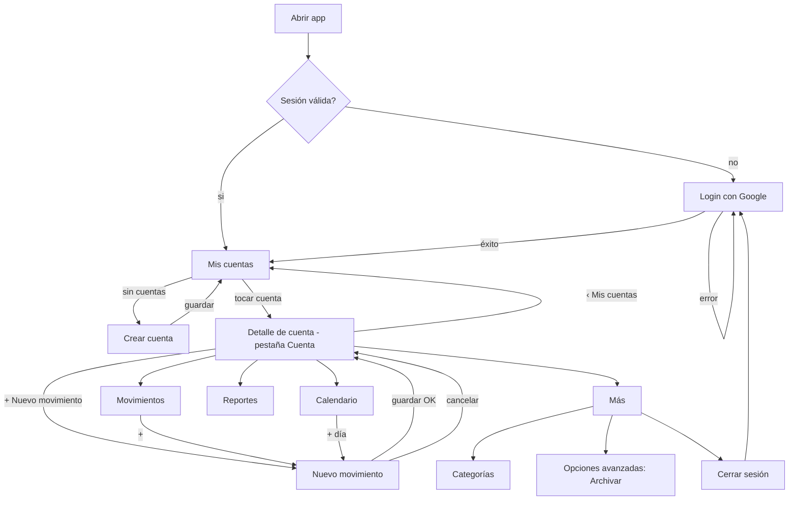
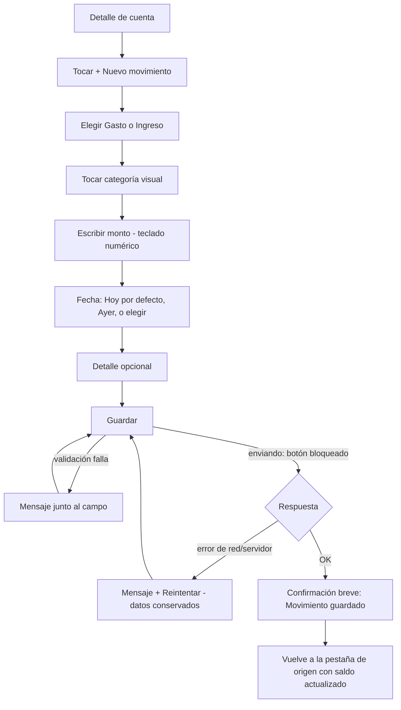
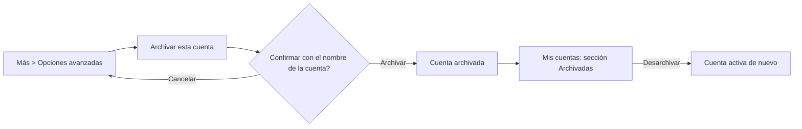

# 007 - Diseño UX del rediseño de CuidaTuBilletera

Estado: **prototipo (`docs/design/prototipo/index.html`) y navegación APROBADOS por el usuario en lo funcional, con observaciones** (la cuenta activa debe verse en todas las pantallas internas: resuelto en §3.5). La **apariencia** de la iteración 2 no se aprobó (pantalla inicial dominada por el verde, lejos del póster); la iteración 3 (composición y jerarquía de Mis cuentas §5.2, color por módulo §3.6) quedó **aprobada con el diseño completo en el paso 347** (docs/003, Decisión R0). Las decisiones que siguen abiertas están en §14. Autor: `mobile-ux-designer`. Alcance de este documento: cómo se usa la app (navegación, flujos, estados, textos, accesibilidad). No define apariencia gráfica (paleta, tipografía, iconos: `mobile-visual-designer`) ni implementa código. No se aplicó ningún cambio en `/app` ni `/api`.

Leyenda de origen de cada elemento:

- **EXISTENTE**: ya está en el código o en el contrato real (verificado en `app/src/screens/` y docs/001).
- **APROBADO**: decisión registrada en docs/001 o docs/003.
- **PROPUESTA NUEVA**: diseño nuevo de este documento; requiere aprobación (sección 14).

Fuera de alcance (no se diseña): metas, presupuestos, alertas, logros, gráficos nuevos, conciliación (Fase 6, solo se reserva un lugar en el menú «Más»), eliminación de cuentas.

---

## 1. Diagnóstico UX actual, pantalla por pantalla

Base: código real. El navegador (`MainNavigator.tsx`) es una pila en `useState` con `BackHandler` (APROBADO, 2B.1 D8 / 3.1 D8). Cuenta seleccionada solo en memoria (APROBADO, 3.1 D8).

| Pantalla | Qué hay hoy (EXISTENTE) | Problemas de uso |
| --- | --- | --- |
| Login (`LoginScreen`) | Título «CuidaTuBilletera», subtítulo «Inicia sesión para continuar.», botón «Ingresar con Google», avisos y errores con `role=alert`. | Sin explicación de qué es la app ni de qué se hace con la cuenta de Google. Contenido centrado sin jerarquía. Fondo blanco sin identidad. |
| Inicio (`HomeScreen` + `HomeDashboard`) | Título «Sesión iniciada» (texto técnico), nombre y correo, chips de cuenta, «Saldo de X», 4 botones (Nuevo movimiento, Ver historial, Ver calendario, Reportes), 10 movimientos recientes, botón «Cuentas», «Cerrar sesión». Contenido centrado verticalmente (`justifyContent: center`). | El título habla de la sesión, no del dinero. Todo está en una sola columna de botones del mismo peso: la acción principal compite con 3 secundarias. Chips de cuenta mezclan «elegir cuenta» y «administrar cuentas» (botón aparte, abajo). Cerrar sesión es un botón tan grande como las acciones de dinero. Con pocos datos queda mucho vacío arriba y abajo; con muchos, el saldo se desplaza fuera de la vista. |
| Cuentas (`AccountsScreen`) | Lista con «Abrir X» (lleva a Categorías), saldo inicial (no el saldo actual), Renombrar, Archivar (con `Alert`), Desarchivar, interruptor «Mostrar archivadas», formulario inline Nueva cuenta (nombre y saldo inicial con `numbers-and-punctuation`). | «Abrir» una cuenta lleva a Categorías: sorpresa (se espera ver la cuenta). Muestra «Saldo inicial» en lugar del saldo actual. Cada fila lleva 2 botones de gestión siempre visibles: ruido y riesgo de toques erróneos. El teclado de saldo permite letras y signos. Sin guía de qué es una cuenta. |
| Categorías (`CategoriesScreen`) | Secciones por tipo, formulario inline (nombre, descripción, tipo, color), Editar/Archivar/Eliminar por fila, «Mostrar archivadas». | Solo se llega entrando a una cuenta desde Cuentas: ruta no descubrible. Tres botones por fila, uno destructivo (Eliminar) pegado a los demás. Colores sin vista previa de su uso. |
| Nuevo/Editar movimiento (`TransactionFormScreen`) | Orden: Monto, Tipo, Categoría, Fecha, Nota. Monto con `decimal-pad` y `autoFocus`; fecha como texto AAAA-MM-DD con Hoy/Ayer; categorías como chips de texto; Anular con `Alert`. | El orden no sigue el modelo mental («qué fue → cuánto → cuándo»): el teclado se abre sobre el monto y tapa tipo y categoría. Fecha como texto es propensa a error. `decimal-pad` permite coma y puntos múltiples (la validación llega tarde, al guardar). Chips de categoría sin color ni icono, difíciles de escanear con 8+ categorías. Hay `busy` que bloquea botones (EXISTENTE, protege doble envío) pero no hay confirmación visible de éxito: solo se cierra. |
| Historial (`HistoryScreen`) | Filtros siempre abiertos: Tipo, Categoría, Rango (2 textos AAAA-MM-DD), Aplicar rango, Limpiar filtros; lista con «Cargar más». | Los filtros ocupan la mitad de la pantalla antes de ver un solo movimiento. Rango por texto. Sin resumen del período. |
| Calendario (`CalendarScreen`) | Cuadrícula mensual propia, mes anterior/siguiente, importes compactos por celda, resumen del mes, detalle del día, «Nuevo movimiento» para el día. | APROBADO (4.1): se conserva. Problemas menores: es una pantalla de pila aparte, no una pestaña; el «Nuevo movimiento» del día es un botón de tamaño completo dentro del detalle. |
| Reportes (`ReportsScreen`) | Modos (mes, año, rango), navegación de período, tarjetas Ingresos/Gastos/Balance (tocables, abren Historial filtrado), desglose por categoría con barras, serie por período, Exportar CSV/PDF, rango con 2 textos. | Exportar está pegado a las tarjetas de totales con el mismo peso visual. Rango por texto. Aceptable en contenido; mejora en jerarquía y en dónde vive. |
| Configuración | No existe pantalla. «Cerrar sesión» está en Inicio. Docs/001 §7 punto 10 (Ajustes: exportar, cerrar sesión) está parcialmente cubierto. | Falta un lugar para sesión, categorías y opciones avanzadas. |

Problemas transversales (EXISTENTE, observados):

1. Cada pantalla de pila es un `ScrollView`/`View` a pantalla completa sin encabezado ni botón de volver visible: solo el botón Atrás del sistema. Quien navega con gestos o no lo conoce, queda atrapado.
2. No hay indicación de en qué cuenta se está en Historial/Calendario/Reportes más allá del título («Historial de Efectivo»).
3. Todos los botones comparten estilo (`ui.tsx`): principal y secundario casi sin diferencia de peso.
4. Objetivos táctiles: `Button` y `Chip` 44 dp mínimo; el estándar de este documento es 48 dp (sección 10).
5. Mensajes de error buenos en general (`ErrorBox`, `role=alert`); se conservan.

## 2. Hallazgos Android (confirmados en teléfono real)

Hechos verificados por el usuario; las causas son hipótesis a confirmar por `mobile-engineer`.

| # | Hallazgo (EXISTENTE) | Causa probable | Efecto de usuario |
| --- | --- | --- | --- |
| H1 | Encabezados superpuestos con la hora/barra de estado. | La app dibuja bajo la barra de estado (comportamiento edge-to-edge de Android moderno / Expo reciente) y ninguna pantalla aplica relleno superior. `App.tsx` solo usa `<StatusBar style="auto" />`; no hay `SafeAreaView` ni `react-native-safe-area-context` en el código. | Título ilegible, toques en la zona del sistema. |
| H2 | La barra inferior de Android (gestos o 3 botones) ocupa espacio / tapa contenido. | Sin relleno inferior ni conocimiento de los insets. | Botones finales (Guardar, Cerrar sesión) cerca o debajo del área del sistema. |
| H3 | Mucho espacio vacío. | `HomeScreen` centra verticalmente (`justifyContent: center`) y usa botones de ancho mínimo 240. | Pantalla poco densa; el saldo no domina. |
| H4 | Jerarquía inconsistente. | Títulos de 22 (pantallas) frente a 24 (Inicio) y 28 (Login); secciones 16; sin sistema de espacios. | Cada pantalla parece de una app distinta. |
| H5 | Teclado abierto (PROPUESTA de verificación). | `autoFocus` en Monto abre el teclado de inmediato; `ScrollView` sin `KeyboardAvoidingView` explícito. | Posible que Guardar o el campo activo queden tapados en pantallas pequeñas. |

## 3. Arquitectura de navegación propuesta

### 3.1 Principios

- **Mis cuentas es el centro** (PROPUESTA NUEVA): tras el login se llega a «Mis cuentas». Quien tiene una sola cuenta puede entrar directo a su detalle (decisión 14.2), pero siempre hay un camino visible de vuelta.
- **Cuenta seleccionada conservada** (EXISTENTE parcial: hoy solo en memoria en `MainNavigator`; PROPUESTA: se conserva mientras dure la sesión y se pasa a todas las pestañas). Cierre de sesión la borra (APROBADO 3.1 D8).
- **Sin dependencias nuevas** (APROBADO 2B.1 D8 / 3.1 D8 / 4.1 D5): pila propia en estado local + barra inferior propia (componente `BottomTabs` de React Native puro). Compatible con React Navigation futuro.

### 3.2 Mapa de pantallas

```
Login
 └─ Mis cuentas  (raíz de sesión)
     ├─ Crear cuenta            (pantalla de pila)
     └─ Detalle de cuenta       (contenedor con barra inferior propia)
         ├─ [Cuenta]       resumen: saldo, período, semana
         ├─ [Movimientos]  historial con filtros discretos
         ├─ [Calendario]   (APROBADO 4.1, se conserva)
         ├─ [Reportes]     + exportación
         └─ [Más]          Configuración de la cuenta y de la sesión
              ├─ Datos de cuenta (nombre)
              ├─ Categorías
              ├─ Opciones avanzadas (Archivar; eliminación NO implementada)
              ├─ Exportar (atajo a Reportes > Exportar)
              ├─ Conciliar (reservado, Fase 6; oculto hasta existir)
              └─ Cerrar sesión

Pantallas de pila sobre el Detalle (ocultan la barra inferior):
   Nuevo movimiento · Editar movimiento · Crear/editar categoría
Acción destacada: botón «+ Nuevo movimiento» visible en Cuenta, Movimientos y Calendario.
```

Pestañas (PROPUESTA NUEVA): 5 elementos con icono y texto siempre visible: **Cuenta**, **Movimientos**, **Calendario**, **Reportes**, **Más**. «Nuevo movimiento» no es una pestaña: es un botón de acción destacada (FAB o botón fijo) para que la tarea más frecuente esté a un toque desde cualquier pestaña. Decisión 14.3 elige entre FAB y botón central.

Nota: «Más» corresponde a lo que docs/001 §7 llama «Ajustes» (EXISTENTE) y «Categorías» (EXISTENTE, hoy colgando de Cuentas). Se reubican sin cambiar su contenido.

### 3.3 Estado de navegación (PROPUESTA, para `mobile-engineer`)

```
Route = login-gate (lo resuelve App.tsx, EXISTENTE)
  | { name: 'accounts' }                       // Mis cuentas
  | { name: 'createAccount' }
  | { name: 'account', account, tab }          // tab: 'resumen'|'movimientos'|'calendario'|'reportes'|'mas'
  | { name: 'transaction', account, transaction?, fecha? }   // EXISTENTE
  | { name: 'categories', account } | { name: 'categoryForm', account, category? }
```

El estado por pestaña (mes del calendario, modo de reportes, filtros del historial) se conserva en el contenedor mientras se permanezca en el Detalle (EXISTENTE: `updateCalendarView`, `updateReportsView`). Cambiar de pestaña no recarga todo: cada pestaña monta una vez y se refresca al volver de una edición.

### 3.4 Comportamiento del botón Atrás (PROPUESTA NUEVA; la base EXISTENTE es «pop de pila o cerrar app en la raíz»)

| Situación | Atrás hace | Notas |
| --- | --- | --- |
| Login | Sale de la app (sistema). | Sin sesión no hay nada que volver. |
| Mis cuentas (raíz) | Sale de la app (sistema). | No cierra sesión. |
| Crear cuenta | Vuelve a Mis cuentas; si hay texto escrito sin guardar, pide confirmar descarte. | Evita perder datos. En R2 la confirmación estaba diferida; se aprueba en docs/003 R3 D1 (solo con cambios sin guardar). Crear cuenta se alinea en R3. |
| Detalle de cuenta, pestaña Cuenta | Vuelve a Mis cuentas. | Es la «pestaña de inicio» del Detalle. |
| Detalle, otra pestaña (Movimientos, Calendario, Reportes, Más) | Vuelve a la pestaña Cuenta (no sale del Detalle). | Un segundo Atrás vuelve a Mis cuentas. Evita saltos largos. |
| Calendario con día abierto | Cierra el detalle del día si está en una vista modal; si no, regla de pestaña. | Conserva comportamiento aprobado. |
| Nuevo/Editar movimiento sin cambios | Vuelve a la pestaña de origen. | EXISTENTE (`onDone`). |
| Nuevo/Editar movimiento con datos escritos | Pide «¿Descartar este movimiento?» (Seguir editando / Descartar). | PROPUESTA NUEVA. |
| Nuevo movimiento guardando (`busy`) | Se ignora Atrás hasta terminar. | Evita estados ambiguos. |
| Teclado abierto | Primero cierra el teclado (sistema), luego aplica la regla. | Comportamiento nativo. |
| Categorías / formulario de categoría | Formulario → lista → pestaña Más. | |
| Cuadros de confirmación (Alert) | Atrás = Cancelar. | `Alert` nativo ya lo hace. |
| Reportes exportando | Atrás permitido; la exportación termina en segundo plano o se cancela sin dejar archivo. | Definir con `mobile-engineer`; hoy `clearExports` limpia al desmontar (EXISTENTE). |

**Volver a Mis cuentas fácil (APROBADO con la navegación):** el Detalle muestra siempre la acción «‹ Mis cuentas» con objetivo de 48 dp, independiente del botón Atrás del sistema, para quien usa gestos o no lo conoce. Vive dentro de la barra de contexto de cuenta (§3.5).

### 3.5 Barra de contexto de cuenta (`AccountContextBar`)

Origen: observación del usuario al aprobar el prototipo («la cuenta activa debe verse claramente en todas las pantallas internas, con el nombre y, si aporta, el saldo»). Restricciones de `architect` (agentId af59ad590ed09a94f): fuente única del estado de la cuenta en el contenedor del Detalle, recarga de saldo por `refreshKey`, navegación local (React Navigation sigue diferida). Estado: APROBADO como requisito; el diseño de esta sección es PROPUESTA NUEVA salvo lo marcado.

#### 3.5.1 Opciones evaluadas

| Opción | Cómo se ve | A favor | En contra |
| --- | --- | --- | --- |
| Encabezado contextual (el título de la pantalla es la cuenta: «Efectivo») | Título grande cambia según la cuenta. | Máxima visibilidad. | Se pierde el título de la pantalla («Movimientos», «Reportes»): TalkBack y el usuario no saben en qué pantalla están; cada pantalla lo resuelve distinto. |
| Badge / pastilla (chip pequeño «Efectivo» junto al título) | Etiqueta compacta. | Ocupa poco. | Fácil de pasar por alto (el usuario pidió «claramente»); no cabe el saldo; objetivo táctil pequeño. |
| Subheader (línea de texto bajo el título) | «en Efectivo · $1,250.00» bajo cada título. | Simple. | Su posición cambia con cada título; baja jerarquía; no aloja «‹ Mis cuentas» ni estados. |
| **Barra de contexto** (franja fija arriba, igual en todas las pantallas internas, encima del título de pantalla) | Ver anatomía. | Un solo componente con la misma posición siempre; separa «dónde estoy» (título) de «con qué cuenta» (barra); aloja volver, estado y saldo; encaja con el `AccountHeader` único pedido por `architect`. | Consume ~56 dp de alto (mitigado con versión compacta). |

**Elegida: barra de contexto.** Es la única opción que cumple a la vez «visible en todas las pantallas», «no confundir con el título» y «una sola fuente de datos».

#### 3.5.2 Anatomía

```
▒▒▒▒▒▒▒▒▒▒▒▒▒▒▒▒▒▒▒▒▒▒▒▒▒▒▒▒▒▒▒▒▒▒▒  barra de estado
 [‹ Mis cuentas] │ Efectivo ▾      $1250.00     ← barra de contexto (≥ 56 dp)
                 │ [Archivada]  (solo si aplica)
 ─────────────────────────────────────
 Movimientos                            ← título de la pantalla (role header)
```

| Elemento | Contenido | Reglas |
| --- | --- | --- |
| Acción izquierda | «‹ Mis cuentas» (texto visible + chevrón). | Botón de 48 × 48 dp mínimo. En pantallas de pila (Nuevo/Editar movimiento, Categorías, Historial abierto desde Reportes) se sustituye por la salida propia de esa pantalla (✕ o «‹ Más», «‹ Reportes»), y la barra queda de solo lectura. |
| Nombre | `account.nombre` del estado del contenedor. | Una línea, elipsis al final; nunca empuja fuera el saldo. |
| Saldo | `formatCents(saldo)` (EXISTENTE en `lib/money.ts`; hoy sin separador de miles). | Texto secundario, prioridad de espacio sobre el nombre; signo «-» visible si es negativo. Se omite donde ya hay un saldo protagonista (pestaña Cuenta). |
| Estado | Etiqueta «Archivada» (texto, no solo color). | Solo si `account.archivada`. |
| Indicador de recarga | Indicador pequeño junto al saldo. | Solo mientras se relee el saldo (ver estados). |
| Toque en nombre/saldo | Abre el **selector rápido de cuenta** (decisión 14.14, aprobada). | En modo solo lectura (p. ej. Nuevo movimiento) nombre y saldo son texto sin acción; el otro cambio de cuenta es «‹ Mis cuentas». |

Selector rápido de cuenta (APROBADO, 14.14): hoja inferior con las cuentas activas (nombre + saldo, del `listAccounts` EXISTENTE, cargado al abrir), la actual marcada (`radio` + `selected`), y al pie «Ver todas mis cuentas» (va a Mis cuentas, donde están las archivadas). Elegir otra cuenta: el contenedor reemplaza su estado con esa cuenta, conserva la pestaña actual y reinicia el estado por pestaña (filtros, período, mes), porque las categorías son por cuenta y un filtro de la cuenta anterior no aplica. Se anuncia «Ahora estás en {nombre}». Atrás cierra la hoja. Estados de la hoja: cargando («Cargando tus cuentas…»), error con [Reintentar], una sola cuenta (lista con esa cuenta + «Ver todas mis cuentas»). Motivo de la recomendación: cambiar de cuenta pasa de 2 toques y una pantalla completa a 2 toques sin perder la pestaña (tarea T5). No se abre desde Nuevo/Editar movimiento ni Categorías (cambiar de cuenta a mitad de un formulario mezclaría datos).

#### 3.5.3 Flujo de datos (restricción de `architect`, no negociable en el diseño)

- **Fuente única:** el contenedor del Detalle (`AccountDetailScreen`/`MainNavigator`) guarda la cuenta (`id`, `nombre`, `saldo`, `archivada`) en su estado local. La barra solo recibe props. **Ninguna pestaña ni pantalla de pila pide el saldo por su cuenta.**
- **Valor inicial:** la cuenta elegida en Mis cuentas o en el selector (ya trae `saldo`, EXISTENTE en `GET /accounts`).
- **Tras crear, editar o anular un movimiento:** el contenedor incrementa `refreshKey` y relee el saldo con `GET /accounts/:id/balance` (endpoint EXISTENTE; respuesta `{accountId, saldoInicial, ingresos, gastos, saldo}`) mediante el método nuevo `getAccountBalance` del cliente de la app, sin cambio de contrato. Los `ingresos`/`gastos` de esa respuesta son históricos, no del período: la barra no los muestra.
- **Renombrar desde Más:** el contenedor reemplaza su estado con la respuesta de `PATCH /accounts/:id` (la barra cambia al instante; sin relectura).
- **Archivar desde Más:** vuelve a Mis cuentas con el aviso «{nombre} archivada. La encuentras en Archivadas.» (§5.9).
- **409 `ACCOUNT_ARCHIVED` al guardar un movimiento** (la cuenta se archivó en otro dispositivo): mensaje «Esta cuenta está archivada, por eso no se guardó el movimiento. Desarchívala desde Mis cuentas para anotar movimientos.» + [Volver a la cuenta]. Al volver, el contenedor marca la cuenta como archivada (el 409 es la confirmación del servidor, no un valor inventado; mecanismo exacto a confirmar con `architect`).

#### 3.5.4 Comportamiento por pantalla

| Pantalla | Barra | Qué muestra | Notas |
| --- | --- | --- | --- |
| Mis cuentas, Crear cuenta, Login | No | — | No hay cuenta activa. |
| Cuenta (resumen) | Completa | «‹ Mis cuentas», nombre, estado. **Sin saldo en la barra.** | El saldo protagonista de la tarjeta (§5.4) usa el mismo valor del contenedor; repetirlo sería ruido. |
| Movimientos (Historial) | Completa | Nombre + saldo + estado. | El título de pantalla es «Movimientos» (ya no «Historial de X»). |
| Historial filtrado abierto desde Reportes (14.6) | Solo lectura | Nombre + saldo. | Salida «‹ Reportes». |
| Calendario | Completa | Nombre + saldo + estado. | El mes sigue siendo el título de la vista. |
| Reportes | Completa | Nombre + saldo actual + estado. | Accesible como «saldo actual» para no confundirlo con el «Balance» del período. |
| Más (y Datos de cuenta, Opciones avanzadas) | Completa | Nombre + saldo + estado. | Renombrar actualiza la barra con la respuesta de PATCH. |
| Categorías y formulario de categoría | Solo lectura | Nombre + saldo + estado. | Salida «‹ Más». Sin selector. |
| Nuevo / Editar movimiento | **Compacta**, solo lectura | Una línea: «Efectivo · $1250.00» (en Editar, igual). | Sustituye «Nuevo movimiento · Efectivo» del título. Con teclado abierto se mantiene en una línea, sin indicador de recarga; si el ancho no alcanza se recorta primero el nombre. Nunca tapa Guardar. Sin selector. |

#### 3.5.5 Estados

| Estado | Qué se ve | Qué no se hace |
| --- | --- | --- |
| Normal | Nombre + saldo. | — |
| Recargando saldo (tras guardar/anular) | Último saldo conocido + indicador pequeño; `accessibilityState.busy`. | No se vacía ni se muestra «$0.00». |
| Error al releer | Nombre + «Saldo no disponible» + [Reintentar] (48 dp). | Nunca un valor inventado ni el saldo viejo como si fuera actual. Ojo: `formatCents` devuelve «$0.00» ante un valor no entero seguro (EXISTENTE): la barra no debe formatear un saldo inválido; debe mostrar el estado de error. |
| Archivada | Etiqueta «Archivada»; «+ Nuevo movimiento» (FAB y el del día del Calendario) **deshabilitado** con texto de ayuda «Cuenta archivada: no admite movimientos nuevos». | No se oculta la consulta del historial ni de reportes. |
| Nombre largo | Una línea con elipsis al final; nombre completo en la etiqueta accesible. | El saldo no se trunca. |
| Saldo negativo | «-$25.00» con signo visible (color de egreso como apoyo, nunca solo color). | No se oculta ni se muestra en valor absoluto. |
| Pantalla estrecha (≤ 340 dp) o fuente al 200 % | La barra pasa a dos filas: «‹ Mis cuentas» arriba; nombre, saldo y estado abajo. Altura mínima, no fija. | No se trunca el saldo ni «‹ Mis cuentas». |

#### 3.5.6 Accesibilidad

- La barra **no** usa `accessibilityRole="header"`: el `header` es solo el título de cada pantalla, que conserva el foco inicial de TalkBack (§10). Orden de lectura: barra, título, contenido.
- El bloque nombre/saldo/estado es un único elemento enfocable con etiqueta «Cuenta {nombre}, saldo {saldo}» y sufijos según estado: «, archivada», «, actualizando saldo», «, saldo no disponible». En Reportes: «saldo actual». En la pestaña Cuenta (sin saldo en barra): «Cuenta {nombre}».
- Con selector (14.14): `role=button` y pista «Toca para cambiar de cuenta». Sin selector o en solo lectura: `role=text` (sin `button`).
- «‹ Mis cuentas»: `role=button`, etiqueta «Volver a Mis cuentas», 48 dp.
- La recarga del saldo no es región viva (no interrumpe; el aviso de «guardado» ya se anuncia). Cambiar de cuenta desde el selector sí se anuncia una vez.
- Contraste 4.5:1 para nombre, saldo y «Archivada».

### 3.6 Color distintivo por módulo (PROPUESTA NUEVA, iteración 3; tonos finales: `mobile-visual-designer`)

Objetivo UX: que el usuario sepa **en qué módulo está** de un vistazo (como las 5 baldosas de color del póster) sin que el verde de marca domine todas las pantallas y sin competir con la semántica del dinero. El color de módulo es una **ayuda de orientación**, nunca un dato.

| Módulo | Rol de color (nombre de rol, no valor) | Referencia del póster | Dónde se manifiesta |
| --- | --- | --- | --- |
| Mis cuentas (raíz) | `marca` solo en la acción primaria; tarjetas con la paleta de cuentas (§5.2.4) | «Controla tus cuentas» | Botón «+ Nueva cuenta». Encabezado claro. |
| Cuenta (resumen del Detalle) | `modulo-cuenta` (familia de marca, verde azulado) | Panel 6 «Principal» | Pestaña activa; tarjeta de saldo protagonista (§5.4), **la única superficie fuerte** de esa pantalla. |
| Movimientos | `modulo-movimientos` (ámbar/amarillo cálido) | «Registra tus movimientos» | Pestaña activa; mosaico del título; acento del panel de filtros activo. |
| Calendario | `modulo-calendario` (azul) | «Visualiza tu calendario» | Pestaña activa; mosaico del título; marca del día seleccionado y de «hoy» (además del borde y el texto, EXISTENTE 4.1). |
| Reportes | `modulo-reportes` (violeta) | «Analiza con reportes» | Pestaña activa; mosaico del título; control segmentado Mes/Año/Rango seleccionado. Las tarjetas Ingresos/Gastos/Balance **no** usan violeta: conservan la semántica de dinero. |
| Más / Configuración / Categorías | `modulo-mas` (neutro pizarra) | Panel 11 (neutro) | Pestaña activa; mosaico del título de Más y de Categorías. Los colores de cada categoría (EXISTENTE, paleta fija) se mantienen y no se mezclan con este rol. |
| Nuevo/Editar movimiento | **Sin color de módulo propio**: manda el **tipo** | Panel 7 | Control Gasto/Ingreso: opción seleccionada con `gasto` (coral) o `ingreso` (verde) + icono (↓/↑) + texto. El botón Guardar usa la acción primaria (`marca`) con texto «Guardar gasto» / «Guardar ingreso» (etiqueta accesible «Guardar», §12). |

Dónde se manifiesta (lista cerrada; fuera de aquí el color de módulo no se usa):

1. **Pestaña activa** de la barra inferior: icono dentro de una «píldora» tintada del color del módulo + etiqueta en negrita. Las inactivas, neutras. Las 5 etiquetas siempre visibles.
2. **Mosaico del título** de la pantalla: cuadro de 32 dp con el icono del módulo sobre tinte suave, a la izquierda del título (`aria-hidden`). Es el lugar principal de identidad; sustituye la idea de encabezados de color a sangre.
3. **Acentos** de controles propios del módulo (segmentado de Reportes, día del Calendario, chips de filtro activos de Movimientos) y como máximo **una superficie fuerte** por pantalla (la tarjeta de saldo en Cuenta). Las demás tarjetas, superficie clara.

Dónde **no** se usa (reglas de no conflicto):

- **Barra de contexto de cuenta (§3.5):** neutra e idéntica en todas las pantallas internas (misma posición, mismo aspecto). No se tiñe por módulo: su valor es ser constante.
- **Importes:** siempre semánticos y neutros respecto al módulo: ingreso = verde + «+», gasto = coral + «-», saldo neutro (negativo con «-» y coral de apoyo). Ningún color de módulo se usa en cifras.
- **FAB «+ Nuevo movimiento»:** color de acción primaria constante en Cuenta, Movimientos y Calendario (es la misma acción en todas; cambiarle el color sugeriría acciones distintas).
- **Paleta de cuentas y de categorías:** independiente de los roles de módulo.
- Requisito a `mobile-visual-designer`: `modulo-movimientos` debe distinguirse claramente de `gasto` (coral) y `modulo-cuenta`/`marca` de `ingreso` (verde), también para daltonismo protanopia/deuteranopia; si no se logra, el módulo cede y usa su tono solo en la píldora de la pestaña.

El color no es el único indicador (criterio de aceptación 31):

- Pestaña activa = color + píldora (forma) + negrita + `accessibilityState.selected`; se distingue en escala de grises.
- Módulo actual = título de texto («Movimientos», «Calendario»…) con `role=header` + icono propio de cada módulo.
- Tipo de movimiento = color + icono ↑/↓ + palabra («Gasto»/«Ingreso») + signo del importe.
- Cuenta = nombre visible; el color de la tarjeta solo ayuda a reconocerla.
- Contraste: texto sobre tintes 4.5:1; icono de la pestaña activa y bordes de píldora 3:1 contra el fondo.

## 4. Diagramas de flujo

### 4.1 Flujo principal



### 4.2 Registrar un movimiento (tarea más frecuente)



### 4.3 Archivar cuenta



## 5. Pantallas, wireframes y estados

Convenciones de los wireframes: `[ ]` botón o campo, `( )` opción de selección, `▒` área del sistema (no usar), `{...}` dato dinámico. Todos los wireframes respetan la barra de estado arriba y la barra del sistema abajo (sección 9, opción A).

Estados que toda pantalla de datos debe cubrir (EXISTENTE como patrón: `useLoader`, `ErrorBox`, estados vacíos): **carga** (indicador con texto), **vacío** (qué pasó + siguiente paso), **error** (mensaje comprensible + Reintentar, `role=alert`), **éxito** (confirmación breve), **sin conexión** (EXISTENTE: mensajes de `auth-messages`).

### 5.1 Login (EXISTENTE, rediseño de contenido)

```
▒▒▒▒▒▒▒▒▒▒▒▒▒▒▒▒▒▒▒▒▒▒▒▒▒▒▒▒▒▒▒▒▒▒▒  barra de estado

        [logotipo de la app]
        CuidaTuBilletera
   Anota lo que entra y lo que sale,
   y mira cómo está tu dinero.

   [  G  Ingresar con Google  ]         48dp+
   Usamos tu cuenta de Google solo
   para identificarte. No vemos tu
   contraseña.
▒▒▒▒▒▒▒▒▒▒▒▒▒▒▒▒▒▒▒▒▒▒▒▒▒▒▒▒▒▒▒▒▒▒▒  barra del sistema
```

Estados: **cargando** (botón con indicador y texto «Ingresando…», bloqueado, `busy`); **error** (EXISTENTE: `AUTH_ERROR_MESSAGES`, caja con `role=alert` sobre el botón); **aviso de sesión cerrada** (EXISTENTE: `SIGNED_OUT_MESSAGES`); **éxito**: entra a Mis cuentas sin pantalla intermedia. El texto «Sesión iniciada» desaparece como título (sección 12).

### 5.2 Mis cuentas (PROPUESTA NUEVA como pantalla raíz; datos EXISTENTES)

Iteración 3 (composición y jerarquía). El flujo aprobado no cambia: Mis cuentas es la raíz, tocar una cuenta abre el Detalle, Archivadas están colapsadas, Renombrar/Archivar viven en Más (14.7). Lo que cambia es **cómo se reparte la pantalla**: el usuario aprobó el prototipo funcional pero no su apariencia («dominada por el verde, no refleja el póster»). Referencia de composición: panel 5 del póster «Mis cuentas» (encabezado ligero, tarjetas de cuenta diferenciadas por color suave con ilustración/icono, saldo grande, chevrón). Del póster **no** se toma: metas, «Pequeños hábitos, grandes logros» como dato, ni barra inferior en esta pantalla (la barra de 5 pestañas es del Detalle, §3.2). Colores finales: `mobile-visual-designer` (docs/008); aquí solo roles y jerarquía.

#### 5.2.1 Wireframe (360 × 640 dp, 2 cuentas activas, 1 archivada)

```
▒▒▒▒▒▒▒▒▒▒▒▒▒▒▒▒▒▒▒▒▒▒▒▒▒▒▒▒▒▒▒▒▒▒▒  barra de estado (24 dp, inset)
 CuidaTuBilletera                 (L)   ← marca 14 sp + avatar con inicial 40 dp
 Hola, Luis                      ┌───┐     (objetivo 48 dp) → hoja de perfil
 Mis cuentas                     │🐷 │  ← ilustración alcancía 72 dp, a la derecha
                                 └───┘     del bloque de títulos, alineada abajo
 ┌──────────────────────────────────┐
 │ Total en tus cuentas              │  ← resumen (14.16), superficie neutra,
 │ $1,570.50                         │     SIN color fuerte; solo si ≥ 2 cuentas
 │ Suma de los saldos de 2 cuentas   │
 └──────────────────────────────────┘
 ┌──────────────────────────────────┐
 │ [▣] Efectivo                    › │  ← tarjeta = un botón; mosaico de icono
 │     Saldo actual                  │     48 dp con color suave de la cuenta
 │     $1,250.00                     │     (§5.2.4); saldo 22-24 sp
 └──────────────────────────────────┘
 ┌──────────────────────────────────┐
 │ [▣] Tarjeta de crédito          › │
 │     Saldo actual                  │
 │     -$150.00                      │  ← signo «-» + color de egreso de apoyo
 └──────────────────────────────────┘
 [        + Nueva cuenta          ]     ← ÚNICA acción primaria, tras la lista
 ▸ Archivadas (1)                        ← fila secundaria 48 dp, colapsada
▒▒▒▒▒▒▒▒▒▒▒▒▒▒▒▒▒▒▒▒▒▒▒▒▒▒▒▒▒▒▒▒▒▒▒  barra del sistema (inset)
```

Presupuesto vertical en 360 × 640 (≈ 592 dp útiles tras insets): encabezado 128 + resumen 88 + 2 tarjetas × (88 + 10) + botón 56 + Archivadas 48 + márgenes 16 × 4 ≈ 576 dp: **cabe sin desplazamiento con 2 cuentas**; con 3 o más, la pantalla se desplaza y el encabezado se desplaza con el contenido (no es fijo: en 640 dp un encabezado fijo dejaría poco espacio a la lista).

#### 5.2.2 Encabezado amigable (PROPUESTA NUEVA)

| Elemento | Contenido | Reglas |
| --- | --- | --- |
| Marca | «CuidaTuBilletera» (14 sp, peso medio). | Texto, no imagen; `aria-hidden` no: se lee una vez, antes del saludo. |
| Saludo | «Hola, {primer nombre}» (EXISTENTE: `AuthUser.name` es **opcional**). | Primera palabra de `name`, máximo una línea con elipsis. Si `name` falta o está vacío: «Hola». Nunca el correo como saludo. |
| Título | «Mis cuentas» (`role=header`, 26/32 sp, estilo `rootTitle` de docs/008 §4; el resto de títulos de pantalla usa `title` 24/30). | Recibe el foco inicial de TalkBack (§10). |
| Acceso a perfil | Avatar circular con la inicial del nombre (o del correo si no hay nombre), 40 dp visual / 48 dp táctil, esquina superior derecha. | Discreto: superficie neutra, sin color de módulo. Etiqueta «Tu perfil y sesión». Abre la **hoja de perfil** (14.17): nombre, correo (EXISTENTES en la sesión) y [Cerrar sesión] con la confirmación de §7.3. No hay pantalla de perfil ni datos nuevos. |
| Ilustración | Alcancía con moneda (activo EXISTENTE `docs/design/assets/icon.png` o su versión sin fondo, a cargo de `mobile-visual-designer`). | A la derecha del bloque saludo/título, alineada con la línea base de «Mis cuentas». **Decorativa** (`accessible=false` / `aria-hidden`). Tamaño según la tabla 5.2.5. Nunca empuja ni trunca el título: si no cabe, se reduce y luego se oculta. |

Fondo del encabezado: **claro** (el de la pantalla o un tinte muy suave), no una franja verde a sangre. Motivo UX: la queja del usuario es que el verde domina; el color fuerte se reserva para la acción primaria (§3.6, regla «una superficie fuerte por pantalla»).

#### 5.2.3 Resumen «Total en tus cuentas» (DECISIÓN 14.16, APROBADA)

- **Qué es:** la suma de `saldo` (EXISTENTE, calculado por la API) de las cuentas **activas** que devolvió `GET /accounts`. No es una estadística ni un patrimonio: es una suma de valores reales. Moneda única USD (APROBADO docs/001), por eso la suma tiene sentido.
- **Cuándo se muestra:** solo con **2 o más** cuentas activas (con 1 repetiría su saldo). No se muestra en carga, error, vacío ni si algún saldo no es entero seguro o la suma excede `Number.MAX_SAFE_INTEGER` (en ese caso se oculta; nunca «$0.00»).
- **Texto:** «Total en tus cuentas» / `{suma}` / «Suma de los saldos de {n} cuentas». Si hay archivadas: «No incluye cuentas archivadas». Una suma negativa se muestra con «-» y color de egreso de apoyo.
- **Qué no lleva:** ni ingresos/gastos, ni comparación con el mes anterior, ni porcentajes, ni metas.
- **Interacción:** no es tocable (`role=text`, etiqueta «Total en tus cuentas, {suma}, suma de {n} cuentas activas»).
- **Resuelto (paso 347, docs/003 Decisión R0 D11):** sumar en la app saldos ya calculados por la API es presentación, no regla de negocio; el total se oculta si algún saldo no es un entero seguro.

#### 5.2.4 Tarjetas de cuenta diferenciadas (PROPUESTA NUEVA)

Anatomía (toda la tarjeta es **un** botón, alto mínimo **88 dp (92 dp con ancho ≥ 400 dp)**, sin botones internos; medida fijada en docs/008 §6.3, ver §14.A):

| Zona | Contenido | Reglas |
| --- | --- | --- |
| Mosaico izquierdo | Icono de 28 dp sobre un mosaico redondeado de 52 dp con el **color suave de la cuenta**. | Decorativo. El color identifica la tarjeta de un vistazo; el **nombre** es el identificador real. |
| Centro | Nombre (17 sp, peso alto, una línea, elipsis) · «Saldo actual» (13 sp) · saldo (22-24 sp, cifras tabulares). | Con nombre largo se recorta el nombre, nunca el saldo. Con fuente ≥ 130 % el saldo baja a su propia línea (ya está en línea propia en el wireframe). |
| Derecha | Chevrón «›». | Decorativo; la etiqueta accesible ya dice que abre. |

- **Color estable por cuenta (DECISIÓN 14.18):** se asigna por **id**, no por posición: `paleta[hash(id) mod N]` con `N` = 6 tonos suaves de `mobile-visual-designer`. Motivo: si se asigna por orden, al crear o archivar una cuenta las demás cambian de color y el usuario pierde la referencia. Alternativa (b): por orden de `createdAt` (estable mientras no se archive ninguna). Colisiones permitidas (dos cuentas pueden compartir tono): el color nunca es el único indicador. La paleta de cuentas **excluye** el verde de ingreso, el coral de gasto y el color de marca de la acción primaria, para no sugerir «esta cuenta va bien/mal». Guardar un color elegido por el usuario requeriría un campo nuevo en D1 (fuera de alcance; mejora futura).
- **Icono (DECISIÓN 14.19):** la API no guarda tipo de cuenta. Opciones: (a) un único icono de billetera para todas, diferenciadas por color; (b) icono por palabra clave del nombre (contiene «tarjeta» → tarjeta; «banco» → banco; «ahorro» → alcancía; resto → billetera), puramente decorativo. **Recomendado (b)** porque acerca la lista al póster sin datos nuevos; si confunde en la prueba de usuario, volver a (a). En ningún caso el icono afirma un tipo ante TalkBack.
- **Saldo negativo:** «-$150.00» con signo visible; color de egreso solo de apoyo; la tarjeta no cambia su fondo.
- **Etiqueta accesible:** «{nombre}, saldo actual {saldo}. Abrir cuenta» (`role=button`). Conserva el texto «saldo actual» del prototipo aprobado.
- **Archivadas:** fila «▸ Archivadas ({n})» (`role=button`, `aria-expanded`); al abrirla, tarjetas compactas (64 dp) con superficie gris, sin color de cuenta, etiqueta «Archivada» en texto, [Ver] y [Desarchivar] (EXISTENTE en el prototipo). Si `n = 0`, la fila no se muestra.

#### 5.2.5 Distribución del espacio y adaptación

Reglas generales: contenido **alineado arriba** (nunca `justifyContent: center`, causa del hallazgo H3); márgenes laterales 16 dp (20 dp si ancho ≥ 400); separación entre tarjetas 8-12 dp. Un **hueco** es espacio vacío *entre* elementos; el espacio libre *al final* del desplazamiento es aceptable.

| Caso | Encabezado / ilustración | Lista y acciones |
| --- | --- | --- |
| 360 × 640, fuente 100 % | 128 dp; alcancía 72 dp. | Total + 2 tarjetas + [Nueva cuenta] + Archivadas sin desplazar (§5.2.1). |
| 412 × 915, fuente 100 % | 152 dp; alcancía 96-104 dp. | Tarjetas de 88-96 dp. Con 1-2 cuentas sobra alto **debajo** de Archivadas: se acepta como final de lista. Para no dejar la mitad inferior vacía en la primera semana, aquí cabe la guía descartable de §7.1 («Toca una cuenta para anotar sus gastos e ingresos») debajo de la lista. No se rellena con datos ni tarjetas inventadas. |
| 1 sola cuenta | Igual. | Sin Total. La tarjeta única puede ser más alta (96 dp) con el texto «Toca para ver tus movimientos». |
| 6+ cuentas | Igual (se desplaza con el contenido). | [Nueva cuenta] queda tras la lista; **no** se fija abajo (evita tapar tarjetas y competir con la barra del sistema). |
| Fuente ≥ 130 % | Alcancía 48 dp. | Saldo en línea propia; tarjetas sin alto máximo. |
| Fuente ≥ 175 % o ancho ≤ 340 dp | **Alcancía oculta**; marca y saludo en líneas separadas. | Avatar sigue visible (48 dp). Nada se trunca salvo el nombre de cuenta con elipsis. |

Jerarquía de botones: **una** primaria (llena, color de acción): «+ Nueva cuenta» (texto del prototipo «+ Crear cuenta» pasa a «+ Nueva cuenta», como el título de §5.3; las pruebas consultan por etiqueta «Nueva cuenta», ya EXISTENTE en `AccountsScreen.test.tsx`). Secundarias discretas (texto, sin relleno): «Archivadas», avatar de perfil. El botón «Cerrar sesión» de tamaño completo del prototipo **desaparece de la lista** y pasa a la hoja de perfil (14.17).

#### 5.2.6 Estados

- **Vacío ilustrado:** alcancía 120 dp (oculta con fuente ≥ 175 %), título «Todavía no tienes cuentas», texto «Una cuenta es el lugar donde anotas tu dinero: efectivo, banco o tarjeta.», primaria [Crear mi primera cuenta]. Sin Total, sin «Archivadas» si no hay; si hay archivadas pero ninguna activa: «No tienes cuentas activas. Puedes crear una o desarchivar una de las anteriores.» y la fila Archivadas visible. El encabezado (marca, saludo, avatar) se mantiene: la sesión siempre se puede cerrar desde el avatar.
- **Carga:** encabezado real + 2 tarjetas esqueleto (mismo alto que las reales, sin cifras) + «Cargando tus cuentas…» accesible; sin Total.
- **Error:** «No pudimos cargar tus cuentas. Revisa tu conexión e inténtalo de nuevo.» + [Reintentar] (`role=alert`); sin Total ni tarjetas vacías.
- **Éxito (tras crear):** la app entra al Detalle de la cuenta nueva (§5.3, comportamiento del prototipo aprobado). Al volver, la cuenta nueva aparece con su color estable.
- **Sesión degradada** (EXISTENTE: `degraded`/`unavailable`): franja de aviso bajo el encabezado, sobre el Total, con [Reintentar]; texto de `auth-messages`.
- Renombrar y Archivar **no** están en la lista (Más > Datos de cuenta / Opciones avanzadas, §6).

### 5.3 Crear cuenta (EXISTENTE como formulario inline; PROPUESTA: pantalla de pila)

```
 ‹ Nueva cuenta
 Nombre de la cuenta
 [ Efectivo, Banco, Tarjeta…        ]
 Saldo inicial (opcional)
 [ $ 0.00                           ]  teclado numérico
 Es el dinero que ya tienes hoy en
 esta cuenta. Después no se puede
 cambiar; lo demás lo registras con
 movimientos.
 [        Crear cuenta        ]
```

Reglas: nombre obligatorio (EXISTENTE «Escribe un nombre.»); saldo inicial opcional (APROBADO docs/001 §5, vacío = 0); teclado `decimal-pad` con filtrado de caracteres; **el saldo inicial no se puede cambiar después** (hecho de contrato: PATCH solo permite nombre y archivada), por eso el texto de ayuda lo avisa antes de guardar. Estados: guardando (botón «Creando…» bloqueado), error de formato (EXISTENTE: «El saldo inicial no es válido. Usa el formato 1234.56…»), límite (EXISTENTE: «Alcanzaste el límite permitido»), éxito («Cuenta creada. Ya puedes anotar movimientos.») y navegación al Detalle de la cuenta nueva (decisión 14.2).

### 5.4 Detalle de cuenta - pestaña Cuenta (PROPUESTA NUEVA; datos EXISTENTES)

```
▒▒▒▒▒▒▒▒▒▒▒▒▒▒▒▒▒▒▒▒▒▒▒▒▒▒▒▒▒▒▒▒▒▒▒
 [‹ Mis cuentas] │ Efectivo ▾          barra de contexto (§3.5), sin saldo aquí
 ─────────────────────────────────
 ┌──────────────────────────────┐
 │ Saldo actual                 │
 │ $1,250.00                    │   grande, protagonista
 └──────────────────────────────┘
 Octubre 2026   ‹ ›                  período: mes (por defecto)
 ┌──────────┐ ┌──────────┐
 │ Ingresos │ │ Gastos   │
 │ $800.00  │ │ $350.00  │
 └──────────┘ └──────────┘
 Esta semana                    Ver todo ›
  Lun 12 · Almuerzo        -$6.50
  Dom 11 · Sueldo         +$800.00
  …
 filtros: ( Todos ) ( Gastos ) ( Ingresos )   discretos
                           [ + Nuevo movimiento ]  FAB
 ─────────────────────────────────
 Cuenta | Movimientos | Calendario | Reportes | Más
▒▒▒▒▒▒▒▒▒▒▒▒▒▒▒▒▒▒▒▒▒▒▒▒▒▒▒▒▒▒▒▒▒▒▒
```

- **Saldo** (EXISTENTE: `account.saldo`). Composición (iteración 3, §3.6): la tarjeta de saldo es la **única superficie de color fuerte** de la pestaña (rol `modulo-cuenta`); las tarjetas Ingresos/Gastos son claras con su cifra en color semántico + signo; la lista de la semana, sobre fondo claro. La alcancía decorativa del póster (panel 6) puede ir dentro de la tarjeta de saldo, a la derecha, 56-64 dp, oculta con fuente ≥ 175 % o ancho ≤ 340 dp; nunca reduce el tamaño del saldo.
- **Ingresos y gastos del período** (EXISTENTE en el contrato: `GET /reports/summary` con rango; PROPUESTA NUEVA su uso aquí). Período por defecto: mes actual; solo ‹ › para cambiar mes. Sin metas ni comparaciones inventadas. Excluye anulados (regla de reportes, EXISTENTE).
- **Movimientos de la semana** (PROPUESTA NUEVA): `GET /transactions` con `desde/hasta` de la semana lunes-domingo (lunes = `WEEK_START`, APROBADO 4.1 D3). Máximo 10 filas, «Ver todo» abre la pestaña Movimientos. Tocar una fila abre Editar (EXISTENTE).
- **Filtros discretos:** un solo control segmentado Todos/Gastos/Ingresos que afecta la lista de la semana; el resto de filtros (categoría, rango) viven en Movimientos.
- **Estados:** carga con esqueleto o indicador por bloque (saldo, período y semana cargan independientes: un error en uno no vacía los demás; EXISTENTE el patrón de `RecentTransactions`). Vacío semana: «Esta semana no has anotado movimientos. Toca + para registrar el primero.» Vacío total (cuenta nueva): «Tu cuenta está lista. Anota tu primer gasto o ingreso con el botón +.» Error por bloque: mensaje corto + [Reintentar]. Éxito tras guardar: la fila nueva aparece y el saldo se actualiza.
- **Saldo:** el de la tarjeta sale del estado del contenedor (§3.5.3), el mismo que muestra la barra en las demás pestañas; tras guardar/anular se relee con `getAccountBalance` (recargando: último valor + indicador; error: «Saldo no disponible» + [Reintentar], nunca un valor inventado).
- **Cuenta archivada** (EXISTENTE: no admite movimientos nuevos): etiqueta «Archivada» en la barra y banner «Cuenta archivada. Puedes consultar su historial, pero no anotar movimientos.»; el FAB se muestra **deshabilitado** (restricción de `architect`; antes se ocultaba).

### 5.5 Nuevo movimiento (EXISTENTE; reordenado)

Pantalla de pila (sin barra inferior). Orden propuesto (PROPUESTA NUEVA): **Tipo → Categoría visual → Monto → Fecha → Detalle → Guardar.** El docs/001 §7 pide «monto primero»; el rediseño lo cambia a favor de tipo y categoría primero porque el teclado numérico, al abrirse al final del recorrido, no tapa las categorías. Es una desviación de una regla de experiencia de docs/001 (§7): requiere aprobación explícita (14.4), con alternativa de mantener el monto primero.

```
▒▒▒▒▒▒▒▒▒▒▒▒▒▒▒▒▒▒▒▒▒▒▒▒▒▒▒▒▒▒▒▒▒▒▒
 Efectivo · $1250.00                    barra compacta, solo lectura (§3.5)
 ✕  Nuevo movimiento
 ( Gasto ) ( Ingreso )                 segmentado, 48dp
 ¿En qué fue?
 [🍽 Alimentación] [🚌 Transporte] [💡 Servicios]
 [🏥 Salud] [📚 Educación] [🏠 Hogar] …     rejilla, color + icono + texto
 ¿Cuánto?
 [ $  12.50                        ]   teclado numérico
 ¿Cuándo?
 ( Hoy ) ( Ayer ) ( Otra fecha… )      «Otra fecha» abre selector
 Detalle (opcional)
 [ Almuerzo con Ana                  ]  0/500
 [          Guardar gasto           ]   fijo sobre el teclado
▒▒▒▒▒▒▒▒▒▒▒▒▒▒▒▒▒▒▒▒▒▒▒▒▒▒▒▒▒▒▒▒▒▒▒
```

Reglas y estados:

- **Categoría visual:** rejilla de botones con el color de la categoría (campo `color` EXISTENTE) y el nombre; el icono es PROPUESTA del diseñador visual (campo `icono` existe en el modelo, docs/001 §5). El color nunca es el único portador de significado: siempre va el nombre. Solo categorías activas del tipo elegido (EXISTENTE). Cambiar de tipo limpia la categoría (EXISTENTE `changeTipo`).
- **Monto:** teclado numérico estricto (`decimal-pad` con filtrado de entrada a dígitos y un separador, hasta 2 decimales; EXISTENTE `parseCentsFromInput` valida), prefijo «$» fijo, `inputMode`/`keyboardType` numérico. Error junto al campo: «Ingresa un monto mayor a cero, por ejemplo 12.50.» (EXISTENTE). Máximo EXISTENTE 99 999 999 999 centavos.
- **Fecha:** botones Hoy (seleccionado por defecto) / Ayer (EXISTENTE) y «Otra fecha…» que abre un selector (calendario del sistema o cuadrícula del propio `CalendarScreen`). El texto AAAA-MM-DD deja de ser la entrada principal. Fechas futuras permitidas (EXISTENTE docs/001 §6). El selector de fecha nativo es una dependencia (`@react-native-community/datetimepicker`, módulo nativo): **no se propone**; la opción sin dependencia es reutilizar la cuadrícula de `CalendarScreen` en modo selección (14.5).
- **Detalle:** el campo `nota` del API (límite 500, EXISTENTE); etiqueta visible «Detalle (opcional)».
- **Doble envío:** al tocar Guardar, el botón pasa a «Guardando…», se deshabilita y todos los campos quedan `editable={false}` (EXISTENTE `busy`); además se ignora Atrás durante el envío. Si el envío falla, los datos se conservan y se muestra el error con [Reintentar]. Idempotencia: la API no tiene clave de idempotencia (no verificada); el bloqueo es solo de cliente. Si la respuesta se pierde por la red, un reintento podría duplicar: el texto de error de red debe invitar a revisar el historial antes de reintentar (PROPUESTA NUEVA: «No pudimos confirmar si se guardó. Revisa tus movimientos antes de volver a intentar.»).
- **Confirmación:** al éxito, vuelve a la pantalla de origen y muestra un aviso breve no bloqueante (snackbar propio, 3 s): «Gasto de $12.50 guardado en Alimentación». Con acción «Deshacer» NO (anular es otra operación; mantener simple). El saldo en pantalla ya refleja el cambio.
- **Cuenta visible:** barra compacta de una línea, de solo lectura, también con teclado abierto (§3.5.4). Si al guardar llega 409 `ACCOUNT_ARCHIVED`: mensaje de §3.5.3 + [Volver a la cuenta], datos del formulario sin enviar.
- **Regreso:** a la pestaña de origen (Cuenta, Movimientos o Calendario con su día); si venía del Calendario, vuelve al mismo mes y día (EXISTENTE).
- **Teclado abierto:** el botón Guardar queda visible encima del teclado (`KeyboardAvoidingView` o relleno por altura del teclado). El `autoFocus` se quita del monto (para no abrir el teclado antes de elegir categoría); el teclado se abre al tocar el campo o tras elegir la categoría (PROPUESTA NUEVA).
- **Editar (EXISTENTE):** tipo y categoría son de solo lectura (APROBADO docs/001 §5), se editan monto, fecha y detalle. «Anular movimiento» queda **al final, separado, en rojo**, con confirmación (EXISTENTE `Alert`: «¿Anular este movimiento? Dejará de contar en el saldo.»).
- **Sin categorías del tipo:** «No tienes categorías de gasto activas. Crea una en Más > Categorías.» + [Ir a Categorías] (hoy dice «desde Cuentas»; cambia).
- **Errores 409 de categoría obsoleta** (EXISTENTE `STALE_CATEGORY_CODES`): se recargan categorías y se pide elegir de nuevo con el mensaje «Esa categoría cambió. Elige otra.»

### 5.6 Historial = pestaña Movimientos (EXISTENTE; filtros discretos)

```
 [‹ Mis cuentas] │ Efectivo ▾   $1250.00   barra de contexto (§3.5)
 ─────────────────────────────────
 Movimientos            [ ⚲ Filtros (2) ]   ← abre panel
 Octubre 2026 · 14 movimientos
  Hoy
   Almuerzo · Alimentación     -$6.50
  Ayer
   Sueldo · Sueldo           +$800.00
  …
  [ Cargar más ]
```

- Filtros (tipo, categoría, rango) pasan a un **panel plegable** (hoja inferior o sección colapsable) abierto con «Filtros». Con filtros activos se muestra el contador y una fila de «chips de filtro» con ✕ para quitarlos uno a uno. «Limpiar filtros» se conserva (EXISTENTE).
- Rango de fechas: dos botones «Desde» y «Hasta» que abren el selector de fecha (14.5); el texto AAAA-MM-DD deja de ser entrada principal.
- Lista agrupada por día (PROPUESTA NUEVA), paginación con «Cargar más» (EXISTENTE, APROBADO 3.1 D8).
- Estados: carga (indicador + «Cargando movimientos…»); vacío sin filtros: «Aún no hay movimientos. Cuando anotes el primero, aparecerá aquí.»; vacío con filtros: «Ningún movimiento coincide con estos filtros.» + [Limpiar filtros]; error: mensaje + [Reintentar] (EXISTENTE «No se pudo conectar…»); error al cargar más: mensaje inline sin perder lo ya cargado (EXISTENTE).
- Tocar una fila abre Editar movimiento (EXISTENTE).

### 5.7 Calendario (APROBADO 4.1: se conserva)

```
 [‹ Mis cuentas] │ Efectivo ▾   $1250.00   barra de contexto (§3.5)
 ─────────────────────────────────
 ‹  Octubre 2026  ›                       cuadrícula aprobada (4.1), sin cambios
```

Se conserva íntegro: cuadrícula propia, lunes primer día, importes compactos por celda, resumen del mes, detalle del día, acceso a Nuevo movimiento con la fecha del día. Cambios solo de **contenedor** (PROPUESTA NUEVA): vive como pestaña del Detalle (sin título duplicado «Calendario de X»; el encabezado de la cuenta ya lo da), su botón «Nuevo movimiento» se mantiene dentro del detalle del día, y se reemplaza por la acción destacada global solo si 14.3 lo decide así. Estados EXISTENTES: carga, vacío de mes («No hay movimientos en este mes»), vacío de día («Este día no tiene movimientos registrados»), error con reintento, «Cargar más».

### 5.8 Reportes y exportación (EXISTENTE; jerarquía)

```
 [‹ Mis cuentas] │ Efectivo ▾   $1250.00   barra (saldo actual, no del período)
 ─────────────────────────────────
 Reportes
 ( Mes ) ( Año ) ( Rango )   ‹ Octubre 2026 ›
 ┌ Ingresos ┐ ┌ Gastos ┐ ┌ Balance ┐
 Por categoría (gastos) …barras…
 Por mes …
 ───────────────────────────────
 Exportar este período
 [ Exportar CSV ]   [ Exportar PDF ]
```

- La exportación pasa a una sección propia **al final** («Exportar este período») con texto que dice qué incluye. Los textos «Exportar CSV»/«Exportar PDF» y sus `accessibilityLabel` se conservan (las pruebas dependen de ellos, sección 12).
- Tarjetas y barras tocables conservan «Ver movimientos» (EXISTENTE, abre Movimientos filtrado). Al abrir Movimientos desde aquí, Atrás vuelve a Reportes (hoy es una pila; con pestañas se conserva empujando una ruta de pila `history` encima, o cambiando de pestaña y recordando la anterior: 14.6).
- Rango por selector de fechas (14.5).
- Estados: carga («Calculando tu resumen…»), vacío («Sin movimientos en este período», EXISTENTE; agregar «Prueba con otro mes»), error + reintento, exportando («Exportando…», botones bloqueados, EXISTENTE), éxito («Archivo listo. Elige dónde compartirlo.» al abrir el selector de compartir, EXISTENTE `expo-sharing`), exportación vacía o fallida con mensaje comprensible («No pudimos crear el archivo. Inténtalo otra vez.»).
- El exportar vive también como atajo en Más (PROPUESTA NUEVA, solo enlace a esta sección).

### 5.9 Configuración = pestaña Más (PROPUESTA NUEVA; funciones EXISTENTES)

```
 [‹ Mis cuentas] │ Efectivo ▾   $1250.00   barra de contexto (§3.5)
 ─────────────────────────────────
 Más
 Cuenta
  ┌ Datos de cuenta                     › ┐   nombre
  ├ Categorías                          › ┤
  └ Exportar                            › ┘
 Sesión
  Conectado como ana@example.com
  [ Cerrar sesión ]
 Opciones avanzadas                      ▸    colapsado
```

**Datos de cuenta (solo nombre, PROPUESTA NUEVA basada en contrato):** campo «Nombre de la cuenta» + [Guardar cambios]. Nota informativa: «El saldo inicial no se puede cambiar. Si el saldo no coincide, anota un movimiento.» No hay edición del saldo inicial (PATCH no lo admite; hecho verificado). Éxito: «Nombre actualizado» y la barra de contexto muestra el nombre nuevo de inmediato (el contenedor toma la respuesta del PATCH, §3.5.3). Errores: nombre vacío (EXISTENTE), conflicto/red con reintento.

**Categorías:** ver 5.10.

**Opciones avanzadas (colapsadas por defecto, separadas visualmente por una línea y encabezado en rojo atenuado):**

```
 Opciones avanzadas
 ┌ Archivar esta cuenta ───────────┐
 │ La cuenta deja de aparecer en tu │
 │ lista y no admite movimientos    │
 │ nuevos. Su historial se conserva │
 │ y puedes desarchivarla.          │
 │ [ Archivar cuenta ]    (rojo)    │
 └──────────────────────────────────┘
 ┌ Eliminar cuenta ─────────────────┐
 │ No disponible por ahora.         │   deshabilitado, ver 6
 └──────────────────────────────────┘
```

- **Archivar** (EXISTENTE: `PATCH {archivada: true}` con confirmación): botón separado del resto, texto rojo, diálogo de confirmación con el nombre de la cuenta: título «Archivar cuenta», cuerpo «¿Archivar «Efectivo»? Dejará de aparecer en tu lista y no podrás anotarle movimientos. Podrás desarchivarla cuando quieras.», botones [Cancelar] [Archivar]. Éxito: vuelve a Mis cuentas con aviso «Efectivo archivada. La encuentras en Archivadas.»
- **Eliminación:** NO implementada, ni la API la ofrece (no existe `DELETE /accounts`; docs/001 §5: las cuentas se archivan, no se eliminan). Qué se mostraría y por qué requiere decisión de contrato: ver sección 6. En este rediseño la fila «Eliminar cuenta» **no se muestra** salvo que se apruebe la alternativa de 6.3; si se muestra, es texto informativo sin botón de borrar.

**Sesión:** Cerrar sesión (EXISTENTE) se mueve aquí desde Inicio, como botón secundario, y pide confirmación solo si hay un envío en curso (el cierre ya limpia datos, EXISTENTE). Conectado como: correo (EXISTENTE, hoy en Inicio).

**Estados:** carga de datos de cuenta no aplica (viene del Detalle); error de guardado con mensaje inline; sesión degradada: el aviso de `auth-messages` se muestra en esta pestaña y en Mis cuentas.

### 5.10 Categorías (EXISTENTE; reubicada en Más)

```
 [‹ Más] │ Efectivo   $1250.00          barra de solo lectura (§3.5)
 ─────────────────────────────────
 Categorías
 ( Gastos ) ( Ingresos )               segmentado
 [ + Nueva categoría ]
  ● Alimentación                    ⋮
  ● Transporte                      ⋮
  …
 ▸ Archivadas (2)
```

- Hoy: dos secciones (egreso/ingreso) con Editar/Archivar/Eliminar en cada fila (EXISTENTE). Propuesta: segmentado por tipo y **una sola acción «⋮» por fila** que abre un menú con Editar, Archivar y Eliminar (este último solo si no tiene movimientos, ver abajo), con el destructivo al final y en rojo. Conserva todas las funciones.
- Crear/editar: nombre, descripción (opcional), tipo (solo al crear: inmutable, APROBADO docs/001 §5; en edición se muestra como texto), color de una paleta fija (EXISTENTE `CATEGORY_COLORS`) con nombre accesible. Vista previa de la categoría como se verá en Nuevo movimiento (PROPUESTA NUEVA).
- **Eliminar vs archivar (EXISTENTE):** el API elimina solo categorías sin movimientos (incluidos anulados; `409 CATEGORY_IN_USE` si no). Mensaje comprensible ante `CATEGORY_IN_USE` (EXISTENTE «tiene movimientos y no puede eliminarse»): ampliar con la salida: «Esta categoría tiene movimientos, por eso no se puede eliminar. Puedes archivarla: no aparecerá al anotar movimientos nuevos, pero tu historial se conserva.» + [Archivar]. Confirmación de eliminar (EXISTENTE): «¿Eliminar «X»? Esta acción no se puede deshacer.»
- Estados: carga, vacío por tipo («Aún no tienes categorías de gasto. Crea la primera.»), error + reintento, cuenta archivada (EXISTENTE: «Cuenta archivada: no se pueden crear ni desarchivar categorías.»), límite (EXISTENTE `LIMIT_REACHED`).

## 6. Mis cuentas: renombrar, archivar y «solicitar eliminación»

Hechos de contrato (verificados): no existe `DELETE /accounts`; `PATCH /accounts/:id` admite solo `nombre` y `archivada`; docs/001 §5: «Las cuentas se archivan, no se eliminan físicamente» y CLAUDE.md: «La información histórica no se elimina, se archiva».

### 6.1 Renombrar y archivar (EXISTENTE, reubicados)

- Renombrar: Más > Datos de cuenta (5.9). Atajo opcional desde Mis cuentas con pulsación larga o menú «⋮» por tarjeta (PROPUESTA; 14.7).
- Archivar: Más > Opciones avanzadas (5.9) con confirmación.
- Desarchivar: en Mis cuentas > Archivadas, botón «Desarchivar» por fila (EXISTENTE).

### 6.2 «Solicitar eliminación»: qué NO se puede hacer hoy

Un botón «Eliminar cuenta» o «Solicitar eliminación» **prometería** algo que el sistema no hace: no hay endpoint, no hay flujo de revisión y la regla del producto prohíbe borrar historial. Mostrarlo funcionando sería engañoso. Tampoco se diseña un «solicitar» que no llegue a nadie.

### 6.3 Alternativa segura para el usuario

Texto en Opciones avanzadas (informativo, sin botón de borrar):

> **¿Quieres dejar de usar esta cuenta?** Archívala: desaparece de tu lista y no admite movimientos nuevos, pero tu historial queda guardado por si lo necesitas. Si tu objetivo es borrar tus datos por completo, esa opción aún no está disponible en la app.

Decisión de contrato requerida para habilitar eliminación real (no se diseña la pantalla hasta que exista; ver 14.8): qué se elimina (cuenta, movimientos, categorías), si es borrado físico o anónimo, retención legal, eliminación de cuenta de usuario (derecho de supresión, requisito de Play Store para apps con cuentas) y su endpoint. Si se aprueba, el flujo mínimo sería: Opciones avanzadas > «Eliminar cuenta y todos sus datos» > pantalla que resume lo que se perderá (n movimientos, n categorías), exige escribir el nombre de la cuenta y un segundo botón rojo «Eliminar definitivamente», con aviso de que no se puede deshacer y sugerencia previa de exportar CSV/PDF. Nada de esto se implementa ahora.

## 7. Guías contextuales y textos

Principios: español cotidiano, trato de «tú» (EXISTENTE en los mensajes actuales), frases cortas, sin jerga («sesión», «token», «archivada» se explica). Las guías son **omitibles**, aparecen una sola vez por pantalla y no bloquean la acción; se guarda «ya vista» solo en almacenamiento local del dispositivo (conveniencia, nunca dato financiero; si falla, la guía se muestra de nuevo sin romper nada). Máximo 1 guía visible a la vez. Sin tutorial de pantalla completa ni carrusel.

### 7.1 Primera utilización (tarjeta descartable [Entendido] / [✕])

| Dónde | Texto |
| --- | --- |
| Mis cuentas, primera vez sin cuentas | «Bienvenido. Empieza creando una cuenta: puede ser tu efectivo, tu banco o tu tarjeta.» |
| Crear cuenta | «El saldo inicial es lo que ya tienes hoy. Si no estás seguro, déjalo vacío.» |
| Detalle de cuenta, primera vez | «Aquí ves cuánto tienes y lo que has anotado. Toca + para registrar un gasto o un ingreso.» |
| Nuevo movimiento, primera vez | «Elige qué fue, escribe cuánto y listo. La fecha es hoy, pero puedes cambiarla.» |
| Calendario, primera vez | «Los días con movimientos muestran sus importes. Toca un día para ver el detalle.» |
| Reportes, primera vez | «Aquí ves cuánto entró y cuánto salió en un período. Toca una barra o un total para ver sus movimientos.» |
| Más > Categorías, primera vez | «Las categorías ordenan tus gastos e ingresos. Puedes cambiarles el nombre y el color.» |

Descarte: botón «Entendido» (48 dp) y gesto de cerrar; el estado «vista» se guarda localmente por guía. Opción en Más: «Ver ayudas otra vez» (APROBADA; 14.9).

### 7.2 Estados vacíos

| Pantalla | Texto + acción |
| --- | --- |
| Mis cuentas | «Todavía no tienes cuentas.» [Crear mi primera cuenta] |
| Movimientos de la semana | «Esta semana no has anotado movimientos.» [+ Nuevo movimiento] |
| Cuenta nueva | «Tu cuenta está lista. Anota tu primer gasto o ingreso con el botón +.» |
| Historial | «Aún no hay movimientos. Cuando anotes el primero, aparecerá aquí.» |
| Historial filtrado | «Ningún movimiento coincide con estos filtros.» [Limpiar filtros] |
| Calendario mes | «No hay movimientos en este mes.» (EXISTENTE) |
| Calendario día | «Este día no tiene movimientos registrados.» [+ Anotar uno] |
| Reportes | «Sin movimientos en este período. Prueba con otro mes.» |
| Categorías por tipo | «Aún no tienes categorías de {gasto/ingreso}. Crea la primera.» |
| Archivadas | «No tienes cuentas archivadas.» |

### 7.3 Confirmaciones (solo acciones destructivas o difíciles de revertir; APROBADO docs/001 §7)

| Acción | Título / cuerpo / botones |
| --- | --- |
| Archivar cuenta | «Archivar cuenta» / «¿Archivar «{nombre}»? Dejará de aparecer en tu lista y no podrás anotarle movimientos. Podrás desarchivarla cuando quieras.» / [Cancelar] [Archivar] |
| Anular movimiento | «Anular movimiento» / «¿Anular este movimiento? Dejará de contar en tu saldo y en los reportes. Queda guardado como anulado.» / [Cancelar] [Anular] |
| Eliminar categoría | «Eliminar categoría» / «¿Eliminar «{nombre}»? No se puede deshacer.» / [Cancelar] [Eliminar] |
| Descartar movimiento | «¿Descartar este movimiento?» / «Lo que escribiste se perderá.» / [Seguir editando] [Descartar] (con cambios sin guardar; aprobado en docs/003 R3 D1, se implementa en R3) |
| Cerrar sesión (si hay envío en curso) | «Cerrar sesión» / «Hay un cambio sin terminar. ¿Cerrar sesión de todos modos?» / [Cancelar] [Cerrar sesión] |

Guardar un movimiento no pide confirmación (docs/001 §7): se confirma con aviso breve después.

### 7.4 Errores comprensibles (se conservan los de `auth-messages` y de pantalla; ejemplos de la capa de contenido)

| Causa | Mensaje | Acción |
| --- | --- | --- |
| Sin conexión (EXISTENTE «No se pudo conectar con el servidor») | «No hay conexión. Revisa tu internet e inténtalo de nuevo.» | [Reintentar] |
| Servidor no disponible (EXISTENTE) | «El servidor no está disponible por ahora. Tus datos están a salvo; inténtalo en unos minutos.» | [Reintentar] |
| Monto inválido (EXISTENTE) | «Ingresa un monto mayor a cero, por ejemplo 12.50.» | foco en el campo |
| Monto sobre el máximo (EXISTENTE) | «El monto máximo es $999,999,999.99.» | |
| Falta categoría (EXISTENTE) | «Elige una categoría.» | resalta la rejilla |
| Nombre vacío (EXISTENTE) | «Escribe un nombre.» | |
| Nombre de categoría repetido (EXISTENTE `CATEGORY_NAME_TAKEN`) | «Ya tienes una categoría con ese nombre.» | |
| Límite alcanzado (EXISTENTE `LIMIT_REACHED`) | «Alcanzaste el límite permitido. Archiva o elimina alguna para crear otra.» | |
| Cuenta archivada (EXISTENTE `ACCOUNT_ARCHIVED`) | «Esta cuenta está archivada. Desarchívala para anotar movimientos.» | |
| Movimiento ya anulado (EXISTENTE `TRANSACTION_VOIDED`) | «Este movimiento ya fue anulado.» | volver |
| Respuesta perdida al guardar | «No pudimos confirmar si se guardó. Revisa tus movimientos antes de volver a intentar.» | [Ver movimientos] |
| Exportación fallida | «No pudimos crear el archivo. Inténtalo otra vez.» | [Reintentar] |

## 8. Tono motivador sin gamificación engañosa

Reglas (PROPUESTA NUEVA):

- Reconocer el acto, no premiarlo: «Listo, anotado.» «Cuenta creada. Ya puedes empezar.» Nunca «¡Felicidades!» por registrar un gasto ni emojis de celebración.
- Cero rachas, puntos, insignias, niveles, ni mensajes de «eres un ahorrador»: no existen objetivos reales en el producto y no se inventan.
- Cero estadísticas inventadas o juicios sobre el gasto («gastaste demasiado»). Solo cifras reales del API: saldo, ingresos, gastos, balance, sin comparaciones salvo las que existan (mes anterior solo si se calcula a partir de datos reales y se aprueba).
- Sin urgencia artificial ni culpa («¡Llevas 3 días sin registrar!»). No hay notificaciones push en el alcance.
- Mensajes de ánimo permitidos y honestos, en vacíos y primeras veces: «Registrar con calma es suficiente.» «Un movimiento a la vez.» «Tu dinero, claro y a la vista.»
- El tono es sereno, cercano y breve; el dinero se muestra con precisión (formato `formatCents`, EXISTENTE).

## 9. Safe areas y barras Android

Hecho: no hay `react-native-safe-area-context` (ni `SafeAreaView` de uso real). RN trae `StatusBar.currentHeight` (Android) y `SafeAreaView` (solo iOS efectivo), y `useWindowDimensions`/`Dimensions`. Lo verificado en el dispositivo: la app queda debajo de la barra de estado (H1) y la barra inferior invade (H2).

### Opción A - Respetar las barras del sistema y diseñar alrededor (EXISTENTE parcial: `expo-status-bar` ya está)

Un componente propio `Screen` aplica: relleno superior = `StatusBar.currentHeight` (más una medida para recorte/notch si está disponible); relleno inferior mínimo para la barra de gestos/3 botones calculado desde la diferencia `Dimensions.get('screen').height - Dimensions.get('window').height - statusBar` o con un valor fijo conservador; `StatusBar` con fondo y estilo explícitos; teclado con `KeyboardAvoidingView`. Si el rediseño conserva la ventana por debajo de las barras (no edge-to-edge) no hay relleno inferior que calcular.

Nota (R1, docs/003 D7 bis): con edge-to-edge obligatorio esta fórmula puede dar 0; la implementación usa un respaldo fijo de 48 dp (mejor esfuerzo) y exige validación en teléfono.

### Opción B - Modo inmersivo con `expo-navigation-bar`

Oculta o hace translúcida la barra de navegación y deja la app a pantalla completa. Es un módulo nativo (cambia el binario, requiere nueva development build).

### Comparación

| Criterio | A: respetar barras | B: inmersivo (`expo-navigation-bar`) |
| --- | --- | --- |
| Usabilidad | Contenido nunca queda bajo gestos del sistema; botones inferiores seguros. | Más superficie, pero la barra oculta reaparece con un gesto que puede confundirse con toques en la barra inferior propia. |
| Accesibilidad | Respeta TalkBack, navegación por 3 botones y por gestos; los objetivos de 48 dp no chocan con zonas del sistema. | Riesgo con tamaños de fuente grandes y con quien depende de la barra de 3 botones (Atrás/Inicio). Ocultar controles del sistema perjudica a usuarios con motricidad reducida. |
| Riesgo técnico | Bajo: sin dependencia nueva, sin build nativa nueva. Requiere probar en 2-3 dispositivos (gestos, 3 botones, recorte). | Medio-alto: módulo nativo, nueva development build y APK, comportamiento distinto por versión de Android (sobre todo con edge-to-edge). |
| Costo | Un componente `Screen` + ajustes por pantalla. | Instalación, configuración de plugin, pruebas de build. |
| Reversibilidad | Alta. | Media (cambio de binario). |
| Encaje con el producto | App de finanzas: ver barras del sistema da sensación de control; no se necesita inmersión. | Útil en juegos/vídeo, no en una app de formularios y listas. |

### Recomendación

**Opción A** (APROBADA, 14.1). No hay un beneficio de producto que justifique un módulo nativo, empeora la accesibilidad y añade riesgo de build, contra el principio «simple primero». Si tras A persistiera una invasión de la barra inferior en algún dispositivo, se reevalúa con evidencia (sección 14.1).

### Qué cambia con una nueva build (no se aplica en este documento)

- **Opción A:** nada nativo si se usa la API de RN; es solo código JS (se puede probar con la build actual). Si `mobile-engineer` decidiera añadir `react-native-safe-area-context` (más preciso para recortes y gestos), sí cambia el binario (nueva development build y APK) y es una decisión de dependencias nativas que requiere aprobación.
- **Opción B:** cambia el binario: dependencia `expo-navigation-bar`, entrada en `plugins` de `app.json`, nueva development build y APK de pruebas, y revisar la configuración Android (`edgeToEdgeEnabled` según versión de Expo).
- En ambos casos, `app.json` no se toca aquí: ningún cambio se aplica hasta aprobación.

## 10. Accesibilidad

Estándares (PROPUESTA NUEVA, algunos EXISTENTES):

- **Objetivos táctiles de 48 dp** como mínimo en botones, chips, filas, pestañas, ‹ ›, «⋮» y casillas. Hoy `Button`/`Chip` son 44 dp (EXISTENTE) e `input` 44: subir a 48. Separación mínima de 8 dp entre objetivos adyacentes; los destructivos con más separación.
- **Tabla de objetivos táctiles (aspecto frente a zona efectiva; PROPUESTA, ver §14.A):** la zona efectiva es lo que se mide; el aspecto puede ser menor solo si la zona se amplía de forma explícita.

  | Control | Aspecto | Zona táctil efectiva | Equivalente React Native | Marca en el prototipo |
  | --- | --- | --- | --- | --- |
  | Botón, chip normal, campo, fila, pestaña, ‹ ›, «⋮», avatar | ≥ 48 dp | ≥ 48 × 48 dp | `minHeight: 48` (`minWidth: 48`) | `data-hit="48"` |
  | Opción de segmentado (Mes/Año/Rango, Todos/Gastos/Ingresos, Gasto/Ingreso) | 48 dp (antes 44 dp en el prototipo) | ≥ 48 dp de alto, reparto del ancho igual | `minHeight: 48` | `data-hit="48"` dentro de `.seg` |
  | Chip pequeño de filtro (`.chip.sm`) | 36 dp de alto | **48 dp de alto** (6 dp extra arriba y abajo) | `hitSlop={{ top: 6, bottom: 6 }}` | `data-hit="extended"` + `::after` de 48 px |

  Reglas del chip pequeño: la separación vertical entre filas de chips es de 12 dp (36 + 12 = 48 de paso), de modo que las zonas ampliadas no se solapan; entre chips de una misma fila quedan 8 dp. `hitSlop` solo agranda la zona: no cambia aspecto ni diseño. Se acepta únicamente para chips de filtro; ningún otro control baja de 48 dp.
- **Roles y estados** (EXISTENTE como patrón): `button`, `radio` para selectores (con `selected`), `header` en títulos, `alert` en errores, `accessibilityState` busy/disabled. Pestañas: `tab` con `selected` y `tablist` en el contenedor. Campos: `accessibilityLabel` visible igual al nombre del campo. El FAB y la barra tienen etiqueta: «Nuevo movimiento».
- **Foco y orden de lectura:** título primero, luego contenido principal, luego acciones. Al abrir una pantalla, el foco de TalkBack va al título. Errores `role=alert` anuncian automáticamente.
- **Contraste:** texto normal 4.5:1, texto grande y componentes 3:1. Hoy `#555555` sobre blanco (EXISTENTE) cumple; el amarillo `#8a6d00` (aviso) y los azules deben validarse. Importes: color **más** signo (+/−) y la palabra del tipo; nunca solo rojo/verde. Los colores de categoría (paleta fija) nunca portan el significado solos.
- **Tamaño de fuente del sistema:** usar `sp` (escala predeterminada de RN) y no bloquear `allowFontScaling`. Probar al 200 % sin truncar el saldo ni el botón Guardar; permitir salto de línea en botones y tarjetas, alturas mínimas (no fijas), y desplazamiento en toda pantalla.
- **Teclado abierto:** Guardar y el campo activo visibles; cierre del teclado al tocar fuera (EXISTENTE `keyboardShouldPersistTaps="handled"`); acción del teclado «Siguiente» entre campos y «Listo» al final.
- **EXCEPCIÓN APROBADA por el usuario en el paso 346 (P-3):** las celdas de día del calendario (7 columnas) miden 52 dp de alto y ≈ 44,3 dp de ancho a 360 dp. Condiciones: solo se aplica con ancho de pantalla ≤ ≈ 400 dp; alto 52 dp; ancho ≥ 44 dp; sin superponer zonas táctiles (separación de 3 dp); cumple WCAG 2.5.8 (mínimo 24 dp). Con ancho ≥ ≈ 400 dp las celdas deben llegar a 48 dp. Es la única excepción al mínimo de 48 dp. La auditoría (`audit.js`) la sigue listando como medición por cada celda: es esperable y no es un defecto.
- **Barra de pestañas (D1, aprobada):** ícono encima de la etiqueta COMPLETA («Cuenta», «Movimientos», «Calendario», «Reportes», «Más»), sin solapamientos ni recortes a 360 y 412 dp. Etiqueta de 11,5 sp (no se reduce a 11); se admiten dos líneas si el texto del sistema crece. Reparto no igualitario: cada pestaña `flex: 1 1 auto` con ancho según su contenido, `minWidth: 48`, relleno horizontal mínimo (2 dp) y píldora compacta (relleno horizontal 10 dp). Zona táctil ≥ 48 dp de ancho y alto de barra ≥ 62 dp (crece si hace falta). Criterio: la auditoría no registra «pestañas solapadas».
- **Texto truncado intencional (nombres largos de cuenta, notas, etc.):** se trunca solo con elipsis en 1-2 líneas; el nombre completo va en `accessibilityLabel` (prototipo: `aria-label` y `title`) y se ve completo en el detalle o la edición. Nunca se trunca el nombre de las categorías habituales (Alimentación, Servicios básicos, Entretenimiento, Otros gastos…): usan hasta dos líneas sin elipsis. En el selector de categorías de Nuevo movimiento (2 columnas) el ícono va sobre el nombre, centrado; el nombre se muestra completo, sin elipsis ni corte de palabra, y la celda crece en alto (3 o más líneas si el nombre es largo, hasta 40 caracteres); alto mínimo 56 dp.
- **Selector de categorías de Nuevo movimiento (D2, aprobada):** cuadrícula de 2 columnas; el nombre puede ocupar DOS líneas sin elipsis; alto mínimo 48 dp (56 dp en el prototipo) que crece con el contenido; probado a 360 y 412 dp.
- **Pantallas pequeñas (≈ 320-360 dp de ancho, 640 dp de alto):** una columna, rejilla de categorías de 2 columnas (nombres de hasta dos líneas), barra inferior con 5 elementos de ≥ 48 dp de ancho y etiquetas completas (ver D1); sin desplazamiento horizontal salvo la cuadrícula del calendario que ya cabe (EXISTENTE).
- **Movimiento reducido:** animaciones mínimas (snackbar y transición simples); sin parpadeos.
- **Idioma:** textos en español; `accessibilityLanguage` no requerido.

## 11. Plan de pruebas UX y criterios de aceptación

### 11.1 Tareas con criterio de éxito (prueba con 5 personas, teléfono real, TalkBack en al menos una sesión)

| # | Tarea | Éxito |
| --- | --- | --- |
| T1 | Iniciar sesión por primera vez y crear la primera cuenta con saldo inicial. | Completa sin ayuda en ≤ 2 min; entiende que el saldo inicial no se cambia después (pregunta de verificación). |
| T2 | Registrar un gasto de 12.50 en Alimentación de hoy. | ≤ 20 s desde Detalle; 0 errores de formato; ve la confirmación y el saldo actualizado. |
| T3 | Registrar un gasto de ayer y un ingreso de otra fecha. | Usa Ayer y el selector sin escribir AAAA-MM-DD. |
| T4 | Decir cuánto gastó este mes y cuánto esta semana. | Lo lee en el Detalle sin cambiar de pantalla. |
| T5 | Cambiar de cuenta y volver a la anterior. | Encuentra «‹ Mis cuentas» en ≤ 5 s; la cuenta elegida se conserva al volver. |
| T6 | Filtrar los movimientos de un mes por categoría y quitar el filtro. | Encuentra Filtros en ≤ 10 s; quita el filtro con ✕. |
| T7 | Editar y anular un movimiento. | Distingue Anular del resto; la confirmación evita el error; el saldo cambia. |
| T8 | Crear, editar el color y archivar una categoría; intentar eliminar una con movimientos. | Entiende por qué no se elimina y archiva. |
| T9 | Renombrar y archivar una cuenta; desarchivarla. | Encuentra Opciones avanzadas; la confirmación nombra la cuenta. |
| T10 | Ver el Calendario, abrir un día y anotar un movimiento en ese día. | Vuelve al mismo día tras guardar. |
| T11 | Exportar CSV del mes. | Encuentra Exportar al final de Reportes o en Más; recibe confirmación. |
| T12 | Intentar «eliminar la cuenta». | Entiende la alternativa (archivar) y que borrar todo no está disponible. |
| T13 | Con teclado abierto en un teléfono de 5.5 pulgadas, guardar un movimiento. | Guardar siempre visible. |
| T14 | Con fuente del sistema al 200 %, repetir T2. | Sin textos cortados; completa. |
| T15 | Tocar Guardar dos veces rápido. | Se crea un solo movimiento. |
| T16 | Presionar Atrás en cada pantalla (tabla 3.4). | Coincide con la tabla en todos los casos. |

### 11.2 Criterios de aceptación para `qa-engineer` (verificables)

1. No hay texto bajo la barra de estado ni bajo la barra inferior en teléfono con gestos y con 3 botones (captura de evidencia en ambos).
2. Todas las pantallas del Detalle comparten la barra de contexto de cuenta (§3.5) y la barra inferior con 5 pestañas; el estado de cada pestaña se conserva al cambiar de pestaña.
3. Tras iniciar sesión se muestra Mis cuentas; el título «Sesión iniciada» ya no se muestra como encabezado de pantalla principal.
4. Atrás se comporta exactamente como la tabla 3.4 (prueba con el `BackHandler` simulado, test unitario por fila).
5. Nuevo movimiento: orden Tipo, Categoría, Monto, Fecha, Detalle, Guardar; monto con teclado numérico y rechazo de letras; fecha por Hoy/Ayer/selector sin texto libre obligatorio; segundo toque en Guardar no genera segunda llamada (prueba: una sola llamada a `createTransaction`).
6. Éxito de guardar muestra aviso breve y vuelve al origen; en fallo se conservan los datos y aparece Reintentar.
7. Detalle muestra saldo, ingresos y gastos del período (mes actual por defecto) y movimientos de la semana (lunes-domingo).
8. Más: Datos de cuenta edita solo el nombre; Archivar en Opciones avanzadas con confirmación; no existe ninguna acción de eliminar cuenta.
9. Eliminación de categoría con movimientos muestra el mensaje con alternativa de archivar.
10. Objetivos táctiles ≥ 48 dp medidos como zona efectiva (§10): controles `data-hit="48"` miden ≥ 48 × 48 dp; los segmentados (`.seg button`, Tipo y Reportes incluidos) miden ≥ 48 dp de alto; los chips pequeños (`data-hit="extended"`) miden 36 dp visibles y 48 dp de zona efectiva (`hitSlop` 6 dp arriba y abajo, filas separadas 12 dp); roles `tab`, `button`, `radio`, `header`, `alert` presentes; etiquetas de TalkBack legibles; sin información solo por color.
11. Al 200 % de fuente no hay textos truncados que impidan completar T2.
12. Aislamiento por usuario (regla permanente): cerrar sesión borra la pila, la cuenta seleccionada y los archivos exportados (EXISTENTE `clearExports`); verificar que tras cambiar de usuario no queda nada.
13. Typecheck, lint, Prettier y pruebas (`app`) en verde; cada cambio de comportamiento tiene prueba.

Barra de contexto de cuenta (§3.5):

14. La barra aparece con el nombre de la cuenta activa en Cuenta, Movimientos, Calendario, Reportes, Más, Categorías (y su formulario), Nuevo movimiento y Editar movimiento; no aparece en Login, Mis cuentas ni Crear cuenta. Muestra el saldo en todas salvo en la pestaña Cuenta.
15. Fuente única: al recorrer las 5 pestañas, `getAccountBalance` y `listAccounts` no se llaman (prueba con contadores del fake de `ResourcesApi`); ninguna pestaña pide el saldo.
16. Tras crear, editar o anular un movimiento con éxito, `getAccountBalance` se llama exactamente una vez para esa cuenta y la barra (o la tarjeta de la pestaña Cuenta) muestra el saldo devuelto.
17. Mientras `getAccountBalance` está pendiente se ve el último saldo conocido con indicador (`busy`); si falla, se ve «Saldo no disponible» + Reintentar y en ningún momento aparece «$0.00» ni otro valor no devuelto por la API.
18. Renombrar en Más cambia el nombre de la barra con la respuesta del PATCH, sin llamar a `getAccountBalance`.
19. Archivar desde Más vuelve a Mis cuentas con el aviso. Una cuenta archivada abierta muestra «Archivada» en la barra y «Nuevo movimiento» deshabilitado (`accessibilityState.disabled`), también el del día en el Calendario.
20. Un 409 `ACCOUNT_ARCHIVED` al guardar muestra el mensaje de §3.5.3 con «Volver a la cuenta»; no se crea el movimiento ni se pierde lo escrito hasta salir.
21. Nombre de 60 caracteres: una línea con elipsis, saldo completo visible y etiqueta accesible con el nombre completo. Saldo negativo con signo «-» visible.
22. Accesibilidad: la barra no tiene rol `header`; su etiqueta es «Cuenta {nombre}, saldo {saldo}» (con sufijo de estado); «‹ Mis cuentas» es `button` con etiqueta «Volver a Mis cuentas» y ≥ 48 dp; el foco inicial de TalkBack sigue yendo al título de la pantalla.
23. Nuevo movimiento con teclado abierto: barra compacta en una línea y Guardar visible a la vez (teléfono de 5.5 pulgadas, captura).
24. 14.14 (aprobada): el selector lista solo cuentas activas, marca la actual, al elegir otra conserva la pestaña y reinicia filtros/período; no se abre desde formularios.

Mis cuentas y color por módulo (iteración 3, §5.2 y §3.6; los criterios 25-31 dependen de la iteración 3 (aprobada) y de las decisiones 14.16 a 14.19 (14.16, 14.17 y 14.18 aprobadas; 14.19 sigue ABIERTA); si alguna se rechaza, se retira o ajusta su criterio):

25. Mis cuentas muestra marca, saludo «Hola, {primer nombre}» (o «Hola» sin nombre; nunca el correo), título «Mis cuentas» con `role=header` y avatar ≥ 48 dp con etiqueta «Tu perfil y sesión»; la alcancía es decorativa (no enfocable por TalkBack).
26. Alcancía: 72 dp en 360 × 640, 48 dp con fuente ≥ 130 %, ausente con fuente ≥ 175 % o ancho ≤ 340 dp (capturas en los tres casos); nunca trunca el título.
27. En 360 × 640 con 2 cuentas activas, Total, ambas tarjetas, «+ Nueva cuenta» y «Archivadas» visibles sin desplazar; en 412 × 915 no hay espacio vacío entre elementos mayor de 24 dp (el espacio al final de la lista no cuenta). Contenido alineado arriba.
28. 14.16 (aprobada): «Total en tus cuentas» = suma exacta de `saldo` de las cuentas activas devueltas por la API (prueba con negativos y archivadas excluidas); oculto con 0-1 cuentas, en carga, en error y si algún saldo no es entero seguro; nunca muestra «$0.00» por fallo.
29. Cada tarjeta es un único botón «{nombre}, saldo actual {saldo}. Abrir cuenta», alto ≥ 88 dp (≥ 92 dp con ancho ≥ 400 dp; medir `.acard`, `data-hit`), sin botones internos; con nombre de 60 caracteres el saldo se ve completo. El color de una cuenta no cambia al crear, archivar o desarchivar otras (prueba de la función de asignación con ids fijos).
30. Una sola acción primaria visible en Mis cuentas («+ Nueva cuenta» o «Crear mi primera cuenta» en vacío); «Cerrar sesión» no aparece en la lista, sí en la hoja de perfil con confirmación.
31. Color por módulo: la pestaña activa se distingue en escala de grises (píldora + negrita) y tiene `selected`; cada pantalla interna tiene título de texto `header`; la barra de contexto tiene el mismo aspecto en todas las pestañas; ningún importe usa un color de módulo; el FAB tiene el mismo color en Cuenta, Movimientos y Calendario.

## 12. Impacto sobre pruebas existentes

Revisadas por conteo de consultas: `App.test.tsx`, `App.resources.test.tsx` y las `*.test.tsx` de `app/src/screens/`.

| Archivo de prueba | Dependencias del flujo actual | Impacto del rediseño |
| --- | --- | --- |
| `App.test.tsx` | `'Sesión iniciada'` (11 usos), `'Cuentas'` (3), `'Cerrar sesión'` (4), `'Sesión no disponible'` (2), `'Ingresar con Google'` (18), `'Reintentar'` (21), mensajes de `auth-messages`, `'Abrir Cuenta de Ana'`, `'Cuenta Banco de Ana'`, `'Saldo de Banco de Ana'`. | **Alto.** «Sesión iniciada» deja de ser el título de la pantalla principal; «Cuentas» ya no es un botón en la primera pantalla; «Cerrar sesión» pasa a Más; «Abrir X» ya no lleva a Categorías. Los textos de login, los de `auth-messages` y «Reintentar» se mantienen. Reescribir las pruebas del flujo post-login para Mis cuentas. |
| `App.resources.test.tsx` | `'Abrir Cuenta de Ana'`, `'Categorías de Cuenta de Ana'`, `'Aún no hay movimientos en esta cuenta'`, `'Cuenta tardía'`. | **Alto.** Cambia el camino hasta Categorías (Más > Categorías) y el texto del vacío. |
| `MainNavigator.test.tsx` | `'Sesión iniciada'` (2), `'Saldo de Efectivo/Banco/Ahorros'`, `'Cuenta Banco'` (rol radio), `'Ver calendario'`, `'Ver historial'`, `'Reportes'`, `'Nuevo movimiento'`, `'Editar movimiento'`, `'Cuentas'`, `'Historial de Efectivo'`, `'Calendario de Efectivo'`, `'Reportes de Banco'`. | **Muy alto.** Se reescribe casi por completo: el navegador cambia de pila plana a Mis cuentas + Detalle con pestañas; los chips de cuenta del Inicio desaparecen (la cuenta se elige en Mis cuentas); los botones «Ver historial/calendario» pasan a pestañas (`tab`); títulos «Historial de X» y similares podrían desaparecer o cambiar. Mantener como pruebas de regresión la conservación de mes/día de Calendario y modo de Reportes. |
| `HomeScreen.test.tsx` | Todo el componente (`'Saldo de …'`, `'Nuevo movimiento'`, `'Reintentar carga'`, `'Cerrar sesión'`, `'ana@example.com'`, sesión degradada/no disponible). | **Muy alto.** `HomeScreen`/`HomeDashboard` se reemplazan por Mis cuentas y la pestaña Cuenta; conservar los casos de sesión degradada/no disponible en la nueva pantalla de Mis cuentas. |
| `AccountsScreen.test.tsx` | `'Nueva cuenta'`, `'Nombre de la cuenta'`, `'Saldo inicial'`, `'Renombrar Efectivo'`, `'Archivar Efectivo'`, `'Guardar'`, testID `accounts-loading`, mensajes de error, `'Saldo inicial -$2.50'`. | **Alto.** Renombrar y Archivar salen de la lista (a Más); la lista muestra saldo actual en lugar de saldo inicial; Crear cuenta es pantalla. Conservar etiquetas «Nombre de la cuenta» y «Saldo inicial» y los mensajes de error para minimizar cambios. |
| `CategoriesScreen.test.tsx` | `'Nueva categoría'`, `'Nombre de la categoría'`, `'Editar Comida'`, `'Eliminar Comida'`, `'Tipo ingreso'`, `'Sin categorías'`, mensajes de conflicto, `'Cuenta archivada'`. | **Medio.** Si Editar/Archivar/Eliminar pasan a un menú «⋮», cambian las consultas por etiqueta de esas acciones; mantener los `accessibilityLabel` de las acciones dentro del menú reduce el cambio. |
| `TransactionFormScreen.test.tsx` | `'Guardar'` (18), `'Categoría Comida'` (12), `'Fecha'` (4, entrada de texto), `'Monto'`, `'Nota'` (3), radio `Ingreso`, `'Anular movimiento'`, `'Elige una categoría.'`. | **Alto.** El botón «Guardar» pasa a «Guardar gasto/ingreso» (o conservar «Guardar» con etiqueta accesible); el campo «Fecha» deja de ser texto libre; «Nota» pasa a «Detalle (opcional)». Para minimizar el impacto: conservar `accessibilityLabel` «Guardar», «Monto», «Nota» y `Categoría X`, y mantener Hoy/Ayer. |
| `HistoryScreen.test.tsx` | Filtros siempre visibles: radio `Gastos`, `'Filtrar por Comida'`, `'Desde'`, `'Hasta'`, `'Aplicar rango'`, `'Limpiar filtros'`, `'Cargar más'`. | **Alto.** Los filtros quedan en un panel plegable; pruebas de filtro deben abrir el panel primero. `Cargar más` y los rótulos de lista se mantienen. Texto de los campos de fecha cambia si se usa selector. |
| `CalendarScreen.test.tsx` | testID `calendar-cell-…`, `'Mes anterior/siguiente'`, `'Octubre 2026'`, `'No hay movimientos en este mes'`, `'Cargar más'`, `'Mes: Ingresos…'`. | **Bajo** (APROBADO 4.1, se conserva): solo el título «Calendario de X» podría desaparecer. Mantener testIDs y etiquetas. |
| `ReportsScreen.test.tsx` | `'Exportar CSV/PDF'` (30), testIDs `report-card-*`, `report-category-*`, `report-bar-*`, `'Desde'`, `'Hasta'`, `'Aplicar'`, `'Sin movimientos en este período'`, `'Exportando…'`, `'Mes siguiente'`. | **Bajo-medio.** Se conservan casi todas; cambia solo si se mueve el rango a selector de fechas o se retitula la sección. |
| Pruebas de `lib/` y `hooks/` | Independientes de la UI. | Sin impacto, salvo nuevas pruebas de utilidades de semana/período y de `getAccountBalance` en `lib/resources-api.test.ts` (ruta, token, validación de enteros seguros, errores). |
| `src/resources-test-utils.ts` (fake de `ResourcesApi`) | Implementa la interfaz completa. | **Obligatorio:** añadir `getAccountBalance` (con contador de llamadas) o el typecheck falla en todas las pruebas que lo usan. |
| `AccountContextBar.test.tsx` (nuevo) | — | Estados de §3.5.5, etiquetas de §3.5.6, ausencia de rol `header`, selector (14.14 aprobada). |
| Títulos «Historial de X», «Calendario de X», «Reportes de X», «Categorías de X» (en `MainNavigator.test.tsx`, `App.resources.test.tsx`) | Se usan para comprobar la cuenta activa. | Pasan a consultarse por la etiqueta de la barra «Cuenta X, saldo …»; los títulos quedan sin el nombre de la cuenta. `MainNavigator.test.tsx` suma los criterios 15-20 de §11.2. |

Dependencias comunes que conviene **mantener estables** para reducir el costo: los `accessibilityLabel` actuales (`Monto`, `Nota`, `Categoría X`, `Nombre de la cuenta`, `Saldo inicial`, `Exportar CSV/PDF`, `Mes anterior/siguiente`, `Desde`, `Hasta`), los `testID` (`calendar-cell-*`, `report-*`, `*-loading`) y los mensajes de error de la API.

## 13. Matriz de cambios por archivo (sin implementar) y riesgos de UX

### 13.1 Archivos que la implementación tocaría (PROPUESTA NUEVA; coordina `orchestrator`, implementa `mobile-engineer`)

| Archivo (ruta bajo `/app/src`) | Cambio | Tipo |
| --- | --- | --- |
| `screens/MainNavigator.tsx` | Nuevo modelo de rutas (accounts, createAccount, account+tab, transaction, categories); `BackHandler` según tabla 3.4; cuenta seleccionada conservada. Si el contenedor del Detalle vive aquí: estado de la cuenta (fuente única) y `refreshKey` incrementado tras crear/editar/anular, que dispara `getAccountBalance`. | Reescritura |
| `screens/AccountContextBar.tsx` (nuevo; archivo propio y no `ui.tsx`, porque conoce la cuenta y el selector; `ui.tsx` queda con primitivas genéricas) | Barra de contexto de §3.5: variantes completa, solo lectura y compacta; estados; selector rápido (si 14.14). Solo props, sin llamadas a la API salvo `listAccounts` del selector. | Nuevo |
| `lib/resources-api.ts` | Método `getAccountBalance(accessToken, accountId)` → `GET /accounts/:id/balance` y tipo de respuesta `{accountId, saldoInicial, ingresos, gastos, saldo}` en la interfaz `ResourcesApi`, validando enteros seguros como los demás métodos. Sin cambio de contrato de la API. | Ampliación |
| `src/resources-test-utils.ts` | Fake con `getAccountBalance`. | Ampliación |
| `screens/AccountsScreen.tsx` | Pasa a «Mis cuentas» (encabezado con saludo, alcancía y avatar; Total opcional 14.16; tarjetas con color estable e icono; saldo actual; Archivadas colapsadas; hoja de perfil 14.17); quita Renombrar/Archivar de la fila; Crear cuenta como pantalla. Función pura de color por id en `lib/` (p. ej. `lib/account-appearance.ts`, nombre a confirmar) con su prueba. | Reescritura parcial |
| `screens/HomeScreen.tsx`, `screens/HomeDashboard.tsx` | Se retiran; su lógica de sesión degradada pasa a Mis cuentas y la pestaña Cuenta (resumen, semana). | Eliminación/reemplazo |
| `screens/AccountDetailScreen.tsx` (nuevo) | Contenedor del Detalle: dueño del estado de la cuenta (fuente única) y del `refreshKey`; pasa nombre/saldo/estado a `AccountContextBar` y a las pantallas de pila; maneja renombrar (respuesta de PATCH), archivar (vuelta a Mis cuentas) y 409 `ACCOUNT_ARCHIVED`; barra inferior y estado por pestaña. Si `architect` prefiere el estado en `MainNavigator`, este archivo solo compone la vista. | Nuevo |
| `screens/AccountSummaryTab.tsx` (nuevo) | Saldo, ingresos/gastos del período, movimientos de la semana, filtros discretos. | Nuevo |
| `screens/MoreScreen.tsx` (nuevo) | Datos de cuenta, Categorías, Exportar, Sesión, Opciones avanzadas. Entrega al contenedor la cuenta devuelta por PATCH al renombrar y avisa al archivar. | Nuevo |
| `screens/TransactionFormScreen.tsx` | Reordenar campos, categoría visual, teclado numérico estricto, selector de fecha, aviso de éxito, descarte al salir; barra compacta de solo lectura; avisar al contenedor tras guardar/anular (para `refreshKey`) y manejar 409 `ACCOUNT_ARCHIVED` con «Volver a la cuenta». | Modificación |
| `screens/HistoryScreen.tsx` | Filtros plegables, chips de filtro activos, agrupación por día; título sin nombre de cuenta. | Modificación |
| `screens/CalendarScreen.tsx` | Solo contenedor (sin título propio); «Nuevo movimiento» del día deshabilitado si la cuenta está archivada; lógica aprobada intacta. | Menor |
| `screens/ReportsScreen.tsx` | Sección de exportación al final; rango con selector; título sin nombre de cuenta. | Menor |
| `screens/CategoriesScreen.tsx` | Segmentado por tipo, menú «⋮», mensaje ampliado de `CATEGORY_IN_USE`; barra de solo lectura. | Modificación |
| `screens/LoginScreen.tsx` | Contenido y jerarquía (texto de privacidad). | Menor |
| `screens/ui.tsx` | `Screen` (safe areas, teclado), `BottomTabs`, `Snackbar`, `Card`, `Segmented`, `Button` 48 dp, `ConfirmDialog` si se reemplaza `Alert`. | Ampliación |
| `lib/dates.ts` (o nuevo `lib/period.ts`) | Utilidades de semana (lunes-domingo) y mes para el Detalle. | Ampliación |
| `lib/guides.ts` (nuevo) | Guías contextuales «ya vistas» en almacenamiento local no sensible. | Nuevo |
| `App.tsx` | Contenedor `Screen` y `StatusBar` con colores explícitos. | Menor |
| `*.test.tsx` | Ver sección 12. | Reescritura/ajuste |
| `docs/001-CONSTITUCION.md` §7, `docs/003`, `docs/004` | Actualizar primero la documentación si se aprueba el nuevo orden del formulario y la navegación (CLAUDE.md: cambios arquitectónicos actualizan primero la documentación). | Documentación |

No se tocan `/api`, esquema D1, sesión/autenticación ni dependencias (A recomendada).

### 13.2 Riesgos de UX

| Riesgo | Mitigación |
| --- | --- |
| Cambiar «monto primero» por «tipo y categoría primero» contradice docs/001 §7. | Aprobación explícita (14.4); medir T2 en la prueba de usuario; alternativa: monto primero con teclado numérico y categorías encima. |
| Pestañas propias sin React Navigation: foco de TalkBack, restauración de estado y gestos pueden quedar inferiores. | Roles `tab`, estado en el contenedor, pruebas con TalkBack; diseño pensado para migrar a React Navigation luego. |
| Una cuenta única hace innecesaria la pantalla Mis cuentas. | Entrada directa al Detalle con enlace «‹ Mis cuentas» (14.2). |
| Quitar Renombrar/Archivar de la lista oculta funciones. | Menú «⋮» o ayuda contextual en Mis cuentas; pruebas T9. |
| Doble envío por respuesta perdida (sin idempotencia en la API). | Bloqueo de cliente + mensaje de verificación; evaluar clave de idempotencia como mejora futura (contrato, no se diseña). |
| Selector de fecha sin dependencia nativa: mayor trabajo propio. | Reutilizar la cuadrícula del Calendario en modo selección (14.5). |
| Más filtros ocultos: usuarios no los descubren. | Botón «Filtros» con contador y chips activos. |
| Saldo mostrado en Mis cuentas y Detalle desfasado tras guardar. | Refrescar al volver de pantallas de pila (EXISTENTE patrón de recarga al montar); en el Detalle, `refreshKey` + `getAccountBalance` (§3.5.3). |
| Saldo de la barra confundido con el «Balance» del período en Reportes. | Etiqueta accesible «saldo actual»; el Balance vive en su tarjeta con el período. |
| `formatCents` muestra «$0.00» ante un valor inválido (EXISTENTE). | La barra no formatea saldos inválidos: muestra «Saldo no disponible» (criterio 17). |
| La barra quita alto útil en pantallas pequeñas. | Versión compacta en formularios; dos filas solo cuando no cabe. |
| Falta de datos de período/semana si el rango cruza meses o la API pagina. | Usar `reports/summary` (agregado en servidor, APROBADO 5 D1) para totales; semana con `page_size` suficiente y «Ver todo». |
| Texto del botón «Guardar» cambiando rompe pruebas y hábito. | Mantener `accessibilityLabel` «Guardar». |

## 14. Decisiones UX: aprobadas y abiertas

**Aprobado por el usuario (con observaciones):** el prototipo `docs/design/prototipo/index.html` y la navegación de §3 (Mis cuentas como raíz, Detalle con 5 pestañas Cuenta/Movimientos/Calendario/Reportes/Más, «‹ Mis cuentas» siempre visible, comportamiento de Atrás de §3.4). Observación incorporada: la cuenta activa visible en todas las pantallas internas (§3.5, con las restricciones de `architect`).

Criterio de la columna Estado: «APROBADA (prototipo/navegación)» solo cuando el prototipo o la navegación aprobada la muestran de forma inequívoca; lo demás sigue **ABIERTA**. Si `orchestrator` o el usuario leen distinto la aprobación, corregir esta columna.

| # | Decisión | Opciones | Recomendación | Estado |
| --- | --- | --- | --- | --- |
| 14.1 | Safe areas y barras Android. | A: respetar barras; B: inmersivo con `expo-navigation-bar`. | **A.** Sin módulo nativo, mejor accesibilidad. Revaluar solo con evidencia en dispositivo. | APROBADA (paso 347: safe areas superior e inferior y navegación del sistema accesible; docs/003 Decisión R0 D7) |
| 14.2 | Pantalla inicial tras el login. | (a) Siempre Mis cuentas; (b) directo al Detalle si hay una sola cuenta; (c) recordar la última cuenta. | **(a)**. | APROBADA (navegación): (a) |
| 14.3 | Acción «Nuevo movimiento». | FAB flotante; botón fijo inferior; elemento central de la barra. | **FAB** con texto en Cuenta, Movimientos y Calendario. | APROBADA (prototipo): FAB |
| 14.4 | Orden del formulario de movimiento. | (a) Tipo, categoría, monto, fecha, detalle; (b) monto primero como docs/001 §7. | **(a)**, actualizando docs/001 §7. | APROBADA en el prototipo; como cambia una regla de docs/001 §7, confirmada por el usuario en el paso 347 y registrada en docs/001 §7 (docs/003, Decisión R0 D5) (fase R0 de docs/009). |
| 14.5 | Entrada de fechas. | (a) Selector propio con la cuadrícula del Calendario; (b) `@react-native-community/datetimepicker` (módulo nativo, nueva build); (c) texto AAAA-MM-DD. | **(a)**: sin dependencia nativa. | ABIERTA (el prototipo muestra «Otra fecha…», no el mecanismo) |
| 14.6 | Navegación Reportes > Movimientos filtrados. | (a) Ruta de pila, Atrás vuelve a Reportes; (b) cambiar a la pestaña Movimientos con filtro. | **(a)**. | APROBADA (paso 349: opción a, pila; Atrás vuelve a Reportes) |
| 14.7 | Dónde viven Renombrar/Archivar. | (a) Solo en Más; (b) Más + menú «⋮» en Mis cuentas. | **(a)**. | APROBADA (prototipo): (a) |
| 14.8 | Eliminación de cuentas/datos. | (a) No ofrecerla (solo archivar, texto de 6.3); (b) contrato `DELETE`/supresión de datos. | **(a)** ahora; (b) con `architect` antes de publicar en Play Store. | (a) APROBADA para este rediseño; (b) ABIERTA |
| 14.9 | Guías de primera vez. | (a) Tarjetas descartables guardadas localmente; (b) ninguna. | **(a)** con «Ver ayudas otra vez» en Más. | APROBADA (paso 347: guías contextuales) |
| 14.10 | Lugar de Cerrar sesión. | Más, o también en Mis cuentas. | Más y, en Mis cuentas, desde la hoja de perfil del avatar (ver 14.17, sustituye la recomendación anterior «solo sin cuentas»). | APROBADA (paso 349: Más y hoja de perfil de Mis cuentas, ver 14.17) |
| 14.11 | Período por defecto del Detalle. | Mes actual; semana; hoy. | Pestaña Cuenta con **movimientos de la semana** (y el resumen del mes), como en el prototipo. | APROBADA (paso 347, docs/003 Decisión R0 D1) |
| 14.12 | Cuenta archivada en el Detalle. | Solo lectura con banner o no abrirla. | **Solo lectura** con banner, etiqueta «Archivada» y «Nuevo movimiento» deshabilitado (§3.5.5). | APROBADA (paso 349: modo consulta) |
| 14.13 | Conciliación (Fase 6). | Reservar el lugar en Más sin mostrarlo. | **Reservar**; no diseñar aún. | ABIERTA |
| 14.14 | Tocar nombre/saldo de la barra de contexto (NUEVA, §3.5.2). | (a) Abre selector rápido de cuenta (hoja inferior, cuentas activas); (b) solo texto, se cambia de cuenta con «‹ Mis cuentas». | **(a)**: cambia de cuenta sin perder la pestaña; sin dependencias ni contrato nuevo (usa `listAccounts`). | APROBADA (paso 347: selector rápido de cuenta) |
| 14.16 | Resumen «Total en tus cuentas» en Mis cuentas (NUEVA, §5.2.3). | (a) Mostrar la suma de saldos de cuentas activas, solo con ≥ 2 cuentas; (b) no mostrar total. | **(a)**: es suma de valores reales de la API, sin estadísticas; `architect` confirma que sumar en la app es presentación, con la condición de entero seguro. | APROBADA (paso 347: total de cuentas activas con ≥ 2 cuentas) |
| 14.17 | Acceso a perfil y cierre de sesión desde Mis cuentas (NUEVA, §5.2.2; resuelve 14.10). | (a) Avatar con inicial → hoja con nombre, correo y Cerrar sesión; (b) solo «Cerrar sesión» al pie si no hay cuentas. | **(a)**: sin datos nuevos y quita el botón grande de la lista. Más conserva Cerrar sesión. | APROBADA (paso 349: opción a) |
| 14.18 | Color estable de cada cuenta (NUEVA, §5.2.4). | (a) Por `hash(id)` sobre paleta de 6; (b) por orden de `createdAt`; (c) elegido por el usuario (campo nuevo en D1, fuera de alcance). | **(a)**. | APROBADA (prototipo, paso 347, docs/003 Decisión R0 D6) |
| 14.19 | Icono de cada cuenta (NUEVA, §5.2.4). | (a) Icono único de billetera; (b) por palabra clave del nombre, decorativo. | **(b)**, con vuelta a (a) si confunde en la prueba de usuario. | ABIERTA |
| 14.15 | Cómo se entera el contenedor de un 409 `ACCOUNT_ARCHIVED` (NUEVA, §3.5.3). | (a) El formulario lo notifica y el contenedor marca la cuenta archivada; (b) volver a Mis cuentas y releer la lista. | **(a)**, a confirmar con `architect` (la respuesta de `/balance` no trae `archivada`). | RESUELTA por `architect` (paso 349: callback del 409 desde el formulario o Categorías; docs/003 Decisión R2) |

### 14.A Revisión de decisiones abiertas y propuestas pendientes de aprobación

Revisión de la tabla anterior (actualizada en el paso 347): constan como aprobadas las filas marcadas APROBADA (14.2, 14.3, 14.7, 14.4 —confirmada en el 347 y registrada en docs/001 §7—, 14.8 a, 14.11 y 14.18; y, por el paso 347, 14.1, 14.9, 14.14 y 14.16; por el paso 349, 14.6, 14.10, 14.12 y 14.17, y 14.15 resuelta por `architect`). Las filas 14.5, 14.13 y 14.19 siguen **ABIERTAS**; los criterios de §11.2 que dependen de ellas se redactan como condicionados (los criterios 24, 28 y 30 ya no son condicionados; sigue condicionado 14.19 en 25 y 29).

Correcciones de coherencia 007 ↔ 008 (no son decisiones nuevas: se alinea 007 con las medidas de docs/008 y del prototipo vigente; 008 es la fuente de las medidas visuales):

| Punto | Antes (007) | Ahora (única medida) | Fuente |
| --- | --- | --- | --- |
| Alto mínimo de tarjeta de cuenta | ≥ 80 dp (§5.2.4 y criterio 29) | 88 dp; 92 dp con ancho ≥ 400 dp | 008 §6.3, prototipo `--acc-card-min:88px` |
| Mosaico/icono de la tarjeta | 48 dp con icono 24-28 | 52 dp con icono 28 | 008 §6.3, `--acc-ico:52px` |
| Título «Mis cuentas» | 26-28 sp | 26/32 (`rootTitle`); otros títulos 24/30 (`title`) | 008 §4, `--title-fs:26px` y `.t-title` 24 |
| Separación entre tarjetas (presupuesto vertical) | 8 dp | 10 dp | 008 §6.3, `--acc-gap:10px` |
| `.ticon` (mosaico del título de módulo) | no definido en 007 | 36 dp (28 dp en variante compacta) | 008 §12 (`ModuleTile`), prototipo `.ticon` 36 |
| `.ctx-ico` (icono en barra de contexto) | no definido en 007 | 30 dp, radio 10 | 008 §6.9, prototipo `.ctx-ico` 30 |
| `.cicon` / `.cicon.sm` (icono de categoría) | no definido en 007 | 40 dp / 32 dp | 008 §12 (`CategoryIcon`), prototipo `.cicon` |

Propuestas NUEVAS P-1, P-2 y P-3: APROBADAS por el usuario (paso 346, confirmadas en el 347; ver docs/003, Decisión R0), con las condiciones indicadas:

| # | Propuesta | Alternativa | Recomendación |
| --- | --- | --- | --- |
| P-1 | Chips pequeños de filtro con aspecto de 36 dp y zona táctil efectiva de 48 dp (`hitSlop` 6 dp, filas separadas 12 dp). Ya figuraba en 008 §6.7 («36 en filtros»). | Subir el chip a 48 dp visibles (el panel de filtros ocupa más alto). | Propuesta de arriba: conserva la composición aprobada y cumple 48 dp efectivos. **APROBADA (paso 346).** Condiciones: chip visible de 36 dp con zona táctil efectiva de 48 dp (`hitSlop` 6 dp), filas separadas 12 dp, solo en chips de filtro. |
| P-2 | Opciones de segmentado de 48 dp de alto (antes 44 dp en el prototipo) en Reportes, filtro de Movimientos y pestaña Cuenta. | — (el mínimo de §10 ya era 48 dp) | Aplicar: corrige una inconsistencia con §10; la pista crece 4 dp. **APROBADA (paso 346).** Condiciones: opciones de segmentado de 48 dp de alto. |
| P-3 | Excepción de ancho en las celdas de día del calendario: alto 52 dp, ancho de 44,3 dp a 360 dp (7 columnas en 328 dp con 3 dp de separación; a 412 dp miden ≥ 48 dp). Cumple WCAG 2.5.8 (mínimo 24 dp) pero no los 48 dp de §10. | Reducir el margen lateral solo en el calendario: llega a ~46 dp, sin alcanzar 48. | Aprobar la excepción: la cuadrícula de 7 columnas no puede llegar a 48 dp en 360 dp. Pendiente de aprobación del usuario. **APROBADA (paso 346).** Condiciones: solo con ancho ≤ ≈ 400 dp; alto 52 dp; ancho ≥ 44 dp; sin superponer zonas táctiles; cumple WCAG 2.5.8; a ≥ ≈ 400 dp deben llegar a 48 dp. Ver §10. |

Mejoras futuras (listadas, **sin diseñar**): conciliación (Fase 6), eliminación de datos, React Navigation y TanStack Query al migrar a una development build, notificaciones, modo oscuro (`userInterfaceStyle` hoy `light`), clave de idempotencia en `POST /transactions`.
