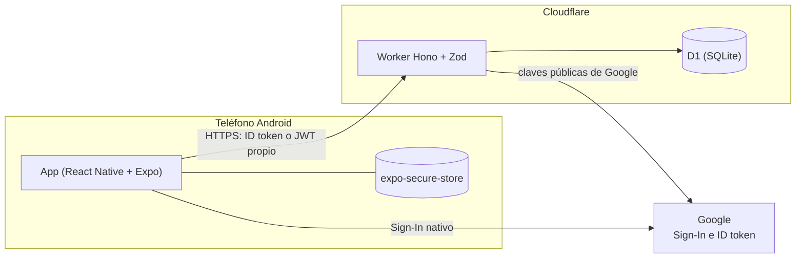
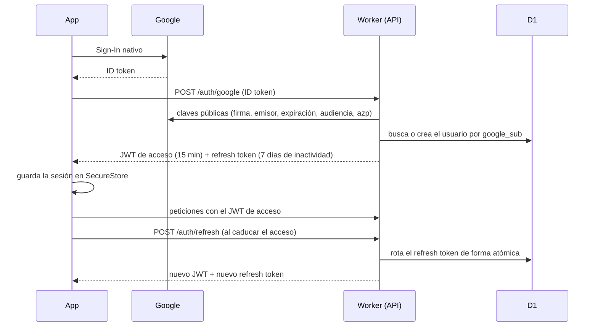
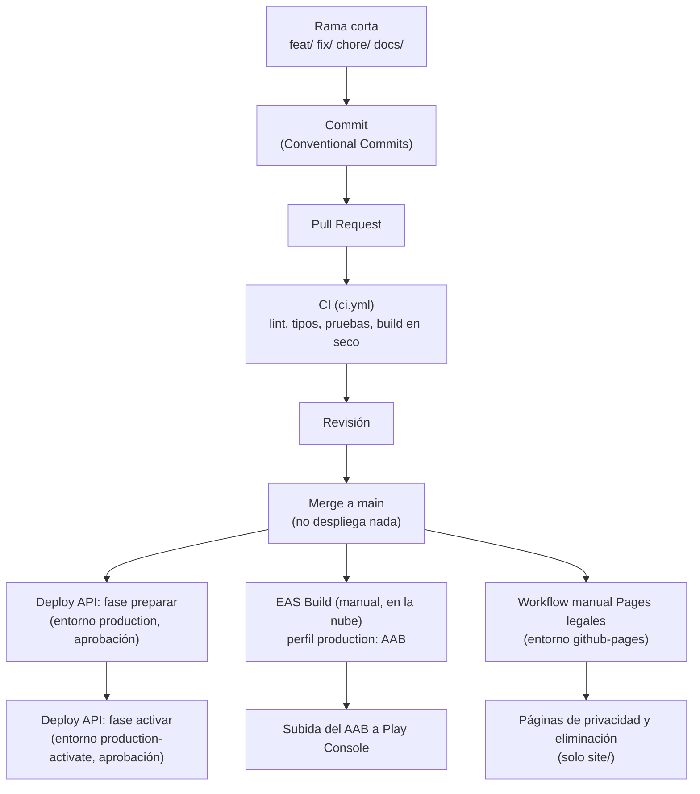

# Arquitectura, integración continua, entorno y secretos

Documento de referencia para quien llega al repositorio. Describe **lo que existe hoy** y dónde comprobarlo. No sustituye a docs/001 (norma del producto), docs/003 (decisiones) ni docs/006 (guía operativa del despliegue): los resume y enlaza. Cuando algo no se pudo comprobar en un archivo se marca como «pendiente de confirmar».

Fecha de esta revisión: 2026-11-20.

## 1. Arquitectura

### 1.1 Componentes

| Componente      | Dónde                                              | Responsabilidad                                                                                                                        |
| --------------- | -------------------------------------------------- | -------------------------------------------------------------------------------------------------------------------------------------- |
| App             | `app/`                                             | Interfaz, Google Sign-In, almacenamiento seguro de la sesión, cliente HTTP con renovación de sesión, exportación y compartir archivos. |
| API             | `api/src/` (`routes/`, `services/`, `db/`, `lib/`) | Valida entradas (Zod), aplica las reglas de negocio, emite y verifica sesiones, accede a D1.                                           |
| Base de datos   | `api/migrations/` (0001 a 0005)                    | Esquema SQL versionado; una migración aplicada no se modifica.                                                                         |
| Páginas legales | `site/`                                            | HTML estático de privacidad y eliminación de cuenta (GitHub Pages).                                                                    |

Endpoints de la API (de `api/src/routes/`): `GET /health`; `POST /auth/google`, `POST /auth/refresh`, `POST /auth/logout`; `GET /me` y `DELETE /me`; `GET/POST/PATCH` de `/accounts` y `/accounts/:id/categories`, `GET /accounts/:id/balance`; `PATCH/DELETE /categories/:id`; `GET/POST/PATCH/DELETE` de `/transactions`; `GET /calendar`; `GET /reports/summary|by-category|by-period`; `GET /export?format=csv|pdf`.

La app no usa React Navigation ni TanStack Query (siguen diferidos, docs/003): la navegación es por estado local.

### 1.2 Autenticación y sesión

- **Token de Google:** el Worker valida firma, emisor, expiración y audiencia (cliente Web) y, si hay clientes Android configurados, la política `azp` (`api/src/services/google-token-service.ts`).
- **Sesión propia:** JWT de acceso de 15 minutos (`SESSION_TTL_SECONDS` en `api/src/lib/auth-config.ts`), firmado con `JWT_SECRET` (mínimo 32 caracteres). Los refresh tokens se guardan hasheados en D1 (`token_hash`, 64 caracteres hexadecimales).
- **Refresco:** vigencia de 7 días de inactividad (`REFRESH_TTL_MS` en `api/src/services/refresh-token.ts`). Cada renovación rota el token en D1; hay una familia de tokens por sesión, detección de reutilización (`revoked_reason = reuse`) y un máximo de 5 sesiones activas por usuario (`MAX_ACTIVE_SESSIONS` en `api/src/db/session-repository.ts`; las sobrantes se marcan `evicted`).
- **Cierre de sesión:** `POST /auth/logout` revoca el refresh token; la app borra la sesión local.
- **Eliminación de cuenta:** `DELETE /me`, con verificación reciente de identidad con Google (docs/003, «Decisión G1»).
- Las respuestas con credenciales o datos del usuario llevan `Cache-Control: no-store` (`api/src/app.ts`).

### 1.3 Modelo de datos

Tablas (de `api/migrations/`): `users` (identificado por `google_sub`, no por el correo), `refresh_tokens`, `accounts` (con `color` e `icono` desde la migración 0004), `categories` (por cuenta, `tipo` ingreso o egreso) y `transactions` (`tipo` ingreso o gasto, `monto` entero, `fecha` AAAA-MM-DD, `deleted_at` para anular). La migración 0005 inserta la categoría predeterminada «Conciliación» en las cuentas existentes.

Las restricciones están en el propio esquema con `CHECK`: formato de identificadores, montos enteros acotados, fechas válidas, longitudes y valores permitidos.

### 1.4 Reglas clave

| Regla                                                                                                        | Dónde se hace cumplir                                                                      |
| ------------------------------------------------------------------------------------------------------------ | ------------------------------------------------------------------------------------------ |
| Montos como **enteros en centavos**                                                                          | `CHECK (typeof(monto) = 'integer' …)` en `0003_transactions.sql`; convenciones en docs/002 |
| **Archivar en vez de borrar**: cuentas y categorías con `archivada`; movimientos con `deleted_at` (anulados) | Esquema y servicios; docs/001 §7                                                           |
| **Filtrado por el usuario del token**: nunca se confía en un identificador enviado por el cliente            | `api/src/lib/auth-middleware.ts` y repositorios en `api/src/db/`                           |
| La **API valida** las reglas de negocio; la app no es fuente de verdad                                       | docs/001 y CLAUDE.md                                                                       |
| `categories` es `RESTRICT` desde `transactions`: no se borra una categoría con movimientos                   | `0003_transactions.sql`                                                                    |
| Excepción aprobada a «no se elimina»: `DELETE /me` borra el perfil y sus datos a petición de la persona      | docs/001 §5 «Eliminación del perfil»; docs/003 «Decisión G1»                               |

### 1.5 Decisiones y compromisos

- **Un Worker, una base D1:** simple y de costo cero en el plan gratuito; límites del plan en docs/006.
- **Sesión propia además de la de Google:** permite renovar sin pedir de nuevo el ID token, con rotación y revocación en D1.
- **Sin pantalla de conciliación:** se resuelve con una categoría predeterminada (docs/003, Decisión 6.1).
- **Navegación por estado local** en vez de React Navigation: menos dependencias nativas (docs/003, Decisiones 2B.1, 3.1 y 4.1).
- **Despliegue manual y en dos fases** de la API: más pasos, pero ningún merge puede cambiar producción por accidente.
- **Riesgos conocidos y aceptados** (docs/011 §4 y §13): sin limitación de frecuencia en `POST /auth/google`; `refresh_tokens` sin purga automática; exportación limitada a 2000 filas.

## 2. Integración y entrega continua

### 2.1 Flujo

Importante: **fusionar a `main` no despliega nada**. docs/001 §10 lo fija así desde el inicio (migraciones y despliegue de producción manuales); no existe despliegue automático al fusionar. La compilación con EAS y la subida a Play se hacen a mano, fuera de GitHub Actions (no hay workflow de EAS en el repositorio).

### 2.2 Workflows

| Workflow                      | Cuándo se ejecuta                                                             | Qué verifica o despliega                                                                                                                                            | Permisos                                                                                 | Entorno protegido                                                                                                   |
| ----------------------------- | ----------------------------------------------------------------------------- | ------------------------------------------------------------------------------------------------------------------------------------------------------------------- | ---------------------------------------------------------------------------------------- | ------------------------------------------------------------------------------------------------------------------- |
| `ci.yml` («CI»)               | `pull_request` y `push` a `main`                                              | `npm ci`, lint, typecheck, pruebas (app y API), pruebas de scripts, verificación de Wrangler, build en seco de la API y export de la app                            | `contents: read`                                                                         | Ninguno; no usa secretos                                                                                            |
| `deploy.yml` («Deploy API»)   | Solo `workflow_dispatch`, desde `main`; input `fase` = `preparar` o `activar` | `preparar`: controles, `wrangler versions upload` (versión sin tráfico) y verificación. `activar`: verificación, `wrangler versions deploy <id>@100` y pruebas HTTP | `contents: read` (y `actions: read` solo en `activar`, para el paso guardia)             | `production` (preparar) y `production-activate` (activar), con revisores; secretos de Cloudflare                    |
| `pages.yml` («Pages legales») | Solo `workflow_dispatch`, desde `main`                                        | Verifica el contenido de `site/`, sube solo `site/` y publica en GitHub Pages; luego comprueba HTTP 200 de las tres URL                                             | Por job: `contents: read`; el job de despliegue añade `pages: write` e `id-token: write` | `github-pages` (revisores y rama `main`, según el propio workflow; configuración en GitHub: pendiente de confirmar) |

Detalle de `deploy.yml` (docs/006): comprueba que el SHA es el vigente de `main`; nunca usa `wrangler deploy` (activaría tráfico de inmediato); el paso guardia de `activar` aborta si el entorno no tiene revisores requeridos y restricción de ramas; verifica con `scripts/verificar-version-prod.js` los bindings y el SHA de la versión; tras activar prueba `/health`, `/me` sin token (401) y `POST /auth/google` con cuerpo vacío (400). No hay rollback automático (recuperación manual en docs/006).

### 2.3 Controles de calidad en CI

`ci.yml`, en este orden: `npm ci` → `npm run lint` → `npm run typecheck` → `npm test` → `npm run test:scripts` → `npm run verificar:wrangler` → `npm run build --workspace api` → `npm run build --workspace controlgastos-app`.

- **Lint:** ESLint con `typescript-eslint` y `eslint-config-prettier` (`eslint.config.js`).
- **Tipos:** `tsc --noEmit` en app y API (la API ejecuta antes `wrangler types --env prod`).
- **Pruebas:** Jest en la app, Vitest en la API; los scripts de `scripts/` tienen sus propias pruebas con `node --test`.
- **Build en seco:** `wrangler deploy --dry-run --env prod` para la API (no publica) y `expo export --platform android` para la app.
- **Verificación de Wrangler:** `scripts/verificar-config-wrangler.js` comprueba invariantes de `api/wrangler.jsonc` (centinela de nivel superior, PROD separado de DEV, formato de ids). En el despliegue corre en modo `--estricto`.
- **Páginas legales:** `pages.yml` falla si faltan archivos, si `site/` contiene algo distinto de `.html`, `.css` y `.nojekyll`, si aparecen marcadores o identificadores prohibidos, enlaces absolutos o contenido activo o remoto, o si una página no tiene `lang="es"` y un solo `<h1>`. `scripts/pages-site.test.js` prueba ese script, y se ejecuta en CI con `npm run test:scripts`.

`npm run format` (Prettier en modo comprobación) **no** figura entre los pasos de `ci.yml`: el formato se exige en el editor y en la revisión (pendiente de confirmar si se quiere añadir a CI).

### 2.4 Buenas prácticas visibles en el repositorio

- **Permisos mínimos:** `permissions: contents: read` en CI y en el despliegue; `permissions: {}` a nivel de workflow en Pages, con permisos por job.
- **Acciones fijadas por SHA** en `deploy.yml` y `pages.yml` (con el tag en comentario). **Excepción:** `ci.yml` usa tags mayores (`@v7`), que son mutables; docs/006 lo registra como decisión pendiente.
- **Entornos con aprobación manual:** `production`, `production-activate` y `github-pages` se declaran en los workflows; que tengan revisores se verifica en `activar` mediante el paso guardia (los valores de configuración de GitHub no se leen desde el repositorio).
- **Sin `pull_request` en los workflows que usan secretos:** `deploy.yml` y `pages.yml` solo se disparan manualmente.
- **Entradas no confiables fuera de `run:`:** los inputs se pasan por variables de entorno.
- **`concurrency` sin cancelar** en despliegue y Pages.
- **Sin acción de terceros con acceso al token de Cloudflare:** se usa Wrangler directamente, no `cloudflare/wrangler-action` (docs/006).
- **Protección de `main`:** docs/001 §9 la exige (PR con CI en verde), pero la configuración real de GitHub no consta en el repositorio: pendiente de confirmar. docs/006 la lista como control que debe configurar el propietario, y no existe `CODEOWNERS`.

## 3. Docker y entorno de desarrollo

Definido en `.devcontainer/devcontainer.json` (detalle y límites en docs/005).

| Elemento               | Valor                                                                                                                        |
| ---------------------- | ---------------------------------------------------------------------------------------------------------------------------- |
| Imagen                 | `mcr.microsoft.com/devcontainers/javascript-node:1-22-bookworm` (etiqueta flotante; fijar un digest es una mejora pendiente) |
| Node                   | 22                                                                                                                           |
| Usuario                | `node` (sin privilegios)                                                                                                     |
| Repositorio            | Bind a `/workspaces/ControlGastos`                                                                                           |
| Volúmenes nombrados    | `node_modules` de la raíz, de `api/` y de `app/` (no se mezclan binarios de Windows y Linux)                                 |
| Puertos reenviados     | 8787 (Wrangler) y 8081 (Metro), en modo silencioso                                                                           |
| `postCreateCommand`    | `chown` de los tres puntos de montaje, `npm ci`, instalación fijada de EAS CLI (25.3.0) y comprobación de su versión         |
| Extensiones de VS Code | ESLint, Prettier y EditorConfig; formato al guardar                                                                          |

**Por qué se usa:** cualquier persona obtiene el mismo entorno (Node, dependencias de lockfile, EAS CLI) con un comando, y se evita contaminar el equipo anfitrión.

**Cómo se levanta:** abrir la carpeta en VS Code y ejecutar `Dev Containers: Reopen in Container`.

**Qué NO hace Docker aquí:**

- **Producción no corre en un contenedor:** corre en Cloudflare Workers (docs/001 §10: Workers no ejecuta contenedores Docker).
- **La compilación Android no corre en el contenedor:** va por **EAS Build en la nube**. Android Studio es solo un plan B fuera del contenedor.
- El contenedor no monta credenciales de Windows (`~/.wrangler`, `~/.expo`, `~/.ssh`, etc.) ni usa modo privilegiado ni Docker-in-Docker; al reconstruirlo hay que volver a iniciar sesión en Wrangler y EAS.
- CI no usa esta imagen: usa `actions/setup-node` con Node 22.

## 4. Entornos y secretos

> Esta sección solo nombra variables y ubicaciones. **Nunca contiene valores**, ni parciales ni de ejemplo.

### 4.1 Los tres contextos

| Contexto  | Dónde vive la configuración                                                                                                                                                                        | Cómo se separa                                               |
| --------- | -------------------------------------------------------------------------------------------------------------------------------------------------------------------------------------------------- | ------------------------------------------------------------ |
| **Local** | `api/.dev.vars` y `app/.env` (ignorados por Git; plantillas `*.example`); `wrangler dev` y Metro                                                                                                   | D1 local de Wrangler; variables de la persona que desarrolla |
| **DEV**   | `env.dev` de `api/wrangler.jsonc` (Worker `controlgastos-api-dev`, D1 propia), secreto del Worker en Cloudflare; entorno `development` de EAS                                                      | Worker, D1, secreto `JWT_SECRET` y cliente OAuth propios     |
| **PROD**  | `env.prod` de `api/wrangler.jsonc` (Worker `controlgastos-api`, D1 propia), secreto del Worker en Cloudflare; entorno `production` de EAS; entornos `production` y `production-activate` de GitHub | Worker, D1, `JWT_SECRET` y clientes OAuth distintos de DEV   |

Cómo se evita mezclarlos:

- El nivel superior de `api/wrangler.jsonc` es un **centinela** sin `main` ni bindings: `wrangler deploy` sin `--env` falla a propósito.
- Los bindings, variables y secretos de Wrangler no se heredan entre entornos.
- `scripts/verificar-config-wrangler.js` exige que PROD no comparta D1 ni clientes de Google con DEV; `deploy.yml` falla si el dry-run de PROD referencia la base de DEV.
- `app/eas.json` asigna `environment` a cada perfil (`development`, `preview`, `production`).

### 4.2 Dónde vive cada tipo de secreto o variable

| Tipo                                    | Ubicación                                                        | Nombres (sin valores)                                                                                                           |
| --------------------------------------- | ---------------------------------------------------------------- | ------------------------------------------------------------------------------------------------------------------------------- |
| Secretos de GitHub Actions por entorno  | Settings → Environments (`production`, `production-activate`)    | `CLOUDFLARE_API_TOKEN`                                                                                                          |
| Variables de GitHub Actions por entorno | Mismos entornos                                                  | `CLOUDFLARE_ACCOUNT_ID`, `WORKER_URL`                                                                                           |
| Secretos del Worker                     | Cloudflare (`wrangler secret put … --env <entorno>`)             | `JWT_SECRET`                                                                                                                    |
| Variables públicas del Worker           | `api/wrangler.jsonc`                                             | `GOOGLE_WEB_CLIENT_ID`, `GOOGLE_ANDROID_CLIENT_ID` (DEV), `GOOGLE_ANDROID_CLIENT_IDS` (PROD)                                    |
| Variables de EAS (por entorno)          | EAS, visibilidad pública                                         | `EXPO_PUBLIC_API_URL`, `EXPO_PUBLIC_GOOGLE_WEB_CLIENT_ID`, `EXPO_PUBLIC_PRIVACY_POLICY_URL`, `EXPO_PUBLIC_ACCOUNT_DELETION_URL` |
| Archivos locales ignorados              | `api/.dev.vars`, `api/.dev.vars.*`, `app/.env`, `.env`, `.env.*` | los de las plantillas `api/.dev.vars.example` y `app/.env.example`                                                              |
| Firma Android                           | Gestionada por EAS (upload key) y Play App Signing               | no se guarda en el repositorio                                                                                                  |

### 4.3 Lo público por diseño y lo realmente secreto

- **Público por diseño:** todo lo que empieza por `EXPO_PUBLIC_` se incrusta en el JavaScript de la app y cualquiera puede leerlo en el AAB. Por eso en EAS tiene visibilidad pública y no debe contener nada sensible. Los identificadores de cliente OAuth (Web y Android) también son públicos por diseño.
- **Realmente secreto:** `JWT_SECRET` (firma las sesiones), `CLOUDFLARE_API_TOKEN` (despliega el Worker), las claves de firma de Android y cualquier respaldo o exportación de datos de usuarios.

### 4.4 Principios aplicados (comprobados en el repositorio)

- **Nada de credenciales en el repositorio:** `.gitignore` cubre `.env`, `.env.*`, `.dev.vars`, `.dev.vars.*`, `*.jks`, `*.keystore`, `*.pem`, `*.key` y `credentials*.json` (con excepción explícita de las plantillas `*.example`). Se comprobó con `git check-ignore`; ver también `.claude/rules/security.md` para los agentes.
- **Tokens con permisos mínimos:** el token de CI previsto es personalizado, de cuenta, solo con edición de Workers, sin D1 ni zonas y con vencimiento (docs/011 §3); las migraciones remotas las hace el propietario con su propia sesión, no con el token de CI (docs/011 §2). Que el token real cumpla esto no se puede comprobar desde el repositorio: pendiente de confirmar.
- **Entornos separados:** ver 4.1.
- **Secretos por entorno, no de repositorio:** `CLOUDFLARE_API_TOKEN` se declara por paso y solo donde se llama a Cloudflare; para `activar` debe ser exclusivo del entorno `production-activate` (docs/006).
- **El contenedor no monta credenciales de Windows** (docs/005 y `devcontainer.json`).
- **Respaldos de datos:** `respaldo-*` y `registro.tsv` están ignorados; los respaldos de D1 viven fuera del repositorio.

### 4.5 Qué haría falta para otro desarrollador

Pasos genéricos para reproducir el proyecto con cuentas propias:

1. **Google Cloud:** crear un proyecto con pantalla de consentimiento y dos clientes OAuth: **Web** (audiencia del token) y **Android** (paquete de la app y huella de la clave de firma que corresponda).
2. **Cloudflare:** crear una cuenta, una base D1 por entorno y anotar su id en `api/wrangler.jsonc`; aplicar las migraciones con Wrangler (`d1 migrations apply`); crear el secreto `JWT_SECRET` por entorno (mínimo 32 caracteres aleatorios) con `wrangler secret put … --env <entorno>`.
3. **Token de CI:** crear un token de cuenta con permisos de edición de Workers solamente y vencimiento.
4. **GitHub:** crear los entornos `production` y `production-activate` con revisores requeridos y restricción a `main`; guardar `CLOUDFLARE_API_TOKEN` como secreto y `CLOUDFLARE_ACCOUNT_ID` y `WORKER_URL` como variables del entorno.
5. **EAS:** iniciar sesión, enlazar el proyecto y crear las variables `EXPO_PUBLIC_*` de cada entorno con visibilidad pública.
6. **Local:** copiar `api/.dev.vars.example` a `api/.dev.vars` y `app/.env.example` a `app/.env` y completar con valores propios; nunca versionarlos.
7. **Play Console:** crear la aplicación, subir el AAB y registrar la huella de Play App Signing en el cliente Android de Google.

## 5. Pruebas

Cifras de la ejecución del 2026-11-20 en el Dev Container (concurrencia reducida; ver nota en docs/004):

| Suite                | Herramienta                            | Resultado                                      |
| -------------------- | -------------------------------------- | ---------------------------------------------- |
| App (`app/`)         | Jest con `jest-expo`                   | 64 suites y 2074 pruebas aprobadas, 0 fallos   |
| API (`api/`)         | Vitest con `@cloudflare/vitest-plugin` | 37 archivos y 1497 pruebas aprobadas, 0 fallos |
| Scripts (`scripts/`) | `node --test`                          | 166 pruebas aprobadas, 0 fallos                |

**Qué se prueba:** reglas de negocio de la API (cuentas, categorías, movimientos, calendario, reportes, exportación CSV y PDF, sesiones, rotación de refresh tokens, eliminación de cuenta, aislamiento por usuario); lógica y pantallas de la app con mocks de módulos nativos; verificadores de configuración y de la versión de PROD; el script de verificación de las páginas legales.

**Qué NO está cubierto por pruebas automáticas:** teclado, insets, barras del sistema y ventanas nativas (diálogos edge-to-edge, hojas con teclado), que solo se ven en un teléfono real; el inicio de sesión real con Google y Play App Signing; compartir archivos con apps reales; el rendimiento del PDF con 2000 filas en el Worker; y el comportamiento en otros dispositivos, fuentes ampliadas y TalkBack. La validación en teléfono real (nivel D de docs/010) se registra por separado y es evidencia distinta de las pruebas automáticas (docs/001 §7).
